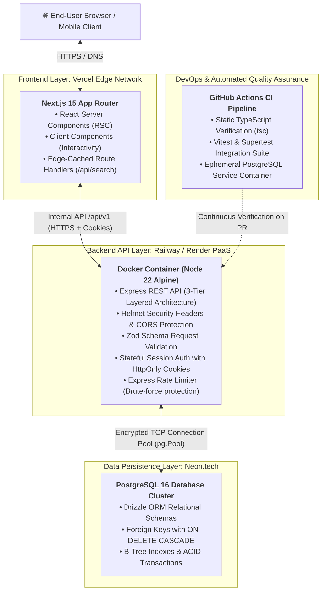
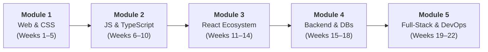

# 🎓 Lagos Data School: Full-Stack Software Engineering Curriculum

> **Organization:** Lagos Data School (Mangrove Technologies)  
> **Course:** Full-Stack Software Engineering: From Fundamentals to Production  
> **Schedule:** Monday, Tuesday, Wednesday (3 × 2-hour contact sessions/week)  
> **Duration:** 22 Weeks Core Curriculum (~5–6 Months)

---

## 📖 Overview & Educational Philosophy

This repository contains the complete, production-grade master lecture notes, architectural diagrams, step-by-step logic traces, and assignments for the **Lagos Data School Full-Stack Software Engineering Program**.

The curriculum is engineered to transform beginners into production-ready software engineers who can independently design, build, test, secure, and deploy modern web applications. Every concept is grounded in two real-world, continuously evolving project threads:

1. **🌴 "Lagos Spots" (Frontend & API Integration Thread):**  
   A dynamic directory of restaurants, study cafes, co-working hubs, nightlife, and cultural venues across Lagos. Progressively rebuilt across the curriculum: from semantic HTML5/CSS3 $\to$ Tailwind CSS v4 $\to$ Vanilla TypeScript DOM manipulation $\to$ Live OpenStreetMap Geocoding $\to$ Component-driven React SPA $\to$ Full-Stack Next.js with Server Components.
2. **📋 "Flowboard" (Backend & Full-Stack Architecture Thread):**  
   A collaborative, Trello-style Kanban workspace API and application. Built with Node.js, Express (3-tier layered architecture), PostgreSQL persistence via Drizzle ORM, cryptographic password hashing (Bcrypt), secure stateful session authentication via `HttpOnly` cookies, edge-level Zod validation, automated Supertest/Vitest suites, multi-stage Docker packaging, and GitHub Actions CI/CD pipelines.

---

## 🏗️ End-to-End System Topology

---

## 📚 22-Week Curriculum Syllabus

The curriculum is structured into **5 core progressive modules**:

### Module 1: Foundations of the Web & Modern Styling (Weeks 1–5)
| Week | Lecture Notes | Key Technical Concepts | Deliverable / Project Milestone |
| :--- | :--- | :--- | :--- |
| **01** | [Week 1: Dev Environment, Git & How the Web Works](./full_stack_development_class_notes/Week%201_%20Dev%20Environment,%20Git%20&%20How%20the%20Web%20Works.md) | Client-Server Model, DNS resolution, TCP 3-Way Handshake, TLS, HTTP/HTTPS methods & headers, Git DAG object model, Branching & PR workflow. | Scaffold `lagos-spots` Git repository, configure `.gitignore`, inspect live DevTools network frames. |
| **02** | [Week 2: HTML Fundamentals](./full_stack_development_class_notes/Week%202_%20HTML%20Fundamentals.md) | DOM tokenization pipeline, Viewport metadata, Semantic landmarks (`<main>`, `<article>`, `<nav>`), Form inputs & labeling, Accessibility (a11y/WCAG). | Semantic multi-page markup for Lagos Spots homepage and "Add a Spot" form. |
| **03** | [Week 3: CSS Fundamentals](./full_stack_development_class_notes/Week%203_%20CSS%20Fundamentals.md) | Cascading & Specificity `(a,b,c,d)` tuple calculation, Box Model mathematics (`border-box`), Margin collapsing, GPU transitions, BEM Architecture. | Complete BEM component styling across Lagos Spots spot cards and form fields. |
| **04** | [Week 4: CSS Layout — Flexbox & Grid](./full_stack_development_class_notes/Week%204_%20CSS%20Layout%20%E2%80%94%20Flexbox%20&%20Grid.md) | 1D Flexbox space distribution algorithms (`flex-grow/shrink/basis`), 2D CSS Grid `repeat(auto-fit, minmax())`, Mobile-First responsive media queries. | Fully responsive Lagos Spots layout adapting seamlessly across mobile, tablet, and desktop viewports. |
| **05** | [Week 5: Tailwind CSS & Modern CSS Workflow](./full_stack_development_class_notes/Week%205_%20Tailwind%20CSS%20&%20Modern%20CSS%20Workflow.md) | Native ES Module bundlers (Vite), Utility-First CSS, Tailwind v4 JIT compilation token scanning, Zero-FOUT Dark Mode scripting. | Full migration of Lagos Spots to Vite + Tailwind CSS with persistent dark mode toggle. |

---

### Module 2: JavaScript & TypeScript Fundamentals (Weeks 6–10)
| Week | Lecture Notes | Key Technical Concepts | Deliverable / Project Milestone |
| :--- | :--- | :--- | :--- |
| **06** | [Week 6: JavaScript Fundamentals](./full_stack_development_class_notes/Week%206_%20JavaScript%20Fundamentals.md) | V8 JavaScript Engine, Call Stack vs. Memory Heap, Execution Contexts, Hoisting & TDZ, Primitive vs. Reference types, Scope Chain. | Data-driven DOM rendering of spot directory from structured JavaScript data arrays. |
| **07** | [Week 7: Arrays, Objects & Data Structures](./full_stack_development_class_notes/Week%207_%20Arrays,%20Objects%20&%20Data%20Structures.md) | Higher-order array functions (`.map`, `.filter`, `.reduce`), Reference copying vs. Deep cloning (`structuredClone`), `localStorage` JSON serialization. | Immutable category badge counters and persistent client-side Favorites management system. |
| **08** | [Week 8: The DOM, Events & Browser APIs](./full_stack_development_class_notes/Week%208_%20The%20DOM,%20Events%20&%20Browser%20APIs.md) | XSS prevention (`textContent` vs `innerHTML`), 3-Phase Event Propagation (Capturing, Target, Bubbling), Event Delegation, 300ms Debounce algorithm. | Defensive DOM spot rendering, delegated favorite button handlers, and debounced live search. |
| **09** | [Week 9: Asynchronous JavaScript & Modern ES6+](./full_stack_development_class_notes/Week%209_%20Asynchronous%20JavaScript%20&%20Modern%20ES6+.md) | Event Loop microtasks vs. macrotasks, Promises, `async`/`await`, `fetch()` HTTP handling, `AbortController` async race condition cancellation. | Real-time geocoding search querying the live OpenStreetMap Nominatim API with cancellation. |
| **10** | [Week 10: TypeScript Fundamentals](./full_stack_development_class_notes/Week%2010_%20TypeScript%20Fundamentals.md) | Type System Hierarchy (`unknown`, `any`, `never`), Structural Subtyping, Discriminated Unions, User-Defined Type Guards (`val is T`), Generics. | 100% strict TypeScript migration with complete compile-time type safety across all modules. |

---

### Module 3: Modern Frontend with React (Weeks 11–14)
| Week | Lecture Notes | Key Technical Concepts | Deliverable / Project Milestone |
| :--- | :--- | :--- | :--- |
| **11** | [Week 11: React Fundamentals](./full_stack_development_class_notes/Week%2011_%20React%20Fundamentals.md) | Declarative UI Paradigm ($UI = f(\text{state})$), React Fiber Virtual DOM reconciliation ($O(n)$ heuristic), JSX compilation, Typed Props, Stable Keys. | Complete Lagos Spots component hierarchy rebuilt as a React + TypeScript SPA. |
| **12** | [Week 12: State, Hooks & Forms](./full_stack_development_class_notes/Week%2012_%20State,%20Hooks%20&%20Forms.md) | React Render & Commit cycles, Automatic Batching, Functional State Updaters, `useEffect` synchronization lifecycle, Controlled Forms. | Lifted state category filtering, controlled spot submission form, custom `useDebounce` hook. |
| **13** | [Week 13: Routing, Global State & Data Fetching](./full_stack_development_class_notes/Week%2013_%20Routing,%20Global%20State%20&%20Data%20Fetching.md) | HTML5 History API, React Router v6 layout routes & `<Outlet />`, React Context API, TanStack Query (React Query) SWR caching & garbage collection. | Multi-page routed Lagos Spots app with global favorites context and TanStack Query API caching. |
| **14** | [Week 14: Advanced React, Testing & Ship](./full_stack_development_class_notes/Week%2014_%20Advanced%20React,%20Testing%20&%20Ship.md) | Referential equality memoization (`React.memo`, `useMemo`, `useCallback`), Route code-splitting with `React.lazy`, Vitest & Testing Library, Vercel SPA ship. | Automated unit test suite, code-split bundle optimization, and live deployment on Vercel (`v1.0.0-frontend`). |

---

### Module 4: Backend Engineering with Node.js & PostgreSQL (Weeks 15–18)
| Week | Lecture Notes | Key Technical Concepts | Deliverable / Project Milestone |
| :--- | :--- | :--- | :--- |
| **15** | [Week 15: Node.js, Express & REST API Design](./full_stack_development_class_notes/Week%2015_%20Node.js,%20Express%20&%20REST%20API%20Design.md) | Node.js runtime vs. Browser, `libuv` thread pool, HTTP verbs & Idempotency matrix, Express Middleware Onion Model, 3-Tier Layered Architecture. | Scaffolding the **Flowboard REST API** (`/api/v1/boards`) with Controller-Service-Model layers. |
| **16** | [Week 16: PostgreSQL & Drizzle ORM](./full_stack_development_class_notes/Week%2016_%20PostgreSQL%20&%20Drizzle%20ORM.md) | Relational Database Architecture (RDBMS), Primary & Foreign Keys (`ON DELETE CASCADE`), B-Tree Indexes, ACID Transactions, Connection Pooling (`pg.Pool`), Drizzle ORM. | Relational schema (`users`, `boards`, `lists`, `tasks`), Drizzle migrations, nested relational joins. |
| **17** | [Week 17: Authentication, Authorization & Security](./full_stack_development_class_notes/Week%2017_%20Authentication,%20Authorization%20&%20Security.md) | AuthN vs AuthZ, Bcrypt 12-round salt derivation ($O(2^n)$ cost), Stateful Sessions vs Stateless JWTs, Cookie security (`HttpOnly`, `Secure`, `SameSite`), IDOR protection. | Secure Signup/Login/Logout authentication system with session cookies and board ownership verification. |
| **18** | [Week 18: Validation, Error Handling & Testing](./full_stack_development_class_notes/Week%2018_%20Validation,%20Error%20Handling%20&%20Testing.md) | Fail-Fast Edge Validation (Zod), Discriminated Union parsing, Unified `AppError` class hierarchy, Express 4-argument global error middleware, Vitest & Supertest. | Edge validation middleware, centralized error responses, and end-to-end integration test suite (`v1.0.0-backend`). |

---

### Module 5: Full-Stack Integration, DevOps & Capstone (Weeks 19–22)
| Week | Lecture Notes | Key Technical Concepts | Deliverable / Project Milestone |
| :--- | :--- | :--- | :--- |
| **19** | [Week 19: Next.js — The Production React Framework](./full_stack_development_class_notes/Week%2019_%20Next.js%20%E2%80%94%20The%20Production%20React%20Framework.md) | React Server Components (RSC) vs Client Components (`'use client'`), Hydration lifecycle, SSR vs SSG vs ISR, Edge Route Handlers as secure cached proxies, Streaming `<Suspense>`. | Next.js App Router full-stack frontend connected live to the Flowboard Express API. |
| **20** | [Week 20: Docker, CI-CD & Deployment](./full_stack_development_class_notes/Week%2020_%20Docker,%20CI-CD%20&%20Deployment.md) | Containerization vs Virtualization, Multi-Stage Docker builds (Alpine runner $<150\text{MB}$), Layer caching, Docker Compose networking, GitHub Actions CI/CD with Postgres service. | Dockerized API, Compose local dev orchestration, passing CI pipeline, and live production deployment on Railway/Vercel (`v1.0.0-production`). |
| **21** | [Week 21: Capstone Build Week 1 — Scoping & Foundations](./full_stack_development_class_notes/Week%2021_%20Capstone%20Build%20Week%201%20%E2%80%94%20Scoping%20&%20Foundations.md) | Technical Scoping, MoSCoW Prioritization Framework, Critical User Path analysis, ERD schema review checklist, Agile standups, 5-Pillar code reviews. | Approved 1-page Technical Specification, migrated PostgreSQL schema, authenticated happy path. |
| **22** | [Week 22: Capstone Build Week 2 & Demo Day](./full_stack_development_class_notes/Week%2022_%20Capstone%20Build%20Week%202%20&%20Demo%20Day.md) | Production Hardening, Helmet HTTP security headers, Token Bucket Rate Limiting, Morgan structured logging, 10-Minute Technical Demo Day presentation framework. | Live presentation of deployed, tested, hardened Full-Stack Capstone evaluated against the 7-Pillar Rubric. |

---

## 🛠️ The Production Technology Stack

| Layer | Technologies & Tooling |
| :--- | :--- |
| **Core Languages** | TypeScript (Strict Mode), JavaScript (ES2022+), Semantic HTML5, Modern CSS3 |
| **Frontend Frameworks** | React 18/19, Next.js 15 (App Router, Server Components, Route Handlers), Tailwind CSS v4, Vite |
| **State & Data Fetching** | React Context API, TanStack Query (React Query v5), React Router v6 |
| **Backend & Runtime** | Node.js (LTS), Express.js (3-Tier Layered Architecture: Controller $\leftrightarrow$ Service $\leftrightarrow$ Model) |
| **Database & ORM** | PostgreSQL 16, Drizzle ORM, Drizzle Kit (Migrations), Neon Serverless Postgres |
| **Security & Auth** | Bcrypt (12 Salt Rounds), Stateful Session Cookies (`HttpOnly`, `Secure`, `SameSite`), Helmet, Express Rate Limit, CORS |
| **Validation & Error Flow** | Zod (Schema-First Type Inference), Custom `AppError` Hierarchy, Global 4-Arg Error Middleware |
| **Testing & Quality** | Vitest, React Testing Library, Supertest (In-Memory HTTP testing), ESLint, Prettier |
| **DevOps & Cloud** | Docker (Multi-Stage Builds), Docker Compose, GitHub Actions (CI/CD), Vercel (Edge CDN), Railway / Render (PaaS) |

---

## 📋 Note Architecture & Pedagogical Standards

Every single week note in the [`full_stack_development_class_notes/`](./full_stack_development_class_notes) directory adheres to strict pedagogical and engineering standards:

1. **Terminology Deconstruction:** Plain-English definitions, etymology, and technical context for every core concept.
2. **Under-the-Hood Mechanics:** Architectural flowcharts, sequence diagrams, and mathematical formulas explaining *why* things work the way they do.
3. **Real, Type-Safe Code Walkthroughs:** Production-grade TypeScript code examples with no pseudo-code or missing types.
4. **Common Pitfalls & Fixes:** Troubleshooting matrices mapping symptoms to root causes and professional solutions.
5. **Comprehensive Weekly Assignments:** Actionable, milestone-driven technical requirements with strict Git branching workflows.
6. **Curated References & Literature:** Verified documentation links, canonical computer science textbooks (*Designing Data-Intensive Applications*, *Eloquent JavaScript*, *Pro Git*, *Clean Code*), and deep-dive engineering blogs.

---

## 🚀 Getting Started for Students & Instructors

### Prerequisites
Ensure the following tools are installed on your local workstation:
- **Node.js (v20.x or v22.x LTS):** [nodejs.org](https://nodejs.org/)
- **Git:** [git-scm.com](https://git-scm.com/)
- **Visual Studio Code:** [code.visualstudio.com](https://code.visualstudio.com/)
  - Recommended Extensions: *Prettier*, *ESLint*, *Tailwind CSS IntelliSense*, *Drizzle ORM*, *GitLens*.
- **Docker Desktop:** [docker.com](https://www.docker.com/products/docker-desktop/) (Required from Week 20 onward).

### Navigating the Notes
1. Browse the [Course Outline](./full_stack_development_class_notes/Full_Stack_Development_Course_Outline.md) for the master schedule and pedagogical roadmap.
2. Follow along week by week in [`full_stack_development_class_notes/`](./full_stack_development_class_notes).
3. Execute all weekly assignments on dedicated Git feature branches (`feature/<topic>`), merging into `main` only via Pull Requests.

---

## ⚖️ License & Attribution
Curriculum developed and maintained for **Lagos Data School (Mangrove Technologies)**.  
Designed for instructional excellence in modern full-stack software engineering.
