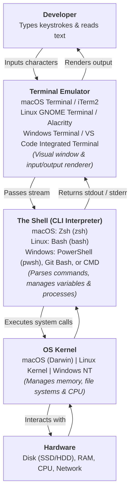
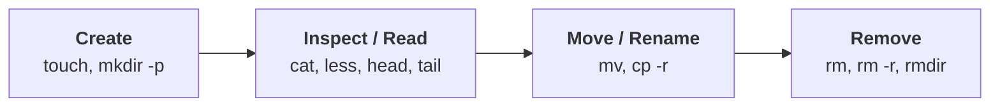
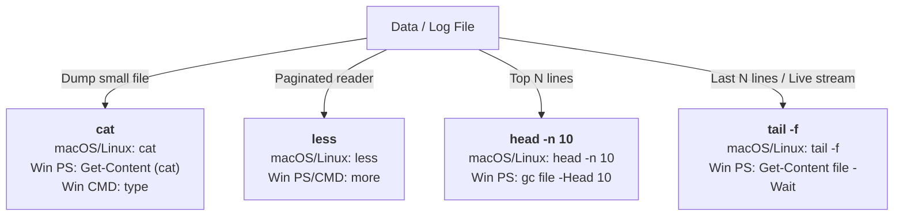
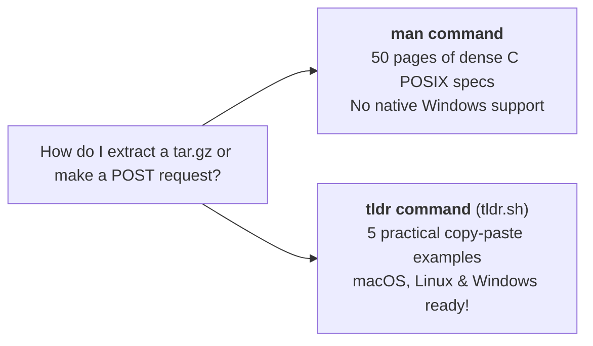
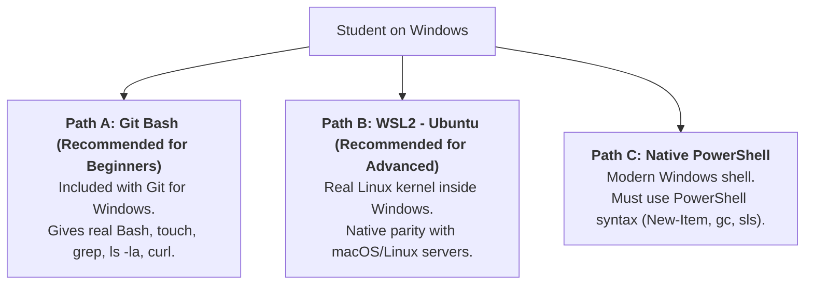

# CLI Fundamentals & Essential Commands

Welcome to the Command Line Interface (CLI) fundamentals guide. As a full-stack developer, the terminal is your primary cockpit. Whether you are scaffolding projects, staging Git commits, running development servers, managing Docker containers, executing database migrations, or deploying code to cloud servers, you will interact with the operating system through text commands.

> [!NOTE]
> **Cross-Platform Note for Instructors & Students:**  
> While macOS is common among instructors, students predominantly run **Windows** or **Linux**. Throughout this guide, every concept, command, and exercise specifies the exact equivalents across **macOS (Zsh)**, **Linux (Bash)**, and **Windows (PowerShell, Git Bash, and CMD)**.

---

## Module 1: The Terminal Mental Model

### 1. Terminal vs. Shell vs. Kernel

Beginners often use "command line", "terminal", and "shell" interchangeably, but they represent distinct layers in the operating system:



1. **Terminal Emulator:** The graphical window that captures keyboard input and renders text on the screen (e.g., VS Code's integrated terminal, macOS Terminal/iTerm2, Linux GNOME Terminal, Windows Terminal).
2. **The Shell:** The command-language interpreter running inside the terminal. It evaluates your text commands, executes programs, and returns output:
   - **macOS:** Defaults to **Zsh** (`zsh`) since macOS Catalina.
   - **Linux:** Defaults to **Bash** (`bash`) on Ubuntu, Debian, Fedora, and cloud instances.
   - **Windows:** Defaults to **PowerShell** (`pwsh` / `powershell.exe`) or legacy **Command Prompt** (`cmd.exe`). Full-stack developers on Windows frequently use **Git Bash** (bundled with Git for Windows) or **WSL2** (Windows Subsystem for Linux) for POSIX compatibility.
3. **The Kernel:** The core of the operating system that controls physical resources (file storage, network interfaces, memory).

---

### 2. Core Terminology

| Term | Technical Meaning | Real-World Full-Stack Context |
| :--- | :--- | :--- |
| **Command** | An executable program, built-in shell function, or alias (e.g., `git`, `node`, `ls`). | Running `node server.js` tells the system to execute the Node runtime binary. |
| **Argument** | The target data passed to a command (e.g., file name, path, or URL). | In `cat README.md`, `README.md` is the argument. |
| **Flag / Option / Switch** | Modifiers preceded by `-` (short flag) or `--` (long flag) that alter command behavior. | In `ls -la`, `-l` enables long format and `-a` shows hidden files. |
| **Working Directory (`cwd`)** | The current folder location where your shell session is operating. | When running `npm install`, dependencies install into the current working directory. |
| **Prompt** | The text indicator waiting for your input (e.g., `user@macbook:~$` or `PS C:\Projects>`). | Displays your user, machine name, active folder, and Git branch. |
| **PATH** | An environment variable storing directory paths where the shell looks for executable programs. | When you type `node`, the shell searches each folder in `$PATH` to find the `node` binary. |
| **Standard Streams** | Three default I/O data channels: `stdin` (0, input), `stdout` (1, standard output), `stderr` (2, error output). | Piping or redirecting streams allows you to route errors to log files and chain tools. |

---

### 3. Anatomizing a Command

Every CLI invocation follows a standardized syntax structure:

```bash
#  [command] [options/flags]   [arguments]
     git       commit -m       "feat: scaffold lagos-spots"
     mkdir     -p              src/components/cards
     grep      -i -n           "lekki" spots.json
```

- **Command:** `mkdir` (the action).
- **Flag:** `-p` (create parent directories if they do not exist).
- **Argument:** `src/components/cards` (the path to create).

---

## Module 2: File System Navigation

### 1. The Directory Hierarchy & Paths

Operating systems organize files into a hierarchical tree, but their root structures differ:

```mermaid
graph TD
    subgraph Unix["macOS & Linux File System (Single Root Tree)"]
        Root["/ (Root)"]
        UHome["Users (macOS) / home (Linux)"]
        UUser["~ (User Home: /Users/ajibola)"]
        UDir["full_stack_development_class_notes (cwd: .)"]
        USpot["lagos-spots"]
        Root --> UHome --> UUser --> UDir --> USpot
    end

    subgraph Win["Windows File System (Drive Letters)"]
        CRoot["C:\ (System Drive)"]
        WUsers["C:\Users"]
        WUser["C:\Users\student (Home: ~)"]
        WDir["full_stack_development_class_notes (cwd: .)"]
        WSpot["lagos-spots"]
        CRoot --> WUsers --> WUser --> WDir --> WSpot
    end
```



#### Special Path Symbols:
- `/` : **Root Directory** on macOS/Linux. On Windows, each drive has its own root (`C:\`, `D:\`).
- `~` : **Home Directory** — Your personal user folder (macOS: `/Users/<username>`, Linux: `/home/<username>`, Windows: `C:\Users\<username>`).
- `.` : **Current Directory** — The folder you are currently inside.
- `..` : **Parent Directory** — The folder one level above the current directory.
- `-` : **Previous Directory** — Switches back to the directory you were in immediately prior (macOS, Linux, and Git Bash).
- **Path Separators:** macOS and Linux use forward slashes (`/`). Windows natively uses backslashes (`\`), but modern PowerShell, Git Bash, and Node.js accept forward slashes (`/`) without issues.

---

### 2. Navigation Commands & Cross-Platform Equivalents

#### `pwd` (Print Working Directory)
Prints the full absolute path of your active folder.

| Operating System / Shell | Command | Notes |
| :--- | :--- | :--- |
| **macOS (Zsh)** | `pwd` | Built-in / POSIX binary |
| **Linux (Bash)** | `pwd` | Built-in / POSIX binary |
| **Windows (PowerShell)** | `pwd` or `Get-Location` | `pwd` is an alias for `Get-Location` |
| **Windows (Git Bash / WSL)** | `pwd` | Standard Linux behavior |
| **Windows (Command Prompt)** | `cd` | Typing `cd` with no arguments prints the current directory |

---

#### `ls` (List Directory Contents)
Lists files and folders inside the directory.

```bash
# macOS & Linux / Git Bash:
ls        # Basic list
ls -l     # Long format (permissions, owner, size, timestamp)
ls -a     # All files, including hidden dotfiles (.env, .gitignore)
ls -la    # Combined: long listing + hidden files
ls -lh    # Human-readable file sizes (KB, MB, GB)
```

##### Cross-Platform Equivalents for `ls`:

| Action | macOS (Zsh) | Linux (Bash) | Windows (PowerShell) | Windows (CMD) |
| :--- | :--- | :--- | :--- | :--- |
| **Basic list** | `ls` | `ls` | `ls` (alias for `Get-ChildItem`) | `dir` |
| **Detailed list** | `ls -l` | `ls -l` | `Get-ChildItem` (shows Mode, Size, Name) | `dir` |
| **Show hidden files** | `ls -a` | `ls -a` | `Get-ChildItem -Force` | `dir /a` |
| **Detailed + Hidden** | `ls -la` | `ls -la` | `ls -Force` or `Get-ChildItem -Force` | `dir /a` |

*Sample `ls -la` output breakdown (macOS/Linux):*
```text
drwxr-xr-x  12 ajibola  staff   384B Sep  2 10:00 .
drwxr-xr-x   4 ajibola  staff   128B Sep  2 09:30 ..
-rw-r--r--   1 ajibola  staff   209B Sep  2 09:45 .gitignore
-rw-r--r--   1 ajibola  staff   2.4K Sep  2 09:50 README.md
drwxr-xr-x   8 ajibola  staff   256B Sep  2 09:40 src
```

---

#### `cd` (Change Directory)
Moves your shell session to another folder.

```bash
# Navigate into a subfolder
cd lagos-spots

# Move up one level (to parent folder)
cd ..

# Move up two levels
cd ../..

# Jump directly to your user's Home directory
cd ~
# (Typing `cd` with no arguments also returns to ~ on macOS/Linux/PowerShell)
cd

# Jump to root directory
cd /        # macOS/Linux
cd C:\      # Windows

# Switch back to previous directory
cd -        # macOS, Linux, Git Bash, WSL
```

> [!WARNING]
> **Windows Command Prompt (`cmd.exe`) Drive Switching Gotcha:**  
> In Windows `cmd.exe`, typing `cd D:\projects` will **not** switch your drive if you are currently on `C:\`. In CMD, you must either type `D:` first, or use the `/d` switch: `cd /d D:\projects`. In PowerShell and Git Bash, `cd D:\projects` works normally.

---

## Module 3: File & Directory Operations (CRUD)

Full-stack development requires constant creation, moving, renaming, and cleaning of source code files.



### 1. Creating Folders (`mkdir`)

```bash
# macOS, Linux, Git Bash & PowerShell:
mkdir components

# Create nested directory trees in one shot:
mkdir -p src/features/spots/ui
```

##### Cross-Platform `mkdir -p` Behavior:

| Operating System / Shell | Nested Folder Command | Notes |
| :--- | :--- | :--- |
| **macOS (Zsh) / Linux (Bash)** | `mkdir -p a/b/c` | The `-p` (parents) flag creates all missing intermediate folders |
| **Windows (PowerShell)** | `mkdir a/b/c` or `New-Item -ItemType Directory -Path a/b/c -Force` | In PowerShell, `mkdir` is a built-in wrapper around `New-Item -Force` and automatically creates parents |
| **Windows (Git Bash / WSL)** | `mkdir -p a/b/c` | Standard POSIX behavior |
| **Windows (Command Prompt)** | `mkdir a\b\c` | Windows `cmd.exe` automatically creates parent directories by default |

---

### 2. Creating Files (`touch`)

```bash
# macOS, Linux, Git Bash & WSL:
touch index.html
touch styles.css app.js .env.example
```

> [!CAUTION]
> **The Windows `touch` Gotcha:**  
> Windows Command Prompt and standard Windows PowerShell **do not have a built-in `touch` command**. If students on native Windows PowerShell type `touch index.html`, they will receive:  
> `The term 'touch' is not recognized as the name of a cmdlet...`

##### How to Create Files Across OS:

| OS / Shell | Command to Create Empty File |
| :--- | :--- |
| **macOS (Zsh)** | `touch index.html` |
| **Linux (Bash)** | `touch index.html` |
| **Windows (PowerShell)** | `New-Item index.html` &nbsp;*or*&nbsp; `"" > index.html` &nbsp;*or*&nbsp; `Set-Content index.html $null` |
| **Windows (Git Bash / WSL)** | `touch index.html` *(Recommended for students on Windows)* |
| **Windows (Command Prompt)** | `type nul > index.html` &nbsp;*or*&nbsp; `echo. > index.html` |

---

### 3. Copying Files and Folders (`cp`)

```bash
# macOS, Linux, Git Bash:
cp .env.example .env            # Copy a single file
cp README.md docs/              # Copy a file into another folder
cp -r src/ src-backup/          # Copy a folder recursively (-r is mandatory!)
```

##### Cross-Platform Copying:

| OS / Shell | Copy File | Copy Folder Recursively |
| :--- | :--- | :--- |
| **macOS / Linux / Git Bash** | `cp file.txt backup.txt` | `cp -r src/ src-backup/` |
| **Windows (PowerShell)** | `cp file.txt backup.txt`<br/>*(alias for `Copy-Item`)* | `Copy-Item -Recurse src/ src-backup/`<br/>*(or `cp -r src/ src-backup/`)* |
| **Windows (Command Prompt)** | `copy file.txt backup.txt` | `xcopy /e /i src src-backup` &nbsp;*or*&nbsp; `robocopy src src-backup /e` |

---

### 4. Moving and Renaming (`mv`)

In Unix, moving a file into a different folder or renaming it in place are the same operation.

```bash
# macOS, Linux, Git Bash:
mv old-name.js new-name.js              # Rename
mv spot-card.js src/components/         # Move into folder
mv spot-card.js src/SpotCard.jsx        # Move and rename simultaneously
```

##### Cross-Platform Moving & Renaming:

| OS / Shell | Command | Notes |
| :--- | :--- | :--- |
| **macOS / Linux / Git Bash** | `mv old.js new.js` | Built-in POSIX `mv` |
| **Windows (PowerShell)** | `mv old.js new.js` &nbsp;*or*&nbsp; `Move-Item old.js new.js` | `mv` is an alias for `Move-Item` |
| **Windows (Command Prompt)** | `ren old.js new.js` &nbsp;*or*&nbsp; `move old.js folder\` | `ren` for rename, `move` for relocation |

---

### 5. Deleting Files and Folders (`rm`)

```bash
# macOS, Linux, Git Bash:
rm scratch.txt                  # Delete single file
rmdir empty-folder/             # Delete empty folder
rm -r old-components/           # Delete folder and its contents recursively
rm -rf node_modules/            # Force recursive deletion without confirmation prompt
```

> [!CAUTION]
> **No Trash Can / Recycle Bin:**  
> Running `rm` from the CLI bypasses the OS Recycle Bin/Trash permanently.  
> **Always verify your current folder (`pwd`) before executing recursive deletion!**

##### Cross-Platform Deletion:

| OS / Shell | Delete File | Delete Directory & Contents |
| :--- | :--- | :--- |
| **macOS / Linux / Git Bash** | `rm file.txt` | `rm -rf dir/` |
| **Windows (PowerShell)** | `rm file.txt`<br/>*(alias for `Remove-Item`)* | `Remove-Item -Recurse -Force dir/`<br/>*(or `rm -r -Force dir/`)* |
| **Windows (Command Prompt)** | `del file.txt` | `rmdir /s /q dir` |

---

## Module 4: Inspecting and Viewing Files

Never open huge log files or database exports in a graphical editor when you only need a quick inspection:



### Cross-Platform Inspection Commands:

| Command & Intent | macOS (Zsh) | Linux (Bash) | Windows (PowerShell) | Windows (CMD) |
| :--- | :--- | :--- | :--- | :--- |
| **Print entire file** | `cat file.json` | `cat file.json` | `cat file.json` &nbsp;*(alias for `Get-Content`)* | `type file.json` |
| **Paginated viewer** | `less server.log`<br/>*(Press `q` to quit)* | `less server.log`<br/>*(Press `q` to quit)* | `more server.log` &nbsp;*or*<br/>`Get-Content file \| Out-Host -Paging` | `more server.log` |
| **First 10 lines** | `head -n 10 spots.csv` | `head -n 10 spots.csv` | `Get-Content spots.csv -Head 10` &nbsp;*or*<br/>`gc spots.csv -TotalCount 10` | *(No direct native tool; use PowerShell)* |
| **Last 20 lines** | `tail -n 20 error.log` | `tail -n 20 error.log` | `Get-Content error.log -Tail 20` | *(No direct native tool; use PowerShell)* |
| **Live log follow** | `tail -f access.log` | `tail -f access.log` | `Get-Content access.log -Wait -Tail 10` | *(No direct native tool; use PowerShell)* |

---

## Module 5: Search, Filtering, Redirection & Pipes

### 1. Standard Streams & Redirection

Every command interacts through three standard streams:
- `stdin` (0): Keyboard or streamed input.
- `stdout` (1): Standard output (normal terminal results).
- `stderr` (2): Error messages.

#### Redirection Operators:
- `>` : Overwrite output to file.
- `>>` : Append output to file.

```bash
# macOS, Linux, Git Bash & PowerShell:
echo "Terra Kulture - Victoria Island" > spots.txt     # Overwrite / Create
echo "Bogobiri House - Ikoyi" >> spots.txt            # Append
```

> [!WARNING]
> **PowerShell Redirection Encoding Gotcha:**  
> In legacy Windows PowerShell 5.1 (the default built into Windows 10/11), using `>` defaults to **UTF-16 LE** encoding instead of standard **UTF-8**, which can break `.json` and `.env` parsing in Node.js!  
> In PowerShell 5.1, explicitly use:  
> `Set-Content -Path spots.txt -Value "Terra Kulture" -Encoding utf8`  
> In modern PowerShell 7+ and Git Bash, standard `>` writes UTF-8 cleanly.

---

### 2. The Pipe Operator (`|`)

The pipe `|` sends the `stdout` of the command on the left directly as `stdin` to the command on the right.

```bash
# macOS, Linux & Git Bash:
ls -la | grep "spot"
cat server.log | grep "500" | tail -n 10
```

---

### 3. Searching with `grep`, `find`, and `which`

#### `grep` (Search Inside Files)
Searches for text strings or regular expressions:

| OS / Shell | Command Syntax |
| :--- | :--- |
| **macOS (Zsh)** | `grep -rn "CLIENT_ORIGIN" src/` |
| **Linux (Bash)** | `grep -rn "CLIENT_ORIGIN" src/` |
| **Windows (PowerShell)** | `Select-String -Pattern "CLIENT_ORIGIN" -Path src\*\*.ts` &nbsp;*(alias: `sls`)* |
| **Windows (Git Bash / WSL)** | `grep -rn "CLIENT_ORIGIN" src/` |
| **Windows (Command Prompt)** | `findstr /s /i /n "CLIENT_ORIGIN" src\*.*` |

- Flags: `-i` = case-insensitive, `-r` / `-R` = recursive through folders, `-n` = show line numbers.

#### `find` (Locate Files by Name)

| OS / Shell | Command Syntax |
| :--- | :--- |
| **macOS / Linux / Git Bash** | `find . -name "*.ts"` &nbsp;*(or directories only: `find . -type d -name "components"`)* |
| **Windows (PowerShell)** | `Get-ChildItem -Recurse -Filter "*.ts"` &nbsp;*(alias: `gci -r -filter *.ts`)* |
| **Windows (Command Prompt)** | `dir /s /b *.ts` |

#### `which` (Locate Installed Binaries in `$PATH`)
Shows which program binary your shell executes:

| OS / Shell | Command Syntax |
| :--- | :--- |
| **macOS (Zsh)** | `which node` |
| **Linux (Bash)** | `which node` &nbsp;*or*&nbsp; `command -v node` |
| **Windows (PowerShell)** | `Get-Command node` &nbsp;*(alias: `gcm`)* &nbsp;*or*&nbsp; `where.exe node` |
| **Windows (Git Bash / WSL)** | `which node` |
| **Windows (Command Prompt)** | `where node` |

---

## Module 6: The Modern Developer's Secret Weapon — `tldr`

### 1. Why `tldr` Beats Traditional `man` Pages

The historical Unix manual command is `man` (e.g., `man tar`, `man curl`).  
While authoritative, `man` pages are dense, archaic, and list hundreds of obscure flags before showing a single example. Furthermore, **Windows has no native `man` command at all**.

The open-source community created **[tldr pages](https://tldr.sh/)** — simplified, community-driven, syntax-highlighted cheat sheets showing the **5–8 most common real-world examples** for every command.



---

### 2. Installing `tldr` Across All Operating Systems

Choose the installation method for your machine:

```bash
# === macOS ===
brew install tldr
# or via npm:
npm install -g tldr

# === Linux (Ubuntu / Debian) ===
sudo apt update && sudo apt install tldr
# or via npm:
npm install -g tldr

# === Linux (Fedora / RHEL) ===
sudo dnf install tldr

# === Linux (Arch) ===
sudo pacman -S tldr

# === Windows (PowerShell / Command Prompt) ===
npm install -g tldr
# or via Windows Package Manager (winget):
winget install tldr
# or via Chocolatey:
choco install tldr-plusplus
```

> [!TIP]
> **Zero-Install Web Version for Any Browser:**  
> Students who cannot install global packages on their laptops can use the web versions immediately:
> - **Official Web Portal:** [https://tldr.sh/](https://tldr.sh/)
> - **Interactive In-Browser Terminal:** [https://tldr.inbrowser.app/](https://tldr.inbrowser.app/)

---

### 3. Practical `tldr` Invocations

```bash
# Practical examples for complex archiving:
tldr tar

# Real-world HTTP requests (GET, POST JSON, download file):
tldr curl

# Essential Git snapshots and amending:
tldr git commit

# Finding and deleting files:
tldr find
```

*Sample output for `tldr curl`:*
```text
curl
Transfers data from or to a server. Supports most protocols, including HTTP, HTTPS, FTP.

- Download the contents of a URL to a file:
  curl http://example.com --output filename

- Send form-encoded data (POST request):
  curl --data 'name=Bob' http://example.com/form

- Send JSON data in a POST request:
  curl --data '{"name":"Bob"}' --header 'Content-Type: application/json' http://example.com/users
```

---

## Module 7: Process Management & Port Conflicts

In full-stack development, running into port conflicts is a daily occurrence:  
`Error: listen EADDRINUSE: address already in use :::3000`

This happens when a previous Node or Express server failed to shut down properly. Here is how to find and terminate the stuck process across platforms:

### 1. Resolving Port 3000 Conflicts

#### On macOS:
```bash
# 1. Find the Process ID (PID)
lsof -i :3000
# Output: node 48291 ajibola ... (LISTEN)

# 2. Terminate the process
kill 48291

# 3. Force kill if unresponsive
kill -9 48291
```

#### On Linux:
```bash
# Method A: Using ss (standard on all modern Linux servers)
ss -tulpn | grep :3000
kill -9 <PID>

# Method B: Using lsof (if installed: sudo apt install lsof)
sudo lsof -i :3000
kill -9 <PID>

# Method C: Immediate one-liner kill
fuser -k 3000/tcp
```

#### On Windows (PowerShell):
```powershell
# 1. Find process listening on port 3000
Get-NetTCPConnection -LocalPort 3000 | Select-Object OwningProcess
# Or using netstat:
netstat -ano | findstr :3000

# 2. Force kill the process by PID
Stop-Process -Id <PID> -Force
```

#### On Windows (Command Prompt):
```cmd
:: 1. Find PID (displayed in the right-most column)
netstat -ano | findstr :3000

:: 2. Force terminate process
taskkill /PID <PID> /F
```

---

### 2. General Process Shortcuts & Tools

- <kbd>Ctrl</kbd> + <kbd>C</kbd> : Sends `SIGINT` to gracefully terminate the foreground process running in your terminal (universal across macOS, Linux, and Windows).
- **System Task Managers:**
  - macOS / Linux: `top` or `htop` (interactive terminal task manager).
  - Windows: `Get-Process` (PowerShell) or GUI **Task Manager** (`Ctrl + Shift + Esc`).

---

## Module 8: Environment Variables & File Permissions

### 1. Environment Variables

Full-stack applications store database credentials, port settings, and API secrets inside environment variables:

| Action | macOS (Zsh) / Linux (Bash) | Windows (PowerShell) | Windows (CMD) |
| :--- | :--- | :--- | :--- |
| **Print variable** | `echo $PORT` | `echo $env:PORT` &nbsp;*or*&nbsp; `$env:PORT` | `echo %PORT%` |
| **Set session variable** | `export PORT=5000` | `$env:PORT="5000"` | `set PORT=5000` |
| **Inline Node run** | `PORT=5000 node server.js` | `$env:PORT="5000"; node server.js` | `set PORT=5000 && node server.js` |

---

### 2. File Permissions & Execution Policies

#### macOS & Linux: POSIX Permissions (`chmod`)
On Unix systems, every file has permissions for **User (u)**, **Group (g)**, and **Others (o)**:
- `r` = Read (4)
- `w` = Write (2)
- `x` = Execute (1)

```bash
# Make a deployment shell script executable:
chmod +x deploy.sh

# Run the executable script:
./deploy.sh
```

#### Windows: Execution Policies & Extensions
Windows does not use POSIX `chmod`. Instead:
1. Executability is determined by file extensions (`.exe`, `.bat`, `.cmd`, `.ps1`).
2. PowerShell blocks running untrusted `.ps1` scripts by default with an `ExecutionPolicy` security error.
   To allow local development scripts to execute, Windows students should run PowerShell **as Administrator** once and type:
   ```powershell
   Set-ExecutionPolicy -ExecutionPolicy RemoteSigned -Scope CurrentUser
   ```

---

## Module 9: Recommended Student Environments on Windows

Instructors working on macOS should guide Windows students toward one of three setups so they don't battle command mismatches:



### Path A: Git Bash (Simplest & Best for Course Parity)
1. Install **Git for Windows** from [git-scm.com](https://git-scm.com/).
2. Open VS Code. Press <kbd>Ctrl</kbd> + <kbd>Shift</kbd> + <kbd>P</kbd> and select **"Terminal: Select Default Profile"**.
3. Choose **Git Bash**.
4. Now, all commands (`touch`, `ls -la`, `rm -rf`, `cat`, `grep`, `mkdir -p`) work **identically to macOS and Linux**.

### Path B: WSL2 (Windows Subsystem for Linux)
1. In Windows PowerShell (as Admin), run: `wsl --install`.
2. Restart the computer to launch an authentic Ubuntu Linux terminal.
3. Install the **WSL** extension in VS Code.

---

## Module 10: Essential Keyboard Shortcuts (Universal)

| Shortcut | macOS | Linux & Windows | Functionality |
| :--- | :--- | :--- | :--- |
| **Autocomplete** | <kbd>Tab</kbd> | <kbd>Tab</kbd> | Auto-completes file or command name (press twice to show list) |
| **Interrupt / Stop** | <kbd>Ctrl</kbd> + <kbd>C</kbd> | <kbd>Ctrl</kbd> + <kbd>C</kbd> | Kills runaway process or stops dev server immediately |
| **Clear Screen** | <kbd>Cmd</kbd> + <kbd>K</kbd> &nbsp;*or*&nbsp; `clear` | <kbd>Ctrl</kbd> + <kbd>L</kbd> &nbsp;*or*&nbsp; `clear` | Cleans terminal viewport |
| **History Cycle** | <kbd>↑</kbd> / <kbd>↓</kbd> | <kbd>↑</kbd> / <kbd>↓</kbd> | Navigates previously executed commands |
| **Reverse Search** | <kbd>Ctrl</kbd> + <kbd>R</kbd> | <kbd>Ctrl</kbd> + <kbd>R</kbd> | Searches your command history by keyword |
| **Jump to Start of Line** | <kbd>Ctrl</kbd> + <kbd>A</kbd> | <kbd>Ctrl</kbd> + <kbd>A</kbd> | Moves cursor to the start of command prompt |
| **Jump to End of Line** | <kbd>Ctrl</kbd> + <kbd>E</kbd> | <kbd>Ctrl</kbd> + <kbd>E</kbd> | Moves cursor to the end of command prompt |

---

## Hands-On Class Exercises: Lagos Spots Lab

Students can execute this exercise to practice terminal commands. Two versions are provided: **Bash/Zsh (macOS, Linux, Git Bash)** and **Native Windows PowerShell**.

### Option 1: macOS / Linux / Git Bash / WSL2

```bash
# 1. Check directory
pwd

# 2. Create project root and enter it
mkdir lagos-spots-lab && cd lagos-spots-lab

# 3. Create nested folders in one command
mkdir -p src/{components,styles,data,utils} public/assets/images

# 4. Create files
touch README.md .gitignore .env.example src/data/spots.json

# 5. Populate files using redirection
echo "# Lagos Spots Directory" > README.md
echo "A directory of study spots and restaurants across Lagos." >> README.md
echo '[{"id": 1, "name": "Terra Kulture", "area": "Victoria Island"}]' > src/data/spots.json

# 6. Inspect files
cat README.md
cat src/data/spots.json

# 7. Search with grep
grep -in "Victoria Island" src/data/spots.json

# 8. Check command syntax using tldr
tldr cp

# 9. Clean up
cd ..
rm -rf lagos-spots-lab/
```

---

### Option 2: Native Windows PowerShell

```powershell
# 1. Check directory
pwd

# 2. Create project root and enter it
mkdir lagos-spots-lab
cd lagos-spots-lab

# 3. Create nested folders in PowerShell
mkdir src/components, src/styles, src/data, src/utils, public/assets/images

# 4. Create files (PowerShell alternative to touch)
New-Item README.md, .gitignore, .env.example, src/data/spots.json

# 5. Populate files using redirection (or Set-Content)
Set-Content -Path README.md -Value "# Lagos Spots Directory"
Add-Content -Path README.md -Value "A directory of study spots and restaurants across Lagos."
Set-Content -Path src/data/spots.json -Value '[{"id": 1, "name": "Terra Kulture", "area": "Victoria Island"}]'

# 6. Inspect files
Get-Content README.md
Get-Content src/data/spots.json

# 7. Search with Select-String (grep equivalent)
Select-String -Pattern "Victoria Island" -Path src/data/spots.json

# 8. Check command syntax using tldr
tldr cp

# 9. Clean up
cd ..
Remove-Item -Recurse -Force lagos-spots-lab
```

---

## Master CLI Quick Reference (Cross-Platform Cheat Sheet)

| Task | macOS (Zsh) | Linux (Bash) | Windows (Git Bash / WSL) | Windows (PowerShell) | Windows (Command Prompt) |
| :--- | :--- | :--- | :--- | :--- | :--- |
| **Current directory** | `pwd` | `pwd` | `pwd` | `pwd` / `Get-Location` | `cd` |
| **List files** | `ls -la` | `ls -la` | `ls -la` | `ls -Force` / `gci -Force` | `dir /a` |
| **Change directory** | `cd path` | `cd path` | `cd path` | `cd path` | `cd /d path` |
| **Make folder & parents** | `mkdir -p a/b` | `mkdir -p a/b` | `mkdir -p a/b` | `mkdir a/b` | `mkdir a\b` |
| **Create empty file** | `touch file.txt` | `touch file.txt` | `touch file.txt` | `New-Item file.txt` | `type nul > file.txt` |
| **Copy file** | `cp a.txt b.txt` | `cp a.txt b.txt` | `cp a.txt b.txt` | `cp a.txt b.txt` | `copy a.txt b.txt` |
| **Copy folder** | `cp -r src/ dst/` | `cp -r src/ dst/` | `cp -r src/ dst/` | `cp -r src/ dst/` | `xcopy /e /i src dst` |
| **Move / Rename** | `mv a.txt b.txt` | `mv a.txt b.txt` | `mv a.txt b.txt` | `mv a.txt b.txt` | `ren a.txt b.txt` |
| **Delete file** | `rm file.txt` | `rm file.txt` | `rm file.txt` | `rm file.txt` | `del file.txt` |
| **Delete folder** | `rm -rf dir/` | `rm -rf dir/` | `rm -rf dir/` | `rm -r -Force dir/` | `rmdir /s /q dir` |
| **Print entire file** | `cat file.txt` | `cat file.txt` | `cat file.txt` | `cat file.txt` / `gc` | `type file.txt` |
| **Paginated view** | `less file.txt` | `less file.txt` | `less file.txt` | `more file.txt` | `more file.txt` |
| **First 10 lines** | `head -n 10 f` | `head -n 10 f` | `head -n 10 f` | `gc f -Head 10` | *(Use PowerShell)* |
| **Last 10 lines / stream** | `tail -f f.log` | `tail -f f.log` | `tail -f f.log` | `gc f.log -Wait` | *(Use PowerShell)* |
| **Search file text** | `grep -rn "str" .`| `grep -rn "str" .`| `grep -rn "str" .`| `Select-String "str"` | `findstr /s /n "str" *` |
| **Find file by name** | `find . -name "*.ts"` | `find . -name "*.ts"` | `find . -name "*.ts"` | `gci -r -filter *.ts` | `dir /s /b *.ts` |
| **Locate program binary** | `which node` | `which node` | `which node` | `where.exe node` / `gcm` | `where node` |
| **Find port occupant** | `lsof -i :3000` | `ss -tulpn \| grep :3000` | `netstat -ano \| grep 3000` | `netstat -ano \| sls 3000` | `netstat -ano \| findstr :3000` |
| **Kill process** | `kill -9 <PID>` | `kill -9 <PID>` | `taskkill //PID <PID> //F` | `Stop-Process -Id <PID> -Force` | `taskkill /PID <PID> /F` |
| **Set environment variable**| `export K=V` | `export K=V` | `export K=V` | `$env:K="V"` | `set K=V` |
| **Read environment variable**| `echo $K` | `echo $K` | `echo $K` | `echo $env:K` | `echo %K%` |
| **Quick command docs** | `tldr <cmd>` | `tldr <cmd>` | `tldr <cmd>` | `tldr <cmd>` | `tldr <cmd>` |

---

## Recommended References & Deep-Dive Resources

### Official Documentation & Community Tools
- **[tldr pages Official Website](https://tldr.sh/)** — Simplified, community-driven man pages for thousands of commands.
- **[tldr In-Browser Demo](https://tldr.inbrowser.app/)** — Interactive browser sandbox to test and learn commands without installation.
- **[explainshell.com](https://explainshell.com/)** — Visual interactive tool that parses complex nested shell flags and explains what each does.
- **[GNU Bash Reference Manual](https://www.gnu.org/software/bash/manual/)** — Official reference for standard Bash scripting and stream manipulation.
- **[Microsoft PowerShell Documentation](https://learn.microsoft.com/en-us/powershell/)** — Complete guide for PowerShell cmdlets, aliases, and scripting.

### Books & Textbooks
- **The Linux Command Line (2nd Edition)** by William Shotts (No Starch Press) — Comprehensive guide to POSIX command line (freely available at `linuxcommand.org`).
- **Conquering the Command Line** by Mark Bates — Modern Unix and developer workflows for web developers.
