# Comprehensive Full-Stack Development Course: From Fundamentals to Production

## Course Overview

* **School:** Lagos Data School (Mangrove Technologies)
* **Schedule:** Monday, Tuesday, Wednesday — 10:00 AM to 12:00 PM (3 × 2-hour sessions/week, 6 hrs/week contact time)
* **Duration:** 22 weeks core curriculum (~5 months). The plan intentionally leaves 2–4 weeks of built-in slack (extra capstone/review time, see Part VI) to stretch to the full 6-month ceiling without restructuring anything — just slow down or add a buffer/review week wherever a cohort needs it.
* **Target Audience:** Beginners with little to no prior programming experience, taken all the way to shipping a deployed, authenticated, tested, production-style full-stack application.
* **Tools:** Node.js (LTS), VS Code, Git/GitHub, a modern browser, Postman/Thunder Client, a free Neon (serverless Postgres) account, Vercel account.
* **Goal:** By the end, students can independently design, build, test, and deploy a full-stack web application — frontend and backend — using the same tools and patterns real production teams use today.

### The Two Running Projects

This course is anchored by **real, continuously-rebuilt projects**, not disposable examples:

1. **"Lagos Spots" (Frontend thread):** A directory of real places around Lagos — restaurants, hangouts, study spots, events — with search, category filters, a "submit a spot" form, and saved favorites. Built in Part I as static HTML/CSS/JS, progressively upgraded — converted to TypeScript, then rebuilt as a React SPA (Part III), then rebuilt again as a Next.js production app (Part V). Every rebuild keeps the same real concept but changes *how* it's built. From Week 9 onward it searches real locations live via OpenStreetMap's free, keyless Nominatim API — a genuine public API, not a toy dataset.
2. **"Flowboard" (Backend + full-stack thread):** A Trello-style task/project board API (users, boards, lists, tasks) built from Part IV onward — real authentication, a real Postgres database via Drizzle ORM, validation, tests, and CI. In the final capstone (Part VI), the Next.js skills from Lagos Spots and the Flowboard API are combined into one finished, deployed, full-stack product (students may keep Flowboard's concept or scope their own idea using the same architecture).

### Reference Key

| Tag | Source |
|---|---|
| `[ProGit]` | *Pro Git* (progit.pdf) |
| `[GitNotes]` | GitNotesForProfessionals.pdf, GitHub For Dummies.pdf |
| `[FC-git]` | flaviocopes.com/courses/git |
| `[HTML5Notes]` | HTML5NotesForProfessionals.pdf |
| `[CSSHandbook]` | css-handbook.pdf, CSSNotesForProfessionals.pdf |
| `[FC-html]` `[FC-css]` `[FC-tailwind]` | flaviocopes.com/courses/{html,css,tailwind} |
| `[Tailwind-Kit]` | Tailwind_CSS-Starter-Kit.pdf |
| `[EloqJS]` | Eloquent_JavaScript.pdf |
| `[YDKJS]` | *You Don't Know JS* (all 5 volumes) |
| `[MJST]` | The Modern JavaScript Tutorial, Parts I–III |
| `[JSNotes]` | JavaScriptNotesForProfessionals.pdf, js-handbook.pdf |
| `[FC-js]` | flaviocopes.com/courses/javascript |
| `[W3S-ts]` | w3schools.com/typescript |
| `[FC-ts]` | flaviocopes.com/courses/typescript |
| `[ReactNotes]` | ReactJS-Guide.pdf, ReactJSNotesForProfessionals.pdf |
| `[FC-react]` `[FC-nextjs]` | flaviocopes.com/courses/{react,nextjs} |
| `[NextEbook]` | NextJS-Ebook-Free.pdf |
| `[NodeNotes]` | node-handbook.pdf, NodeJSNotesForProfessionals.pdf |
| `[ExpressNotes]` | express-handbook.pdf, Express Cheat Sheet.pdf |
| `[FC-node]` `[FC-express]` | flaviocopes.com/courses/{nodejs,express} |
| `[APIGuide]` | API-Guide.pdf |
| `[SQLNotes]` | SQLNotesForProfessionals.pdf |
| `[FC-sql]` `[W3S-pg]` `[FC-pg]` | flaviocopes.com/courses/sql, w3schools.com/postgresql, flaviocopes.com/courses/postgresql |
| `[FC-drizzle]` | flaviocopes.com/courses/drizzle |
| `[FC-webauth]` `[FC-apisec]` `[FC-security]` `[FC-crypto]` | flaviocopes.com/courses/{web-authentication, api-security, security-fundamentals, cryptography-for-developers} |
| `[FC-testing]` | flaviocopes.com/courses/testing |
| `[FC-docker]` `[FC-cicd]` `[FC-vercel]` | flaviocopes.com/courses/{docker, github-actions-cicd, vercel} |
| `[CleanCode]` `[CodeComplete]` `[GoF]` | Supplementary code-quality reading, introduced in Part VI |

---

## PART I: Foundations & Frontend Basics (Weeks 1–6)

### Week 1 — Dev Environment, Git & GitHub, How the Web Works

**Learning Objectives:** Set up a real dev environment; explain client-server/HTTP/DNS at a working level; use Git for real version control; create the Lagos Spots repo.

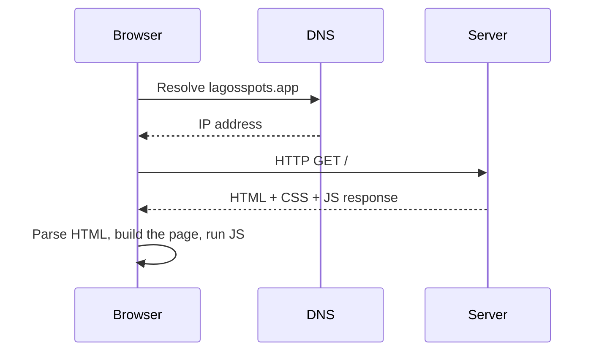
*What actually happens between typing a URL and seeing a page — traced live in DevTools' Network tab on Monday.*

| Session | Focus | Practical |
|---|---|---|
| Mon | Course kickoff. Install Node.js LTS, VS Code + extensions. Client-server model, HTTP request/response, DNS (diagram above). `[FC-git]` intro to CLI basics. | Install everything; open DevTools and inspect a real page's requests. |
| Tue | Git fundamentals: `init`, `add`, `commit`, `.gitignore`, `log`. GitHub: remotes, `push`/`pull`, creating a repo. `[ProGit]` ch. 1–2, `[FC-git]`. | Create the `lagos-spots` GitHub repo; make first commits. |
| Wed | Branching & PRs (even solo, to build the habit): `branch`, `checkout`/`switch`, `merge`, opening a Pull Request on GitHub. `[GitNotes]`. | Create a branch, make a change, open and merge your first PR. |

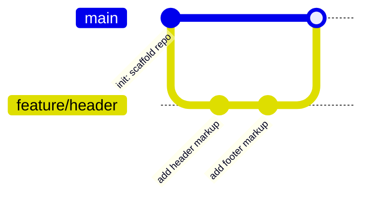
*The exact branch → commit → PR → merge loop students repeat for every feature from here on.*

**Take-home:** Write a personal README describing the Lagos Spots concept (what places it will list, who it's for); practice 3 more commits with meaningful messages.

### Week 2 — HTML Fundamentals

**Learning Objectives:** Structure a document semantically; build real forms; understand accessibility basics.

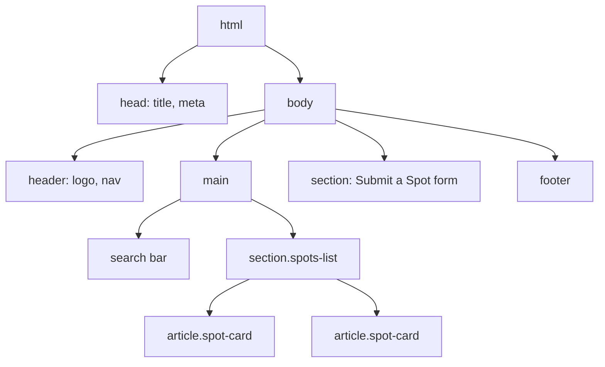
*The real document tree students build this week — not an abstract example.*

| Session | Focus | Practical |
|---|---|---|
| Mon | Document structure, semantic tags (`header`, `main`, `nav`, `section`, `footer`), headings, text elements. `[HTML5Notes]`, `[FC-html]`. | Scaffold `index.html`: header with logo/nav, a search bar placeholder, empty spots section. |
| Tue | Lists, links, images, semantic sectioning for a card-based listing. | Build the "Spots" section markup with 4–5 real (placeholder) places, each as an `<article class="spot-card">`. |
| Wed | Forms: inputs, labels, `<form>`, basic validation attributes; accessibility basics (alt text, label association, landmark roles). | Build the real "Submit a Spot" form (name, category, area, short description). |

**Take-home:** Complete a full, semantically valid `index.html` for Lagos Spots (listing + submit form) with no styling yet.

### Week 3 — CSS Fundamentals

**Learning Objectives:** Style with the box model, selectors, and typography correctly.

| Session | Focus | Practical |
|---|---|---|
| Mon | The box model, `margin`/`padding`/`border`, `box-sizing`. Selectors & specificity. `[CSSHandbook]`, `[FC-css]`. | Style the header and search bar. |
| Tue | Typography, color, `background`, basic transitions. | Style each `.spot-card` (name, category badge, description). |
| Wed | BEM naming convention; organizing CSS files for a growing project. | Refactor all class names to BEM (`spot-card__title`, `spot-card--featured`); split into `base.css`/`components.css`. |

**Take-home:** Fully style Lagos Spots (no layout system yet — this is foundational box/type work).

### Week 4 — CSS Layout: Flexbox & Grid

**Learning Objectives:** Lay out real page structure with Flexbox and Grid; make it responsive.

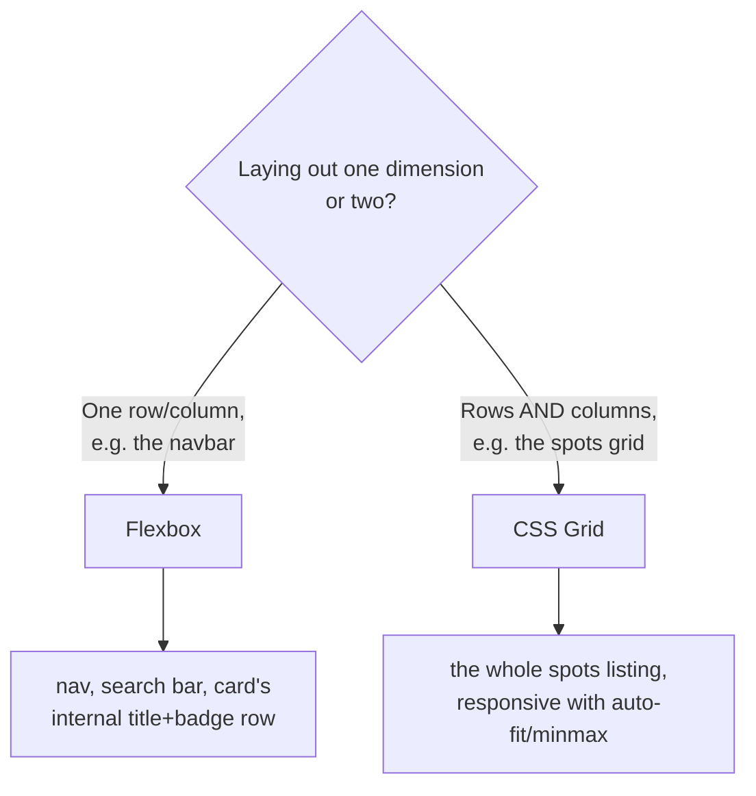

| Session | Focus | Practical |
|---|---|---|
| Mon | Flexbox: container/item properties, common patterns (navbars, rows inside a card). `[CSSHandbook]`. | Lay out the nav and each card's internal title+badge row as flex. |
| Tue | CSS Grid: `grid-template-columns`, `gap`, responsive grids without media queries (`auto-fit`/`minmax`). | Rebuild the spots section as a responsive grid of cards. |
| Wed | Media queries, mobile-first responsive design; testing with DevTools device emulation. | Make the whole page responsive across 3 breakpoints. |

**Take-home:** Ship a fully responsive, laid-out Lagos Spots page (still plain CSS).

### Week 5 — Tailwind CSS & Modern CSS Workflow

**Learning Objectives:** Understand utility-first CSS; convert a hand-styled page to Tailwind; use a modern build tool.

| Session | Focus | Practical |
|---|---|---|
| Mon | What utility-first CSS is and why teams adopt it; installing Tailwind via Vite. `[Tailwind-Kit]`, `[FC-tailwind]`. | Scaffold a Vite project, install Tailwind, confirm it compiles. |
| Tue | Core utilities: spacing, flex/grid utilities, responsive prefixes, dark mode (`dark:`). | Port the layout and spot cards to Tailwind classes. |
| Wed | Component extraction patterns (`@apply` sparingly), custom theme config, category-badge color variants. | Finish the port; add category badge colors (Food, Study, Nightlife, Events) via a small theme config. |

**Take-home:** Fully Tailwind-ified Lagos Spots, still vanilla HTML/JS.

### Week 6 — JavaScript Fundamentals

**Learning Objectives:** Write real JS: variables, types, operators, control flow.

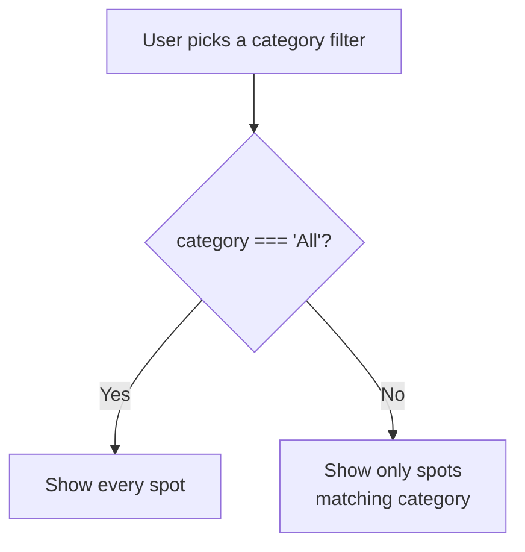

| Session | Focus | Practical |
|---|---|---|
| Mon | Variables (`let`/`const`), primitive types, type coercion pitfalls. `[EloqJS]` ch. 1, `[YDKJS: Types & Grammar]`, `[FC-js]`. | Small drills in the browser console; link a real `script.js`. |
| Tue | Operators, conditionals (`if`/`else`, ternary, `switch`). | Implement the category-filter decision logic above in plain JS. |
| Wed | Loops (`for`, `while`), functions (declarations vs. expressions vs. arrows), scope basics. `[YDKJS: Scope & Closures]`. | Write a `renderSpots(spots)` function that builds the cards from a real JS array instead of hardcoded HTML. |

**Take-home:** The spots list is now rendered from a JS array via `renderSpots()`, not hardcoded markup.

---

## PART II: JavaScript & TypeScript Mastery (Weeks 7–10)

### Week 7 — Arrays, Objects & Data Structures

**Learning Objectives:** Manipulate real data with array/object methods.

| Session | Focus | Practical |
|---|---|---|
| Mon | Arrays: `map`, `filter`, `reduce`, `find`, `sort`. `[EloqJS]` ch. 4, `[FC-js]`. | Filter spots by category, sort by name/area. |
| Tue | Objects: property access, destructuring, spread/rest, `Object.keys/values/entries`. | Refactor each spot into a well-shaped object (`{ id, name, category, area, description }`); destructure inside `renderSpots`. |
| Wed | Nested data structures; JSON basics (`JSON.stringify`/`parse`). | Persist a "favorites" list (array of spot IDs) to `localStorage` as JSON. |

**Take-home:** Spots data is a clean array of objects, filterable/sortable, with favorites persisted.

### Week 8 — The DOM, Events & Browser APIs

**Learning Objectives:** Manipulate the DOM imperatively and handle real user interaction.

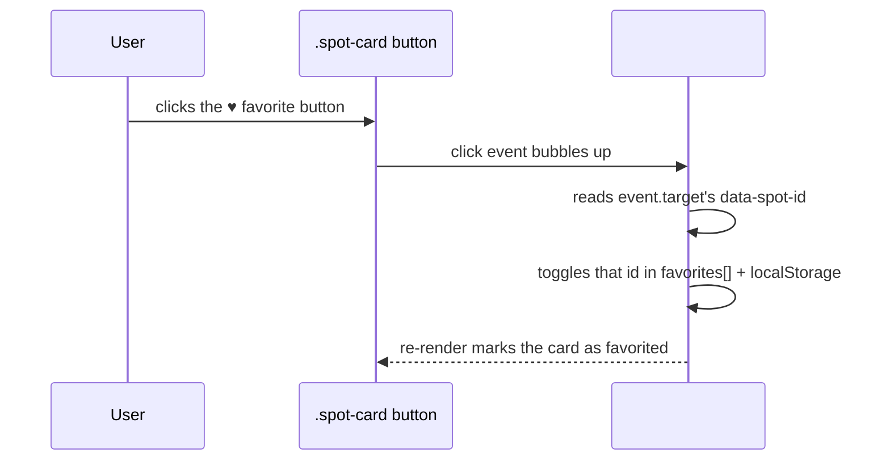
*Why one listener on the parent list beats one listener per card — event delegation, taught against the real favorite button.*

| Session | Focus | Practical |
|---|---|---|
| Mon | DOM selection/traversal, creating/appending elements. `[MJST Part II]`, `[FC-js]`. | Dynamically build the spots grid via DOM APIs instead of a template string. |
| Tue | Events: `addEventListener`, event delegation (diagram above), form submission handling. | Wire up the favorite ♥ button with delegation; wire the "Submit a Spot" form with real client-side validation and inline errors. |
| Wed | Browser storage APIs recap, basic Web APIs (e.g. `IntersectionObserver` for a "load more on scroll" effect, optional). | Polish interactions: form success/error states, favorited-card styling. |

**Take-home:** Fully interactive vanilla-JS Lagos Spots: dynamic rendering, favoriting, validated submit form.

### Week 9 — Asynchronous JavaScript & Modern ES6+

**Learning Objectives:** Fetch real data asynchronously from a genuine public API; use modern JS syntax fluently.

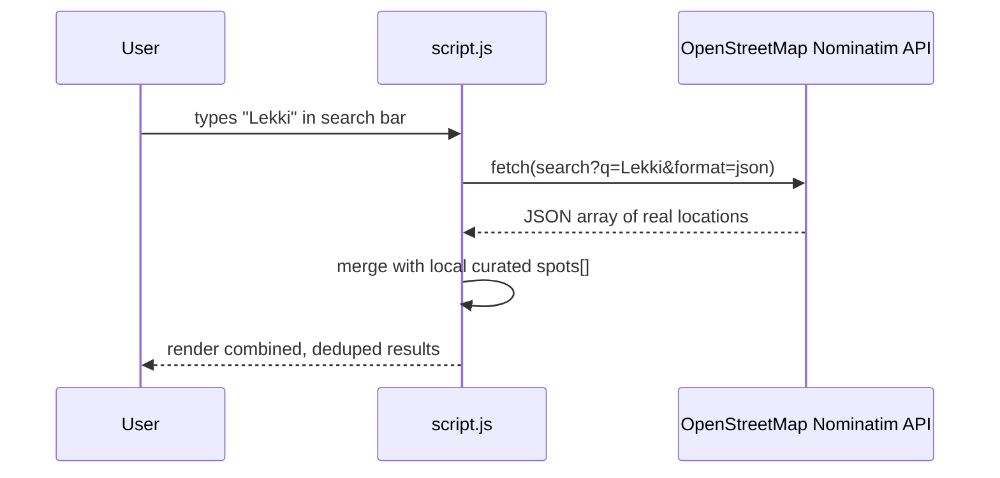

| Session | Focus | Practical |
|---|---|---|
| Mon | The event loop (conceptually), callbacks → Promises → `async`/`await`. `[YDKJS: Async & Performance]`, `[FC-js]`. | Call OpenStreetMap's free, keyless Nominatim search API (`nominatim.openstreetmap.org/search`) for a typed area name; log the raw results. |
| Tue | Error handling with `try/catch`, `Promise.all`. Modules (`import`/`export`). `[YDKJS: ES6 & Beyond]`. | Merge Nominatim results into the spots array (diagram above); handle loading/error UI states. |
| Wed | Template literals, default/rest params, optional chaining, nullish coalescing — modern syntax sweep. | Refactor the whole codebase to use these consistently; split into ES modules. |

**Take-home:** Lagos Spots searches real locations live via Nominatim, merged with curated data, with proper loading/error states, split into clean ES modules.

### Week 10 — TypeScript Fundamentals

**Learning Objectives:** Add static types to real JavaScript; understand why production teams default to TS.

| Session | Focus | Practical |
|---|---|---|
| Mon | Why TypeScript; basic types, type inference, `interface` vs `type`. `[W3S-ts]`, `[FC-ts]`. | Set up TS in the Vite project (`tsc --init`); define a `Spot` interface. |
| Tue | Functions with typed params/returns, union types, generics (basic intro), `unknown` vs `any`. | Convert `renderSpots`, the filter functions, and the Nominatim fetch to TypeScript, typing the raw API response separately from the internal `Spot` shape. |
| Wed | Typing DOM APIs and event handlers in TS; `tsconfig.json` strictness options. | Finish converting the entire codebase to `.ts`; fix all type errors under `strict: true`. |

**Take-home:** *(Milestone: Lagos Spots v1 — vanilla HTML/CSS/TS — complete.)* All logic is typed, compiling clean under strict mode.

---

## PART III: React (Weeks 11–14)

### Week 11 — React Fundamentals

**Learning Objectives:** Understand components/JSX; scaffold with Vite + TS; rebuild the app as components.

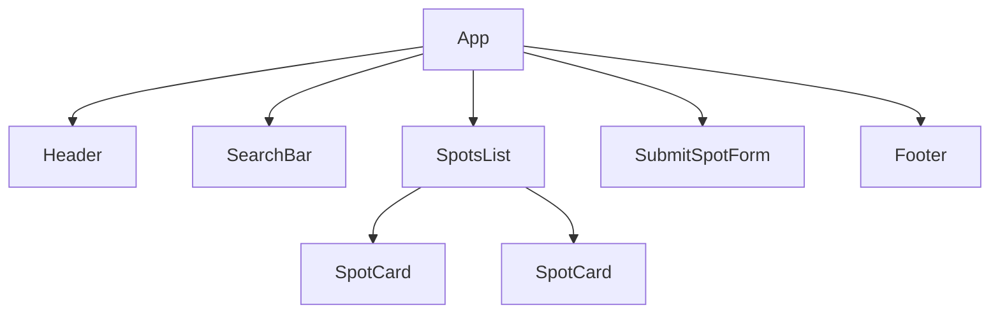

| Session | Focus | Practical |
|---|---|---|
| Mon | What React is; Vite's `react-ts` template; JSX syntax rules. `[ReactNotes]`, `[FC-react]`. | Scaffold `lagos-spots-react` (TypeScript template); render the app title in `App.tsx`. |
| Tue | Functional components, props (typed with TS), `props.children`. | Build typed `Header`, `SearchBar`, `SpotCard` components matching the tree above. |
| Wed | Rendering lists with `.map()` + `key`; component composition. | Render the real (typed) spots array via `SpotCard` components inside `SpotsList`. |

**Take-home:** Header, search bar, and spot cards rebuilt as typed React components.

### Week 12 — State, Hooks & Forms

**Learning Objectives:** Manage component state and side effects; build a real controlled form.

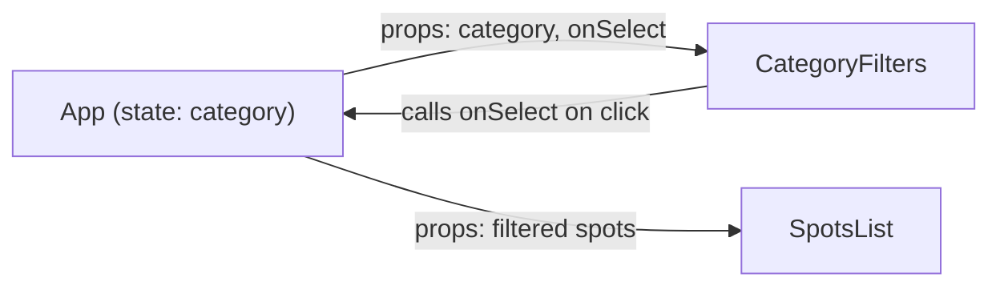
*Props flow down, events flow up — traced against the real category filter.*

| Session | Focus | Practical |
|---|---|---|
| Mon | `useState`, controlled inputs, event typing in TS. `[FC-react]`. | Add category-filter buttons using `useState` (diagram above). |
| Tue | `useEffect` and the dependency array; calling the Nominatim API inside React. | Move the Nominatim search into a `useEffect` triggered on a debounced search term, with typed `data`/`loading`/`error` state. |
| Wed | Controlled forms: single `formData` state object, validation on submit. | Rebuild the real "Submit a Spot" form as a typed, controlled component. |

**Take-home:** Filterable spots grid + live Nominatim search + validated submit form, all typed React.

### Week 13 — Routing, Global State & Data Fetching

**Learning Objectives:** Add real client-side routing; manage global state properly; fetch server state the production way.

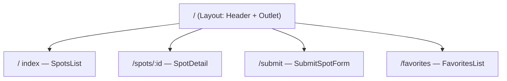

| Session | Focus | Practical |
|---|---|---|
| Mon | React Router: `createBrowserRouter`, layouts, `<Outlet>`, dynamic routes (`:id`). `[FC-react]`. | Real routes matching the sitemap above. |
| Tue | Context API for global state; when it's the right tool vs. prop-drilling a couple of levels; intro to Zustand as a lighter alternative for larger apps. | `FavoritesContext` holding the favorited spot IDs, persisted to `localStorage`, consumed on both `SpotCard` and the new `/favorites` route. |
| Wed | TanStack Query: why hand-rolled `fetch`+`useEffect` doesn't scale (caching, dedup, refetch); basic `useQuery`. | Replace the Nominatim `useEffect` fetch with `useQuery`, keyed by the search term. |

**Take-home:** Multi-route Lagos Spots SPA with a real `/favorites` page and TanStack Query powering search.

### Week 14 — Advanced React, Testing & Ship

**Learning Objectives:** Extract custom hooks; optimize performance; test components; deploy.

| Session | Focus | Practical |
|---|---|---|
| Mon | Custom hooks; `React.memo`, `useMemo`, `useCallback`; code-splitting with `React.lazy`. `[FC-react]`. | Extract a `useSpotSearch` hook; lazy-load the `SpotDetail` route. |
| Tue | Testing with Vitest + React Testing Library: render, query, simulate interaction. `[FC-testing]`. | Write real tests for `SpotCard` (favorite toggle) and the submit form's validation. |
| Wed | Environment variables, `npm run build`, deploying to Vercel. | Deploy the React app live on Vercel. |

**Take-home:** *(Milestone: Lagos Spots v2 — React + TS SPA, tested and deployed live.)*

---

## PART IV: Backend Engineering (Weeks 15–18)

*Introduces the second running project: **Flowboard**, a Trello-style task/project board API.*

### Week 15 — Node.js, Express & REST API Design

**Learning Objectives:** Bootstrap a real Express + TypeScript API; design a layered architecture.

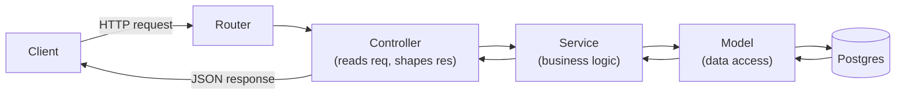
*Every request in Flowboard makes this exact trip — traced live before any code is written.*

| Session | Focus | Practical |
|---|---|---|
| Mon | Node.js runtime basics; Express setup with TypeScript; first server. `[NodeNotes]`, `[ExpressNotes]`, `[FC-node]`, `[FC-express]`. | Scaffold `flowboard-api` (Express + TS); define CRUD routes for `boards`. |
| Tue | `express.Router()`, middleware, `express.json()`, dev workflow (`nodemon`/`tsx watch`). | Split routes into `routes/boardRoutes.ts`; mount under `/api/v1`. |
| Wed | Controller → Service → Model layering (diagram above); REST conventions (status codes, pagination query params). `[APIGuide]`. | Build the Controller/Service/Model trio for `boards`, backed by an in-memory array for now. |

**Take-home:** Layered, in-memory Flowboard API for `boards`, tested in Postman.

### Week 16 — PostgreSQL & Drizzle ORM

**Learning Objectives:** Model relational data; connect a real Postgres database; perform typed CRUD via Drizzle.

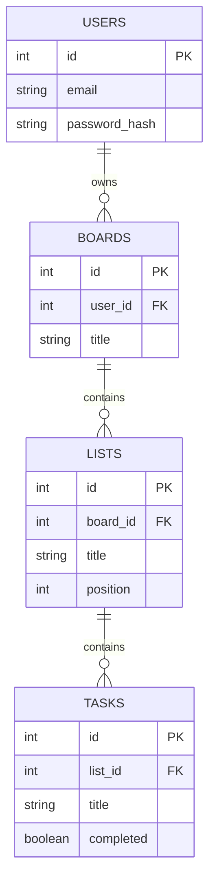

| Session | Focus | Practical |
|---|---|---|
| Mon | Relational modeling: `users`, `boards`, `lists`, `tasks` and their relations (ER diagram above). SQL fundamentals. `[SQLNotes]`, `[FC-sql]`. | Create a free Neon Postgres project; sketch the schema. |
| Tue | Drizzle setup, schema declarations, Drizzle Kit migrations. `[FC-drizzle]`, `[W3S-pg]`, `[FC-pg]`. | Define the Drizzle schema for all 4 tables; generate and run the first migration. |
| Wed | Typed CRUD with Drizzle; relations & joins; transactions for multi-table writes. | Rewrite the `boards` Model layer to use Drizzle against real Postgres; add `lists` and `tasks` CRUD. |

**Take-home:** Flowboard persists real data in Postgres via Drizzle — no in-memory arrays left.

### Week 17 — Authentication, Authorization & Security

**Learning Objectives:** Implement real, secure authentication; scope data to the logged-in user; understand security fundamentals.

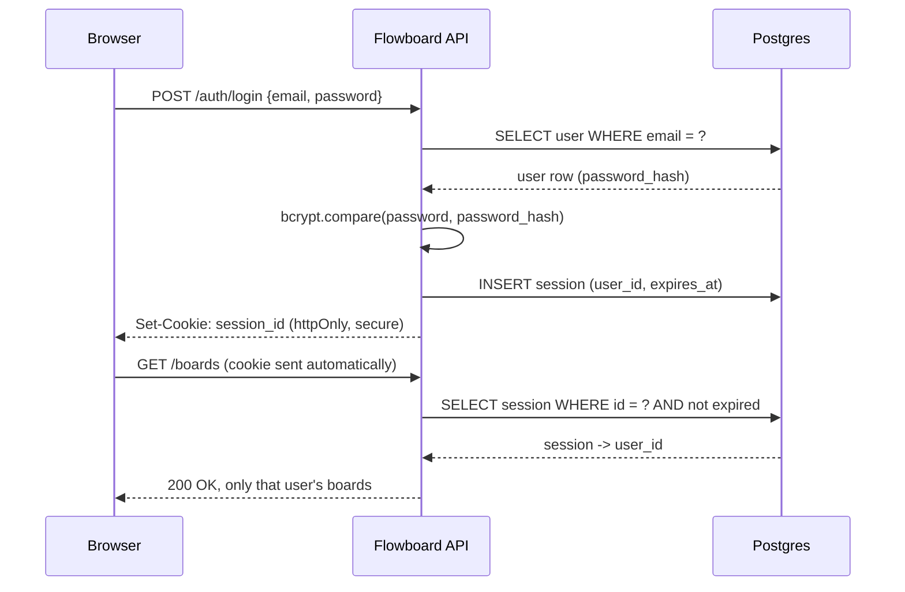

| Session | Focus | Practical |
|---|---|---|
| Mon | Security mindset: threat modeling, secure defaults, secrets management. `[FC-security]`. Password hashing with `bcrypt`. | Build `authService.signup` — hash password, insert user. |
| Tue | Session-based authentication (chosen over JWT as the primary pattern — revocable, more secure default for a web app): secure session cookies, login, session storage (sequence diagram above). `[FC-webauth]`. | Build `POST /auth/login` issuing a secure, httpOnly session cookie; a `POST /auth/logout`. |
| Wed | Auth middleware, ownership checks (403 vs 401), CSRF basics, intro to OAuth/OIDC for federated login (concept only) and API security principles for the stateless case. `[FC-apisec]`, `[FC-crypto]` (for password/token concepts). | Protect all `boards`/`lists`/`tasks` routes; scope every query to `req.user.id`; add ownership checks on mutation. |

**Take-home:** Two different signed-up users only ever see their own boards — proven with two separate Postman sessions.

### Week 18 — Validation, Error Handling & Testing

**Learning Objectives:** Validate input at the edge; centralize error handling; write real automated tests.

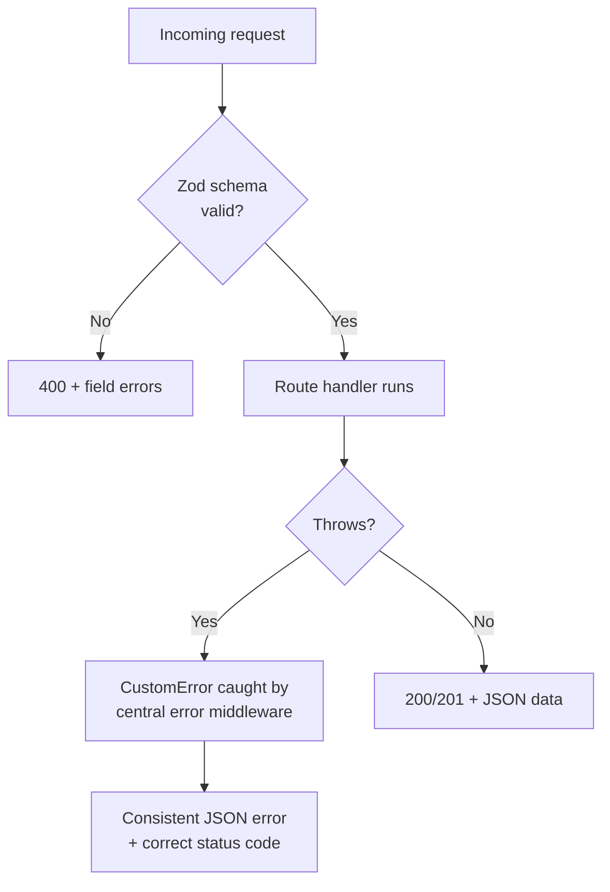

| Session | Focus | Practical |
|---|---|---|
| Mon | Zod schemas for `boards`/`lists`/`tasks`; a `validate` middleware. | Add Zod validation to every write endpoint. |
| Tue | Custom error classes + one centralized error-handling middleware; consistent JSON error shape (diagram above). | Replace ad-hoc throws with `CustomError`; wire the central handler. |
| Wed | Testing with Vitest + Supertest against a real (disposable/branch) test database. `[FC-testing]`. | Write integration tests for signup/login and full `boards`/`tasks` CRUD as an authenticated user. |

**Take-home:** *(Milestone: Flowboard API v1 — authenticated, validated, tested — complete.)*

---

## PART V: Production, Next.js & DevOps (Weeks 19–20)

### Week 19 — Next.js: The Production React Framework

**Learning Objectives:** Understand what a meta-framework adds over plain React; use Next.js to solve a real problem (hiding a third-party API behind your own backend); scaffold the capstone frontend.

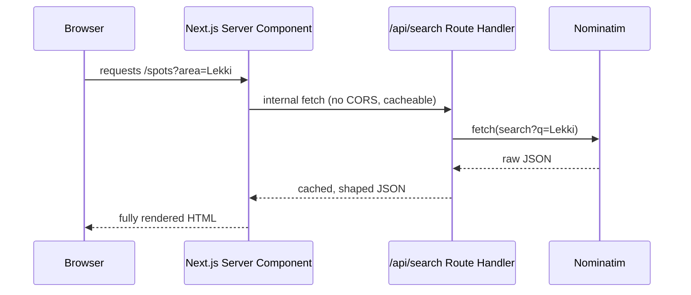
*Why proxy Nominatim through your own Route Handler instead of calling it straight from the browser: caching, rate-limit control, and a stable contract your frontend can rely on.*

| Session | Focus | Practical |
|---|---|---|
| Mon | Why Next.js: file-based routing, Server vs. Client Components, SSR/SSG at a conceptual level. `[NextEbook]`, `[FC-nextjs]`. | Scaffold a new Next.js (App Router, TS) project for Lagos Spots. |
| Tue | Data fetching in Server Components; Route Handlers (`app/api/.../route.ts`) as the Next.js equivalent of an Express route (diagram above). | Build `/api/search/route.ts` proxying Nominatim; render results in a Server Component. |
| Wed | Connecting a Next.js frontend to an external API (Flowboard) — env vars, fetch patterns, loading/error UI with Suspense. | Scaffold the capstone's Next.js frontend; build a first authenticated page that reads real data from the Flowboard API. |

**Take-home:** A working Next.js app that proxies Nominatim through its own Route Handler, plus a first page reading real data from Flowboard.

### Week 20 — Docker, CI/CD & Deployment

**Learning Objectives:** Containerize the API; automate testing on every push; deploy both apps for real.

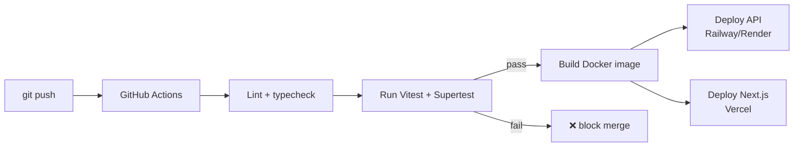

| Session | Focus | Practical |
|---|---|---|
| Mon | Docker fundamentals: images vs. containers, a `Dockerfile` for the Express API, `docker-compose` for API + Postgres locally. `[FC-docker]`. | Containerize Flowboard; run it locally via `docker compose up`. |
| Tue | GitHub Actions & CI/CD: a workflow that runs lint/tests on every push/PR (pipeline diagram above). `[FC-cicd]`. | Add `.github/workflows/ci.yml`; prove it fails on a deliberately broken test, then passes. |
| Wed | Deploying: the Next.js app to Vercel, the API to Railway/Render (or a Docker-based host) with production env vars. `[FC-vercel]`. | Deploy both apps live; confirm the deployed frontend talks to the deployed API. |

**Take-home:** *(Milestone: Both apps live, connected, with green CI.)*

---

## PART VI: Capstone (Weeks 21–22, extend as needed toward the 6-month mark)

### Week 21 — Capstone Build Week 1

Students finalize their capstone scope: either **polish and extend Flowboard + its Next.js frontend into one cohesive product**, or **pitch and build their own idea** using the exact same architecture (Next.js + Express/Route Handlers + Postgres/Drizzle + session auth + Zod + tests + Docker/CI + deployed). Daily sessions become structured build/office-hours time: Monday scoping & data modeling, Tuesday–Wednesday implementation with 1:1 code review.

Optional supplementary reading introduced here for code-quality polish: `[CleanCode]`, `[CodeComplete]`, `[GoF]` (naming, function design, common design patterns applied to their own codebase).

### Week 22 — Capstone Build Week 2 & Demo Day

Final implementation, bug fixes, deployment hardening (rate limiting, logging, `helmet`), and a real demo day — each student presents their live, deployed, full-stack application end to end.

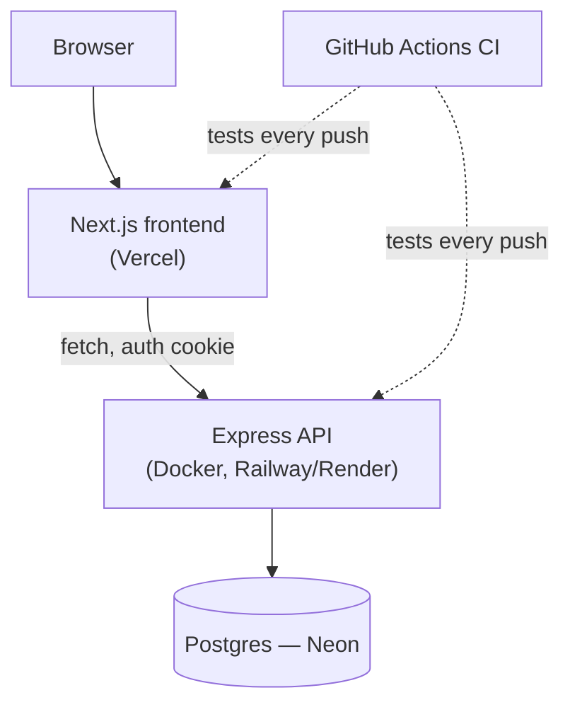
*The finished system every student presents on Demo Day — same shape as Flowboard, whatever the final idea.*

**Final Deliverable Checklist:**
1. **Frontend:** Next.js (TS), Tailwind, real routing, real data — no mock/placeholder data left.
2. **Backend:** Express or Next.js Route Handlers, layered architecture, Postgres via Drizzle.
3. **Auth:** Real signup/login with hashed passwords and secure sessions; data scoped per user.
4. **Validation & Errors:** Zod on every write path; one centralized error handler.
5. **Tests & CI:** Vitest/Supertest coverage, passing automatically in GitHub Actions.
6. **Security:** `helmet`, rate limiting, no secrets committed.
7. **Deployment:** Live URLs for both frontend and backend, connected, working end to end.

### Buffer / Extension Weeks (Weeks 23–26, as needed)

Not pre-scripted by design — reserved for whatever a real cohort needs: a slower pace through any Part I–V week, extra review sessions, makeup classes for holidays, or extra capstone polish time. Using any subset of these naturally extends the program from ~5 months toward the full 6-month ceiling without changing the curriculum's structure.

---

## Next Steps

This is the master roadmap. Detailed weekly lecture notes (with the same granular, minute-by-minute session breakdowns used above, plus diagrams and worked examples) will be authored one Part at a time, starting with Part I, so each can be reviewed before moving to the next.
