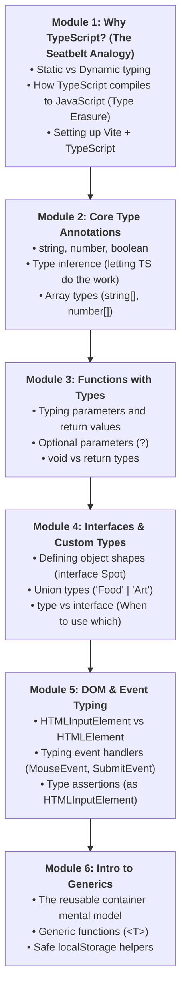
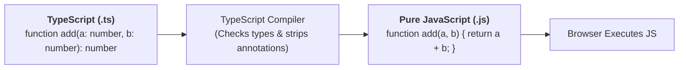
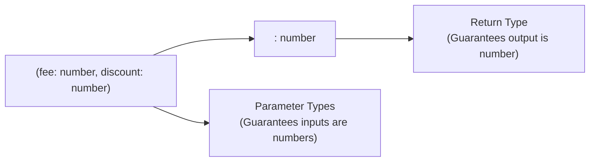
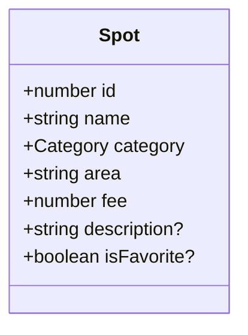

# Week 10: TypeScript Fundamentals

Welcome to Week 10! Over the past four weeks, you wrote pure, dynamic JavaScript: creating variables, manipulating arrays and objects, handling DOM events, and fetching real data from APIs.

JavaScript is incredibly flexible, but that flexibility comes with a hidden cost. Have you ever spent 45 minutes tracking down a bug, only to realize:
- You misspelled a property name (`spot.nmae` instead of `spot.name`)?
- You passed a string `"5000"` into a function that expected a number, causing `"5000" + 200` to become `"5000200"`?
- You tried to access `.length` on a variable that turned out to be `undefined`?

In vanilla JavaScript, the browser will not warn you about these mistakes until your code actually runs (often in front of real users!).

This week, you master **TypeScript**: JavaScript with a powerful **static type-checking safety net**. TypeScript catches bugs in your code editor while you type, before your code ever runs in a browser.

---

## Pedagogical Roadmap



---

## Module 1: Why TypeScript? (The Seatbelt Analogy)

### 1. Dynamic Typing vs Static Typing

> [!NOTE]
> **The Mental Model:**
> - **Vanilla JavaScript is like driving without a seatbelt or lane assist.** You can drive anywhere you want at any speed, but if you drift into oncoming traffic, you crash.
> - **TypeScript is the intelligent driver-assist system.** It alerts you the split-second your hands slip: *"Warning: you promised this was a number, but you are assigning a string!"*

| Feature | Vanilla JavaScript | TypeScript |
| :--- | :--- | :--- |
| **When are errors caught?** | **Runtime** (When a user runs the code in the browser). | **Compile-Time** (Inside VS Code while you are typing). |
| **Autocomplete & IntelliSense** | Guesswork; requires memorizing property names. | **100% Autocomplete** for every property and function argument. |
| **Refactoring Confidence** | Renaming a property might break 10 unseen files. | Renaming a property automatically updates all occurrences. |
| **Browser Execution** | Native execution in every browser. | **Compiles into pure JavaScript**; browsers do not run TypeScript directly. |

---

### 2. How TypeScript Works: Type Erasure

Browsers like Google Chrome and Safari do **not** understand TypeScript syntax (`: string`, `interface`).

When you build your application using a bundler like **Vite** or the TypeScript compiler (`tsc`):
1. TypeScript checks all your types for errors.
2. If there are no errors, it **erases all type annotations** and outputs clean, pure JavaScript.
3. The browser runs that pure JavaScript with **zero performance penalty**.



---

## Module 2: Core Type Annotations & Inference

### 1. Basic Primitive Types

To declare a type in TypeScript, add a colon `:` followed by the type name:

```ts
// Explicit type annotations:
const spotName: string = "Terra Kulture";
const entryFee: number = 2500;
const isOpen: boolean = true;
const discountCode: null = null;
let userRating: undefined = undefined;
```

---

### 2. Type Inference (Don't Over-Annotate!)

> [!TIP]
> **Pro Practice:** You do **not** need to write `: string` or `: number` on every single variable! 
> If you assign an initial value, TypeScript is smart enough to deduce the type automatically. This is called **Type Inference**.

```ts
// TypeScript automatically knows city is a string:
let city = "Lagos"; 

// city = 100; // 🔴 ERROR: Type 'number' is not assignable to type 'string'.
```
Only write explicit annotations when declaring an empty variable or when TypeScript cannot infer the type.

---

### 3. Array Types

To type an array, take the type of its items and add `[]`:

```ts
// Array of strings:
const categories: string[] = ["Food", "Art", "Nightlife"];

// Array of numbers:
const ratings: number[] = [4.5, 4.8, 3.9, 5.0];

// categories.push(10); // 🔴 ERROR: Argument of type 'number' is not assignable to parameter of type 'string'.
```

---

## Module 3: Functions with Types

In JavaScript, functions are where most bugs occur because callers can pass whatever arguments they want. In TypeScript, you type both the **parameters** and the **return value**:



```ts
// Function with typed parameters and return type:
function calculateDiscountedFee(fee: number, discountPercentage: number): number {
  return fee - (fee * discountPercentage) / 100;
}

const finalPrice = calculateDiscountedFee(5000, 20); // 4000
// calculateDiscountedFee("5000", 20); // 🔴 ERROR: Argument of type 'string' is not assignable!
```

### Optional Parameters & Void Returns

- **Optional Parameters (`?`):** If an argument isn't mandatory, add a `?` before the colon.
- **`void` Return Type:** If a function does not return a value (e.g., it just logs or updates the DOM), its return type is `void`.

```ts
function logSpotDetails(name: string, area?: string): void {
  if (area) {
    console.log(`📍 ${name} located in ${area}`);
  } else {
    console.log(`📍 ${name}`);
  }
}

logSpotDetails("Bogobiri", "Ikoyi"); // Valid
logSpotDetails("Nike Art Gallery");  // Valid (area is optional)
```

---

## Module 4: Interfaces & Custom Types

### 1. Modeling Data with `interface`

In Week 7, we created Lagos Spot objects with properties like `id`, `name`, `category`, and `fee`. In TypeScript, we define a strict blueprint for our objects using an **`interface`**:



```ts
interface Spot {
  id: number;
  name: string;
  category: string;
  area: string;
  fee: number;
  description?: string; // Optional property
  isFavorite?: boolean;  // Optional property
}

// Now creating a Spot is strictly validated by VS Code:
const spot1: Spot = {
  id: 1,
  name: "Terra Kulture",
  category: "Food",
  area: "Victoria Island",
  fee: 0
  // description is optional, so omitting it is completely valid!
};
```

If you misspell a property or forget a required field, TypeScript highlights it in red immediately!

---

### 2. Union Types & Literal Types

What if `category` shouldn't be *any* random string, but strictly one of four choices: `'Food'`, `'Art'`, `'Nightlife'`, or `'Nature'`?

We use a **Union of String Literals**:

```ts
// Define the allowed category options:
type Category = "Food" | "Art" | "Nightlife" | "Nature";

interface SpotWithStrictCategory {
  id: number;
  name: string;
  category: Category; // Must be one of the four allowed strings!
  area: string;
}

const goodSpot: SpotWithStrictCategory = {
  id: 2,
  name: "Hard Rock Cafe",
  category: "Nightlife", // 🟢 Valid!
  area: "VI"
};

/*
const badSpot: SpotWithStrictCategory = {
  id: 3,
  name: "Random Spot",
  category: "Shopping", // 🔴 ERROR: Type '"Shopping"' is not assignable to type 'Category'.
  area: "Lekki"
};
*/
```

---

### 3. `type` vs `interface`: Quick Decision Rule

| Use `interface` for: | Use `type` for: |
| :--- | :--- |
| Data objects and models (`Spot`, `User`, `Review`). | Unions (`"Food" \| "Art"`). |
| Things you might want to extend later with `extends`. | Primitives, Tuples (`[number, number]`), or function signatures. |

---

## Module 5: DOM & Event Typing in the Browser

When working with the browser DOM in TypeScript, elements have specific types:

```ts
// 1. querySelector returns HTMLElement | null by default:
const heading = document.querySelector("h1"); 

// 2. Form Inputs have properties like .value that general elements don't:
// Use Type Assertions (as HTMLInputElement) when you know the exact tag:
const searchInput = document.querySelector("#search-input") as HTMLInputElement;

console.log(searchInput.value); // TypeScript knows .value exists on HTMLInputElement!

// 3. Typing Event Listeners:
searchInput.addEventListener("input", (event: Event) => {
  const target = event.target as HTMLInputElement;
  console.log("Typing:", target.value);
});

const submitForm = document.querySelector("#add-spot-form") as HTMLFormElement;
submitForm.addEventListener("submit", (event: SubmitEvent) => {
  event.preventDefault();
  console.log("Form submitted!");
});
```

---

## Module 6: Introduction to Generics (`<T>`)

> [!NOTE]
> **The Mental Model:** A **Generic** is like a shipping container or a labeled cardboard box. It doesn't care whether you ship apples, books, or electronics — it securely holds whatever type you place inside it, and keeps track of what type came out.

In TypeScript, `<T>` stands for a **Type Variable**.

### A Practical Generic: Safe `localStorage` Helper
```ts
// A generic function that safely retrieves and parses stored data of ANY type:
function getFromStorage<T>(key: string, fallbackValue: T): T {
  const rawData = localStorage.getItem(key);
  if (!rawData) {
    return fallbackValue;
  }
  try {
    return JSON.parse(rawData) as T;
  } catch (error) {
    console.error(`Error parsing ${key}:`, error);
    return fallbackValue;
  }
}

// 1. Reading an array of numbers:
const savedIds = getFromStorage<number[]>("favorite_ids", []);
savedIds.push(10); // Fully autocompleted as number[]!

// 2. Reading a user object:
interface UserProfile {
  name: string;
  theme: "light" | "dark";
}

const userProfile = getFromStorage<UserProfile>("user_pref", { name: "Guest", theme: "light" });
console.log(userProfile.theme); // Fully autocompleted!
```

---

## Module 7: Rookie Traps & Debugging Guide

| Error Message | What Happened | How to Fix It |
| :--- | :--- | :--- |
| `Type 'string' is not assignable to type 'number'` | You passed text into a parameter expecting a number. | Convert with `Number(val)` or check where the string originated. |
| `Property 'value' does not exist on type 'Element'` | `querySelector` returned a generic `Element` which does not have `.value`. | Cast it: `document.querySelector('#input') as HTMLInputElement`. |
| `Object is possibly 'null'` | You tried to access properties on an element that might not exist in the DOM. | Use optional chaining `el?.classList.add()` or an `if (el)` check. |
| `Property 'xyz' is missing in type '{ ... }'` | You created an object with an interface, but forgot one of the required properties. | Add the missing property, or mark it optional with `?` in the interface. |

---

## 🎯 Week 10 Hands-on Classroom Exercises

### Level 1: Basic Typing Warmups
1. Create a `Student` interface with `id` (number), `name` (string), and `completedWeeks` (number[]).
2. Create an array `students: Student[]` with at least 3 students.
3. Write a typed function `getTopStudent(students: Student[]): Student` that returns the student who has completed the most weeks.

### Level 2: Strict Lagos Spots Model
1. Create a `Category` union type with: `'Food' | 'Art' | 'Music' | 'Nature'`.
2. Create a `Spot` interface containing: `id`, `name`, `category`, `area`, `fee`, and optional `rating`.
3. Write a typed function `filterSpotsByCategory(spots: Spot[], category: Category): Spot[]`.

### Level 3: Porting Lagos Spots to TypeScript
1. In your Vite project, rename `script.js` (or create `src/main.ts`).
2. Add your `Spot` interface and type your `spots` array.
3. Type your DOM selectors (`searchInput as HTMLInputElement`, `spotsContainer as HTMLElement`).
4. Enjoy full editor autocomplete and zero runtime type errors!

---

## 📚 Curated Deep-Dive References

* [The Valley of Code: TypeScript Tutorial](https://thevalleyofcode.com/typescript/) — Flavio Copes' gentle, beginner-friendly guide to TypeScript.
* [TypeScript Official Handbook](https://www.typescriptlang.org/docs/handbook/intro.html) — The official guide from the TypeScript team.
* [TypeScript for JavaScript Programmers](https://www.typescriptlang.org/docs/handbook/typescript-in-5-minutes.html) — Fast-track transition guide from JS to TS.
* [W3Schools: TypeScript Tutorial](https://www.w3schools.com/typescript/) — Interactive beginner exercises and syntax drills.
* [Total TypeScript (by Matt Pocock)](https://www.totaltypescript.com/) — The best interactive TypeScript tutorials and tips.
