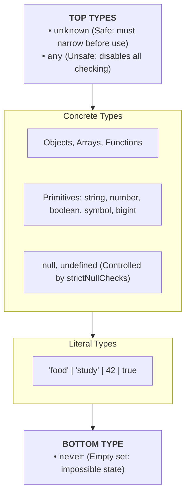
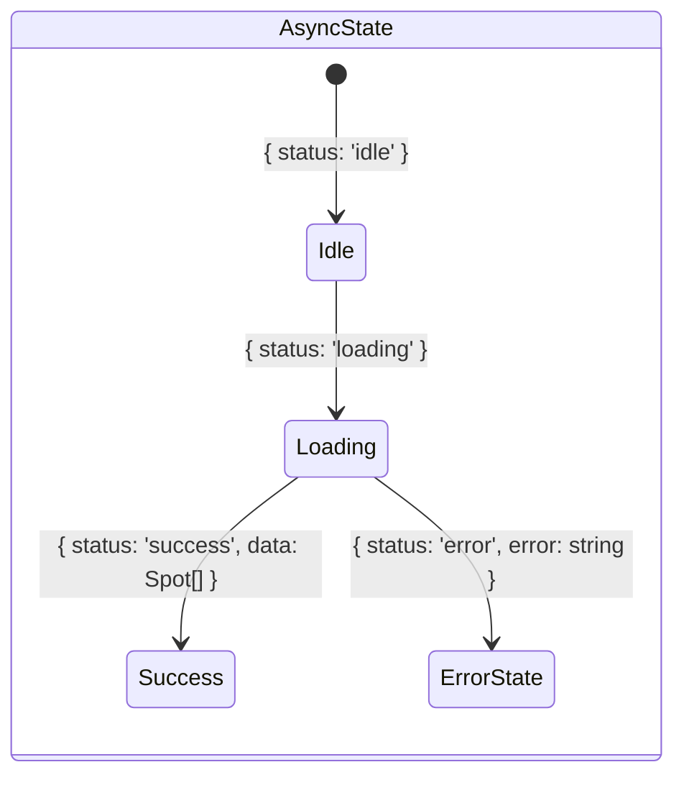
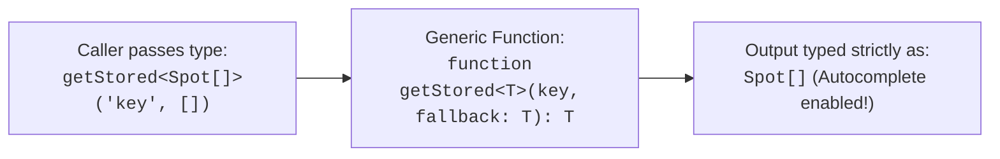

# Week 10: TypeScript Fundamentals

Until this point, you have written JavaScript with occasional type hints. This week, we transition to strict, professional **TypeScript**: understanding how the compiler enforces static guarantees, how the type system functions via **Structural Subtyping**, how to implement **Generics**, **Type Guards**, and **Discriminated Unions**, and how to ensure end-to-end type safety between third-party APIs and your application state.

---

## Module 1: The TypeScript Type System & Compilation Model

### 1. The Core Terminology of TypeScript

| Term | What It Actually Means | Technical Context |
| :--- | :--- | :--- |
| **Static Type Checking** | Verifying the correctness of types at **compile-time** (in your editor or during build) before running code. | Prevents `TypeError: Cannot read properties of undefined` in production. |
| **Type Erasure** | The process where the TypeScript compiler (`tsc`) removes all interfaces, types, and generic annotations, emitting pure JavaScript. | **TypeScript types do not exist at runtime.** They carry zero runtime performance overhead. |
| **Structural Subtyping ("Duck Typing")** | Type compatibility is based solely on the *shape and properties* of an object, not its explicit name or inheritance class. | If an object has all required properties of an interface, TypeScript treats it as valid. |
| **Type Inference** | The compiler's ability to deduce data types automatically without explicit annotations (e.g., `const x = 5` is inferred as `number`). | Minimizes noisy boilerplate while preserving full type safety. |
| **Union Type (`A | B`)** | A type representing a value that can be *either* type `A` or type `B`. | Models multi-state outcomes (e.g., `Spot | undefined`, `'food' | 'study'`). |
| **Intersection Type (`A & B`)** | Combines multiple type definitions into one unified shape containing all properties of both. | Used for extending properties across data models. |

---

### 2. Under the Hood: The TypeScript Type Hierarchy

Understanding TypeScript's type relationships prevents unsafe casting:



- **`any`:** Completely turns off the type checker for that variable. Using `any` is a dangerous escape hatch that propagates through your codebase (**Any Contagion**).
- **`unknown`:** The type-safe counterpart of `any`. Any value can be assigned to `unknown`, but TypeScript **forbids accessing any properties on it until you narrow its type** via `typeof`, `instanceof`, or custom type guards.
- **`never`:** Represents values that can never occur (e.g., the return type of a function that always throws an error or an unreachable branch in exhaustive switch checks).

---

### 3. `interface` vs. `type` Alias: When to Use Which

```ts
// 1. Interface: Best for extensible Object models and public API contracts
interface BaseEntity {
  id: string;
  createdAt: Date;
}

interface Spot extends BaseEntity {
  name: string;
  category: Category;
  area: string;
}

// 2. Type Alias: Essential for Unions, Primitives, Tuples, and Computed Types
type Category = 'food' | 'study' | 'nightlife' | 'events';
type Coordinates = [latitude: number, longitude: number]; // Tuple
type EntityId = string | number;                         // Union

// 3. Declaration Merging (Unique to Interface):
// Multiple interfaces with the same name automatically merge into one!
interface UserSettings {
  theme: 'light' | 'dark';
}
interface UserSettings {
  notifications: boolean;
}
// Resulting UserSettings has BOTH theme AND notifications.
```

---

## Module 2: Advanced Type Narrowing & Discriminated Unions

### 1. Under the Hood: Discriminated (Tagged) Unions

A **Discriminated Union** is a pattern that uses a common, literal property (the "discriminant" tag) to allow TypeScript to narrow complex union states with 100% mathematical certainty.



```ts
// src/types.ts

// 1. Define explicit state variants with a shared 'status' tag
export type AsyncState<T> =
  | { status: 'idle' }
  | { status: 'loading' }
  | { status: 'success'; data: T; timestamp: number }
  | { status: 'error'; errorMessage: string };

// 2. Exhaustive state-handling UI renderer
function renderStateUI(state: AsyncState<Spot[]>): void {
  const container = document.getElementById('spots-list');
  if (!container) return;

  switch (state.status) {
    case 'idle':
      container.innerHTML = '<p>Enter a search query to find Lagos places.</p>';
      break;

    case 'loading':
      container.innerHTML = '<div class="spinner">Searching live directory...</div>';
      break;

    case 'success':
      // TypeScript GUARANTEES state.data exists here!
      renderSpots(state.data);
      break;

    case 'error':
      // TypeScript GUARANTEES state.errorMessage exists here!
      container.innerHTML = `<div class="error-banner">${state.errorMessage}</div>`;
      break;

    default: {
      // Exhaustive checking: If a new status is added to AsyncState,
      // TypeScript will raise a compile-time error here!
      const _exhaustiveCheck: never = state;
      throw new Error(`Unhandled state: ${_exhaustiveCheck}`);
    }
  }
}
```

---

### 2. Custom Type Guards (`value is T`)

When receiving un-typed data from `localStorage` or external JSON APIs, TypeScript cannot automatically know if the shape is valid. A **User-Defined Type Guard** bridges the gap between runtime verification and compile-time types:

```ts
// Runtime validation function that proves a variable conforms to Spot interface
export function isSpot(value: unknown): value is Spot {
  if (typeof value !== 'object' || value === null) {
    return false;
  }

  const candidate = value as Record<string, unknown>;

  return (
    typeof candidate.id === 'string' &&
    typeof candidate.name === 'string' &&
    typeof candidate.area === 'string' &&
    ['food', 'study', 'nightlife', 'events'].includes(candidate.category as string)
  );
}

// Usage when reading from disk:
export function loadSavedSpots(): Spot[] {
  const raw = localStorage.getItem('custom_spots');
  if (!raw) return [];

  try {
    const parsed: unknown = JSON.parse(raw);
    if (!Array.isArray(parsed)) return [];
    
    // Filters array and narrows type to Spot[] simultaneously!
    return parsed.filter(isSpot);
  } catch {
    return [];
  }
}
```

---

## Module 3: Generics & Type-Safe Utility Helpers

### 1. What are Generics?

Generics provide **type variables** (`<T>`) that allow functions, classes, and interfaces to operate over multiple types while preserving strict type safety:



```ts
// src/storage.ts

/**
 * Generic localStorage retriever with type fallback
 */
export function getStored<T>(key: string, fallback: T): T {
  try {
    const item = localStorage.getItem(key);
    if (item === null) return fallback;
    return JSON.parse(item) as T;
  } catch (err) {
    console.warn(`Error reading key "${key}" from localStorage:`, err);
    return fallback;
  }
}

// 1. Reading favorite spot string IDs
const favoriteIds = getStored<string[]>('ls_favorites', []);

// 2. Reading theme setting
const savedTheme = getStored<'light' | 'dark'>('ls_theme', 'light');

// 3. Reading full spots cache
const cachedSpots = getStored<Spot[]>('ls_cached_spots', []);
```

---

## Module 4: Strict Configuration & DOM Casting

### 1. Production `tsconfig.json` Configuration

```json
{
  "compilerOptions": {
    "target": "ES2022",
    "useDefineForClassFields": true,
    "module": "ESNext",
    "lib": ["ES2022", "DOM", "DOM.Iterable"],
    "skipLibCheck": true,

    /* Strict Type-Checking Options */
    "strict": true,
    "noImplicitAny": true,
    "strictNullChecks": true,
    "strictFunctionTypes": true,
    "noImplicitThis": true,
    "alwaysStrict": true,

    /* Additional Lint Checks */
    "noUnusedLocals": true,
    "noUnusedParameters": true,
    "noFallthroughCasesInSwitch": true,

    /* Module Resolution */
    "moduleResolution": "bundler",
    "resolveJsonModule": true,
    "isolatedModules": true,
    "noEmit": true
  },
  "include": ["src"]
}
```

---

### 2. Typing DOM Queries & Event Handlers

```ts
// Explicit Element Generic on querySelector
const spotForm = document.querySelector<HTMLFormElement>('#add-spot-form');
const searchBox = document.querySelector<HTMLInputElement>('#search-input');

if (searchBox) {
  // InputEvent typing with type assertion
  searchBox.addEventListener('input', (event: Event) => {
    const input = event.target as HTMLInputElement;
    console.log(`Current query: ${input.value}`);
  });
}
```

---

### Common Pitfalls & How to Avoid Them

| Pitfall | Root Cause | Fix |
| :--- | :--- | :--- |
| **`as unknown as SomeType`** | Forcing unsafe type assertions to bypass compiler errors. | Use proper type guards (`isSpot`) or optional chaining instead of blind casting. |
| **Using `any` for API responses** | Strips all autocomplete and lets property typos pass unnoticed. | Model the external schema explicitly with optional fields (`NominatimResult`). |
| **Checking `instanceof Interface`** | Interfaces do not exist at runtime in JavaScript. | Use structural checks with custom type guards (`isSpot(obj)`). |

---

### Week 10: Comprehensive Assignment (Milestone: Lagos Spots v1 Complete)

**Objective:** Achieve 100% strict-mode TypeScript type safety across the entire Lagos Spots codebase, eliminating all implicit and explicit `any` types, with full interface modeling, generics, and discriminated union UI state handling.

**Requirements:**
1. **Domain Modeling (`src/types.ts`):**
   - Explicit `Spot` interface and `Category` union type (`'food' | 'study' | 'nightlife' | 'events'`).
   - `NominatimResult` interface with optional fields representing raw API data.
   - `AsyncState<T>` discriminated union for async lifecycle state management.
2. **Generic Utilities:**
   - Implemented type-safe generic `getStored<T>(key, fallback)` helper.
3. **Runtime Type Guard:**
   - Implemented `isSpot(value: unknown): value is Spot` protecting localStorage parsing.
4. **Strict Compiler Compliance:**
   - `tsconfig.json` configured with `"strict": true`.
   - Running `npx tsc --noEmit` returns **0 errors**.
5. **Git Workflow:**
   - Developed on branch `feature/typescript-conversion`, merged via Pull Request, and pulled locally.
