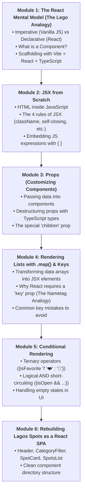
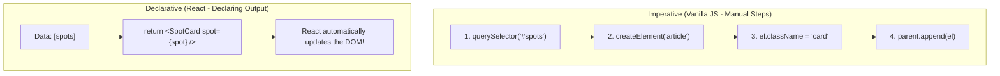
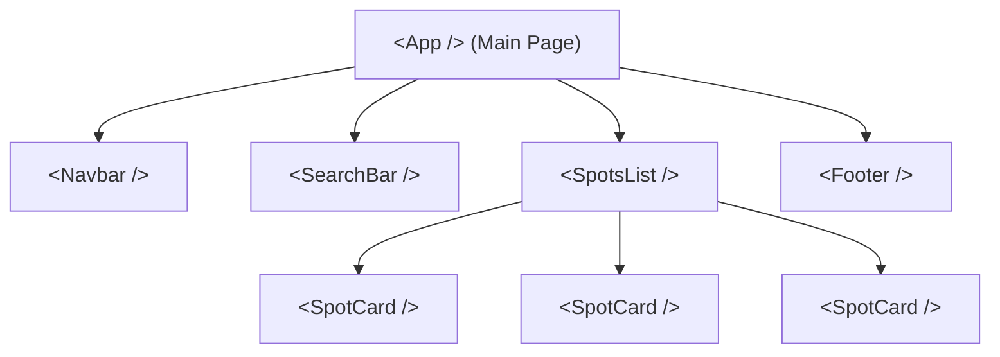
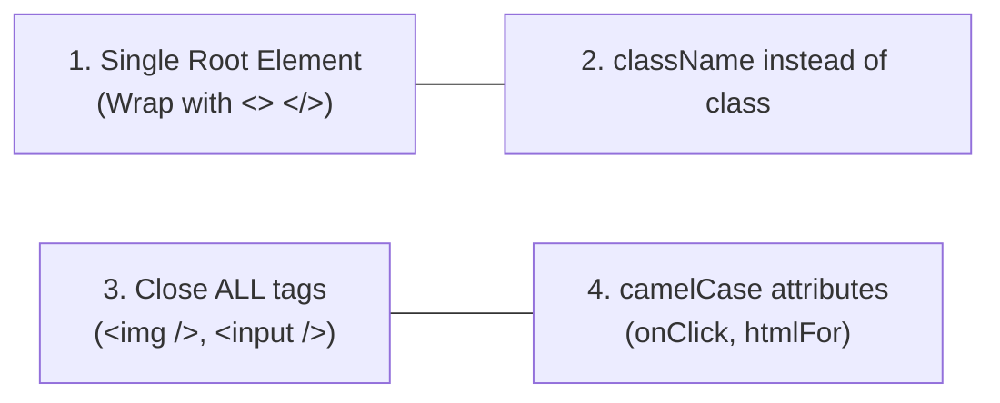
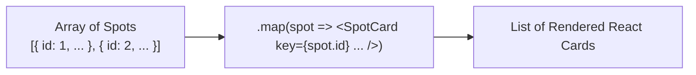

# Week 11: React Fundamentals

Welcome to Week 11! Up until now, you built **Lagos Spots** using vanilla JavaScript and TypeScript: selecting elements with `document.querySelector`, creating elements with `document.createElement`, and manually updating `textContent` or `innerHTML`.

This approach worked fine for small experiments, but as apps grow, manual DOM manipulation becomes painful:
- If a spot is added, you have to remember to update the list, update the category counts, and update the search results.
- If data changes in one place, the screen easily falls out of sync.
- Managing 500 lines of manual DOM updates feels like building a house with individual grains of sand!

This week, you transition to **React** — the world's most popular UI library used by Meta, Netflix, Uber, and Airbnb. You will learn how to build websites using reusable **Components**, write **JSX**, pass data with **Props**, and render dynamic lists.

---

## Pedagogical Roadmap



---

## Module 1: The React Mental Model (The Lego Analogy)

### 1. Imperative vs. Declarative Programming

> [!NOTE]
> **The Mental Model:**
> - **Imperative (Vanilla JavaScript):** You act like a micromanager. You give the browser step-by-step instructions: *"Find the section with ID spots-list, create an article tag, add a class, set its text, append it to the section."*
> - **Declarative (React):** You act like an architect. You simply describe what the UI should look like for a given set of data ($UI = f(data)$). When the data changes, React automatically handles all the tedious DOM updates behind the scenes!



---

### 2. What is a Component? (The Lego Brick)

A **Component** is a reusable, self-contained piece of UI. Think of components as **custom Lego bricks**:
- You build a `<Header />` brick.
- You build a `<SpotCard />` brick.
- You build a `<Footer />` brick.
- You snap them all together inside an `<App />` component!



In React, a component is just a **regular JavaScript function** that:
1. Starts with a **Capital Letter** (e.g., `SpotCard`, not `spotCard`).
2. Returns **JSX** (HTML-like markup).

```tsx
// Your very first React Component!
function WelcomeBanner() {
  return (
    <div className="banner">
      <h1>Welcome to Lagos Spots</h1>
      <p>Discover the best food, art, and music across Lagos.</p>
    </div>
  );
}
```

---

### 3. Scaffolding Lagos Spots with Vite + React + TypeScript

Open your terminal and run:

```bash
# 1. Create a new React + TypeScript project with Vite
npm create vite@latest lagos-spots-react -- --template react-ts

# 2. Enter project folder and install dependencies
cd lagos-spots-react
npm install

# 3. Start the local development server
npm run dev
```

Open the printed URL (usually `http://localhost:5173`) in your browser to see your live React app!

---

## Module 2: JSX from Scratch

**JSX** stands for JavaScript XML. It allows you to write HTML tags directly inside your JavaScript code. 

Behind the scenes, Vite compiles your JSX into standard JavaScript objects called **React Elements**.

### The 4 Crucial Rules of JSX



#### Rule 1: Every Component Must Return a Single Root Element
If you have multiple tags, wrap them inside a **Fragment** (`<> ... </>`):
```tsx
// 🔴 ERROR: Adjacent JSX elements must be wrapped:
// return ( <h1>Title</h1> <p>Text</p> );

// 🟢 CORRECT (Using a React Fragment):
return (
  <>
    <h1>Title</h1>
    <p>Text</p>
  </>
);
```

#### Rule 2: Use `className` Instead of `class`
Because `class` is a reserved keyword in JavaScript, React uses `className`:
```tsx
// 🔴 Wrong: <div class="card">
// 🟢 Correct:
<div className="bg-white rounded-lg p-4 shadow">
```

#### Rule 3: All Tags Must Self-Close
In HTML, `` or `<input>` didn't require closing tags. In JSX, they **must** close with `/>`:
```tsx

<input type="text" placeholder="Search..." />
```

#### Rule 4: Embedding JavaScript Expressions with `{}`
Any valid JavaScript expression (variables, calculations, function calls) can be injected into JSX by wrapping it in curly braces `{}`:

```tsx
function SpotOverview() {
  const spotName = "Terra Kulture";
  const entryFee = 0;
  const isWeekend = true;

  return (
    <div>
      {/* 1. Embedding a string variable */}
      <h2>{spotName}</h2>

      {/* 2. Performing a calculation */}
      <p>Group Ticket (4 people): ₦{entryFee * 4}</p>

      {/* 3. Evaluating a ternary condition */}
      <p>Status: {isWeekend ? "Crowded" : "Quiet"}</p>
    </div>
  );
}
```

---

## Module 3: Props (Customizing Components)

### 1. What are Props? (The Custom Order Analogy)

> [!NOTE]
> **The Mental Model:** When you order jollof rice at a restaurant, you customize it: *"Give me 1 plate, extra fried plantain, no spicy pepper."*
> **Props** (short for properties) are the customized inputs you pass into a component.

Just like HTML attributes (`src`, `href`), you pass props to custom components:

```tsx
<SpotCard name="Terra Kulture" area="Victoria Island" fee={0} />
<SpotCard name="Bogobiri" area="Ikoyi" fee={2500} />
```

---

### 2. Typing and Receiving Props with TypeScript

In TypeScript, we always define an `interface` for our props, and destructure them directly in the function arguments:

```tsx
// src/components/SpotCard.tsx

// 1. Define the blueprint for this component's props:
interface SpotCardProps {
  name: string;
  area: string;
  category: string;
  fee: number;
  isFavorite?: boolean; // Optional prop
}

// 2. Destructure props with type annotation:
export function SpotCard({ name, area, category, fee, isFavorite = false }: SpotCardProps) {
  return (
    <article className="border rounded-lg p-4 bg-white shadow-sm mb-3">
      <div className="flex justify-between items-start">
        <h3 className="text-lg font-bold text-slate-800">{name}</h3>
        <span className="text-xs bg-orange-100 text-orange-700 font-semibold px-2 py-1 rounded">
          {category}
        </span>
      </div>

      <p className="text-xs text-slate-500 mt-1">📍 {area}</p>
      
      <p className="text-sm font-semibold text-slate-700 mt-3">
        {fee === 0 ? "Free Entry" : `₦${fee.toLocaleString()}`}
      </p>

      <button className="mt-3 text-sm px-3 py-1 rounded border">
        {isFavorite ? "❤️ Favorited" : "🤍 Save"}
      </button>
    </article>
  );
}
```

---

### 3. The Special `children` Prop

What if you want to pass nested text or other HTML elements inside a component, like `<Badge>Art & Culture</Badge>`?

React automatically provides a special prop named **`children`**:

```tsx
// src/components/Badge.tsx
import React from "react";

interface BadgeProps {
  color?: string;
  children: React.ReactNode; // Accepts text, JSX, or other components!
}

export function Badge({ color = "bg-orange-100 text-orange-800", children }: BadgeProps) {
  return (
    <span className={`text-xs px-2.5 py-1 rounded-full font-medium ${color}`}>
      {children}
    </span>
  );
}

// Usage:
// <Badge>Food</Badge>
// <Badge color="bg-blue-100 text-blue-800">Study Spot</Badge>
```

---

## Module 4: Rendering Lists with `.map()` & The `key` Prop

In Week 7, you learned `.map()`. In React, `.map()` is the primary way we transform an array of data into an array of UI cards!



```tsx
// src/components/SpotsList.tsx
import { SpotCard } from "./SpotCard";

const initialSpots = [
  { id: 1, name: "Terra Kulture", area: "Victoria Island", category: "Food", fee: 0 },
  { id: 2, name: "Nike Art Gallery", area: "Lekki", category: "Art", fee: 0 },
  { id: 3, name: "Bogobiri House", area: "Ikoyi", category: "Music", fee: 2500 }
];

export function SpotsList() {
  return (
    <section className="space-y-4">
      {initialSpots.map((spot) => (
        <SpotCard
          key={spot.id} // ⚠️ MANDATORY key prop!
          name={spot.name}
          area={spot.area}
          category={spot.category}
          fee={spot.fee}
        />
      ))}
    </section>
  );
}
```

### Why is the `key` Prop Mandatory? (The Nametag Analogy)

> [!CAUTION]
> **The Mental Model:** Imagine 30 students in a classroom. If a student leaves and another enters, the teacher doesn't kick everyone out and start over. The teacher looks at their **ID badge** (`key`) to know exactly who arrived or who left.
> 
> Without a unique `key` (like `spot.id`), React cannot tell which item changed, causing subtle bugs and poor rendering performance. **Never use array index (`i`) as key if items can be sorted or deleted!**

---

## Module 5: Conditional Rendering

Web apps constantly show or hide elements based on conditions:

### 1. Ternary Operator (`condition ? <TrueJSX /> : <FalseJSX />`)
Best for displaying one of two choices:
```tsx
function FavoriteButton({ isSaved }: { isSaved: boolean }) {
  return (
    <button className="text-sm border px-3 py-1 rounded">
      {isSaved ? "❤️ Saved to Favorites" : "🤍 Add to Favorites"}
    </button>
  );
}
```

### 2. Logical AND (`condition && <JSX />`)
Best when you want to render something **only if the condition is true**, and nothing otherwise:
```tsx
function SpotCard({ name, isFree }: { name: string; isFree: boolean }) {
  return (
    <div className="card">
      <h3>{name}</h3>
      {isFree && (
        <span className="bg-green-100 text-green-700 text-xs px-2 py-0.5 rounded">
          FREE ADMISSION
        </span>
      )}
    </div>
  );
}
```

---

## Module 6: Rebuilding Lagos Spots as a React SPA

Here is the clean component architecture for our React application:

```
src/
├── types.ts              # Data interfaces (Spot, Category)
├── components/
│   ├── Header.tsx        # Logo, navigation & site title
│   ├── Badge.tsx         # Reusable category chip
│   ├── SpotCard.tsx      # Single spot listing card
│   └── SpotsList.tsx     # Grid mapping over spots
└── App.tsx               # Root component assembling the page
```

```tsx
// src/App.tsx
import { Header } from "./components/Header";
import { SpotsList } from "./components/SpotsList";

export function App() {
  return (
    <div className="min-h-screen bg-slate-50 text-slate-900">
      <Header />
      <main className="max-w-4xl mx-auto px-4 py-8">
        <h2 className="text-2xl font-bold mb-6">Popular Places in Lagos</h2>
        <SpotsList />
      </main>
    </div>
  );
}

export default App;
```

---

## Module 7: Rookie Traps & Debugging Guide

| Error Message | Root Cause | How to Fix It |
| :--- | :--- | :--- |
| `Adjacent JSX elements must be wrapped in an enclosing tag` | Returning two sibling tags without a parent. | Wrap them in a Fragment `<> ... </>` or a `<div>`. |
| `Each child in a list should have a unique 'key' prop` | Forgot to add `key={item.id}` inside your `.map()` call. | Add a unique identifier: `<SpotCard key={spot.id} ... />`. |
| `Objects are not valid as a React child` | You tried to render an entire object directly: `{spot}` instead of `{spot.name}`. | Pick a string or number property from the object: `{spot.name}`. |
| Component not displaying on screen | Function name starts with lowercase (e.g., `function spotCard`). | Always start component names with a Capital letter: `function SpotCard`. |

---

## 🎯 Week 11 Hands-on Classroom Exercises

### Level 1: Your First Components
1. In your new React project, create a `<Navbar />` component that displays the Lagos Spots logo and two navigation links ("Explore" and "Submit").
2. Create a `<Footer />` component with copyright and student credits.
3. Import both into `App.tsx` and verify they render on screen.

### Level 2: Reusable Badge Component
1. Create a `<Badge />` component that accepts a `text` prop and an optional `color` prop.
2. Render badges for `"Food"`, `"Art"`, and `"Nightlife"` inside a category preview row.

### Level 3: Porting Lagos Spots Cards to React
1. Create a `Spot` interface in `src/types.ts`.
2. Create a `<SpotCard />` component that receives a `spot` object via props and renders its name, area, fee, and category.
3. Create an array of 5 Lagos spots in `App.tsx` and render them using `.map()`.
4. Add a "Free Entry" tag that renders conditionally only when `spot.fee === 0`.

---

## 📚 Curated Deep-Dive References

* [The Valley of Code: React Tutorial](https://thevalleyofcode.com/react/) — Flavio Copes' gentle, beginner-focused introduction to React and JSX.
* [React Official Documentation: Describing the UI](https://react.dev/learn/describing-the-ui) — The outstanding official React docs on components and JSX.
* [React Official Documentation: Passing Props to a Component](https://react.dev/learn/passing-props-to-a-component) — How props make components flexible.
* [React Official Documentation: Rendering Lists](https://react.dev/learn/rendering-lists) — Deep dive into `.map()` and the importance of `key`.
* [MDN Web Docs: Getting Started with React](https://developer.mozilla.org/en-US/docs/Learn/Tools_and_testing/Client-side_JavaScript_frameworks/React_getting_started) — Mozilla guide to modern React workflows.
