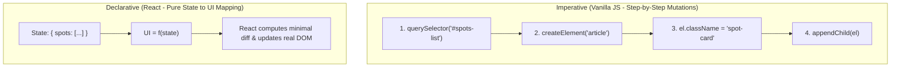
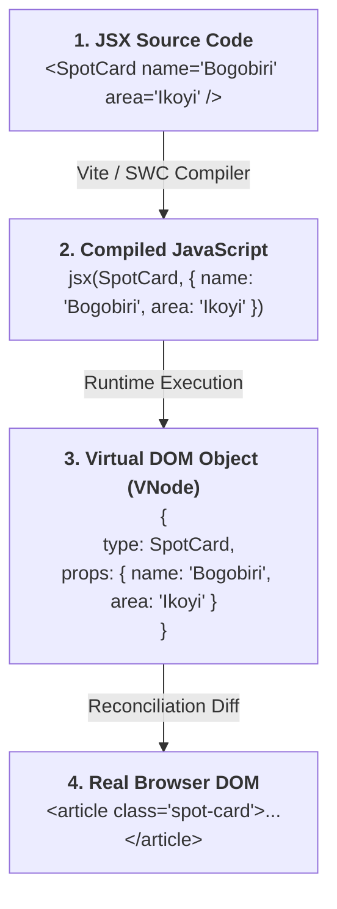
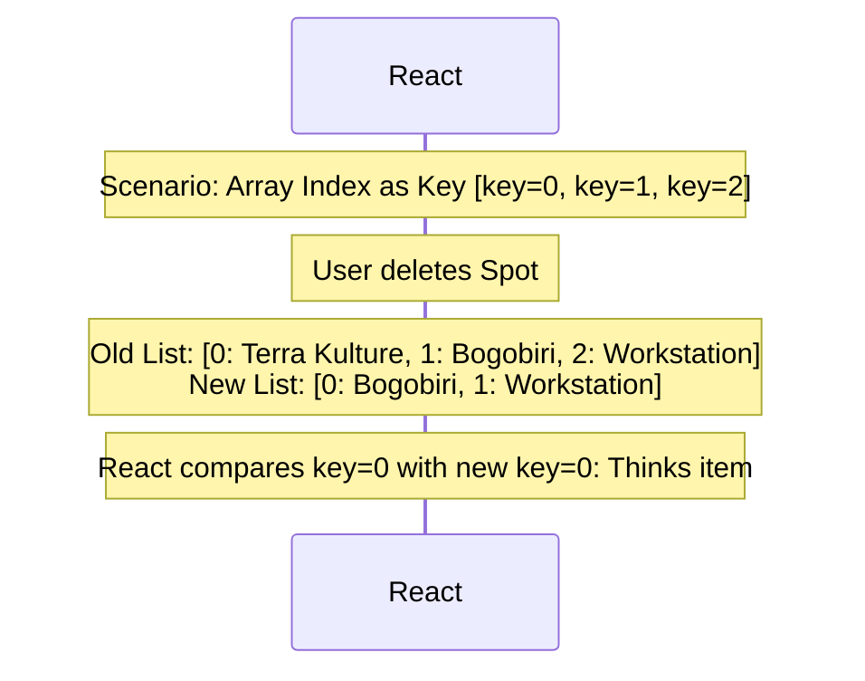
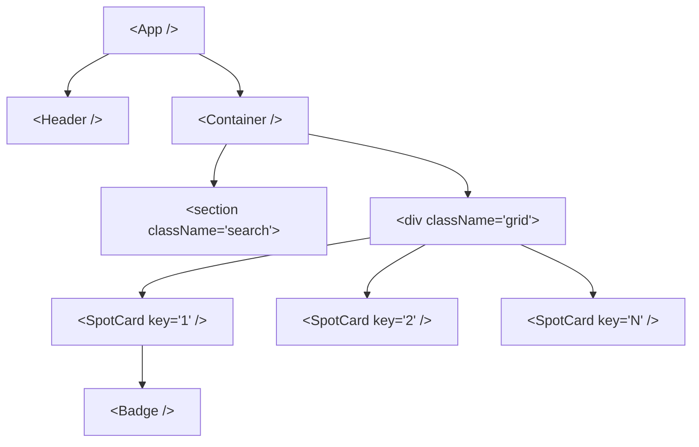

# Week 11: React Fundamentals

Through Week 10, you built Lagos Spots imperatively: manually querying DOM elements, constructing nodes, attaching event listeners, and tracking state in disparate variables. This week, we transition to **React** — a declarative, component-based UI library. You will master the **Declarative UI paradigm**, the **Virtual DOM & Reconciliation diffing algorithm**, **JSX/TSX compilation mechanics**, **Unidirectional Data Flow**, and **Type-Safe Component Props**.

---

## Module 1: The Declarative Paradigm & The Virtual DOM

### 1. The Core Terminology of React

| Term | What It Actually Means | Technical Context |
| :--- | :--- | :--- |
| **Declarative UI** | Describing *what* the user interface should look like for a given state, rather than step-by-step instructions on *how* to mutate the DOM ($UI = f(state)$). | Eliminates manual DOM manipulation (`appendChild`, `innerHTML`, `querySelector`). |
| **Component** | A pure JavaScript function that accepts input (`props`) and returns a tree of React Elements (JSX). | Reusable, isolated building blocks of a user interface. |
| **React Element** | A lightweight, immutable plain JavaScript object describing a DOM node or component (e.g., `{ type: 'h1', props: { children: 'Lagos Spots' } }`). | Created when JSX compiles; does **not** create a real browser DOM node immediately. |
| **Virtual DOM (VDOM)** | An in-memory representation of the real DOM tree kept in synchronization with the actual browser DOM by ReactDOM. | Allows React to batch calculations and compute minimal DOM mutations. |
| **Reconciliation** | The algorithmic process where React compares the new Virtual DOM tree against the previous Virtual DOM tree (**Diffing**) and commits only the minimal necessary changes to the real DOM. | Achieves high performance by avoiding full-tree real DOM reflows. |
| **Unidirectional Data Flow** | Data flows strictly in one direction: downwards from parent components to child components via `props`. | Makes application state predictable and easy to debug. |

---

### 2. Imperative vs. Declarative: The Mental Shift



---

### 3. Under the Hood: JSX Compilation & The Virtual DOM Diff

JSX is **not HTML**. It is a syntax extension for JavaScript that compiles at build time via the Babel/SWC compiler into standard `jsx-runtime` function calls:



#### The Reconciliation Diffing Algorithm ($O(n)$ Heuristic):
When state or props change:
1. **Different Element Types:** If root elements have different types (e.g., changing from `<div>` to `<section>`), React tears down the old tree, unmounts all children, and builds the new tree from scratch.
2. **Same Element Types:** When comparing two React DOM elements of the same type, React looks at the attributes of both, keeps the underlying DOM node, and only updates the changed attributes (`className`, `style`).
3. **Recursing On Children (`key` Prop):** React iterates over both lists of children simultaneously. Keys tell React which items were added, removed, or reordered without re-rendering the entire list.

---

## Module 2: Component Architecture & Typed Props

### 1. Scaffolding Lagos Spots in React + Vite + TypeScript

```bash
# 1. Scaffold React + TypeScript project
npm create vite@latest lagos-spots-react -- --template react-ts

# 2. Install dependencies & Tailwind CSS v4
cd lagos-spots-react
npm install
npm install tailwindcss @tailwindcss/vite
```

```ts
// vite.config.ts
import { defineConfig } from 'vite';
import react from '@vitejs/plugin-react-swc';
import tailwindcss from '@tailwindcss/vite';

export default defineConfig({
  plugins: [react(), tailwindcss()],
});
```

---

### 2. Building Type-Safe Functional Components

Props are passed into components like HTML attributes, but can receive any JavaScript data type (strings, numbers, objects, arrays, callback functions):

```tsx
// src/components/Badge.tsx
import React from 'react';

export interface BadgeProps {
  category: 'food' | 'study' | 'nightlife' | 'events';
  children: React.ReactNode; // Allows passing nested text or elements
}

const categoryStyles: Record<BadgeProps['category'], string> = {
  food: 'bg-amber-100 text-amber-800 dark:bg-amber-950 dark:text-amber-300',
  study: 'bg-blue-100 text-blue-800 dark:bg-blue-950 dark:text-blue-300',
  nightlife: 'bg-purple-100 text-purple-800 dark:bg-purple-950 dark:text-purple-300',
  events: 'bg-emerald-100 text-emerald-800 dark:bg-emerald-950 dark:text-emerald-300',
};

export const Badge: React.FC<BadgeProps> = ({ category, children }) => {
  return (
    <span className={`text-xs font-semibold px-2.5 py-1 rounded-full capitalize ${categoryStyles[category]}`}>
      {children}
    </span>
  );
};
```

```tsx
// src/components/SpotCard.tsx
import React from 'react';
import { Spot } from '../types';
import { Badge } from './Badge';

export interface SpotCardProps {
  spot: Spot;
  isFavorite?: boolean;
  onToggleFavorite?: (spotId: string) => void;
}

export const SpotCard: React.FC<SpotCardProps> = ({ spot, isFavorite = false, onToggleFavorite }) => {
  return (
    <article className="flex flex-col bg-white dark:bg-slate-800 border border-slate-200 dark:border-slate-700 rounded-xl p-5 shadow-sm hover:shadow-md transition-all">
      <div className="flex justify-between items-start gap-2 mb-3">
        <h3 className="text-lg font-bold text-slate-900 dark:text-white">{spot.name}</h3>
        <Badge category={spot.category}>{spot.category}</Badge>
      </div>

      <p className="text-xs font-medium text-slate-500 dark:text-slate-400 mb-2">📍 {spot.area}</p>
      <p className="text-sm text-slate-600 dark:text-slate-300 flex-grow mb-4">{spot.description}</p>

      <div className="flex items-center justify-between gap-3 pt-3 border-t border-slate-100 dark:border-slate-700">
        <button
          type="button"
          onClick={() => onToggleFavorite?.(spot.id)}
          className={`px-3 py-1.5 rounded-lg text-sm font-medium border transition-colors ${
            isFavorite
              ? 'bg-rose-50 border-rose-200 text-rose-600 dark:bg-rose-950/40 dark:border-rose-800'
              : 'border-slate-200 text-slate-600 hover:bg-slate-50 dark:border-slate-600 dark:text-slate-300'
          }`}
          aria-label={isFavorite ? 'Remove from favorites' : 'Add to favorites'}
        >
          {isFavorite ? '❤️ Favorited' : '🤍 Save'}
        </button>

        <a
          href={`https://www.google.com/maps/search/?api=1&query=${encodeURIComponent(`${spot.name} ${spot.area} Lagos`)}`}
          target="_blank"
          rel="noopener noreferrer"
          className="text-sm font-medium text-orange-600 hover:text-orange-700 dark:text-orange-400"
        >
          Directions &rarr;
        </a>
      </div>
    </article>
  );
};
```

---

## Module 3: Rendering Collections & The Critical `key` Prop

### 1. Under the Hood: Why Array Indexes Fail as Keys

When rendering lists with `.map()`, React requires a **`key` prop** on the outermost element returned by the callback:

```tsx
// 🟢 CORRECT: Using a stable, unique ID
{spots.map((spot) => (
  <SpotCard key={spot.id} spot={spot} />
))}

// 🔴 DANGEROUS ANTI-PATTERN: Using array index as key
{spots.map((spot, index) => (
  <SpotCard key={index} spot={spot} />
))}
```



#### The Rules of React Keys:
1. **Keys must be unique among siblings:** Keys do not need to be globally unique across the whole app, only unique within the mapping array.
2. **Keys must remain stable across renders:** Do not generate keys on the fly like `key={Math.random()}` or `key={crypto.randomUUID()}` inside JSX. Doing so forces React to destroy and recreate the real DOM node on every single render.

---

### 2. Component Composition with `props.children`

```tsx
// src/components/Container.tsx
import React from 'react';

interface ContainerProps {
  children: React.ReactNode;
}

export const Container: React.FC<ContainerProps> = ({ children }) => {
  return <div className="max-w-7xl mx-auto px-4 sm:px-6 lg:px-8">{children}</div>;
};
```

---

## Module 4: Assembling the Lagos Spots Application Tree



```tsx
// src/App.tsx
import React from 'react';
import { Spot } from './types';
import { Header } from './components/Header';
import { Container } from './components/Container';
import { SpotCard } from './components/SpotCard';

const INITIAL_SPOTS: Spot[] = [
  {
    id: 'terra-kulture',
    name: 'Terra Kulture',
    category: 'food',
    area: 'Victoria Island',
    description: 'Cultural hub featuring traditional Nigerian cuisine, art exhibitions, and theatre.',
    imageUrl: '/assets/terra-kulture.jpg',
  },
  {
    id: 'bogobiri',
    name: 'Bogobiri House',
    category: 'events',
    area: 'Ikoyi',
    description: 'Boutique hotel, African art gallery, open-mic poetry, and live Afrobeat music hub.',
    imageUrl: '/assets/bogobiri.jpg',
  },
  {
    id: 'workstation',
    name: 'Workstation Bar Beach',
    category: 'study',
    area: 'Victoria Island',
    description: 'High-speed internet co-working hub with uninterrupted power and coffee bar.',
    imageUrl: '/assets/workstation.jpg',
  },
];

export const App: React.FC = () => {
  return (
    <div className="min-h-screen bg-slate-50 dark:bg-slate-900 text-slate-900 dark:text-white">
      <Header />
      
      <main className="py-8">
        <Container>
          <div className="mb-8">
            <h2 className="text-3xl font-extrabold tracking-tight">Explore Lagos Spots</h2>
            <p className="text-slate-500 dark:text-slate-400 mt-1">
              Curated hangouts, study spaces, and cultural venues across Lagos.
            </p>
          </div>

          <div className="grid grid-cols-1 md:grid-cols-2 lg:grid-cols-3 gap-6">
            {INITIAL_SPOTS.map((spot) => (
              <SpotCard key={spot.id} spot={spot} />
            ))}
          </div>
        </Container>
      </main>
    </div>
  );
};

export default App;
```

---

### Common Pitfalls & How to Avoid Them

| Pitfall | Consequence | Fix |
| :--- | :--- | :--- |
| **Mutating `props` in child components** | Violates unidirectional data flow and creates stale render loops. | Treat all props as strictly immutable read-only values. |
| **Returning multiple un-nested elements** | Fails JSX compilation because JavaScript functions can only return one value. | Wrap sibling elements in `<React.Fragment>` or `<> ... </>`. |
| **Instantiating keys on inner children** | React cannot track the root mapped component. | Always place the `key` prop on the topmost JSX element returned inside `.map()`. |

---

### Week 11: Comprehensive Assignment

**Objective:** Rebuild the static frontend of Lagos Spots as a modular, type-safe React + TypeScript component tree powered by Vite and Tailwind CSS.

**Requirements:**
1. **Project Setup:**
   - Scaffolded with Vite (`react-ts` template) with Tailwind CSS v4 configured.
2. **Component Decomposition:**
   - `Header`: Site branding, navigation links, and theme toggle placeholder.
   - `Container`: Reusable layout constraint wrapper utilizing `props.children`.
   - `Badge`: Dynamic category badge with typed color variations.
   - `SpotCard`: Typed spot card component rendering name, badge, area, description, and external Google Maps direction links.
3. **Collection Rendering:**
   - Curated dataset mapped into `<SpotCard />` components using stable, unique `spot.id` strings as keys (no array indexes).
4. **Strict Type Safety:**
   - All component props defined via explicit TypeScript interfaces (`SpotCardProps`, `BadgeProps`).
   - Zero ESLint or TypeScript compile errors.
5. **Git Workflow:**
   - Developed on branch `feature/react-fundamentals`, merged via Pull Request, and pulled locally.
