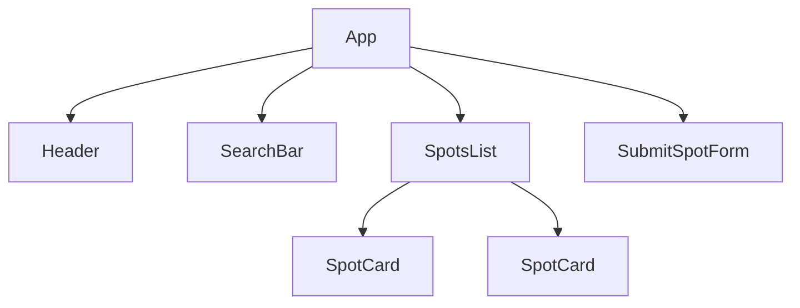

# Week 11: React Fundamentals

Everything you've built so far works, but you've felt the strain: every time data changes, you're manually finding elements and rewriting their content by hand. This week you meet **React** — a library built entirely around one idea: describe *what* the UI should look like for a given piece of data, and let the library figure out *how* to update the real page when that data changes. You'll rebuild Lagos Spots from the ground up, starting with its component structure.

---

## Module 1: What React Is, and Getting Set Up

### 1. The Core Idea: Declarative UI

* **Lecture & Concepts:**
    * Everything you wrote through Week 10 was **imperative**: "find this element, then create that element, then append it here." React is **declarative**: you write a function that says "given this data, the UI looks like *this*," and React handles the actual DOM updates behind the scenes.
    * A **component** is just a function that returns a description of UI. Small components combine into bigger ones, the same way HTML tags nest — a `SpotCard` might live inside a `SpotsList`, which lives inside the whole `App`.

* **Class Exercise: Spot the Components**
    1. Look at your current vanilla Lagos Spots page.
    2. On paper, circle 4–5 distinct, reusable pieces: the header, the search bar, one spot card, the submit form. These become your first real React components.

---

### 2. Scaffolding with Vite

* **Lecture & Concepts:**
    * Vite's official React + TypeScript template gives you a working React project in seconds, with the exact same fast dev server you already know from Week 5.

* **In-Depth Example (Terminal):**
    ```bash
    npm create vite@latest lagos-spots-react -- --template react-ts
    cd lagos-spots-react
    npm install
    npm install tailwindcss @tailwindcss/vite
    npm run dev
    ```
    * Re-add Tailwind exactly as you did in Week 5 (`vite.config.ts` plugin + the `@import "tailwindcss";` line) — the utility classes you already know carry over directly.

* **Class Exercise: Scaffold the Real Project**
    1. Run the commands above, wire Tailwind back in, and confirm `npm run dev` shows the default Vite+React starter page.
    2. Clear out the boilerplate content in `src/App.tsx`, leaving just a bare `<h1>Lagos Spots</h1>`.

---

### 3. JSX

* **Lecture & Concepts:**
    * **JSX** looks like HTML but is actually JavaScript — it compiles down to plain function calls that build UI descriptions. A few real differences from HTML you'll hit immediately: `class` is written `className` (since `class` is a reserved word in JS), every element must close (``, not ``), and a component can only return **one** root element (or a `<>...</>` Fragment wrapping several).
    * Curly braces `{}` embed real JavaScript expressions directly inside markup: `{spot.name}`, `{2 + 2}`, `{isFavorited ? '♥' : '♡'}`.

* **In-Depth Example:**
    ```tsx
    function App() {
      const appName = 'Lagos Spots';

      return (
        <div className="p-6">
          <h1 className="text-2xl font-bold">{appName}</h1>
        </div>
      );
    }

    export default App;
    ```

* **Class Exercise: Render Real Content**
    1. In `App.tsx`, declare a `const appName` and render it inside an `<h1>` using `{}`.
    2. Add a short tagline paragraph below it, describing Lagos Spots in one sentence.

---

## Module 2: Components & Typed Props

### 1. Functional Components

* **Lecture & Concepts:**
    * A component is a function whose name starts with a capital letter (React uses this to tell components apart from regular HTML tags) and that returns JSX. Components live in their own `.tsx` files, one per component, exported and imported like any other module.

* **In-Depth Example:**
    ```tsx
    // src/components/Header.tsx
    function Header() {
      return (
        <header className="flex justify-between items-center p-4">
          <h1 className="text-xl font-bold">Lagos Spots</h1>
        </header>
      );
    }

    export default Header;
    ```

* **Class Exercise: Build `Header`**
    1. Create `src/components/Header.tsx` as shown.
    2. Import it into `App.tsx` and render `<Header />` in place of your hardcoded `<h1>`.

---

### 2. Props & `props.children`

* **Lecture & Concepts:**
    * **Props** pass data from a parent component into a child — the exact same idea as HTML attributes, but carrying any JavaScript value, not just strings. Props are **read-only**: a component must never modify its own props.
    * TypeScript makes a component's props explicit and checked: define an `interface` for what a component expects, and destructure props straight out of the function's parameter.
    * `props.children` is a special prop containing whatever JSX was nested *inside* a component's opening/closing tags — the standard way to build "wrapper" components.



* **In-Depth Example (A Real, Typed `SpotCard`):**
    ```tsx
    // src/components/SpotCard.tsx
    interface SpotCardProps {
      name: string;
      category: string;
      area: string;
      description: string;
    }

    function SpotCard({ name, category, area, description }: SpotCardProps) {
      return (
        <article className="bg-white p-4 rounded-lg border border-gray-200">
          <div className="flex justify-between items-start gap-2">
            <h3 className="text-lg font-semibold">{name}</h3>
            <span className="text-xs bg-orange-100 text-orange-700 px-2 py-1 rounded-full">
              {category}
            </span>
          </div>
          <p className="text-sm text-gray-500">{area}</p>
          <p className="text-sm text-gray-600 mt-2">{description}</p>
        </article>
      );
    }

    export default SpotCard;
    ```

* **Class Exercise: Build a Typed, Reusable Card**
    1. Create `SpotCard.tsx` exactly as shown, with a real, typed `SpotCardProps` interface.
    2. Render it three times in `App.tsx` with three different sets of hardcoded props, and confirm each renders independently.

---

### 3. `props.children` in Practice

* **In-Depth Example:**
    ```tsx
    // src/components/Badge.tsx
    interface BadgeProps {
      children: React.ReactNode;
    }

    function Badge({ children }: BadgeProps) {
      return (
        <span className="text-xs bg-orange-100 text-orange-700 px-2 py-1 rounded-full">
          {children}
        </span>
      );
    }

    export default Badge;
    ```

* **Class Exercise: Extract `Badge`**
    1. Build `Badge` as shown, and use it inside `SpotCard` in place of the raw `<span>`, passing `category` as its children: `<Badge>{category}</Badge>`.

---

## Module 3: Rendering Real Lists

### 1. `.map()` and the `key` Prop

* **Lecture & Concepts:**
    * Rendering a list in React is the same `.map()` you already know from Week 7 — except now it maps data straight into JSX elements instead of HTML strings.
    * Every item in a list **must** have a `key` prop — a stable, unique identifier React uses to track which item is which across re-renders. Using the array index as a key works today but breaks the moment items can be reordered, filtered, or removed — use a spot's real `id`.

* **In-Depth Example:**
    ```tsx
    // src/components/SpotsList.tsx
    import SpotCard from './SpotCard';
    import type { Spot } from '../types';

    interface SpotsListProps {
      spots: Spot[];
    }

    function SpotsList({ spots }: SpotsListProps) {
      return (
        <div className="grid grid-cols-1 md:grid-cols-3 gap-4">
          {spots.map((spot) => (
            <SpotCard key={spot.id} {...spot} />
          ))}
        </div>
      );
    }

    export default SpotsList;
    ```

* **Class Exercise: Bring Back Real Data**
    1. Copy your `Spot` interface and curated `spots` array from the vanilla project (Week 10) into `src/types.ts` and `src/data.ts` respectively.
    2. Build `SpotsList.tsx` as shown, and render it from `App.tsx` with your real spots array — the spread (`{...spot}`) passes every field as a prop in one line.

---

### Week 11: Comprehensive Assignment

**Objective:** The visual shell of Lagos Spots, rebuilt as typed, composed React components rendering your real curated data.

**Requirements:**

1. **Scaffold:** A working Vite `react-ts` project with Tailwind wired in.
2. **Components:** `Header`, `Badge`, `SpotCard`, and `SpotsList`, each in its own file, each with a real, explicit TypeScript props interface (where applicable).
3. **Composition:** `SpotCard` uses `Badge` via `props.children`; `SpotsList` renders `SpotCard`s via `.map()`.
4. **Keys:** Every list item uses a stable `key` (the spot's real `id`), never the array index.
5. **Real Data:** The rendered spots come from your actual `Spot[]` array carried over from Part II, not new hardcoded placeholders.
6. **Git:** A fresh `lagos-spots-react` repository, committed and pushed via the branch → PR → merge workflow.

**Bonus Challenge:** Build a `Footer` component accepting `children`, and use it to display a dynamic spot count: `<Footer>{spots.length} spots and counting</Footer>`.
