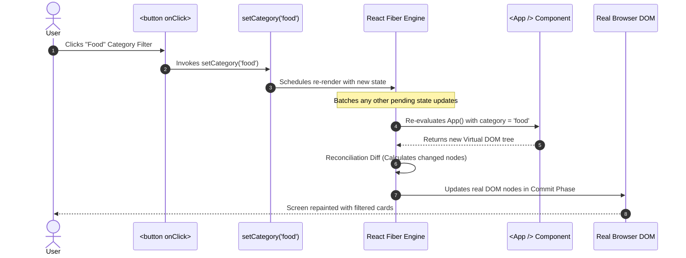
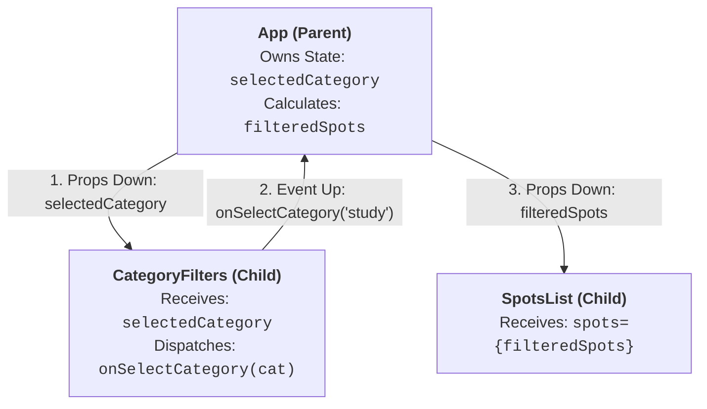
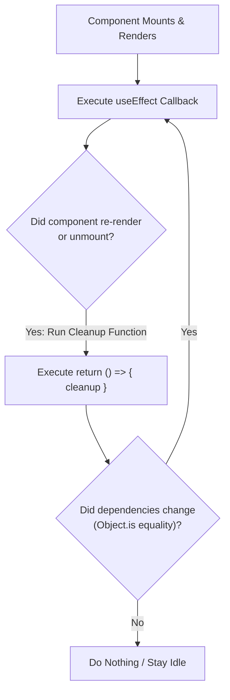

# Week 12: State, Hooks & Forms

In Week 11, you built static components receiving hardcoded props. This week, you give your application dynamic memory and interactivity using React's foundational hooks: **`useState`**, **`useEffect`**, and **Custom Hooks**. You will master **State Lifting ("Props Down, Events Up")**, understand how **Automatic Batching** and **Closures** behave under the hood, eliminate **Asynchronous Race Conditions**, and architect robust **Type-Safe Controlled Forms**.

---

## Module 1: `useState` & The React Render Cycle

### 1. The Core Terminology of React Hooks

| Term | What It Actually Means | Technical Context |
| :--- | :--- | :--- |
| **State** | A component's internal, reactive memory that persists between render cycles. | Mutating state via its setter function schedules a re-render of the component and its children. |
| **Render Phase** | React executes the component function, evaluating JSX expressions to build a new Virtual DOM tree. | Must be a **pure calculation** with zero side effects. |
| **Commit Phase** | React compares the new Virtual DOM with the old one and writes the minimal differences to the real browser DOM. | Handled synchronously by `react-dom`. |
| **Automatic Batching** | React groups multiple state updates triggered within event handlers, promises, or timeouts into a **single re-render pass**. | Prevents UI flickering and optimizes performance. |
| **State Lifting** | Moving state up to the closest common ancestor component when two or more sibling components need to share or synchronize that data. | Maintains the core principle of a Single Source of Truth. |

---

### 2. Under the Hood: How `useState` Schedules Re-Renders



---

### 3. The Functional State Update Pattern (Preventing Stale Closures)

When a new state value depends directly on the previous state, passing a raw value can read a **stale snapshot** from an earlier render:

```tsx
// 🔴 VULNERABLE TO STALE CLOSURES: Multiple synchronous calls will only increment by 1!
const handleAddTwo = () => {
  setCount(count + 1); // Reads current snapshot 'count' (e.g. 0 -> 1)
  setCount(count + 1); // Still reads snapshot 'count' (0 -> 1)
};

// 🟢 SAFE: Functional Updater receives the guaranteed latest state from the queue
const handleAddTwoSafe = () => {
  setCount((prev) => prev + 1); // 0 -> 1
  setCount((prev) => prev + 1); // 1 -> 2
};
```

---

### 4. State Lifting Pattern: "Props Down, Events Up"



```tsx
// src/components/CategoryFilter.tsx
import React from 'react';
import { Category } from '../types';

export interface CategoryFilterProps {
  selected: Category | 'all';
  onSelect: (category: Category | 'all') => void;
  counts: Record<string, number>;
}

const CATEGORIES: Array<Category | 'all'> = ['all', 'food', 'study', 'nightlife', 'events'];

export const CategoryFilter: React.FC<CategoryFilterProps> = ({ selected, onSelect, counts }) => {
  return (
    <div className="flex flex-wrap gap-2 mb-6">
      {CATEGORIES.map((cat) => {
        const isSelected = selected === cat;
        const count = cat === 'all' ? undefined : counts[cat] ?? 0;

        return (
          <button
            key={cat}
            type="button"
            onClick={() => onSelect(cat)}
            className={`px-4 py-2 text-sm font-semibold rounded-full transition-all capitalize ${
              isSelected
                ? 'bg-orange-600 text-white shadow-sm'
                : 'bg-white dark:bg-slate-800 text-slate-700 dark:text-slate-300 border border-slate-200 dark:border-slate-700 hover:bg-slate-100 dark:hover:bg-slate-700'
            }`}
          >
            {cat} {count !== undefined && <span className="opacity-75 text-xs">({count})</span>}
          </button>
        );
      })}
    </div>
  );
};
```

---

## Module 2: `useEffect` & Asynchronous Side Effects

### 1. The 3 Phases of the `useEffect` Dependency Array



| Dependency Syntax | When the Effect Runs | Typical Real-World Use Case |
| :--- | :--- | :--- |
| `useEffect(fn)` *(No array)* | After **every single render** (mount + updates). | Rare; logging or performance measurements. |
| `useEffect(fn, [])` *(Empty array)* | Exactly **once on initial mount**. | Subscribing to window resize, initial data fetch from `localStorage`. |
| `useEffect(fn, [query, page])` | On mount **and whenever `query` or `page` changes**. | Querying an external API based on user search input. |

---

### 2. Custom Hooks: Encapsulating Debounced Search

A **Custom Hook** is a JavaScript function whose name starts with `use` and that can call other React hooks. It allows you to package and reuse stateful logic cleanly:

```tsx
// src/hooks/useDebounce.ts
import { useState, useEffect } from 'react';

export function useDebounce<T>(value: T, delayMs: number): T {
  const [debouncedValue, setDebouncedValue] = useState<T>(value);

  useEffect(() => {
    // Schedule state update after delay
    const timerId = setTimeout(() => {
      setDebouncedValue(value);
    }, delayMs);

    // Cleanup: Clear timer if value changes before delay expires
    return () => {
      clearTimeout(timerId);
    };
  }, [value, delayMs]);

  return debouncedValue;
}
```

---

### 3. Under the Hood: Preventing Race Conditions with Cleanup Flags

```tsx
// src/components/SearchBar.tsx
import React, { useState, useEffect } from 'react';
import { useDebounce } from '../hooks/useDebounce';
import { searchLocations } from '../api';
import { NominatimLocation } from '../types';

export const SearchBar: React.FC = () => {
  const [searchTerm, setSearchTerm] = useState('');
  const [results, setResults] = useState<NominatimLocation[]>([]);
  const [isLoading, setIsLoading] = useState(false);
  const [errorMessage, setErrorMessage] = useState<string | null>(null);

  const debouncedQuery = useDebounce(searchTerm, 350);

  useEffect(() => {
    if (!debouncedQuery.trim()) {
      setResults([]);
      setIsLoading(false);
      return;
    }

    // Race condition prevention flag
    let isCurrent = true;
    setIsLoading(true);
    setErrorMessage(null);

    searchLocations(debouncedQuery)
      .then((data) => {
        if (isCurrent) {
          setResults(data);
        }
      })
      .catch((err) => {
        if (isCurrent) {
          setErrorMessage('Unable to reach Nominatim search. Please try again.');
        }
      })
      .finally(() => {
        if (isCurrent) {
          setIsLoading(false);
        }
      });

    // Cleanup: If user types again, mark previous request as obsolete
    return () => {
      isCurrent = false;
    };
  }, [debouncedQuery]);

  return (
    <div className="relative w-full max-w-xl mb-8">
      <input
        type="text"
        value={searchTerm}
        onChange={(e) => setSearchTerm(e.target.value)}
        placeholder="Search neighborhood or venue in Lagos..."
        className="w-full px-4 py-3 rounded-xl border border-slate-300 dark:border-slate-700 bg-white dark:bg-slate-800 text-slate-900 dark:text-white focus:ring-2 focus:ring-orange-500 focus:outline-none"
      />
      {isLoading && (
        <span className="absolute right-4 top-3.5 text-xs text-orange-600 font-medium">Searching...</span>
      )}
      {errorMessage && <p className="text-xs text-rose-500 mt-2">{errorMessage}</p>}
    </div>
  );
};
```

---

## Module 3: Controlled Forms & State Management

### 1. Controlled Components vs. Uncontrolled Components

- **Controlled Component:** Form element whose value is bound to React state via `value={state}` and updated via `onChange={(e) => setState(e.target.value)}`. React is the **Single Source of Truth**.
- **Uncontrolled Component:** Form element whose state is managed internally by the browser DOM, accessed on-demand via `useRef()`.

---

### 2. Type-Safe Multi-Field Form Architecture

```tsx
// src/components/AddSpotForm.tsx
import React, { useState, ChangeEvent, FormEvent } from 'react';
import { Spot, Category } from '../types';

export interface SpotFormData {
  name: string;
  category: Category;
  area: string;
  description: string;
}

interface AddSpotFormProps {
  onAddSpot: (newSpot: Spot) => void;
}

const INITIAL_STATE: SpotFormData = {
  name: '',
  category: 'food',
  area: '',
  description: '',
};

export const AddSpotForm: React.FC<AddSpotFormProps> = ({ onAddSpot }) => {
  const [formData, setFormData] = useState<SpotFormData>(INITIAL_STATE);
  const [validationError, setValidationError] = useState<string | null>(null);

  const handleChange = (
    e: ChangeEvent<HTMLInputElement | HTMLSelectElement | HTMLTextAreaElement>
  ) => {
    const { name, value } = e.target;
    setFormData((prev) => ({
      ...prev,
      [name]: value,
    }));
  };

  const handleSubmit = (e: FormEvent) => {
    e.preventDefault();

    if (formData.name.trim().length < 3) {
      setValidationError('Spot name must be at least 3 characters long.');
      return;
    }
    if (formData.description.trim().length < 15) {
      setValidationError('Description must be at least 15 characters long.');
      return;
    }

    setValidationError(null);

    const createdSpot: Spot = {
      id: crypto.randomUUID(),
      ...formData,
      imageUrl: '/assets/placeholder-spot.jpg',
    };

    onAddSpot(createdSpot);
    setFormData(INITIAL_STATE); // Reset form
  };

  return (
    <form onSubmit={handleSubmit} className="bg-white dark:bg-slate-800 p-6 rounded-2xl border border-slate-200 dark:border-slate-700 shadow-sm max-w-xl">
      <h3 className="text-xl font-bold mb-4">Add a New Lagos Spot</h3>

      {validationError && (
        <div className="p-3 mb-4 text-sm text-rose-700 bg-rose-50 dark:bg-rose-950/40 rounded-lg border border-rose-200 dark:border-rose-800">
          {validationError}
        </div>
      )}

      <div className="space-y-4">
        <div>
          <label htmlFor="name" className="block text-xs font-semibold uppercase text-slate-500 mb-1">
            Spot Name
          </label>
          <input
            id="name"
            name="name"
            type="text"
            value={formData.name}
            onChange={handleChange}
            placeholder="e.g. Terra Kulture"
            className="w-full px-3 py-2 rounded-lg border border-slate-300 dark:border-slate-600 bg-transparent text-sm focus:ring-2 focus:ring-orange-500 focus:outline-none"
            required
          />
        </div>

        <div className="grid grid-cols-1 sm:grid-cols-2 gap-4">
          <div>
            <label htmlFor="category" className="block text-xs font-semibold uppercase text-slate-500 mb-1">
              Category
            </label>
            <select
              id="category"
              name="category"
              value={formData.category}
              onChange={handleChange}
              className="w-full px-3 py-2 rounded-lg border border-slate-300 dark:border-slate-600 bg-transparent text-sm focus:ring-2 focus:ring-orange-500 focus:outline-none"
            >
              <option value="food">Food & Dining</option>
              <option value="study">Co-working & Study</option>
              <option value="nightlife">Nightlife & Drinks</option>
              <option value="events">Arts & Events</option>
            </select>
          </div>

          <div>
            <label htmlFor="area" className="block text-xs font-semibold uppercase text-slate-500 mb-1">
              Lagos Area
            </label>
            <input
              id="area"
              name="area"
              type="text"
              value={formData.area}
              onChange={handleChange}
              placeholder="e.g. Victoria Island"
              className="w-full px-3 py-2 rounded-lg border border-slate-300 dark:border-slate-600 bg-transparent text-sm focus:ring-2 focus:ring-orange-500 focus:outline-none"
              required
            />
          </div>
        </div>

        <div>
          <label htmlFor="description" className="block text-xs font-semibold uppercase text-slate-500 mb-1">
            Description
          </label>
          <textarea
            id="description"
            name="description"
            rows={3}
            value={formData.description}
            onChange={handleChange}
            placeholder="Describe what makes this spot stand out..."
            className="w-full px-3 py-2 rounded-lg border border-slate-300 dark:border-slate-600 bg-transparent text-sm focus:ring-2 focus:ring-orange-500 focus:outline-none"
            required
          />
        </div>

        <button
          type="submit"
          className="w-full py-2.5 px-4 rounded-xl text-sm font-semibold text-white bg-orange-600 hover:bg-orange-700 transition-colors shadow-sm"
        >
          Add Spot to Directory
        </button>
      </div>
    </form>
  );
};
```

---

### Common Pitfalls & How to Avoid Them

| Pitfall | Root Cause | Fix |
| :--- | :--- | :--- |
| **Infinite render loop** | Calling a state updater inside the component body or inside `useEffect` without a dependency array. | Wrap state updates in event handlers or specify exact dependency arrays. |
| **Stale closure in async hooks** | Forgetting to cancel asynchronous promises when dependencies change before the previous promise settles. | Use a boolean cancellation flag or `AbortController` in the `useEffect` cleanup function. |
| **Direct state mutation** | `spots.push(newSpot)` does not change array reference, so React skips reconciliation. | Return a new array reference: `setSpots((prev) => [newSpot, ...prev])`. |

---

### Week 12: Comprehensive Assignment

**Objective:** Equip Lagos Spots with full interactivity using `useState`, `useEffect`, Custom Hooks, and Controlled Forms.

**Requirements:**
1. **Interactive Category Filter:**
   - Lifted state in `App.tsx` coordinating `CategoryFilter` and `SpotsList`.
   - Category buttons display real-time count badges computed via `.reduce()`.
2. **Debounced Nominatim Live Search Hook:**
   - Custom `useDebounce` hook implemented with timer cleanup.
   - `SearchBar` component querying Nominatim asynchronously with race-condition cleanup flags.
3. **Controlled Form Implementation:**
   - `AddSpotForm` component managing state with single-object updater pattern.
   - Comprehensive validation (name $\ge 3$, description $\ge 15$).
   - Form submission prepends new spot to state, updates directory immediately, and resets form inputs.
4. **Git Workflow:**
   - Developed on branch `feature/state-hooks-forms`, merged via Pull Request, and pulled locally.
