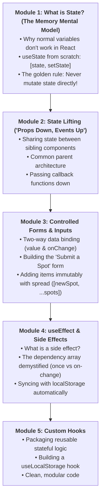
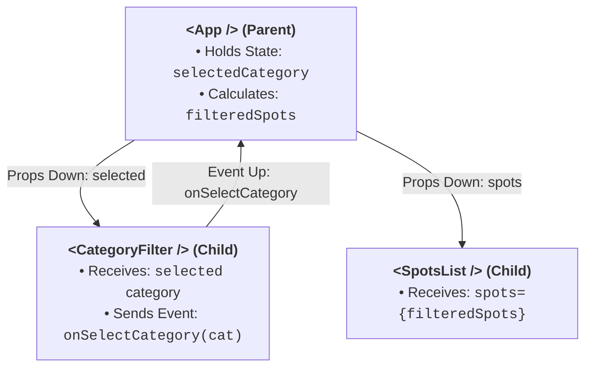
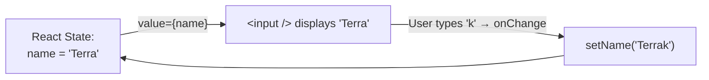
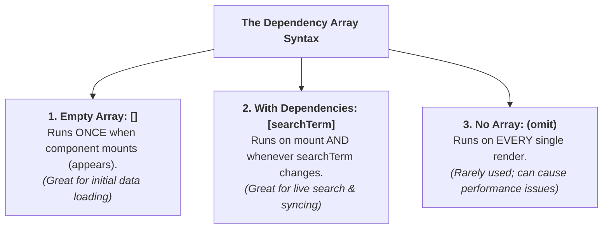

# Week 12: State, Hooks & Forms

Welcome to Week 12! In Week 11, you learned the building blocks of React: creating components, writing JSX, and passing data down via props. But so far, our components have been static posters.

In a real application:
- Users click a filter button, and the displayed list changes.
- Users type into a search input, and the page filters in real time.
- Users fill out a "Submit a Spot" form, and a new card pops up instantly.
- Users toggle a favorite ❤️, and it stays saved across page refreshes.

To do all this, components need **memory**. In React, this memory is called **State**.

This week, you master React's most essential hooks: **`useState`**, **`useEffect`**, **Controlled Forms**, and **Custom Hooks**.

---

## Pedagogical Roadmap



---

## Module 1: What is State? (The Memory Mental Model)

### 1. Why Normal Variables Don't Work in React

Imagine writing this inside a component:

```tsx
// 🔴 DOES NOT WORK IN REACT:
function BrokenCounter() {
  let count = 0; // Regular variable

  function handleClick() {
    count++; // count changes in memory, but the screen DOES NOT UPDATE!
    console.log(count);
  }

  return <button onClick={handleClick}>Clicked {count} times</button>;
}
```

Why does this fail?
1. **Local variables do not trigger a re-render.** React has no idea you changed `count`.
2. **Every time a component re-renders, local variables are wiped out and recreated from scratch!**

> [!NOTE]
> **The Mental Model:** **State** is React's persistent memory. When you update state via its setter function, React automatically **re-renders** the component and updates the DOM with the new value!

---

### 2. The `useState` Hook from Scratch

To give a component state, import `useState` from `"react"`:

```tsx
import { useState } from "react";

function Counter() {
  // Array destructuring:
  // 1. count: Current value
  // 2. setCount: Function to update the value & trigger re-render
  const [count, setCount] = useState<number>(0);

  return (
    <button
      onClick={() => setCount(count + 1)}
      className="px-4 py-2 bg-orange-600 text-white rounded font-bold"
    >
      Clicked {count} times
    </button>
  );
}
```

```mermaid
sequenceDiagram
    actor User
    participant Button as &lt;button onClick&gt;
    participant Setter as setCount(count + 1)
    participant React as React Engine
    participant DOM as Screen

    User->>Button: Clicks button
    Button->>Setter: Calls setCount(1)
    Setter->>React: Tells React: "State changed from 0 to 1!"
    React->>React: Re-runs Counter() function with count = 1
    React->>DOM: Updates screen from "0" to "1"
```

---

### 3. The Golden Rule of State: NEVER Mutate Directly!

> [!CAUTION]
> In React, state is considered **immutable** (read-only).
> - 🔴 **NEVER DO THIS:** `spots.push(newSpot);` or `spot.name = "New Name";`
> - 🟢 **ALWAYS DO THIS:** Use setter functions and spread syntax to return a new copy:
>   `setSpots([...spots, newSpot]);`

```tsx
// Example: Toggling a Boolean Favorite state
function FavoriteButton() {
  const [isFavorite, setIsFavorite] = useState(false);

  return (
    <button
      onClick={() => setIsFavorite(!isFavorite)}
      className="text-lg p-2 rounded"
    >
      {isFavorite ? "❤️ Saved" : "🤍 Save to Favorites"}
    </button>
  );
}
```

---

## Module 2: State Lifting ("Props Down, Events Up")

In **Lagos Spots**, we have two components:
1. `<CategoryFilter />` (Where the user clicks "Food", "Art", etc.).
2. `<SpotsList />` (Where the filtered cards are shown).

Where should the `selectedCategory` state live?
Neither component can see inside the other! Therefore, we **lift state up** to their closest common parent: **`<App />`**.



### Implementing "Props Down, Events Up":

```tsx
// src/components/CategoryFilter.tsx
interface CategoryFilterProps {
  selected: string;
  onSelect: (category: string) => void;
}

const CATEGORIES = ["All", "Food", "Art", "Nightlife"];

export function CategoryFilter({ selected, onSelect }: CategoryFilterProps) {
  return (
    <div className="flex gap-2 mb-6">
      {CATEGORIES.map((cat) => (
        <button
          key={cat}
          onClick={() => onSelect(cat)} // Sends event up to parent!
          className={`px-4 py-1.5 rounded-full text-sm font-medium transition ${
            selected === cat ? "bg-orange-600 text-white" : "bg-slate-200 text-slate-700"
          }`}
        >
          {cat}
        </button>
      ))}
    </div>
  );
}
```

---

## Module 3: Controlled Forms & Inputs

In vanilla JavaScript, you extracted form values using `document.querySelector('#input').value`.

In React, we use **Controlled Components**:
1. You store the input's current value in React state.
2. The input displays that value: `value={text}`.
3. When the user types, `onChange` updates the state: `onChange={(e) => setText(e.target.value)}`.



### Complete "Submit a Spot" Form:

```tsx
// src/components/AddSpotForm.tsx
import { useState } from "react";
import { Spot } from "../types";

interface AddSpotFormProps {
  onAddSpot: (newSpot: Spot) => void;
}

export function AddSpotForm({ onAddSpot }: AddSpotFormProps) {
  const [name, setName] = useState("");
  const [area, setArea] = useState("");
  const [category, setCategory] = useState("Food");
  const [fee, setFee] = useState<number>(0);

  function handleSubmit(e: React.FormEvent) {
    e.preventDefault();

    if (!name.trim() || !area.trim()) {
      alert("Please fill in spot name and area!");
      return;
    }

    const newSpot: Spot = {
      id: Date.now(),
      name: name.trim(),
      area: area.trim(),
      category: category,
      fee: fee
    };

    onAddSpot(newSpot); // Pass new spot up to App state!

    // Reset input fields:
    setName("");
    setArea("");
    setFee(0);
  }

  return (
    <form onSubmit={handleSubmit} className="p-4 bg-white rounded-lg shadow border space-y-4 mb-8">
      <h3 className="font-bold text-lg text-slate-800">Add a New Lagos Spot</h3>
      
      <div>
        <label className="block text-xs font-semibold text-slate-600 mb-1">Spot Name</label>
        <input
          type="text"
          value={name}
          onChange={(e) => setName(e.target.value)}
          placeholder="e.g. Terra Kulture"
          className="w-full border p-2 rounded text-sm"
        />
      </div>

      <div className="grid grid-cols-2 gap-3">
        <div>
          <label className="block text-xs font-semibold text-slate-600 mb-1">Area</label>
          <input
            type="text"
            value={area}
            onChange={(e) => setArea(e.target.value)}
            placeholder="e.g. Victoria Island"
            className="w-full border p-2 rounded text-sm"
          />
        </div>

        <div>
          <label className="block text-xs font-semibold text-slate-600 mb-1">Category</label>
          <select
            value={category}
            onChange={(e) => setCategory(e.target.value)}
            className="w-full border p-2 rounded text-sm bg-white"
          >
            <option value="Food">Food</option>
            <option value="Art">Art</option>
            <option value="Nightlife">Nightlife</option>
            <option value="Nature">Nature</option>
          </select>
        </div>
      </div>

      <button type="submit" className="w-full bg-orange-600 text-white font-semibold py-2 rounded">
        Submit Spot
      </button>
    </form>
  );
}
```

---

## Module 4: `useEffect` & Side Effects

### 1. What is a Side Effect?

In React, the main job of a component function is to **calculate and return JSX**.

A **Side Effect** is anything that happens outside of that rendering process:
- Saving data to `localStorage`.
- Fetching data from a backend server API.
- Setting timers with `setTimeout` or `setInterval`.

React provides the **`useEffect`** hook to run side effects safely.

---

### 2. The Dependency Array Demystified

`useEffect(callbackFunction, [dependencies])` takes two arguments:



#### Practical Example: Syncing Spots to `localStorage`
```tsx
import { useState, useEffect } from "react";

export function App() {
  // 1. Initialize state from localStorage, or use default:
  const [favorites, setFavorites] = useState<number[]>(() => {
    const saved = localStorage.getItem("lagos_favs");
    return saved ? JSON.parse(saved) : [];
  });

  // 2. Automatically save to localStorage whenever 'favorites' changes!
  useEffect(() => {
    localStorage.setItem("lagos_favs", JSON.stringify(favorites));
    console.log("Saved updated favorites to storage!");
  }, [favorites]); // Only runs when favorites changes!

  // ... rest of component ...
}
```

---

## Module 5: Custom Hooks (Packaging Reusable Logic)

> [!NOTE]
> **The Mental Model:** A **Custom Hook** is just a standard JavaScript function whose name starts with `use` (e.g., `useLocalStorage`, `useDebounce`) that can call other React hooks.
> It allows you to extract state logic so multiple components can share it cleanly without duplicating code!

### Building `useLocalStorage`:

```tsx
// src/hooks/useLocalStorage.ts
import { useState, useEffect } from "react";

export function useLocalStorage<T>(key: string, initialValue: T) {
  // 1. Get initial value from storage or fallback:
  const [value, setValue] = useState<T>(() => {
    try {
      const stored = localStorage.getItem(key);
      return stored ? JSON.parse(stored) : initialValue;
    } catch {
      return initialValue;
    }
  });

  // 2. Keep storage in sync whenever value changes:
  useEffect(() => {
    try {
      localStorage.setItem(key, JSON.stringify(value));
    } catch (err) {
      console.error("Failed to save to localStorage:", err);
    }
  }, [key, value]);

  return [value, setValue] as const;
}
```

#### How Clean It Looks in Your Component:
```tsx
// Inside App.tsx:
const [favorites, setFavorites] = useLocalStorage<number[]>("lagos_favs", []);
// Now favorites automatically saves to disk with ZERO extra code!
```

---

## Module 6: Rookie Traps & Debugging Guide

| Error Message / Trap | Root Cause | How to Fix It |
| :--- | :--- | :--- |
| `Too many re-renders. React limits the number of renders to prevent an infinite loop` | You called a state setter directly in the JSX body: `onClick={setCount(count + 1)}`. | Pass an arrow function instead: `onClick={() => setCount(count + 1)}`. |
| Updating an array or object doesn't update the screen | You mutated state in place: `spots.push(newSpot); setSpots(spots)`. | Spread into a new array: `setSpots([...spots, newSpot])`. |
| State shows old value immediately after `setCount` | State updates in React are asynchronous snapshots. | Use the functional updater: `setCount(prev => prev + 1)` or let the re-render handle the new value. |
| Missing `value` or `onChange` on form input | An input field cannot be typed into or typed text disappears immediately. | Verify both `value={name}` and `onChange={(e) => setName(e.target.value)}` are connected. |

---

## 🎯 Week 12 Hands-on Classroom Exercises

### Level 1: Category Filter & State Lifting
1. In `App.tsx`, create `const [category, setCategory] = useState("All")`.
2. Pass `category` and `setCategory` into `<CategoryFilter />`.
3. Filter your `spots` array based on `category` and pass the filtered results into `<SpotsList />`.

### Level 2: Controlled Search Bar
1. Create a `<SearchBar />` component with an input field.
2. Store the `searchTerm` state in `App.tsx`.
3. Filter spots so that only places matching the search term (case-insensitive) are shown.

### Level 3: Adding Spots Live + Persistent Storage
1. Build the `<AddSpotForm />` and connect it so that submitting a new place adds it to the list without reloading the page.
2. Use `useLocalStorage` (or `useEffect`) to save all added spots and favorites so they never disappear when refreshing the browser!

---

## 📚 Curated Deep-Dive References

* [The Valley of Code: React State](https://thevalleyofcode.com/react/state) — Flavio Copes' beginner guide to `useState`.
* [React Official Documentation: Managing State](https://react.dev/learn/managing-state) — The official visual guide to thinking in React state.
* [React Official Documentation: Sharing State Between Components](https://react.dev/learn/sharing-state-between-components) — State lifting explained with step-by-step diagrams.
* [React Official Documentation: Synchronizing with Effects](https://react.dev/learn/synchronizing-with-effects) — Deep dive into `useEffect` without fear.
* [React Official Documentation: Reusing Logic with Custom Hooks](https://react.dev/learn/reusing-logic-with-custom-hooks) — How to package hooks like a pro.
