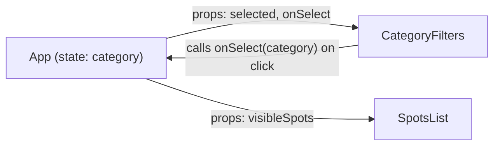

# Week 12: State, Hooks & Forms

Your components render real data, but nothing on the page can change yet — no filtering, no live search, no submitting a new spot. This week you meet React's most important hook, `useState`, wire up a live category filter, bring your Week 9 Nominatim search into a component with `useEffect`, and rebuild the "Add a Spot" form as a real, controlled React form.

---

## Module 1: `useState` and a Real Category Filter

### 1. Props vs. State

* **Lecture & Concepts:**
    * **Props** are handed to a component from its parent and can't be changed by the component itself. **State** is a component's *own* memory — data it owns and can update, which causes React to automatically re-render with the new value.
    * `useState(initialValue)` returns a pair: the current value, and a function to update it. Calling the updater function is what triggers a re-render — directly mutating the variable does nothing.

* **In-Depth Example (A Real, Working Filter):**
    ```tsx
    import { useState } from 'react';

    const CATEGORIES = ['all', 'food', 'study', 'nightlife', 'events'];

    function CategoryFilters({ onSelect, selected }: { onSelect: (c: string) => void; selected: string }) {
      return (
        <div className="flex gap-2">
          {CATEGORIES.map((category) => (
            <button
              key={category}
              onClick={() => onSelect(category)}
              className={selected === category ? 'font-bold underline' : ''}
            >
              {category}
            </button>
          ))}
        </div>
      );
    }
    ```
    ```tsx
    // In App.tsx
    const [category, setCategory] = useState('all');
    const visibleSpots = category === 'all' ? spots : spots.filter((s) => s.category === category);

    <CategoryFilters selected={category} onSelect={setCategory} />
    <SpotsList spots={visibleSpots} />
    ```


*Props flow down, events flow up — the pattern every piece of interactive React relies on.*

* **Class Exercise: Build the Real Filter**
    1. Build `CategoryFilters` exactly as shown.
    2. Add `category` state to `App.tsx`, and compute `visibleSpots` by filtering — reuse the exact filtering logic from your Week 7/10 vanilla project.
    3. Confirm clicking a category button updates the visible cards immediately.

---

## Module 2: `useEffect` and Real Data Fetching

### 1. Side Effects

* **Lecture & Concepts:**
    * A **side effect** is anything a component does that reaches *outside* of just returning JSX — fetching data, reading `localStorage`, setting a timer. `useEffect(callback, dependencies)` runs `callback` after React has rendered, and re-runs it whenever a value in the `dependencies` array changes. An empty array (`[]`) means "run once, right after the first render."

* **In-Depth Example (Bringing Back Nominatim Search):**
    ```tsx
    import { useState, useEffect } from 'react';
    import { searchLocations } from '../api';
    import type { NominatimResult } from '../types';

    function useDebouncedValue(value: string, delayMs: number) {
      const [debounced, setDebounced] = useState(value);
      useEffect(() => {
        const timeoutId = setTimeout(() => setDebounced(value), delayMs);
        return () => clearTimeout(timeoutId); // cleanup: cancel the pending timeout on every re-run
      }, [value, delayMs]);
      return debounced;
    }

    function SearchBar() {
      const [query, setQuery] = useState('');
      const [results, setResults] = useState<NominatimResult[]>([]);
      const [loading, setLoading] = useState(false);
      const [error, setError] = useState<string | null>(null);

      const debouncedQuery = useDebouncedValue(query, 300);

      useEffect(() => {
        if (!debouncedQuery) {
          setResults([]);
          return;
        }

        let cancelled = false;
        setLoading(true);
        setError(null);

        searchLocations(debouncedQuery)
          .then((data) => {
            if (!cancelled) setResults(data);
          })
          .catch(() => {
            if (!cancelled) setError('Something went wrong. Please try again.');
          })
          .finally(() => {
            if (!cancelled) setLoading(false);
          });

        return () => {
          cancelled = true; // cleanup: ignore this request's result if a newer one has started
        };
      }, [debouncedQuery]);

      return (
        <div>
          <input
            type="text"
            value={query}
            onChange={(e) => setQuery(e.target.value)}
            placeholder="Search a place in Lagos..."
          />
          {loading && <p>Searching...</p>}
          {error && <p className="text-red-600">{error}</p>}
        </div>
      );
    }
    ```
    * The `cancelled` flag matters: without it, if the user types quickly, an *older*, slower request could resolve *after* a newer one and overwrite its results with stale data — a real, common React bug called a race condition.

* **Class Exercise: Rebuild Real Search in React**
    1. Build `useDebouncedValue` and `SearchBar` exactly as shown, moving `searchLocations` (from your Week 9 `api.ts`) into this project unchanged.
    2. Confirm typing quickly doesn't flash stale results, and that turning off your network shows the real error state.

---

## Module 3: Controlled Forms

### 1. Controlled Components

* **Lecture & Concepts:**
    * A **controlled component** is a form input whose value is driven entirely by React state — `value={state}` and `onChange={...}` together mean React is the single source of truth for what's in the field, not the DOM itself.
    * Using **one state object** for an entire form (rather than one `useState` per field) keeps related data together and scales cleanly as fields are added.

* **In-Depth Example (The Real "Add a Spot" Form):**
    ```tsx
    import { useState } from 'react';
    import type { FormEvent, ChangeEvent } from 'react';

    interface SpotFormData {
      name: string;
      category: string;
      area: string;
      description: string;
    }

    const initialFormData: SpotFormData = { name: '', category: '', area: '', description: '' };

    function SubmitSpotForm({ onSubmit }: { onSubmit: (data: SpotFormData) => void }) {
      const [formData, setFormData] = useState<SpotFormData>(initialFormData);
      const [error, setError] = useState('');

      function handleChange(event: ChangeEvent<HTMLInputElement | HTMLSelectElement | HTMLTextAreaElement>) {
        const { name, value } = event.target;
        setFormData((prev) => ({ ...prev, [name]: value }));
      }

      function handleSubmit(event: FormEvent) {
        event.preventDefault();
        if (formData.description.length < 10) {
          setError('Description must be at least 10 characters.');
          return;
        }
        setError('');
        onSubmit(formData);
        setFormData(initialFormData);
      }

      return (
        <form onSubmit={handleSubmit} className="flex flex-col gap-3">
          <input name="name" value={formData.name} onChange={handleChange} placeholder="Spot name" required />
          <select name="category" value={formData.category} onChange={handleChange} required>
            <option value="">Choose one…</option>
            <option value="food">Food</option>
            <option value="study">Study</option>
            <option value="nightlife">Nightlife</option>
            <option value="events">Events</option>
          </select>
          <input name="area" value={formData.area} onChange={handleChange} placeholder="Area" required />
          <textarea name="description" value={formData.description} onChange={handleChange} />
          {error && <p className="text-red-600 text-sm">{error}</p>}
          <button type="submit">Add Spot</button>
        </form>
      );
    }
    ```
    * `[name]: value` is a **computed property name** — it lets one `handleChange` function update the correct field for *any* input, based on that input's real `name` attribute, instead of writing a separate handler per field.

* **Class Exercise: Wire the Real Form**
    1. Build `SubmitSpotForm` exactly as shown.
    2. In `App.tsx`, hold your `spots` array in state (`useState<Spot[]>`), and pass an `onSubmit` handler that appends the new spot (with a generated `id` and default `favorited: false`) via `setSpots((prev) => [...prev, newSpot])`.
    3. Confirm submitting adds a real, visible card without a page reload.

---

### Week 12: Comprehensive Assignment

**Objective:** A genuinely interactive Lagos Spots React app: live category filtering, live Nominatim search, and a real, controlled submit form.

**Requirements:**

1. **Filtering:** `CategoryFilters` + `category` state correctly filters the rendered `SpotsList`.
2. **Search:** `SearchBar` debounces input, fetches via `useEffect`, and correctly shows loading/error/empty states — with the race-condition cleanup in place.
3. **Controlled Form:** `SubmitSpotForm` uses one `formData` state object and computed property names in `handleChange`.
4. **Real Submission:** Submitting a valid form adds a new spot to the app's state and clears the form; an invalid description shows a real inline error.
5. **Git:** Committed and pushed via the branch → PR → merge workflow.

**Bonus Challenge:** Add a `useReducer`-based version of `formData`/`error` as an alternative to the two separate `useState` calls, and write one sentence in a comment on when a reducer starts being worth the extra structure over plain `useState`.
