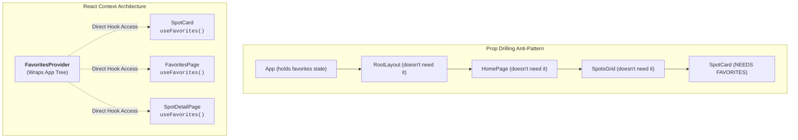
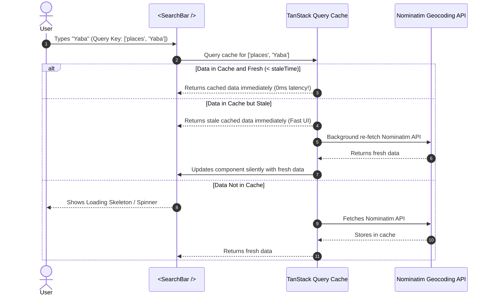

# Week 13: Routing, Global State & Data Fetching

Single-page applications must support bookmarkable URLs, deeply nested layouts, and global data synchronization without suffering from **"Prop Drilling"**. This week, you transform Lagos Spots into a multi-route application using **React Router v6**, implement global state management with the **React Context API**, and replace imperative `useEffect` data fetching with production-grade **Server State Management via TanStack Query (React Query)**.

---

## Module 1: Client-Side Routing with React Router v6

### 1. The Core Terminology of Routing

| Term | What It Actually Means | Technical Context |
| :--- | :--- | :--- |
| **Single-Page Application (SPA)** | A web application that loads a single HTML page on initial visit and dynamically rewrites the page content as the user navigates, without reloading from the server. | Provides native-app speed by eliminating full-page browser refreshes. |
| **HTML5 History API** | Browser APIs (`history.pushState()`, `history.replaceState()`, and the `popstate` event) enabling JavaScript to manipulate the browser address bar and history stack. | React Router uses this to update URLs without triggering browser HTTP requests. |
| **Layout Route** | A parent route that renders persistent shared layout UI (Navbar, Footer) and embeds child routes inside an `<Outlet />`. | Keeps navigation state intact across page transitions. |
| **Dynamic Route Segment** | A URL path segment preceded by a colon (`:id` or `:slug`) that acts as a wildcard parameter. | Read inside components using the `useParams()` hook. |
| **Query Parameters** | Key-value pairs appended to a URL after `?` (e.g., `/spots?category=food&sort=name`). | Read and written via the `useSearchParams()` hook. |

---

### 2. Under the Hood: How Client-Side Navigation Works

```mermaid
sequenceDiagram
    autonumber
    actor User
    participant Link as <Link to="/spots/terra-kulture">
    participant Router as React Router Engine
    participant History as Browser History API
    participant Outlet as <Outlet /> Component

    User->>Link: Clicks navigation link
    Link->>Router: Intercepts click (event.preventDefault())
    Router->>History: window.history.pushState({}, '', '/spots/terra-kulture')
    Note over History: Address bar updates instantly; NO network reload!
    Router->>Router: Matches route path "spots/:id" -> SpotDetailPage
    Router->>Outlet: Replaces Outlet content with <SpotDetailPage />
    Outlet-->>User: Instant component transition!
```

---

### 3. Route Configuration with `createBrowserRouter`

```tsx
// src/router.tsx
import { createBrowserRouter } from 'react-router-dom';
import { RootLayout } from './layouts/RootLayout';
import { HomePage } from './pages/HomePage';
import { SpotDetailPage } from './pages/SpotDetailPage';
import { SubmitSpotPage } from './pages/SubmitSpotPage';
import { FavoritesPage } from './pages/FavoritesPage';
import { NotFoundPage } from './pages/NotFoundPage';

export const router = createBrowserRouter([
  {
    path: '/',
    element: <RootLayout />,
    errorElement: <NotFoundPage />,
    children: [
      {
        index: true, // Default child route for "/"
        element: <HomePage />,
      },
      {
        path: 'spots/:id', // Dynamic route: /spots/terra-kulture
        element: <SpotDetailPage />,
      },
      {
        path: 'submit',
        element: <SubmitSpotPage />,
      },
      {
        path: 'favorites',
        element: <FavoritesPage />,
      },
    ],
  },
]);
```

```tsx
// src/layouts/RootLayout.tsx
import React from 'react';
import { Outlet, NavLink } from 'react-router-dom';
import { Header } from '../components/Header';
import { Container } from '../components/Container';

export const RootLayout: React.FC = () => {
  return (
    <div className="min-h-screen bg-slate-50 dark:bg-slate-900 text-slate-900 dark:text-white flex flex-col">
      <Header />
      
      <main className="flex-grow py-8">
        <Container>
          {/* Outlet is the dynamic placeholder where child routes render */}
          <Outlet />
        </Container>
      </main>

      <footer className="border-t border-slate-200 dark:border-slate-800 py-6 text-center text-xs text-slate-500">
        &copy; 2026 Lagos Spots. Built for the community.
      </footer>
    </div>
  );
};
```

---

## Module 2: Global State Management with React Context

### 1. Eliminating Prop Drilling

When state is needed by deeply nested components across different pages (e.g., user favorites needed on `HomePage`, `SpotDetailPage`, and `FavoritesPage`), passing props through intermediate layers is termed **Prop Drilling**:



---

### 2. Implementing `FavoritesContext` with Lazy Initialization

```tsx
// src/context/FavoritesContext.tsx
import React, { createContext, useContext, useState, useEffect, ReactNode } from 'react';

interface FavoritesContextType {
  favoriteIds: string[];
  isFavorite: (id: string) => boolean;
  toggleFavorite: (id: string) => void;
}

const FavoritesContext = createContext<FavoritesContextType | undefined>(undefined);

const STORAGE_KEY = 'lagos_spots_favorites_v2';

export const FavoritesProvider: React.FC<{ children: ReactNode }> = ({ children }) => {
  // Lazy initial state function: Reads disk ONLY once on startup
  const [favoriteIds, setFavoriteIds] = useState<string[]>(() => {
    try {
      const stored = localStorage.getItem(STORAGE_KEY);
      return stored ? JSON.parse(stored) : [];
    } catch {
      return [];
    }
  });

  // Synchronize with localStorage whenever favorites change
  useEffect(() => {
    try {
      localStorage.setItem(STORAGE_KEY, JSON.stringify(favoriteIds));
    } catch (err) {
      console.error('Failed to persist favorites:', err);
    }
  }, [favoriteIds]);

  const isFavorite = (id: string): boolean => favoriteIds.includes(id);

  const toggleFavorite = (id: string): void => {
    setFavoriteIds((prev) =>
      prev.includes(id) ? prev.filter((favId) => favId !== id) : [...prev, id]
    );
  };

  return (
    <FavoritesContext.Provider value={{ favoriteIds, isFavorite, toggleFavorite }}>
      {children}
    </FavoritesContext.Provider>
  );
};

// Custom consumer hook with safety guard
export const useFavorites = (): FavoritesContextType => {
  const context = useContext(FavoritesContext);
  if (!context) {
    throw new Error('useFavorites must be used within a <FavoritesProvider>');
  }
  return context;
};
```

---

## Module 3: Server State Management with TanStack Query

### 1. Client State vs. Server State

| Dimension | Client State (UI State) | Server State (Remote State) |
| :--- | :--- | :--- |
| **Ownership** | Owned entirely by the browser client (e.g., modal open, selected tab, form inputs). | Owned remotely by a database/server (e.g., list of spots, geocoding search results). |
| **Persistence** | Synchronous and in-memory. | Asynchronous, requiring network roundtrips. |
| **Staleness** | Never stale; client has 100% control. | Can become **stale** immediately if another user updates data remotely. |
| **Management Tool** | `useState`, `useReducer`, `React Context`. | **TanStack Query (React Query)**, SWR. |

---

### 2. Under the Hood: The Stale-While-Revalidate (SWR) Lifecycle



---

### 3. Setting Up TanStack Query

```bash
npm install @tanstack/react-query
```

```tsx
// src/main.tsx
import React from 'react';
import ReactDOM from 'react-dom/client';
import { RouterProvider } from 'react-router-dom';
import { QueryClient, QueryClientProvider } from '@tanstack/react-query';
import { FavoritesProvider } from './context/FavoritesContext';
import { router } from './router';
import './style.css';

// Initialize global QueryClient
const queryClient = new QueryClient({
  defaultOptions: {
    queries: {
      staleTime: 1000 * 60 * 5, // Data remains fresh for 5 minutes
      gcTime: 1000 * 60 * 30,    // Unused cache retained in memory for 30 minutes
      retry: 2,                 // Automatically retry failed requests up to 2 times
      refetchOnWindowFocus: false,
    },
  },
});

ReactDOM.createRoot(document.getElementById('root')!).render(
  <React.StrictMode>
    <QueryClientProvider client={queryClient}>
      <FavoritesProvider>
        <RouterProvider router={router} />
      </FavoritesProvider>
    </QueryClientProvider>
  </React.StrictMode>
);
```

---

### 4. Querying Nominatim with `useQuery`

```tsx
// src/hooks/useNominatimSearch.ts
import { useQuery } from '@tanstack/react-query';
import { searchLocations } from '../api';
import { NominatimLocation } from '../types';

export function useNominatimSearch(debouncedQuery: string) {
  return useQuery<NominatimLocation[], Error>({
    queryKey: ['locations', debouncedQuery], // Cache key uniquely identified by search string
    queryFn: ({ signal }) => searchLocations(debouncedQuery, signal),
    enabled: debouncedQuery.trim().length >= 3, // Only execute query if input has 3+ characters
  });
}
```

```tsx
// Usage in SearchBar:
export const SearchBar: React.FC = () => {
  const [query, setQuery] = useState('');
  const debouncedQuery = useDebounce(query, 300);
  
  const { data: results = [], isLoading, isError, error } = useNominatimSearch(debouncedQuery);

  return (
    <div className="relative w-full max-w-lg mb-6">
      <input
        type="text"
        value={query}
        onChange={(e) => setQuery(e.target.value)}
        placeholder="Search Lagos locations..."
        className="w-full px-4 py-2.5 rounded-xl border border-slate-300 dark:border-slate-700 bg-white dark:bg-slate-800"
      />
      {isLoading && <p className="text-xs text-orange-600 mt-1">Searching cache & network...</p>}
      {isError && <p className="text-xs text-rose-500 mt-1">{error.message}</p>}
      
      {results.length > 0 && (
        <ul className="absolute z-10 w-full mt-1 bg-white dark:bg-slate-800 border border-slate-200 dark:border-slate-700 rounded-xl shadow-lg max-h-60 overflow-y-auto">
          {results.map((place) => (
            <li key={place.place_id} className="px-4 py-2 hover:bg-slate-50 dark:hover:bg-slate-700 text-sm cursor-pointer">
              {place.display_name}
            </li>
          ))}
        </ul>
      )}
    </div>
  );
};
```

---

### Common Pitfalls & How to Avoid Them

| Pitfall | Root Cause | Fix |
| :--- | :--- | :--- |
| **Full page reload on navigation** | Using regular `<a href="...">` tags instead of React Router `<Link to="...">`. | Use `<Link to="...">` or `<NavLink to="...">`. |
| **Missing context error crash** | Consuming `useFavorites()` in a component not wrapped by `<FavoritesProvider>`. | Always wrap the root tree with Context Providers in `main.tsx`. |
| **Static `queryKey` collision** | Passing a hardcoded key `queryKey: ['search']` so different query parameters overwrite each other. | Include dynamic variables in the key array: `queryKey: ['search', debouncedQuery]`. |

---

### Week 13: Comprehensive Assignment

**Objective:** Scale Lagos Spots into a multi-page routed application featuring React Router layouts, centralized favorites management with React Context, and server-state caching via TanStack Query.

**Requirements:**
1. **Client-Side Routing:**
   - Routes configured with `createBrowserRouter`:
     - `/` $\to$ `HomePage`
     - `/spots/:id` $\to$ `SpotDetailPage` (reading `:id` via `useParams()`)
     - `/submit` $\to$ `SubmitSpotPage`
     - `/favorites` $\to$ `FavoritesPage`
   - Persistent `RootLayout` with `<Outlet />` and active navigation styling using `<NavLink />`.
2. **Global Favorites Context:**
   - `FavoritesContext` and `FavoritesProvider` managing favorite IDs with lazy `localStorage` synchronization.
   - Custom `useFavorites()` hook consumed across `SpotCard`, `SpotDetailPage`, and `FavoritesPage`.
3. **Server State with TanStack Query:**
   - Configured `QueryClientProvider` with 5-minute `staleTime`.
   - `useNominatimSearch` custom query hook with cache-key parameterization and query cancellation.
4. **Git Workflow:**
   - Developed on branch `feature/routing-context-query`, merged via Pull Request, and pulled locally.
