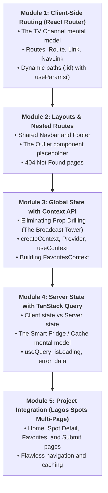
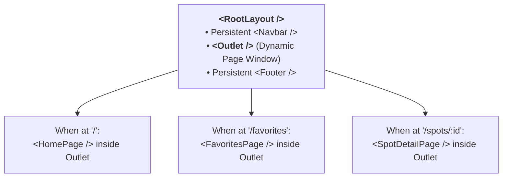
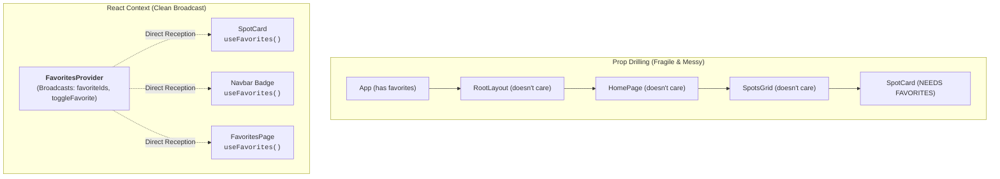

# Week 13: Routing, Global State & Data Fetching

Welcome to Week 13! In Weeks 11 and 12, you turned Lagos Spots into a responsive, state-driven React application. However, everything currently lives on a single screen:
- If a user wants to send a link to a specific place (like `/spots/terra-kulture`), they can't — there is only one URL (`/`).
- If a user clicks the browser's **Back button**, it leaves your website instead of going to the previous screen!
- If your favorites list is needed across multiple pages, you have to pass it through layers of components that don't even care about it (**Prop Drilling**).

This week, you transform Lagos Spots into a full-fledged multi-page web application using **React Router**, manage app-wide data with the **React Context API**, and master production-grade data fetching with **TanStack Query (React Query)**.

---

## Pedagogical Roadmap



---

## Module 1: Client-Side Routing (React Router)

### 1. What is Client-Side Routing? (The TV Channel Analogy)

> [!NOTE]
> **The Mental Model:**
> - In a traditional website, clicking a link is like ordering a completely new television set every time you want to watch a different show. The entire screen goes blank while the whole page reloads from the server.
> - In a **Single Page Application (SPA)** with **React Router**, clicking a link is like changing the TV channel with a remote control. The television (your browser) stays on, the frame stays steady, and only the show on the screen changes instantly!

```mermaid
sequenceDiagram
    actor User
    participant Link as &lt;Link to="/spots/2"&gt;
    participant Router as React Router
    participant Browser as Browser Address Bar
    participant Page as Screen

    User->>Link: Clicks link
    Link->>Router: Intercepts click (Stops full reload!)
    Router->>Browser: Updates URL to "/spots/2"
    Router->>Page: Renders &lt;SpotDetailPage /&gt; instantly (0ms network delay!)
```

---

### 2. Setting Up React Router

Install the package in your project:
```bash
npm install react-router-dom
```

#### The Core Building Blocks:
| Component / Hook | Role | Example |
| :--- | :--- | :--- |
| **`<BrowserRouter>`** | Wraps your app and connects it to browser navigation history. | Placed in `main.tsx` or `App.tsx`. |
| **`<Routes>` & `<Route>`** | Defines the path-to-component mapping. | `<Route path="/about" element={<AboutPage />} />` |
| **`<Link>`** | Replaces traditional `<a>` tags to navigate without reloading. | `<Link to="/favorites">Favorites</Link>` |
| **`<NavLink>`** | Like `<Link>`, but automatically knows if it is the currently active page (great for navbars!). | `<NavLink className={({isActive}) => isActive ? 'active' : ''}>` |
| **`useParams()`** | Reads dynamic variables from the URL. | `const { id } = useParams();` |

---

### 3. Dynamic Routes & `useParams()`

What if you have 100 spots in Lagos? You don't create 100 separate route files! You create **one dynamic route** with a parameter:

```tsx
// Inside App.tsx:
<Routes>
  <Route path="/" element={<HomePage />} />
  {/* Dynamic route parameter: :id acts as a placeholder! */}
  <Route path="/spots/:id" element={<SpotDetailPage />} />
</Routes>
```

#### Reading the Dynamic ID inside `SpotDetailPage.tsx`:
```tsx
// src/pages/SpotDetailPage.tsx
import { useParams, Link } from "react-router-dom";
import { spotsData } from "../data/spots";

export function SpotDetailPage() {
  // Grab the :id from the URL (always returned as a string):
  const { id } = useParams<{ id: string }>();

  // Find the matching spot:
  const spot = spotsData.find((s) => s.id === Number(id));

  if (!spot) {
    return (
      <div className="p-8 text-center">
        <h2 className="text-xl font-bold">Spot Not Found</h2>
        <Link to="/" className="text-orange-600 underline mt-4 inline-block">
          &larr; Back to all spots
        </Link>
      </div>
    );
  }

  return (
    <div className="max-w-2xl mx-auto p-6 bg-white rounded-lg shadow">
      <Link to="/" className="text-sm text-slate-500 hover:text-slate-800">
        &larr; Back to Explore
      </Link>
      <h1 className="text-3xl font-extrabold text-slate-900 mt-4">{spot.name}</h1>
      <span className="inline-block bg-orange-100 text-orange-800 text-xs font-bold px-2 py-1 rounded mt-2">
        {spot.category}
      </span>
      <p className="text-slate-600 mt-4">{spot.description}</p>
      <p className="text-lg font-semibold text-slate-800 mt-6">
        📍 {spot.area} · {spot.fee === 0 ? "Free Entry" : `₦${spot.fee.toLocaleString()}`}
      </p>
    </div>
  );
}
```

---

## Module 2: Layouts & Nested Routes with `<Outlet />`

Instead of duplicating the `<Navbar />` and `<Footer />` inside every single page, React Router lets you create a **Layout Route**:



```tsx
// src/layouts/RootLayout.tsx
import { Outlet } from "react-router-dom";
import { Navbar } from "../components/Navbar";
import { Footer } from "../components/Footer";

export function RootLayout() {
  return (
    <div className="min-h-screen flex flex-col bg-slate-50">
      <Navbar />
      <main className="flex-grow max-w-5xl mx-auto w-full px-4 py-8">
        {/* <Outlet /> is the placeholder where the active child page renders! */}
        <Outlet />
      </main>
      <Footer />
    </div>
  );
}
```

---

## Module 3: Global State with the React Context API

### 1. The Prop Drilling Problem (The Broadcast Tower Analogy)

> [!NOTE]
> **The Mental Model:**
> - **Prop Drilling** is like whispering a message down a chain of 10 people to reach someone at the back of the room. The 8 people in the middle don't care about the message, but they must hear it and pass it along.
> - **React Context** is like installing a **Radio Broadcast Tower**. The provider broadcasts data, and any component anywhere in the building can tune its receiver (`useContext`) directly to that broadcast, skipping the middle layers entirely!



---

### 2. Creating & Providing `FavoritesContext`

```tsx
// src/context/FavoritesContext.tsx
import React, { createContext, useContext, useState, useEffect } from "react";

interface FavoritesContextType {
  favorites: number[];
  isFavorite: (id: number) => boolean;
  toggleFavorite: (id: number) => void;
}

// 1. Create the Context:
const FavoritesContext = createContext<FavoritesContextType | undefined>(undefined);

// 2. Create the Provider Component:
export function FavoritesProvider({ children }: { children: React.ReactNode }) {
  const [favorites, setFavorites] = useState<number[]>(() => {
    const saved = localStorage.getItem("lagos_spots_favs");
    return saved ? JSON.parse(saved) : [];
  });

  useEffect(() => {
    localStorage.setItem("lagos_spots_favs", JSON.stringify(favorites));
  }, [favorites]);

  function isFavorite(id: number): boolean {
    return favorites.includes(id);
  }

  function toggleFavorite(id: number) {
    setFavorites((prev) =>
      prev.includes(id) ? prev.filter((favId) => favId !== id) : [...prev, id]
    );
  }

  return (
    <FavoritesContext.Provider value={{ favorites, isFavorite, toggleFavorite }}>
      {children}
    </FavoritesContext.Provider>
  );
}

// 3. Custom Consumer Hook (Clean & safe):
export function useFavorites() {
  const context = useContext(FavoritesContext);
  if (!context) {
    throw new Error("useFavorites must be used within a <FavoritesProvider>");
  }
  return context;
}
```

Now, any component in your app can use favorites with a single clean line:
```tsx
const { isFavorite, toggleFavorite } = useFavorites();
```

---

## Module 4: Server State with TanStack Query (React Query)

### 1. Client State vs Server State (The Smart Fridge Analogy)

| Type | What It Is | Who Owns It? | Best Tool |
| :--- | :--- | :--- | :--- |
| **Client State** | UI state like "Is modal open?", "Selected theme". | The browser client. | `useState`, `Context`. |
| **Server State** | Data that lives in an external database/API (places, locations, users). | The remote server. | **TanStack Query**. |

> [!TIP]
> **The Mental Model:** TanStack Query is like a **Smart Refrigerator**.
> When you want food, you check the fridge first (the **Cache**).
> 1. If it's already there, you eat immediately (**0ms delay!**).
> 2. Meanwhile, the fridge quietly contacts the market in the background to check if fresh food is available.
> 3. If fresh food arrives, it updates your pantry seamlessly!

---

### 2. Setting Up TanStack Query

```bash
npm install @tanstack/react-query
```

Wrap your application in `QueryClientProvider`:
```tsx
// src/main.tsx
import { QueryClient, QueryClientProvider } from "@tanstack/react-query";

const queryClient = new QueryClient();

ReactDOM.createRoot(document.getElementById("root")!).render(
  <QueryClientProvider client={queryClient}>
    <FavoritesProvider>
      <App />
    </FavoritesProvider>
  </QueryClientProvider>
);
```

---

### 3. Fetching Data with `useQuery`

Replace 30 lines of manual `useState`, `useEffect`, `isLoading`, and `try/catch` with a single powerful hook:

```tsx
import { useQuery } from "@tanstack/react-query";

async function fetchLagosPlaces(searchTerm: string) {
  const res = await fetch(`https://nominatim.openstreetmap.org/search?format=json&q=${searchTerm}, Lagos`);
  if (!res.ok) throw new Error("Network request failed");
  return res.json();
}

export function PlacesSearch() {
  const [searchTerm, setSearchTerm] = useState("Yaba");

  const { data, isLoading, error } = useQuery({
    queryKey: ["places", searchTerm], // Unique cache key
    queryFn: () => fetchLagosPlaces(searchTerm),
    staleTime: 1000 * 60 * 5 // Data stays fresh in cache for 5 minutes!
  });

  if (isLoading) return <p className="text-slate-500">⏳ Loading Lagos places...</p>;
  if (error) return <p className="text-red-500">⚠️ Error loading places.</p>;

  return (
    <div>
      <h3 className="font-bold mb-2">Search Results:</h3>
      {data?.map((place: any) => (
        <div key={place.place_id} className="p-3 border rounded mb-2 bg-white">
          <p className="font-semibold text-sm">{place.display_name}</p>
        </div>
      ))}
    </div>
  );
}
```

---

## Module 5: Rookie Traps & Debugging Guide

| Error Message / Trap | Root Cause | How to Fix It |
| :--- | :--- | :--- |
| `useNavigate() may be used only in the context of a <Router> component` | You tried using routing hooks outside `<BrowserRouter>`. | Ensure your components are wrapped inside `<BrowserRouter>` in `main.tsx` or `App.tsx`. |
| `useFavorites must be used within a <FavoritesProvider>` | You forgot to wrap your app tree in `<FavoritesProvider>`. | Wrap `<App />` with `<FavoritesProvider>` in `main.tsx`. |
| Full page reloads when clicking links | You used standard `<a href="...">` tags instead of React Router's `<Link to="...">`. | Replace `<a>` with `<Link to="...">` or `<NavLink to="...">`. |
| TanStack Query re-fetches endlessly | You passed an unstable function or inline object into `queryFn` or `queryKey`. | Ensure `queryKey` is an array of primitives: `['places', query]`. |

---

## 🎯 Week 13 Hands-on Classroom Exercises

### Level 1: Multi-Route Setup
1. Install `react-router-dom` and configure 3 routes:
   - `/` $\to$ `<HomePage />`
   - `/favorites` $\to$ `<FavoritesPage />`
   - `/submit` $\to$ `<SubmitSpotPage />`
2. Create a `<Navbar />` with `<NavLink>` tags that highlight in bold orange when the page is active.

### Level 2: Dynamic Place Detail Page
1. Add a route: `/spots/:id`.
2. On the home page, make each spot card link to `/spots/${spot.id}`.
3. Build `<SpotDetailPage />` using `useParams()` to look up and display the spot's full details!

### Level 3: Global Favorites Context
1. Create `FavoritesContext` and wrap your app.
2. In `<Navbar />`, show a live badge with the count of saved favorites: `Favorites (3)`.
3. In `<SpotCard />`, wire the favorite button to `toggleFavorite(spot.id)` so clicking it updates everywhere in real time!

---

## 📚 Curated Deep-Dive References

* [The Valley of Code: React Router](https://thevalleyofcode.com/react/router) — Flavio Copes' gentle walkthrough of client-side routing.
* [React Router Official Tutorial](https://reactrouter.com/en/main/start/tutorial) — The official step-by-step tutorial on layouts and loaders.
* [React Official Documentation: Passing Data Deeply with Context](https://react.dev/learn/passing-data-deeply-with-context) — How Context eliminates prop drilling.
* [TanStack Query Official Docs](https://tanstack.com/query/latest/docs/framework/react/overview) — The premier guide to server state management.
