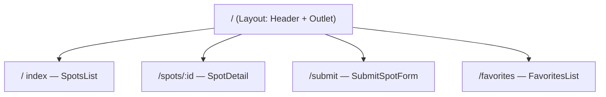

# Week 13: Routing, Global State & Data Fetching

Lagos Spots is still a single page holding everything in one component's state. This week it becomes a real, multi-page application: proper routes with real URLs, favorites that any component can reach without prop-drilling, and a production-grade way of fetching server data that replaces your hand-rolled `useEffect` fetching logic from last week.

---

## Module 1: Client-Side Routing with React Router

### 1. Why a Router?

* **Lecture & Concepts:**
    * So far, "pages" have just been conditionally rendered pieces of one component tree — the URL never changes. **React Router** gives the app real, bookmarkable, shareable URLs (`/spots/terra-kulture`) while still being a single-page app under the hood — no full page reload on navigation.
    * `createBrowserRouter([...])` defines your routes as data; `<RouterProvider router={router} />` renders whichever route matches the current URL.

### 2. Layouts, `<Outlet>` & Dynamic Routes

* **Lecture & Concepts:**
    * A **layout route** wraps shared UI (the header, footer) around whichever child route is active. `<Outlet />` is the placeholder inside a layout where React Router renders the matched child.
    * A **dynamic route segment** (`:id`) captures part of the URL as a parameter, read inside the matched component with the `useParams()` hook.



* **In-Depth Example:**
    ```tsx
    // src/router.tsx
    import { createBrowserRouter } from 'react-router-dom';
    import Layout from './components/Layout';
    import HomePage from './pages/HomePage';
    import SpotDetailPage from './pages/SpotDetailPage';
    import SubmitPage from './pages/SubmitPage';
    import FavoritesPage from './pages/FavoritesPage';

    export const router = createBrowserRouter([
      {
        path: '/',
        element: <Layout />,
        children: [
          { index: true, element: <HomePage /> },
          { path: 'spots/:id', element: <SpotDetailPage /> },
          { path: 'submit', element: <SubmitPage /> },
          { path: 'favorites', element: <FavoritesPage /> },
        ],
      },
    ]);
    ```
    ```tsx
    // src/components/Layout.tsx
    import { Outlet, Link } from 'react-router-dom';

    function Layout() {
      return (
        <div>
          <header className="flex gap-4 p-4">
            <Link to="/">Lagos Spots</Link>
            <Link to="/submit">Add a Spot</Link>
            <Link to="/favorites">Favorites</Link>
          </header>
          <main className="p-4">
            <Outlet />
          </main>
        </div>
      );
    }
    ```
    ```tsx
    // src/pages/SpotDetailPage.tsx
    import { useParams } from 'react-router-dom';

    function SpotDetailPage() {
      const { id } = useParams();
      // fetching/finding by id comes together with the data layer, later this module
      return <div>Spot detail for: {id}</div>;
    }
    ```

* **Class Exercise: Build the Real Sitemap**
    1. Install `react-router-dom`, and build the router, `Layout`, and four page components exactly matching the diagram above.
    2. Move your Week 11–12 components (`SpotsList`, `SubmitSpotForm`) into their respective page components.
    3. Confirm navigating via the header's `<Link>`s changes the URL without a full page reload, and that `/spots/terra-kulture` correctly shows that id via `useParams()`.

---

## Module 2: Global State with Context

### 1. The Prop-Drilling Problem

* **Lecture & Concepts:**
    * "Favorited" status needs to be readable and updatable from `SpotCard` (on the home page), `SpotDetailPage`, *and* a new `FavoritesPage` — passing it down as props through every layer in between ("prop drilling") gets unwieldy fast.
    * **Context** lets you provide a value once, high in the tree, and read it directly from any descendant component, no matter how deep — without passing it through every component in between.

### 2. Building `FavoritesContext`

* **Lecture & Concepts:**
    * `createContext` defines the shape of shared data. A custom **Provider** component wraps part of the tree and supplies the real value. `useContext(MyContext)` reads it from any descendant.

* **In-Depth Example:**
    ```tsx
    // src/context/FavoritesContext.tsx
    import { createContext, useContext, useState, useEffect } from 'react';
    import type { ReactNode } from 'react';

    interface FavoritesContextValue {
      favoriteIds: string[];
      toggleFavorite: (id: string) => void;
    }

    const FavoritesContext = createContext<FavoritesContextValue | null>(null);

    const STORAGE_KEY = 'lagos-spots:favorite-ids';

    export function FavoritesProvider({ children }: { children: ReactNode }) {
      const [favoriteIds, setFavoriteIds] = useState<string[]>(() => {
        const raw = localStorage.getItem(STORAGE_KEY);
        return raw ? JSON.parse(raw) : [];
      });

      useEffect(() => {
        localStorage.setItem(STORAGE_KEY, JSON.stringify(favoriteIds));
      }, [favoriteIds]);

      function toggleFavorite(id: string) {
        setFavoriteIds((prev) =>
          prev.includes(id) ? prev.filter((existingId) => existingId !== id) : [...prev, id]
        );
      }

      return (
        <FavoritesContext.Provider value={{ favoriteIds, toggleFavorite }}>
          {children}
        </FavoritesContext.Provider>
      );
    }

    export function useFavorites() {
      const context = useContext(FavoritesContext);
      if (!context) throw new Error('useFavorites must be used inside a FavoritesProvider');
      return context;
    }
    ```
    * The `useState` initializer here is a *function* (`() => {...}`), not a direct call — this makes React read `localStorage` only once, on the very first render, instead of on every single re-render.
    * A **custom hook** (`useFavorites`) wrapping `useContext` is the standard pattern: it gives consumers a clean function to call, and throws a clear error if someone forgets to wrap their tree in the Provider.

* **Class Exercise: Wire Up Favorites Everywhere**
    1. Build `FavoritesContext.tsx` exactly as shown, and wrap your router's root in `<FavoritesProvider>` in `main.tsx`.
    2. In `SpotCard`, call `useFavorites()` and use `favoriteIds.includes(spot.id)` plus `toggleFavorite(spot.id)` for the favorite button — remove any favorites logic that was living in local component state.
    3. Build `FavoritesPage` to render only the spots whose id is in `favoriteIds`.

---

## Module 3: Real Server State with TanStack Query

### 1. Why Not Just `useEffect`?

* **Lecture & Concepts:**
    * Your Week 12 hand-rolled `useEffect` fetch works, but it's missing things a real production app needs: caching (searching "Lekki" twice shouldn't refetch instantly), automatic retry on failure, and de-duplicating identical in-flight requests. Rebuilding all of that by hand for every fetch in a growing app doesn't scale.
    * **TanStack Query** (`@tanstack/react-query`) is the standard library for this — it manages server data as its own concern, separate from your component's own local UI state.

* **In-Depth Example:**
    ```tsx
    // src/main.tsx
    import { QueryClient, QueryClientProvider } from '@tanstack/react-query';

    const queryClient = new QueryClient();

    // wrap <RouterProvider /> in <QueryClientProvider client={queryClient}>
    ```
    ```tsx
    // src/components/SearchBar.tsx
    import { useQuery } from '@tanstack/react-query';
    import { searchLocations } from '../api';

    function SearchBar() {
      const [query, setQuery] = useState('');
      const debouncedQuery = useDebouncedValue(query, 300);

      const { data: results = [], isLoading, isError } = useQuery({
        queryKey: ['locationSearch', debouncedQuery],
        queryFn: () => searchLocations(debouncedQuery),
        enabled: debouncedQuery.length > 0, // don't fetch on an empty query
      });

      return (
        <div>
          <input value={query} onChange={(e) => setQuery(e.target.value)} />
          {isLoading && <p>Searching...</p>}
          {isError && <p className="text-red-600">Something went wrong.</p>}
          {/* render results */}
        </div>
      );
    }
    ```
    * The **query key** (`['locationSearch', debouncedQuery]`) is how TanStack Query caches and de-duplicates — the same key returns cached data instantly instead of refetching, and changing the key (a new search term) triggers a fresh fetch automatically. No manual `cancelled` flag is needed anymore — the library handles stale-request race conditions for you.

* **Class Exercise: Replace the Hand-Rolled Fetch**
    1. Install `@tanstack/react-query`, wrap the app in `QueryClientProvider`.
    2. Rewrite `SearchBar` using `useQuery` exactly as shown, deleting the manual `loading`/`error`/`results` state and the `cancelled` cleanup logic from Week 12 — TanStack Query now owns all of that.
    3. Search the same term twice in a row and confirm the second search is instant (served from cache), visible by briefly disabling your network.

---

### Week 13: Comprehensive Assignment

**Objective:** A real, multi-route Lagos Spots SPA with app-wide favorites and production-grade data fetching.

**Requirements:**

1. **Routing:** Real routes for `/`, `/spots/:id`, `/submit`, and `/favorites`, sharing one `Layout` with working `<Link>` navigation.
2. **Global State:** `FavoritesContext` correctly shared across at least two independent routes (home and favorites), persisted to `localStorage`.
3. **Data Fetching:** `SearchBar` is rewritten on `useQuery`, with correct `queryKey`s and an `enabled` guard for an empty query.
4. **No Regressions:** Category filtering, favoriting, and the submit form all still work exactly as before, now inside the routed structure.
5. **Git:** Committed and pushed via the branch → PR → merge workflow.

**Bonus Challenge:** Add an `errorElement` to the router config for a route, and deliberately throw an error inside a component to confirm React Router's fallback UI renders instead of a blank white screen.
