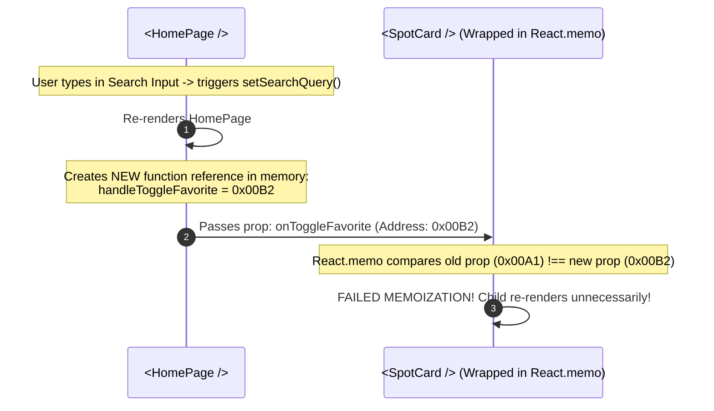
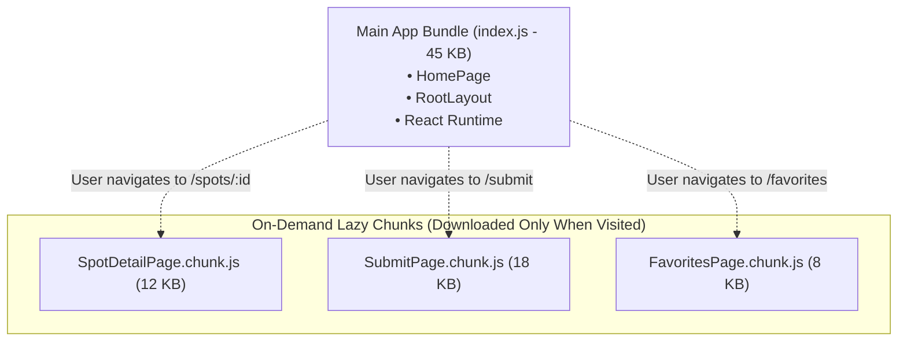

# Week 14: Advanced React, Testing & Ship

This week marks the culmination of the React Frontend curriculum. You will transition Lagos Spots from a working prototype into a production-grade web application: eliminating unnecessary render cycles via **Memoization (`React.memo`, `useMemo`, `useCallback`)**, code-splitting routes with **`React.lazy` & `<Suspense>`**, writing automated component tests with **Vitest & React Testing Library (RTL)**, and deploying the optimized build to **Vercel / Netlify**.

---

## Module 1: React Performance Optimization & Code-Splitting

### 1. The Core Terminology of React Performance

| Term | What It Actually Means | Technical Context |
| :--- | :--- | :--- |
| **Referential Equality** | In JavaScript, objects, arrays, and functions are compared by their **memory address reference**, not their contents (`{} !== {}`, `(() => {}) !== (() => {})`). | Passing a fresh inline arrow function or object prop causes child components to re-render even if data is identical. |
| **`React.memo`** | A Higher-Order Component that memoizes the rendered output of a component, skipping re-renders if its props have shallow referential equality. | Prevents child component re-renders when parent state updates. |
| **`useMemo`** | A React hook that caches the result of an expensive calculation between renders, recalculating only when dependencies change. | Used for computationally expensive operations (filtering, sorting large datasets). |
| **`useCallback`** | A React hook that returns a **memoized callback function reference** across renders. | Essential when passing callback handlers to `React.memo`-wrapped child components. |
| **Code-Splitting** | Splitting the single monolithic JavaScript application bundle into smaller chunks that load on-demand when specific routes are visited. | Dramatically reduces initial page load times and improves **Largest Contentful Paint (LCP)**. |
| **`Suspense`** | A React boundary component that renders a fallback UI (like a loading spinner or skeleton) while its lazy-loaded child component is being downloaded over the network. | Manages async asset loading states declaratively. |

---

### 2. Under the Hood: Why `useCallback` is Required with `React.memo`



#### The Fix: Stabilizing Function References with `useCallback`
```tsx
// src/pages/HomePage.tsx
import React, { useState, useMemo, useCallback } from 'react';
import { SpotCard } from '../components/SpotCard';
import { useFavorites } from '../context/FavoritesContext';
import { Spot, Category } from '../types';

export const HomePage: React.FC<{ allSpots: Spot[] }> = ({ allSpots }) => {
  const [selectedCategory, setSelectedCategory] = useState<Category | 'all'>('all');
  const [searchQuery, setSearchQuery] = useState('');
  const { isFavorite, toggleFavorite } = useFavorites();

  // 1. Memoize expensive array filtering and sorting
  const visibleSpots = useMemo(() => {
    return allSpots.filter((spot) => {
      const matchesCategory = selectedCategory === 'all' || spot.category === selectedCategory;
      const matchesQuery =
        searchQuery.trim() === '' ||
        spot.name.toLowerCase().includes(searchQuery.toLowerCase()) ||
        spot.area.toLowerCase().includes(searchQuery.toLowerCase());
      return matchesCategory && matchesQuery;
    });
  }, [allSpots, selectedCategory, searchQuery]);

  // 2. Memoize the callback handler so its memory reference stays stable
  const handleToggle = useCallback(
    (spotId: string) => {
      toggleFavorite(spotId);
    },
    [toggleFavorite]
  );

  return (
    <div>
      <input
        type="text"
        value={searchQuery}
        onChange={(e) => setSearchQuery(e.target.value)}
        placeholder="Filter visible spots..."
        className="mb-6 px-4 py-2 border rounded-lg"
      />

      <div className="grid grid-cols-1 md:grid-cols-2 lg:grid-cols-3 gap-6">
        {visibleSpots.map((spot) => (
          <SpotCard
            key={spot.id}
            spot={spot}
            isFavorite={isFavorite(spot.id)}
            onToggleFavorite={handleToggle}
          />
        ))}
      </div>
    </div>
  );
};
```

---

### 3. Under the Hood: Route-Level Code-Splitting with `React.lazy`

By default, Vite packages all pages into a single bundle (`index.js`). A visitor opening the homepage downloads code for the Admin panel, Detail views, and Submit forms upfront.

**`React.lazy`** transforms dynamic imports (`import('./pages/SpotDetailPage')`) into asynchronous chunks loaded only on-demand:



```tsx
// src/router.tsx
import React, { lazy, Suspense } from 'react';
import { createBrowserRouter } from 'react-router-dom';
import { RootLayout } from './layouts/RootLayout';
import { HomePage } from './pages/HomePage';

// Lazy-load secondary routes
const SpotDetailPage = lazy(() =>
  import('./pages/SpotDetailPage').then((m) => ({ default: m.SpotDetailPage }))
);
const SubmitSpotPage = lazy(() =>
  import('./pages/SubmitSpotPage').then((m) => ({ default: m.SubmitSpotPage }))
);
const FavoritesPage = lazy(() =>
  import('./pages/FavoritesPage').then((m) => ({ default: m.FavoritesPage }))
);

const PageLoader = () => (
  <div className="flex justify-center items-center py-20">
    <div className="animate-spin rounded-full h-8 w-8 border-b-2 border-orange-600"></div>
  </div>
);

export const router = createBrowserRouter([
  {
    path: '/',
    element: <RootLayout />,
    children: [
      { index: true, element: <HomePage /> },
      {
        path: 'spots/:id',
        element: (
          <Suspense fallback={<PageLoader />}>
            <SpotDetailPage />
          </Suspense>
        ),
      },
      {
        path: 'submit',
        element: (
          <Suspense fallback={<PageLoader />}>
            <SubmitSpotPage />
          </Suspense>
        ),
      },
      {
        path: 'favorites',
        element: (
          <Suspense fallback={<PageLoader />}>
            <FavoritesPage />
          </Suspense>
        ),
      },
    ],
  },
]);
```

---

## Module 2: Automated Testing with Vitest & React Testing Library

### 1. The React Testing Philosophy: Testing User Behavior

**React Testing Library (RTL)** follows a core tenet:
> *"The more your tests resemble the way your software is used, the more confidence they can give you."*

RTL avoids testing internal component state (`wrapper.state()`) or private methods. Instead, tests query the rendered DOM using accessibility landmarks that real users and screen readers rely on (`getByRole`, `getByLabelText`, `getByText`).

---

### 2. Setting Up Vitest & jsdom

```bash
npm install -D vitest @testing-library/react @testing-library/user-event @testing-library/jest-dom jsdom
```

```ts
// vite.config.ts
/// <reference types="vitest" />
import { defineConfig } from 'vite';
import react from '@vitejs/plugin-react-swc';
import tailwindcss from '@tailwindcss/vite';

export default defineConfig({
  plugins: [react(), tailwindcss()],
  test: {
    globals: true,
    environment: 'jsdom',
    setupFiles: './src/test/setup.ts',
  },
});
```

```ts
// src/test/setup.ts
import '@testing-library/jest-dom';
```

---

### 3. Writing Robust Component Tests

```tsx
// src/components/__tests__/SpotCard.test.tsx
import { describe, it, expect, vi } from 'vitest';
import { render, screen } from '@testing-library/react';
import userEvent from '@testing-library/user-event';
import { SpotCard } from '../SpotCard';
import { Spot } from '../../types';

const mockSpot: Spot = {
  id: 'bogobiri',
  name: 'Bogobiri House',
  category: 'events',
  area: 'Ikoyi',
  description: 'African art gallery and live Afrobeat music hub.',
  imageUrl: '/assets/bogobiri.jpg',
};

describe('<SpotCard />', () => {
  it('renders spot title, area, and category badge accurately', () => {
    render(<SpotCard spot={mockSpot} isFavorite={false} />);

    expect(screen.getByRole('heading', { level: 3, name: /bogobiri house/i })).toBeInTheDocument();
    expect(screen.getByText(/ikoyi/i)).toBeInTheDocument();
    expect(screen.getByText(/events/i)).toBeInTheDocument();
    expect(screen.getByText(/african art gallery/i)).toBeInTheDocument();
  });

  it('triggers onToggleFavorite callback with correct ID when favorite button is clicked', async () => {
    const user = userEvent.setup();
    const handleToggle = vi.fn();

    render(
      <SpotCard spot={mockSpot} isFavorite={false} onToggleFavorite={handleToggle} />
    );

    const favoriteButton = screen.getByRole('button', { name: /add to favorites/i });
    await user.click(favoriteButton);

    // Verify callback was invoked with exact parameter
    expect(handleToggle).toHaveBeenCalledTimes(1);
    expect(handleToggle).toHaveBeenCalledWith('bogobiri');
  });

  it('displays active favorited label when isFavorite prop is true', () => {
    render(<SpotCard spot={mockSpot} isFavorite={true} />);
    expect(screen.getByRole('button', { name: /remove from favorites/i })).toHaveTextContent(/favorited/i);
  });
});
```

---

## Module 3: Production Build & Deployment Pipeline

### 1. Client Environment Variables in Vite

Vite exposes environment variables prefixed with `VITE_` to client-side code via `import.meta.env`:

```env
# .env
VITE_APP_TITLE=Lagos Spots
VITE_NOMINATIM_BASE_URL=https://nominatim.openstreetmap.org
```

> [!CAUTION]
> **Client Secrets Rule:** Any variable prefixed with `VITE_` is compiled directly into the client-side JavaScript bundle and is publicly readable by anyone inspecting the source in DevTools. **Never put private API keys, database credentials, or secret signing keys in `.env` files within frontend projects!**

---

### 2. Building & Deploying to Vercel

```bash
# 1. Execute type check and production build
npm run build

# 2. Preview the production build locally
npm run preview
```

#### Production Deployment Steps:
1. Push `lagos-spots-react` to GitHub:
   ```bash
   git push origin main
   ```
2. Log into [Vercel](https://vercel.com) and click **"Add New Project"**.
3. Import your GitHub repository `lagos-spots-react`.
4. Vercel automatically detects the Vite build command (`npm run build`) and output directory (`dist`). Click **Deploy**.
5. Configure client-side SPA routing rewrites by adding a `vercel.json` file to the root:
   ```json
   {
     "rewrites": [{ "source": "/(.*)", "destination": "/index.html" }]
   }
   ```

---

### Common Pitfalls & How to Avoid Them

| Pitfall | Root Cause | Fix |
| :--- | :--- | :--- |
| **Over-memoization overhead** | Wrapping trivial components and basic calculations with `useMemo`/`useCallback`. | Only apply memoization to computationally heavy operations or components with expensive child subtrees. |
| **Testing implementation details** | Inspecting component internal state instead of user-visible elements. | Use RTL's `screen.getByRole()` and simulate real interactions with `userEvent`. |
| **404 error on page refresh on Vercel** | SPA routing requests hit server directly for non-existent `/spots/123` file. | Add `vercel.json` rewrites redirecting all routes to `/index.html`. |

---

### Week 14: Comprehensive Assignment (Frontend Capstone Milestone)

**Objective:** Finalize the Lagos Spots React application with memoization optimizations, route-level code splitting, automated Vitest unit tests, and deploy the live build to a public URL on Vercel.

**Requirements:**
1. **Performance & Code-Splitting:**
   - `HomePage` filtering memoized via `useMemo`.
   - `SpotDetailPage`, `SubmitSpotPage`, and `FavoritesPage` code-split using `React.lazy()` with `<Suspense>` fallback loader.
   - `SpotCard` wrapped in `React.memo` with stable `useCallback` handlers.
2. **Automated Test Suite:**
   - Vitest and React Testing Library configured with `jsdom`.
   - Unit tests written for `SpotCard` (verifying rendering and favorite click callbacks).
   - Unit tests written for `AddSpotForm` (verifying validation error states on short inputs).
   - Running `npm run test` executes and passes all test suites.
3. **Production Deployment:**
   - Application deployed to Vercel/Netlify with live HTTPS URL.
   - Verified that refreshing on deep routes (e.g., `/favorites` or `/spots/terra-kulture`) does not throw 404 errors.
4. **Git Workflow:**
   - Final frontend milestone tagged `v1.0.0-frontend`, merged into `main`, and pushed to GitHub.
