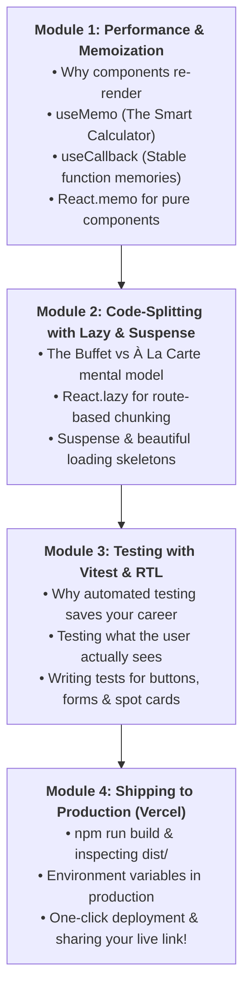
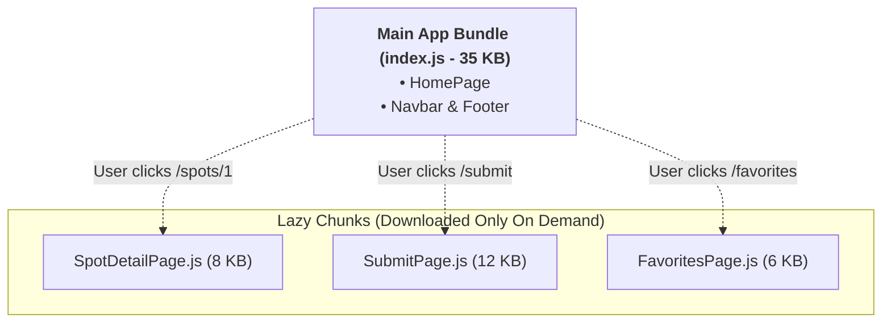

# Week 14: Advanced React, Testing & Ship

Welcome to Week 14! You have reached the grand finale of **Part III: React Mastery**. Over the past three weeks, you designed components, managed reactive state, and built a multi-route architecture with React Router and Context.

Now comes the difference between an amateur hobby project and a **professional, production-ready product**:
1. **Performance:** Does your app lag when searching through hundreds of places, or does it stay at 60 FPS?
2. **Bundle Size:** Does a user on a mobile 3G network in Lagos have to download your entire app upfront, or do pages load on-demand?
3. **Automated Testing:** When you change a piece of code at 2:00 AM, are you confident nothing else broke?
4. **Deployment:** How do you actually put your project live on the internet with a custom link to show employers and friends?

This week, you master **Performance Optimization (`useMemo`, `useCallback`)**, **Code-Splitting (`React.lazy` & `<Suspense>`)**, **Testing with Vitest & React Testing Library**, and **Deploying to Vercel**.

---

## Pedagogical Roadmap



---

## Module 1: Performance & Memoization

### 1. Why Do React Components Re-Render?

Whenever state changes in a parent component, React re-runs that component function from top to bottom. By default, **every child component inside it also re-renders**.

For 95% of small apps, this is completely fine. But when filtering a massive directory of places or rendering hundreds of cards, running heavy calculations on every single keystroke causes visible typing lag.

---

### 2. `useMemo`: The Smart Calculator

> [!NOTE]
> **The Mental Model:** Imagine your friend asks: *"What is 2,438 × 1,942?"* You do the heavy math on paper and say: *"4,734,596."*
> Five seconds later, your friend asks the exact same question again. You don't recalculate from scratch on paper — you remember the answer you already calculated!
> **`useMemo` caches the result of an expensive calculation** and only recalculates if its dependencies change.

```tsx
import { useState, useMemo } from "react";
import { Spot } from "../types";

export function SpotSearch({ allSpots }: { allSpots: Spot[] }) {
  const [searchTerm, setSearchTerm] = useState("");
  const [darkTheme, setDarkTheme] = useState(false);

  // 🟢 useMemo caches the filtered array.
  // It ONLY recalculates when 'allSpots' or 'searchTerm' changes!
  // If 'darkTheme' toggles, this heavy filter is SKIPPED!
  const filteredSpots = useMemo(() => {
    console.log("Filtering spots...");
    return allSpots.filter((spot) =>
      spot.name.toLowerCase().includes(searchTerm.toLowerCase()) ||
      spot.area.toLowerCase().includes(searchTerm.toLowerCase())
    );
  }, [allSpots, searchTerm]);

  return (
    <div>
      <input
        value={searchTerm}
        onChange={(e) => setSearchTerm(e.target.value)}
        placeholder="Search Lagos spots..."
      />
      <button onClick={() => setDarkTheme(!darkTheme)}>Toggle Theme</button>
      {/* Render filteredSpots ... */}
    </div>
  );
}
```

---

### 3. `useCallback`: Remembering Function References

In JavaScript, functions are objects. Every time a component re-renders, **any function defined inside it is created as a completely new function in memory**:

```js
// In JavaScript:
const fn1 = () => "hello";
const fn2 = () => "hello";
console.log(fn1 === fn2); // FALSE! Different memory addresses!
```

If you pass an arrow function prop down to a child component, the child thinks the prop changed on every single render.

**`useCallback`** returns the **exact same function reference** between renders:

```tsx
import { useCallback } from "react";

// The function is only recreated if 'toggleFavorite' changes:
const handleToggle = useCallback((spotId: number) => {
  toggleFavorite(spotId);
}, [toggleFavorite]);
```

---

## Module 2: Code-Splitting with `React.lazy` & `<Suspense>`

### 1. The Monolith Problem (The Buffet vs À La Carte Analogy)

> [!NOTE]
> **The Mental Model:**
> - Without code-splitting, your website is like an **all-you-can-eat buffet where you must eat all 50 dishes before walking through the door**. Even if a visitor only wanted to see the home page, their phone downloads the code for the Admin dashboard, Submit form, and Detail views upfront!
> - With **Code-Splitting**, you order **à la carte**. When a user visits the homepage, they only download the homepage (fast!). When they click `/submit`, the browser fetches that page's chunk in the background.



---

### 2. Implementing `React.lazy` in Your Router

```tsx
// src/router.tsx
import { lazy, Suspense } from "react";
import { createBrowserRouter } from "react-router-dom";
import { RootLayout } from "./layouts/RootLayout";
import { HomePage } from "./pages/HomePage";

// 1. Lazy load secondary pages:
const SpotDetailPage = lazy(() => import("./pages/SpotDetailPage"));
const SubmitSpotPage = lazy(() => import("./pages/SubmitSpotPage"));
const FavoritesPage = lazy(() => import("./pages/FavoritesPage"));

// 2. Simple Loading Spinner Fallback:
const LoadingSpinner = () => (
  <div className="py-20 text-center text-slate-500 font-semibold animate-pulse">
    ⏳ Loading page...
  </div>
);

export const router = createBrowserRouter([
  {
    path: "/",
    element: <RootLayout />,
    children: [
      { index: true, element: <HomePage /> },
      {
        path: "spots/:id",
        element: (
          <Suspense fallback={<LoadingSpinner />}>
            <SpotDetailPage />
          </Suspense>
        ),
      },
      {
        path: "submit",
        element: (
          <Suspense fallback={<LoadingSpinner />}>
            <SubmitSpotPage />
          </Suspense>
        ),
      },
    ],
  },
]);
```

---

## Module 3: Automated Testing with Vitest & RTL

### 1. Why Do Developers Write Automated Tests?

Imagine you just fixed a typo in the `<AddSpotForm />`. How do you know:
- Did you accidentally break the favorite button on the home page?
- Does submitting an empty form still show an error message?
- Does typing into the search bar still filter places?

Manual testing (clicking around the website for 15 minutes every time you make a change) is slow and error-prone. **Automated tests run in 2 seconds and verify that every feature works flawlessly.**

---

### 2. Setting Up Vitest & React Testing Library

```bash
npm install -D vitest @testing-library/react @testing-library/jest-dom jsdom
```

Add test command to `package.json`:
```json
"scripts": {
  "test": "vitest"
}
```

---

### 3. Writing Your First Component Test

The philosophy of **React Testing Library** is simple: **Test your components the same way a real human user interacts with them.** (Don't test internal state variables; test what appears on the screen!).

```tsx
// src/components/SpotCard.test.tsx
import { render, screen } from "@testing-library/react";
import userEvent from "@testing-library/user-event";
import { describe, it, expect, vi } from "vitest";
import { SpotCard } from "./SpotCard";

describe("SpotCard Component", () => {
  const mockSpot = {
    id: 1,
    name: "Terra Kulture",
    area: "Victoria Island",
    category: "Food",
    fee: 0,
  };

  it("renders the spot name and location correctly", () => {
    render(<SpotCard spot={mockSpot} isFavorite={false} onToggleFavorite={() => {}} />);

    // Check if the title is visible on screen:
    expect(screen.getByText("Terra Kulture")).toBeDefined();
    expect(screen.getByText(/Victoria Island/i)).toBeDefined();
    expect(screen.getByText("Free Entry")).toBeDefined();
  });

  it("calls onToggleFavorite when favorite button is clicked", async () => {
    const handleToggle = vi.fn(); // Spy function that tracks if it was called

    render(<SpotCard spot={mockSpot} isFavorite={false} onToggleFavorite={handleToggle} />);

    // User finds the button and clicks it:
    const button = screen.getByRole("button", { name: /save/i });
    await userEvent.click(button);

    // Verify our function was called exactly once with spot id 1:
    expect(handleToggle).toHaveBeenCalledTimes(1);
  });
});
```

Run `npm test`, and watch Vitest run your tests in milliseconds!

---

## Module 4: Shipping to Production (Vercel)

### 1. The Production Build: `npm run build`

When you develop locally, Vite serves unbundled TypeScript files. Before deploying, you must create an **optimized production build**:

```bash
npm run build
```

This compiles all your code, minifies HTML/CSS/JS, and creates a **`dist/`** folder containing small, blazingly fast assets ready for the cloud.

---

### 2. Deploying to Vercel in 3 Minutes

**Vercel** is the gold standard for deploying modern frontend web applications:

1. Push your latest code to GitHub:
   ```bash
   git add .
   git commit -m "feat: complete Lagos Spots React SPA with routing and tests"
   git push origin main
   ```
2. Go to [vercel.com](https://vercel.com) and sign in with GitHub.
3. Click **"Add New Project"** $\to$ Select your `lagos-spots` repository.
4. Click **Deploy**!
5. In under 45 seconds, Vercel gives you a live, public, SSL-secured URL (e.g., `https://lagos-spots.vercel.app`) to share with the world!

---

## Module 5: Rookie Traps & Debugging Guide

| Error Message / Trap | Root Cause | How to Fix It |
| :--- | :--- | :--- |
| `React.lazy failed: Element type is invalid` | You used named export (`export function ...`) instead of default export with `React.lazy`. | Either export default, or use `.then(m => ({ default: m.Component }))`. |
| 404 Not Found when refreshing on a nested route (e.g. `/favorites`) on Vercel | Vercel server tries to find a physical file named `/favorites.html`. | Add a `vercel.json` rewrites file redirecting all paths to `index.html`. |
| Vitest says `document is not defined` | Test environment not configured to browser DOM. | In `vite.config.ts`, add `test: { environment: 'jsdom' }`. |

---

## 🎯 Week 14 Hands-on Classroom Exercises

### Level 1: Memoization Drills
1. In `HomePage.tsx`, wrap your spot filter logic in `useMemo`.
2. Add a `console.log("Filtering spots...")` inside the memo callback.
3. Add a theme toggle button or counter on the page and verify that clicking it **does not re-run** the filter calculation!

### Level 2: Component Tests with Vitest
1. Set up Vitest in your project.
2. Write a test for `<AddSpotForm />` that verifies:
   - Typing into the spot name input updates the field.
   - Clicking submit with valid data calls the submit handler.

### Level 3: Ship Your Project Live!
1. Run `npm run build` locally and fix any remaining TypeScript compiler errors.
2. Push your code to GitHub on `main`.
3. Deploy your project to Vercel or Netlify.
4. Share your live production link with your classmates and instructor!

---

## 📚 Curated Deep-Dive References

* [React Official Documentation: useMemo](https://react.dev/reference/react/useMemo) — When to use and when to avoid useMemo.
* [React Official Documentation: useCallback](https://react.dev/reference/react/useCallback) — Keeping callback references stable.
* [React Official Documentation: Suspense](https://react.dev/reference/react/Suspense) — Declarative loading states and fallbacks.
* [Testing Library Documentation](https://testing-library.com/docs/react-testing-library/intro/) — The industry standard for user-centric testing.
* [Vercel Deployment Documentation](https://vercel.com/docs) — Deploying Vite and React SPAs seamlessly.
