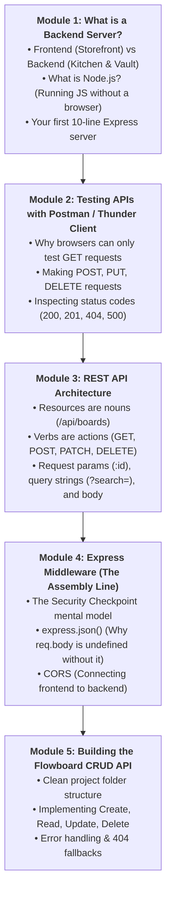
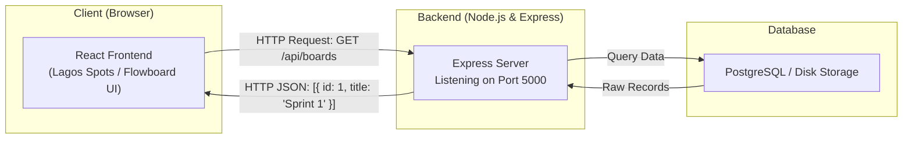
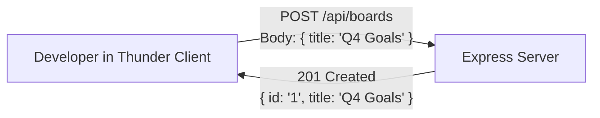
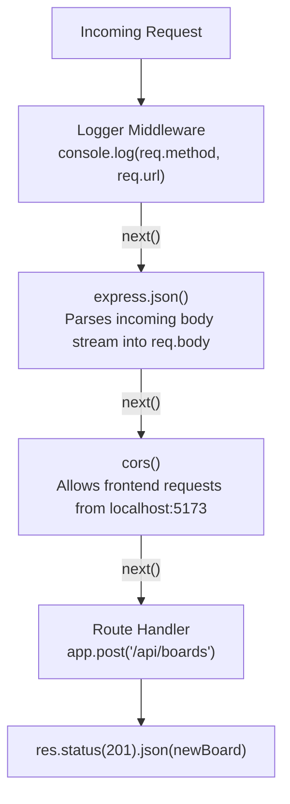

# Week 15: Node.js, Express & REST API Design

Welcome to Week 15 and welcome to **Part IV: Backend & Full-Stack Development**!

Up until now, all of your code has executed **client-side in the browser**. When you saved favorites in Lagos Spots, they were stored in that single browser's `localStorage`. If you opened the site on another laptop or a phone, your saved places were gone!

To build real products — where multiple users can register, collaborate, create shared data, and access it from any device — you need a **Backend Server** and a **Database**.

This week, we introduce our second major running project: **Flowboard** — a collaborative, Trello-style project management API. You will learn how to run JavaScript on the server with **Node.js**, build lightning-fast web APIs with **Express**, and design clean **RESTful endpoints**.

---

## Pedagogical Roadmap



---

## Module 1: What is a Backend Server? & Intro to Node.js

### 1. Frontend vs. Backend (The Restaurant Mental Model)

> [!NOTE]
> **The Mental Model:**
> - **The Frontend (Browser / Client):** The dining area of a restaurant. It has comfortable tables, menus, nice lighting, and friendly waiters. Its job is to look great and collect orders from customers.
> - **The Backend (Server & Database):** The kitchen and the locked storage pantry. It receives orders, validates recipes, securely cooks the food, stores customer accounts, and ensures nobody walks into the kitchen without permission.



---

### 2. What is Node.js?

Normally, JavaScript can only run inside a web browser (Chrome, Firefox).

**Node.js** is a program that allows you to run JavaScript directly on your computer's operating system! With Node.js, your JavaScript code can:
- Listen for network requests on a specific **Port** (like `5000` or `3000`).
- Read and write files directly on your hard drive.
- Connect securely to cloud databases.

Verify that Node is installed on your computer:
```bash
node -v
# Output should be v18.x.x, v20.x.x, or newer LTS
```

---

### 3. Your First 10-Line Express Server

Let's build a working server from scratch:

```bash
# 1. Create project folder
mkdir flowboard-api && cd flowboard-api

# 2. Initialize npm package.json
npm init -y

# 3. Install Express & developer tools
npm install express cors dotenv
npm install -D tsx typescript @types/node @types/express @types/cors
```

Create a file named `src/index.ts`:

```ts
// src/index.ts
import express, { Request, Response } from "express";

const app = express();
const PORT = 5000;

// A simple GET route:
app.get("/", (req: Request, res: Response) => {
  res.send("🚀 Flowboard API is online and listening!");
});

// A route that returns JSON data:
app.get("/api/health", (req: Request, res: Response) => {
  res.json({ status: "healthy", timestamp: new Date() });
});

// Start listening for incoming connections:
app.listen(PORT, () => {
  console.log(`Server running at http://localhost:${PORT}`);
});
```

Add a dev script to `package.json`:
```json
"scripts": {
  "dev": "tsx watch src/index.ts"
}
```

Run `npm run dev`, open `http://localhost:5000/api/health` in your browser, and you will see your live JSON response!

---

## Module 2: Testing APIs with Thunder Client or Postman

When building websites, browsers can easily test `GET` requests (just by typing a URL). But how do you test submitting a form with `POST`, updating data with `PATCH`, or deleting a board with `DELETE` before your frontend is built?

> [!TIP]
> Install the free **Thunder Client** extension directly inside VS Code (or download **Postman**).
> Thunder Client allows you to construct any HTTP request, type a JSON body, set headers, and inspect the status code and response instantly!



### Essential HTTP Status Codes to Know:
- **`200 OK`:** Successful read or update.
- **`201 Created`:** New item successfully created via `POST`.
- **`400 Bad Request`:** Client sent invalid or missing data.
- **`404 Not Found`:** The requested ID or URL does not exist.
- **`500 Internal Server Error`:** The server crashed (check your backend terminal console!).

---

## Module 3: REST API Architecture

**REST (Representational State Transfer)** is the industry-standard way to design web APIs.

### The Core REST Rules:
1. **URIs represent NOUNS (resources), never verbs:**
   - 🟢 Good: `GET /api/boards` (Get all boards)
   - 🔴 Bad: `/api/getBoards` or `/api/createNewBoard`
2. **HTTP Verbs describe the ACTION:**

| HTTP Verb | Purpose in Flowboard | Example Route | Expected Status |
| :--- | :--- | :--- | :--- |
| **`GET`** | Read / Fetch all items | `/api/boards` | `200 OK` |
| **`GET`** | Read a single item by ID | `/api/boards/:id` | `200 OK` or `404` |
| **`POST`** | Create a new item | `/api/boards` | `201 Created` |
| **`PATCH`** | Update specific fields on an item | `/api/boards/:id` | `200 OK` |
| **`DELETE`** | Remove an item | `/api/boards/:id` | `200 OK` / `204` |

---

## Module 4: Express Middleware (The Assembly Line)

> [!NOTE]
> **The Mental Model:** Imagine an airport security checkpoint.
> Before you get on the plane (your route handler), you pass through checkpoints:
> 1. Checkpoint 1 checks your passport (Logging / Auth).
> 2. Checkpoint 2 scans your bags and translates contents (`express.json()`).
> 3. Each checkpoint does its job and says **`next()`** to send you to the next station.



### The Most Common Beginner Express Bug:
If you send a JSON body from Thunder Client, but inside Express `req.body` is `undefined`, you forgot to enable the JSON body parser!

**Always add this near the top of your server:**
```ts
app.use(express.json()); // Parses incoming JSON in request bodies!
```

---

## Module 5: Building the Flowboard CRUD API

Let's build a complete, working in-memory CRUD API for **Flowboard Boards**:

```ts
// src/index.ts
import express, { Request, Response } from "express";
import cors from "cors";

const app = express();
const PORT = 5000;

// Enable essential middlewares:
app.use(cors());
app.use(express.json());

// In-Memory Data Store (We replace this with PostgreSQL in Week 16):
interface Board {
  id: string;
  title: string;
  description: string;
  createdAt: Date;
}

let boards: Board[] = [
  { id: "1", title: "Project Launch", description: "Tasks for Q4 MVP launch", createdAt: new Date() },
  { id: "2", title: "Marketing Campaign", description: "Lagos billboard & social outreach", createdAt: new Date() },
];

// 1. GET /api/boards - List all boards
app.get("/api/boards", (req: Request, res: Response) => {
  res.json(boards);
});

// 2. GET /api/boards/:id - Get a single board by ID
app.get("/api/boards/:id", (req: Request, res: Response) => {
  const boardId = req.params.id;
  const board = boards.find((b) => b.id === boardId);

  if (!board) {
    return res.status(404).json({ error: `Board with ID ${boardId} not found.` });
  }

  res.json(board);
});

// 3. POST /api/boards - Create a new board
app.post("/api/boards", (req: Request, res: Response) => {
  const { title, description } = req.body;

  // Input Validation:
  if (!title || title.trim().length < 3) {
    return res.status(400).json({ error: "Title is required and must be at least 3 characters." });
  }

  const newBoard: Board = {
    id: Date.now().toString(),
    title: title.trim(),
    description: description ? description.trim() : "",
    createdAt: new Date(),
  };

  boards.push(newBoard);
  res.status(201).json(newBoard);
});

// 4. PATCH /api/boards/:id - Update an existing board
app.patch("/api/boards/:id", (req: Request, res: Response) => {
  const boardId = req.params.id;
  const board = boards.find((b) => b.id === boardId);

  if (!board) {
    return res.status(404).json({ error: `Board with ID ${boardId} not found.` });
  }

  const { title, description } = req.body;
  if (title) board.title = title.trim();
  if (description !== undefined) board.description = description.trim();

  res.json(board);
});

// 5. DELETE /api/boards/:id - Delete a board
app.delete("/api/boards/:id", (req: Request, res: Response) => {
  const boardId = req.params.id;
  const initialLength = boards.length;
  boards = boards.filter((b) => b.id !== boardId);

  if (boards.length === initialLength) {
    return res.status(404).json({ error: `Board with ID ${boardId} not found.` });
  }

  res.json({ message: "Board deleted successfully." });
});

// Start the server
app.listen(PORT, () => {
  console.log(`Flowboard API running on http://localhost:${PORT}`);
});
```

---

## Module 6: Rookie Traps & Debugging Guide

| Error Message / Trap | Root Cause | How to Fix It |
| :--- | :--- | :--- |
| `Error: listen EADDRINUSE: address already in use :::5000` | Another instance of your server is already running on port 5000. | Kill the previous terminal process (`Ctrl + C`) or change the port to 5001. |
| `req.body is undefined` | Missing `express.json()` middleware. | Add `app.use(express.json())` before defining routes. |
| Request hangs forever in Thunder Client / Postman | You forgot to send a response: no `res.json()` or `res.send()`. | Ensure every route sends a response or calls `next()`. |
| `Cannot GET /api/board` (Notice missing 's') | Misspelled route URL. | Check spelling in both Thunder Client and your Express route definition. |

---

## 🎯 Week 15 Hands-on Classroom Exercises

### Level 1: Initializing Your Server
1. Create a `flowboard-api` folder and initialize with `npm init -y`.
2. Install Express, CORS, and TypeScript tooling.
3. Write a health check route `GET /api/health` and verify it in your browser.

### Level 2: Testing CRUD with Thunder Client
1. Implement the `GET /api/boards` and `POST /api/boards` routes.
2. In Thunder Client or Postman, send a `POST` request with a JSON body:
   `{ "title": "Classroom Sprint", "description": "Learning Express today" }`.
3. Verify that you get back a `201 Created` status with the newly created board!

### Level 3: Adding Lists to Flowboard
1. Inside Flowboard, boards contain **Lists** (e.g., "To Do", "In Progress", "Done").
2. Create an in-memory `lists` array: `{ id, boardId, title }`.
3. Implement `GET /api/boards/:boardId/lists` to return all lists belonging to a specific board.
4. Implement `POST /api/boards/:boardId/lists` to create a new list for that board!

---

## 📚 Curated Deep-Dive References

* [The Valley of Code: Node.js Tutorial](https://thevalleyofcode.com/nodejs/) — Flavio Copes' gentle introduction to server-side JavaScript.
* [The Valley of Code: Express Handbook](https://thevalleyofcode.com/express/) — Step-by-step guide to Express routing and middlewares.
* [Express.js Official Documentation](https://expressjs.com/en/starter/installing.html) — Official documentation and routing guides.
* [MDN Web Docs: Express Web Development](https://developer.mozilla.org/en-US/docs/Learn/Server-side/Express_Nodejs) — Comprehensive tutorial on backend architecture.
