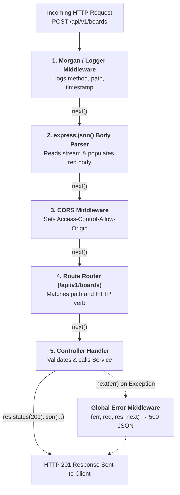
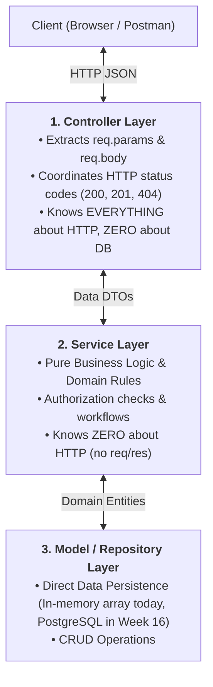

# Week 15: Node.js, Express & REST API Design

Up to this point, all application logic has executed client-side in the browser. This week marks your transition to **Backend Engineering**: writing server-side JavaScript/TypeScript using **Node.js** and **Express**. We introduce a brand-new, production-grade project that will carry the entire backend curriculum: **Flowboard** — a collaborative Trello-style project management API. You will master **RESTful API Architecture**, the **Express Middleware Pipeline (The Onion Model)**, **HTTP Verbs & Idempotency**, and a clean **3-Tier Layered Architecture (Controller $\leftrightarrow$ Service $\leftrightarrow$ Model)**.

---

## Module 1: Node.js Runtime & Express Architecture

### 1. The Core Terminology of Server-Side Engineering

| Term | What It Actually Means | Technical Context |
| :--- | :--- | :--- |
| **Node.js Runtime** | An open-source, cross-platform JavaScript runtime built on Chrome's V8 engine and `libuv`. | Allows JavaScript to run on servers with direct access to the Operating System, filesystem, TCP sockets, and databases. |
| **`libuv`** | A C library powering Node.js that provides an asynchronous event loop and thread pool for non-blocking I/O operations. | Handles disk I/O, DNS lookups, and network socket communication on background OS threads. |
| **REST (Representational State Transfer)** | An architectural style for networked applications using stateless, client-server communication and standard HTTP methods over resource URIs. | Resources are nouns (e.g., `/api/v1/boards`), and actions are expressed via HTTP verbs (`GET`, `POST`, `PATCH`, `DELETE`). |
| **Idempotency** | A property of an HTTP method where making the same request multiple times produces the exact same server state as making it once. | `GET`, `PUT`, `DELETE`, and `HEAD` are idempotent; `POST` is **non-idempotent**. |
| **Middleware** | A pipeline of functions in Express with access to the Request (`req`), Response (`res`), and next middleware function (`next()`). | Executes tasks like logging, authentication, request body parsing, and input validation. |

---

### 2. Under the Hood: HTTP Verbs, Status Codes & Idempotency Matrix

| HTTP Method | CRUD Operation | Idempotent? | Safe? (Read-Only) | Standard Success Status | Standard Error Statuses |
| :--- | :--- | :--- | :--- | :--- | :--- |
| **`GET`** | **R**ead | **Yes** | **Yes** | `200 OK` | `404 Not Found` |
| **`POST`** | **C**reate | **No** (Creates new resource on each call) | **No** | `201 Created` | `400 Bad Request`, `422 Unprocessable` |
| **`PUT`** | **U**pdate (Complete Replacement) | **Yes** | **No** | `200 OK` / `204 No Content` | `400`, `404` |
| **`PATCH`** | **U**pdate (Partial Modification) | **No** / **Yes** (Depends on payload) | **No** | `200 OK` | `400`, `404` |
| **`DELETE`** | **D**elete | **Yes** (Repeated delete results in resource gone) | **No** | `200 OK` / `204 No Content` | `404 Not Found` |

---

### 3. Under the Hood: The Express Middleware Onion Pipeline

Express processes incoming HTTP requests sequentially through a pipeline of middleware functions. Each function can modify `req` or `res`, terminate the request, or pass control along via `next()`:



> [!CAUTION]
> **The Hanging Request Bug:** If a middleware function does **not** call `next()` and does **not** send a response (e.g. `res.send()` or `res.json()`), the HTTP connection remains open until the client times out!

---

## Module 2: Scaffolding the Flowboard API

### 1. Project Initialization with TypeScript and `tsx`

```bash
# 1. Create project directory and package.json
mkdir flowboard-api && cd flowboard-api
npm init -y

# 2. Install production runtime dependencies
npm install express cors dotenv

# 3. Install developer tooling & TypeScript definitions
npm install -D typescript tsx @types/node @types/express @types/cors
```

#### `tsconfig.json` Setup:
```json
{
  "compilerOptions": {
    "target": "ES2022",
    "module": "NodeNext",
    "moduleResolution": "NodeNext",
    "lib": ["ES2022"],
    "outDir": "./dist",
    "rootDir": "./src",
    "strict": true,
    "esModuleInterop": true,
    "skipLibCheck": true,
    "forceConsistentCasingInFileNames": true
  },
  "include": ["src/**/*"]
}
```

#### `package.json` Scripts:
```json
"scripts": {
  "dev": "tsx watch src/index.ts",
  "build": "tsc",
  "start": "node dist/index.js"
}
```

---

## Module 3: Layered 3-Tier Architecture

### 1. Why Layering Matters (Separation of Concerns)

Tightly coupling HTTP parsing with database queries creates unmaintainable, untestable code. We enforce a strict **3-Tier Layered Architecture**:



---

### 2. Complete Flowboard Domain Implementation

```
src/
├── types/
│   └── board.types.ts       # TypeScript Domain Interfaces & DTOs
├── models/
│   └── board.model.ts       # Data storage layer
├── services/
│   └── board.service.ts     # Business logic & validation
├── controllers/
│   └── board.controller.ts  # HTTP Request/Response coordination
├── routes/
│   └── board.routes.ts      # URL path mapping
└── index.ts                 # Express app initialization & server entry
```

#### 1. Domain Types (`src/types/board.types.ts`):
```ts
export interface Board {
  id: string;
  title: string;
  description: string;
  createdAt: Date;
  updatedAt: Date;
}

export interface CreateBoardDTO {
  title: string;
  description?: string;
}

export interface UpdateBoardDTO {
  title?: string;
  description?: string;
}
```

#### 2. Model Layer (`src/models/board.model.ts`):
```ts
import { Board } from '../types/board.types';

// In-memory data store (swapped with PostgreSQL & Drizzle in Week 16)
let boardsTable: Board[] = [
  {
    id: 'b-1',
    title: 'Product Roadmap Q3',
    description: 'Core product features and milestone deliverables',
    createdAt: new Date(),
    updatedAt: new Date(),
  },
];

export const BoardModel = {
  findAll: async (): Promise<Board[]> => {
    return [...boardsTable];
  },

  findById: async (id: string): Promise<Board | null> => {
    const found = boardsTable.find((b) => b.id === id);
    return found ? { ...found } : null;
  },

  create: async (data: Omit<Board, 'id' | 'createdAt' | 'updatedAt'>): Promise<Board> => {
    const newBoard: Board = {
      id: `b-${crypto.randomUUID()}`,
      ...data,
      createdAt: new Date(),
      updatedAt: new Date(),
    };
    boardsTable.push(newBoard);
    return { ...newBoard };
  },

  update: async (id: string, data: Partial<Omit<Board, 'id' | 'createdAt'>>): Promise<Board | null> => {
    const index = boardsTable.findIndex((b) => b.id === id);
    if (index === -1) return null;

    boardsTable[index] = {
      ...boardsTable[index],
      ...data,
      updatedAt: new Date(),
    };
    return { ...boardsTable[index] };
  },

  delete: async (id: string): Promise<boolean> => {
    const initialLength = boardsTable.length;
    boardsTable = boardsTable.filter((b) => b.id !== id);
    return boardsTable.length < initialLength;
  },
};
```

#### 3. Service Layer (`src/services/board.service.ts`):
```ts
import { BoardModel } from '../models/board.model';
import { Board, CreateBoardDTO, UpdateBoardDTO } from '../types/board.types';

export const BoardService = {
  getAllBoards: async (): Promise<Board[]> => {
    return BoardModel.findAll();
  },

  getBoardById: async (id: string): Promise<Board> => {
    const board = await BoardModel.findById(id);
    if (!board) {
      const error: any = new Error(`Board with ID "${id}" was not found.`);
      error.statusCode = 404;
      throw error;
    }
    return board;
  },

  createBoard: async (dto: CreateBoardDTO): Promise<Board> => {
    if (!dto.title || dto.title.trim().length < 3) {
      const error: any = new Error('Board title must be at least 3 characters long.');
      error.statusCode = 400;
      throw error;
    }

    return BoardModel.create({
      title: dto.title.trim(),
      description: dto.description?.trim() ?? '',
    });
  },

  updateBoard: async (id: string, dto: UpdateBoardDTO): Promise<Board> => {
    // Verify board exists first
    await BoardService.getBoardById(id);

    const updated = await BoardModel.update(id, dto);
    if (!updated) {
      const error: any = new Error(`Failed to update board "${id}".`);
      error.statusCode = 500;
      throw error;
    }
    return updated;
  },

  deleteBoard: async (id: string): Promise<void> => {
    await BoardService.getBoardById(id);
    await BoardModel.delete(id);
  },
};
```

#### 4. Controller Layer (`src/controllers/board.controller.ts`):
```ts
import { Request, Response, NextFunction } from 'express';
import { BoardService } from '../services/board.service';

export const BoardController = {
  getBoards: async (_req: Request, res: Response, next: NextFunction): Promise<void> => {
    try {
      const boards = await BoardService.getAllBoards();
      res.status(200).json({
        status: 'success',
        results: boards.length,
        data: { boards },
      });
    } catch (err) {
      next(err);
    }
  },

  getBoard: async (req: Request, res: Response, next: NextFunction): Promise<void> => {
    try {
      const { id } = req.params;
      const board = await BoardService.getBoardById(id);
      res.status(200).json({
        status: 'success',
        data: { board },
      });
    } catch (err) {
      next(err);
    }
  },

  createBoard: async (req: Request, res: Response, next: NextFunction): Promise<void> => {
    try {
      const newBoard = await BoardService.createBoard(req.body);
      res.status(201).json({
        status: 'success',
        data: { board: newBoard },
      });
    } catch (err) {
      next(err);
    }
  },

  updateBoard: async (req: Request, res: Response, next: NextFunction): Promise<void> => {
    try {
      const { id } = req.params;
      const updatedBoard = await BoardService.updateBoard(id, req.body);
      res.status(200).json({
        status: 'success',
        data: { board: updatedBoard },
      });
    } catch (err) {
      next(err);
    }
  },

  deleteBoard: async (req: Request, res: Response, next: NextFunction): Promise<void> => {
    try {
      const { id } = req.params;
      await BoardService.deleteBoard(id);
      res.status(204).send(); // 204 No Content
    } catch (err) {
      next(err);
    }
  },
};
```

#### 5. Route Router (`src/routes/board.routes.ts`):
```ts
import { Router } from 'express';
import { BoardController } from '../controllers/board.controller';

const router = Router();

router.route('/')
  .get(BoardController.getBoards)
  .post(BoardController.createBoard);

router.route('/:id')
  .get(BoardController.getBoard)
  .patch(BoardController.updateBoard)
  .delete(BoardController.deleteBoard);

export default router;
```

#### 6. Express Server Entry (`src/index.ts`):
```ts
import express, { Request, Response, NextFunction } from 'express';
import cors from 'cors';
import boardRoutes from './routes/board.routes';

const app = express();
const PORT = process.env.PORT || 4000;

// Global Middleware
app.use(cors());
app.use(express.json()); // Parses application/json body

// Health Check Endpoint
app.get('/health', (_req: Request, res: Response) => {
  res.status(200).json({ status: 'ok', uptime: process.uptime() });
});

// Mount Versioned API Routers
app.use('/api/v1/boards', boardRoutes);

// 404 Catch-All Handler
app.use((req: Request, res: Response) => {
  res.status(404).json({
    status: 'fail',
    message: `Endpoint ${req.method} ${req.originalUrl} does not exist on this server.`,
  });
});

// Global Error-Handling Middleware (Must have 4 arguments!)
app.use((err: any, _req: Request, res: Response, _next: NextFunction) => {
  const statusCode = err.statusCode || 500;
  const message = err.message || 'Internal Server Error';

  console.error(`[Error ${statusCode}]:`, err);

  res.status(statusCode).json({
    status: statusCode >= 500 ? 'error' : 'fail',
    message,
    ...(process.env.NODE_ENV === 'development' && { stack: err.stack }),
  });
});

app.listen(PORT, () => {
  console.log(`🚀 Flowboard API server listening on http://localhost:${PORT}`);
});
```

---

### Common Pitfalls & How to Avoid Them

| Pitfall | Root Cause | Fix |
| :--- | :--- | :--- |
| `req.body` is `undefined` | Sending JSON payloads without registering the JSON body parser. | Add `app.use(express.json());` before mounting routers. |
| `Error [ERR_HTTP_HEADERS_SENT]: Cannot set headers after they are sent to the client` | Attempting to send a second response (e.g. forgot `return res.json()`). | Always `return` when sending early error responses inside conditional branches. |
| Server hangs indefinitely | Forgetting to call `next()` or send a response in a middleware function. | Ensure every middleware branch either sends a response or calls `next()`. |

---

### Week 15: Comprehensive Assignment

**Objective:** Scaffold the Flowboard REST API with Node.js, Express, and TypeScript, implementing the 3-Tier Layered Architecture (Controller $\leftrightarrow$ Service $\leftrightarrow$ Model) and complete CRUD operations.

**Requirements:**
1. **Tooling & Setup:**
   - Initialized with `npm`, TypeScript strict mode, and `tsx watch` for auto-restarts.
   - Global middleware: `cors()`, `express.json()`.
2. **Layered Architecture:**
   - Code strictly partitioned into `routes/`, `controllers/`, `services/`, `models/`, and `types/`.
   - Controllers handle HTTP req/res; Services handle business rules; Models handle storage.
3. **RESTful Endpoints:**
   - `GET /api/v1/boards` $\to$ Returns array of boards (`200 OK`).
   - `GET /api/v1/boards/:id` $\to$ Returns single board or `404 Not Found`.
   - `POST /api/v1/boards` $\to$ Validates title ($\ge 3$ chars) and creates board (`201 Created`).
   - `PATCH /api/v1/boards/:id` $\to$ Partial update (`200 OK`).
   - `DELETE /api/v1/boards/:id` $\to$ Deletes board (`204 No Content`).
4. **Global Error Handling:**
   - 404 handler for unrecognized routes.
   - 4-argument global error middleware returning formatted JSON errors.
5. **Git Workflow:**
   - Repository `flowboard-api` initialized, committed with conventional commit messages, and pushed to GitHub.

---

## Recommended References & Deep-Dive Resources

### Official Documentation & Standards
- [Node.js Official Documentation](https://nodejs.org/docs/latest/api/) — Complete API reference for the Node.js runtime, event loop, and core modules.
- [Express.js Official Guide](https://expressjs.com/en/guide/routing.html) — Routing, middleware pipeline execution, and error handling architecture.
- [RESTful API Design Standards (restfulapi.net)](https://restfulapi.net/) — Resource-oriented URI design, HTTP verb semantics, and status code specifications.

### Recommended Textbooks & Canonical Books
- **Node.js Design Patterns (3rd Edition)** by Mario Casciaro and Luciano Mammino (Packt) — *Chapters 1–4: The Node.js Platform, Module System, and Asynchronous Control Flow Patterns.*
- **Build APIs You Won't Hate** by Phil Sturgeon — *Practical architectural guide for designing RESTful APIs, versioning, serialization, and status code best practices.*
- **REST in Practice: Hypermedia and Systems Architecture** by Jim Webber, Savas Parastatidis, and Ian Robinson (O'Reilly) — *Deconstructing distributed system design using HTTP.*

### Deep Dives & Architectural Guides
- [Martin Fowler: Richardson Maturity Model](https://martinfowler.com/articles/richardsonMaturityModel.html) — The 4-level model evaluating RESTful API compliance.
- [Node.js Event Loop, Timers, and process.nextTick()](https://nodejs.org/en/learn/asynchronous-work/event-loop-timers-and-nexttick) — Official guide explaining libuv event loop phases.
