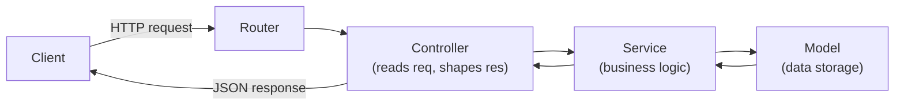

# Week 15: Node.js, Express & REST API Design

Everything you've built so far has run entirely in the browser. This week that changes: you write real server-side code for the first time, starting a brand-new project — **Flowboard**, a Trello-style task board API that will carry the rest of the course. By the end of this week it responds to real HTTP requests with a proper layered architecture, even though it doesn't touch a real database yet.

---

## Module 1: Your First Express Server

### 1. What Node.js and Express Actually Are

* **Lecture & Concepts:**
    * **Node.js** is a runtime that executes JavaScript *outside* a browser — on a server, with access to the filesystem, network, and operating system that browser JS is deliberately blocked from touching.
    * **Express** is a minimal web framework built on top of Node's built-in `http` module. Raw `http` requires manually parsing URLs, methods, and bodies for every request; Express gives you a clean, declarative way to say "when a `GET` request hits `/boards`, run this function."

* **In-Depth Example (Terminal):**
    ```bash
    mkdir flowboard-api && cd flowboard-api
    npm init -y
    npm install express
    npm install -D typescript tsx @types/node @types/express
    npx tsc --init
    ```

### 2. Your First Real Server

* **Lecture & Concepts:**
    * `express()` creates an app instance. `app.listen(port, callback)` starts it listening for real network connections on that port.

* **In-Depth Example:**
    ```ts
    // src/index.ts
    import express from 'express';

    const app = express();
    const PORT = process.env.PORT ?? 3000;

    app.listen(PORT, () => {
      console.log(`Flowboard API listening on port ${PORT}`);
    });
    ```

* **Class Exercise: Start the Server**
    1. Scaffold `flowboard-api` exactly as shown.
    2. Write `src/index.ts` as shown, and run it with `npx tsx src/index.ts`.
    3. Confirm the console message appears, and visiting `http://localhost:3000` in a browser shows *something* (even an error — you haven't defined any routes yet).

---

### 3. Defining Your First Routes

* **Lecture & Concepts:**
    * `app.get/post/patch/delete(path, handler)` registers a route. The handler receives `req` (the incoming request) and `res` (used to send a response back).

* **In-Depth Example:**
    ```ts
    app.get('/boards', (req, res) => {
      res.send('list of boards goes here');
    });

    app.get('/boards/:id', (req, res) => {
      res.send(`board ${req.params.id}`);
    });

    app.post('/boards', (req, res) => {
      res.send('create a board');
    });

    app.patch('/boards/:id', (req, res) => {
      res.send(`update board ${req.params.id}`);
    });

    app.delete('/boards/:id', (req, res) => {
      res.send(`delete board ${req.params.id}`);
    });
    ```

* **Class Exercise: Define the Five Board Routes**
    1. Add all five routes above to `src/index.ts`.
    2. Using Postman or Thunder Client, hit each one and confirm it returns its placeholder message.

---

## Module 2: Routers, Middleware & Dev Workflow

### 1. `express.Router()`

* **Lecture & Concepts:**
    * Cramming every route into one file stops scaling almost immediately once a real API grows past one resource. `express.Router()` creates a self-contained, mountable mini-app — one router per resource (`boards`, later `auth`, `lists`, `tasks`).
    * `app.use(path, router)` mounts a router under a URL prefix — routes defined inside the router become relative to that prefix.

* **In-Depth Example:**
    ```ts
    // src/routes/boardRoutes.ts
    import { Router } from 'express';

    const router = Router();

    router.get('/', (req, res) => res.send('list of boards'));
    router.get('/:id', (req, res) => res.send(`board ${req.params.id}`));
    router.post('/', (req, res) => res.send('create a board'));
    router.patch('/:id', (req, res) => res.send(`update board ${req.params.id}`));
    router.delete('/:id', (req, res) => res.send(`delete board ${req.params.id}`));

    export default router;
    ```
    ```ts
    // src/index.ts
    import boardRoutes from './routes/boardRoutes';

    app.use('/api/v1/boards', boardRoutes);
    ```
    * Note the routes inside the router use `/` and `/:id`, not `/boards` and `/boards/:id` — the mount path in `app.use` supplies that prefix. Versioning the mount point (`/api/v1`) now costs nothing and saves real pain the day the API's shape needs to change for some clients but not others.

* **Class Exercise: Extract the Router**
    1. Move all five routes into `boardRoutes.ts` exactly as shown.
    2. Mount it under `/api/v1/boards` in `src/index.ts`.
    3. Confirm all five routes still respond correctly at their new, versioned URLs.

---

### 2. Middleware & JSON Bodies

* **Lecture & Concepts:**
    * **Middleware** is a function that runs *before* a route handler, with the signature `(req, res, next) => {}`. Calling `next()` passes control to the next middleware or the route handler; not calling it leaves the request hanging forever.
    * `express.json()` is built-in middleware that parses an incoming JSON request body and makes it available as `req.body` — without it, `req.body` is `undefined` even when a client sends real JSON.

* **In-Depth Example:**
    ```ts
    app.use(express.json()); // must be registered before any route that reads req.body
    ```

* **Class Exercise: Enable JSON Bodies**
    1. Add `app.use(express.json());` as the very first `app.use()` call, before mounting any routers.
    2. Using Postman, send a `POST /api/v1/boards` request with a real JSON body (e.g. `{ "title": "Personal Projects" }`), and temporarily `console.log(req.body)` inside the handler to confirm it arrives correctly.

---

### 3. A Real Dev Workflow

* **Lecture & Concepts:**
    * Manually restarting the server after every code change wastes real time. `tsx watch` (or `nodemon` for plain JS) restarts automatically the instant a file is saved.

* **In-Depth Example:**
    ```json
    // package.json
    "scripts": {
      "dev": "tsx watch src/index.ts"
    }
    ```

* **Class Exercise: Add the Dev Script**
    1. Add the script above, and use `npm run dev` from now on instead of running `tsx` manually.

---

## Module 3: Layered Architecture — Controller, Service, Model

### 1. Why Layer an API?

* **Lecture & Concepts:**
    * Putting all logic directly inside route handlers works for a toy example, but real teams separate concerns into three layers, each with exactly one job:
        * **Controller:** reads the HTTP request, calls the right service method, shapes the HTTP response. It knows about `req`/`res`, nothing about *how* data is stored.
        * **Service:** holds the actual business logic — validation rules, decisions. It knows nothing about HTTP.
        * **Model:** the only layer that touches data storage directly (an in-memory array today, real SQL from Week 16).
    * This separation means swapping storage (array → Postgres, Week 16) only ever touches the Model layer — the Controller and Service stay untouched.



* **In-Depth Example:**
    ```ts
    // src/models/boardModel.ts
    interface Board { id: string; title: string; }
    let boards: Board[] = [];

    export const BoardModel = {
      getAll: () => boards,
      findById: (id: string) => boards.find((b) => b.id === id),
      create: (title: string) => {
        const board = { id: crypto.randomUUID(), title };
        boards.push(board);
        return board;
      },
      update: (id: string, title: string) => {
        const board = boards.find((b) => b.id === id);
        if (board) board.title = title;
        return board;
      },
      remove: (id: string) => {
        boards = boards.filter((b) => b.id !== id);
      },
    };
    ```
    ```ts
    // src/services/boardService.ts
    import { BoardModel } from '../models/boardModel';

    export const BoardService = {
      listBoards: () => BoardModel.getAll(),
      getBoard: (id: string) => BoardModel.findById(id),
      createBoard: (title: string) => {
        if (!title?.trim()) throw new Error('Title is required');
        return BoardModel.create(title.trim());
      },
    };
    ```
    ```ts
    // src/controllers/boardController.ts
    import { Request, Response } from 'express';
    import { BoardService } from '../services/boardService';

    export const BoardController = {
      getAllBoards(req: Request, res: Response) {
        res.status(200).json(BoardService.listBoards());
      },
      createBoard(req: Request, res: Response) {
        try {
          const board = BoardService.createBoard(req.body.title);
          res.status(201).json(board);
        } catch (error) {
          res.status(400).json({ error: (error as Error).message });
        }
      },
    };
    ```
    ```ts
    // src/routes/boardRoutes.ts
    router.get('/', BoardController.getAllBoards);
    router.post('/', BoardController.createBoard);
    ```

* **Class Exercise: Build the Real Layers**
    1. Create `models/boardModel.ts`, `services/boardService.ts`, and `controllers/boardController.ts` exactly as shown, then fill in the remaining `getById`/`update`/`delete` flows through all three layers yourself, following the same pattern.
    2. Update `boardRoutes.ts` to call controller methods — the router should contain **zero** business logic, only wiring.
    3. Confirm every route still works via Postman, now flowing through all three layers.

---

### Week 15: Comprehensive Assignment

**Objective:** A fully layered, in-memory Flowboard API for the `boards` resource.

**Requirements:**

1. **Server:** Express + TypeScript project running via `npm run dev` with `tsx watch`.
2. **Routing:** All five CRUD routes for `boards`, mounted under `/api/v1/boards` via a dedicated router.
3. **Middleware:** `express.json()` registered before any route reading `req.body`.
4. **Layering:** Full Controller → Service → Model separation for all five operations — the router contains only routing, the controller only HTTP concerns, the service the validation rule (a non-empty title), and the model the actual array storage.
5. **Status Codes:** `201` on successful creation, `400` on a validation failure, `200` on successful reads/updates.
6. **Git:** `flowboard-api` pushed to a new GitHub repository, committed via the branch → PR → merge workflow.

**Bonus Challenge:** Add basic pagination to `GET /boards` via `?limit=&offset=` query parameters, threaded through all three layers.
