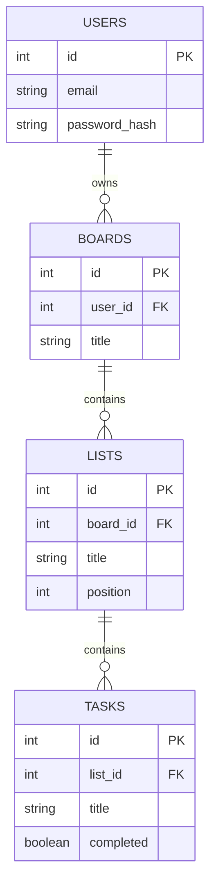

# Week 16: PostgreSQL & Drizzle ORM

Flowboard's data currently vanishes every time the server restarts. This week it gets a real, permanent home: a genuine PostgreSQL database, modeled properly with relations, and accessed through **Drizzle** — a TypeScript-native ORM that keeps your queries fully typed end to end.

---

## Module 1: Relational Modeling & a Real Database

### 1. Designing Flowboard's Schema

* **Lecture & Concepts:**
    * A **relational database** stores data in tables with defined relationships between them. Flowboard needs four: `users` (who owns things), `boards` (owned by a user), `lists` (columns within a board, like "To Do"/"In Progress"/"Done"), and `tasks` (cards within a list).
    * A **foreign key** is a column that references another table's primary key, enforcing that the relationship is always valid — a task can't belong to a list that doesn't exist.



* **Class Exercise: Sketch It Yourself**
    1. Before writing any code, redraw the diagram above by hand (or in any diagramming tool), adding one more column you think each table genuinely needs (e.g., `tasks.due_date`, `boards.created_at`).
    2. Explain out loud (or in a comment) why `lists.position` exists — think about what happens when a user drags a list to reorder it.

---

### 2. Choosing and Creating a Real Postgres Database

* **Lecture & Concepts:**
    * Options for running Postgres range from self-hosting it yourself, to a managed service (AWS RDS), to **serverless** offerings like **Neon** — a free tier, instant provisioning, and no server to maintain, which suits a small project perfectly.

* **Class Exercise: Create Your Neon Project**
    1. Create a free account at neon.tech and a new project.
    2. Copy the connection string it gives you into a `.env` file in `flowboard-api` — **never commit this file**. Add `.env` to `.gitignore` immediately, before anything else.

---

## Module 2: Setting Up Drizzle

### 1. Installing and Configuring

* **Lecture & Concepts:**
    * **Drizzle** is a "headless" ORM: it generates fully-typed query builders directly from a schema you define in TypeScript, without hiding SQL behind excessive abstraction — you still largely think in relational terms, just with real autocomplete and compile-time safety.

* **In-Depth Example (Terminal & Config):**
    ```bash
    npm install drizzle-orm pg
    npm install -D drizzle-kit @types/pg
    ```
    ```ts
    // drizzle.config.ts
    import { defineConfig } from 'drizzle-kit';

    export default defineConfig({
      schema: './src/db/schema.ts',
      out: './drizzle',
      dialect: 'postgresql',
      dbCredentials: { url: process.env.DATABASE_URL! },
    });
    ```

### 2. Declaring the Schema

* **Lecture & Concepts:**
    * Drizzle's schema is plain TypeScript — each table is a function call describing its columns, types, and constraints, which also becomes the source of your fully-typed `Board`, `List`, and `Task` types.

* **In-Depth Example:**
    ```ts
    // src/db/schema.ts
    import { pgTable, serial, text, integer, boolean, timestamp } from 'drizzle-orm/pg-core';

    export const users = pgTable('users', {
      id: serial('id').primaryKey(),
      email: text('email').notNull().unique(),
      passwordHash: text('password_hash').notNull(),
      createdAt: timestamp('created_at').defaultNow().notNull(),
    });

    export const boards = pgTable('boards', {
      id: serial('id').primaryKey(),
      userId: integer('user_id').notNull().references(() => users.id, { onDelete: 'cascade' }),
      title: text('title').notNull(),
    });

    export const lists = pgTable('lists', {
      id: serial('id').primaryKey(),
      boardId: integer('board_id').notNull().references(() => boards.id, { onDelete: 'cascade' }),
      title: text('title').notNull(),
      position: integer('position').notNull().default(0),
    });

    export const tasks = pgTable('tasks', {
      id: serial('id').primaryKey(),
      listId: integer('list_id').notNull().references(() => lists.id, { onDelete: 'cascade' }),
      title: text('title').notNull(),
      completed: boolean('completed').notNull().default(false),
    });
    ```
    * `.references(() => users.id, { onDelete: 'cascade' })` is the real foreign key from the ER diagram — `onDelete: 'cascade'` means deleting a user automatically deletes their boards too, rather than leaving orphaned rows behind.

* **Class Exercise: Define the Real Schema**
    1. Create `src/db/schema.ts` exactly as shown, matching your Module 1 sketch.
    2. Create the Drizzle connection: `src/db/index.ts` exporting a configured `drizzle(pool)` instance using `pg.Pool` and your `.env`'s `DATABASE_URL`.

### 3. Migrations

* **Lecture & Concepts:**
    * A **migration** is a version-controlled record of a schema change — Drizzle Kit compares your `schema.ts` against the real database and generates the SQL needed to bring the database in line.

* **In-Depth Example (Terminal):**
    ```bash
    npx drizzle-kit generate
    npx drizzle-kit migrate
    ```

* **Class Exercise: Run Your First Migration**
    1. Run both commands above.
    2. In Neon's dashboard, confirm all four tables now exist with the correct columns and foreign keys.

---

## Module 3: Typed CRUD, Relations & Transactions

### 1. Basic CRUD with Drizzle

* **In-Depth Example (Real, Typed Queries):**
    ```ts
    // src/models/boardModel.ts
    import { db } from '../db';
    import { boards } from '../db/schema';
    import { eq } from 'drizzle-orm';

    export const BoardModel = {
      getAllForUser: (userId: number) => db.select().from(boards).where(eq(boards.userId, userId)),
      findById: async (id: number) => (await db.select().from(boards).where(eq(boards.id, id)))[0],
      create: async (userId: number, title: string) =>
        (await db.insert(boards).values({ userId, title }).returning())[0],
      update: async (id: number, title: string) =>
        (await db.update(boards).set({ title }).where(eq(boards.id, id)).returning())[0],
      remove: (id: number) => db.delete(boards).where(eq(boards.id, id)),
    };
    ```
    * Every method here is fully typed — `title` must be a `string`, the return value is a real `Board`, and a typo in a column name fails at compile time, not silently at runtime like raw SQL strings would.

* **Class Exercise: Rewrite the Model Layer**
    1. Replace your Week 15 in-memory `BoardModel` with the real Drizzle version above.
    2. Confirm through Postman that boards created now persist across server restarts.

### 2. Relations & Joins

* **Lecture & Concepts:**
    * Fetching a board *with* its lists in one query, rather than one query per list, avoids the "N+1 query problem" — a genuine, common performance mistake. Drizzle's relational query API handles this cleanly once relations are declared.

* **In-Depth Example:**
    ```ts
    // src/db/schema.ts (add below the table definitions)
    import { relations } from 'drizzle-orm';

    export const boardsRelations = relations(boards, ({ many }) => ({
      lists: many(lists),
    }));
    export const listsRelations = relations(lists, ({ one, many }) => ({
      board: one(boards, { fields: [lists.boardId], references: [boards.id] }),
      tasks: many(tasks),
    }));
    ```
    ```ts
    const boardWithLists = await db.query.boards.findFirst({
      where: eq(boards.id, boardId),
      with: { lists: { with: { tasks: true } } },
    });
    ```

* **Class Exercise: Build `lists` and `tasks` CRUD**
    1. Declare the relations above.
    2. Build full Model → Service → Controller CRUD for `lists` and `tasks`, following Week 15's layering pattern exactly.
    3. Add a `GET /boards/:id/full` endpoint returning a board with its lists and each list's tasks, using the relational query above.

### 3. Transactions

* **Lecture & Concepts:**
    * A **transaction** groups multiple writes so they either *all* succeed or *all* fail together — critical whenever one logical action touches more than one table (e.g., deleting a board should also delete its lists and tasks atomically, though the `onDelete: 'cascade'` from Module 2 already handles that specific case at the database level).

* **In-Depth Example (Creating a Board With a Default List, Atomically):**
    ```ts
    async function createBoardWithDefaultList(userId: number, title: string) {
      return db.transaction(async (tx) => {
        const [board] = await tx.insert(boards).values({ userId, title }).returning();
        await tx.insert(lists).values({ boardId: board.id, title: 'To Do', position: 0 });
        return board;
      });
    }
    ```

* **Class Exercise: Use a Real Transaction**
    1. Implement `createBoardWithDefaultList` exactly as shown, and use it in place of the plain `BoardModel.create` when handling `POST /boards`.
    2. Confirm a new board always arrives with exactly one "To Do" list.

---

### Week 16: Comprehensive Assignment

**Objective:** Flowboard persists real, relational data in PostgreSQL via Drizzle — no in-memory arrays left anywhere.

**Requirements:**

1. **Schema:** All four tables (`users`, `boards`, `lists`, `tasks`) defined in Drizzle with correct foreign keys and `onDelete: 'cascade'`.
2. **Migrations:** Generated and applied via Drizzle Kit; visible in your real Neon database.
3. **CRUD:** Full Model → Service → Controller layers for `boards`, `lists`, and `tasks`, all backed by real Drizzle queries.
4. **Relations:** A working `GET /boards/:id/full` endpoint using Drizzle's relational query API.
5. **Transactions:** `createBoardWithDefaultList` correctly creates a board and its default list atomically.
6. **Git:** Committed and pushed via the branch → PR → merge workflow.

**Bonus Challenge:** Add a `PATCH /lists/:id/position` endpoint, and write a short comment explaining what could go wrong if two users reordered lists on the same board at the exact same moment without a transaction.
