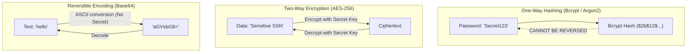

# Week 17: Authentication, Authorization & Security

In Week 16, you built persistent database queries for Flowboard. However, the API currently has no concept of user identity: any anonymous client can query, modify, or delete any board in the database. This week, you build a production-grade **Authentication (AuthN)** and **Authorization (AuthZ)** system: implementing **Cryptographic Password Hashing with Bcrypt**, **Stateful Session Authentication via Secure HttpOnly Cookies**, **JSON Web Tokens (JWT) analysis**, **Insecure Direct Object Reference (IDOR) prevention**, and **OWASP Security Hardening**.

---

## Module 1: Cryptographic Foundations & Password Hashing

### 1. The Core Terminology of Application Security

| Term | What It Actually Means | Technical Context |
| :--- | :--- | :--- |
| **Authentication (AuthN)** | The process of verifying *who a user is* (e.g., matching email and hashed password). | Answers: *"Are you who you claim to be?"* |
| **Authorization (AuthZ)** | The process of verifying *what permissions an authenticated user has* (e.g., can this user delete Board #42?). | Answers: *"Are you allowed to perform this action?"* |
| **Cryptographic Hashing** | A one-way mathematical function that converts arbitrary-length input into a fixed-length string that is computationally impossible to invert. | Passwords must **never** be stored plaintext or encrypted; they must always be hashed. |
| **Salt** | A cryptographically secure random string concatenated with a password before hashing. | Guarantees that two users with the identical password ("Password123!") produce completely different hash strings, defeating **Rainbow Table** attacks. |
| **Cost Factor (Salt Rounds)** | A parameter controlling how many iterations ($2^{\text{cost}}$) the hashing algorithm performs. | Deliberately slows down computation (e.g., 100ms per hash) to make offline brute-force attacks computationally unfeasible. |
| **IDOR Vulnerability** | Insecure Direct Object Reference: Occurs when an API allows a user to access or mutate a database record by guessing its ID without validating ownership. | Prevented by strictly enforcing `WHERE user_id = req.user.id` on every query. |

---

### 2. Under the Hood: Hashing vs. Encryption vs. Encoding



---

### 3. Anatomy of a Bcrypt Hash String

When Bcrypt hashes a password, it formats the output into a single standardized 60-character string:

```
$2b$12$e8uq.s6jM9iC8wN2dF8H0u1p8k7y6x5w4v3u2t1s0r9q8p7o6n5m4
\__/\_/\____________________/\____________________________/
 |   |          |                          |
 |   |          |                          +--> Hash Checksum (31 chars)
 |   |          +-----------------------------> Random Salt (22 chars)
 |   +----------------------------------------> Cost Factor: 2^12 = 4,096 iterations
 +--------------------------------------------> Algorithm Identifier (Bcrypt 2b)
```

---

## Module 2: Stateful Sessions vs. Stateless JWTs

### 1. Architectural Comparison Matrix

| Feature | Stateful Session Auth (Recommended for Web Apps) | Stateless JWT Auth (API / Microservices) |
| :--- | :--- | :--- |
| **Storage Location** | Server database / Redis table + `session_id` in Cookie. | Cryptographically signed token string in Client memory/header. |
| **Revocation / Logout** | **Instant & Guaranteed:** Deleting the session row immediately revokes access across all devices. | **Difficult:** Token remains valid until expiration unless maintaining a distributed blacklist. |
| **Database Overhead** | 1 fast session lookup per incoming request (or Redis $O(1)$). | 0 database lookups (CPU verifies cryptographic signature). |
| **Security Surface** | Immune to XSS if stored in `HttpOnly` cookies. | Vulnerable to XSS if stored in `localStorage`. |

---

### 2. Under the Hood: Session Authentication Lifecycle

```mermaid
sequenceDiagram
    autonumber
    actor User
    participant Browser
    participant API as Express API Server
    participant DB as PostgreSQL Database

    User->>Browser: Enters email & password, clicks Login
    Browser->>API: POST /api/v1/auth/login { email, password }
    API->>DB: SELECT * FROM users WHERE email = $1
    DB-->>API: User record with password_hash
    API->>API: bcrypt.compare(password, password_hash)
    
    alt Password Valid
        API->>DB: INSERT INTO sessions (user_id, expires_at) VALUES (...)
        DB-->>API: Created session { id: 'sess_9f8e7d...', expires_at }
        API-->>Browser: Set-Cookie: session_id=sess_9f8e7d; HttpOnly; Secure; SameSite=Lax
        Browser-->>User: Redirect to Flowboard Dashboard
    else Invalid Credentials
        API-->>Browser: 401 Unauthorized: "Invalid email or password"
    end

    Note over Browser,API: Subsequent Protected Request
    Browser->>API: GET /api/v1/boards (Cookie sent automatically by browser!)
    API->>DB: SELECT * FROM sessions WHERE id = $1 AND expires_at > NOW()
    DB-->>API: Session valid -> userId: 'u-101'
    API->>DB: SELECT * FROM boards WHERE user_id = 'u-101'
    DB-->>API: User's owned boards
    API-->>Browser: 200 OK with board data
```

---

### 3. Cookie Security Attributes Deconstructed

When issuing authentication cookies from Express, three flags are mandatory:

1. **`httpOnly: true`:** Prevents client-side JavaScript (`document.cookie`) from accessing the cookie. **Blocks session-stealing via XSS attacks.**
2. **`secure: true`:** Instructs the browser to transmit the cookie exclusively over encrypted **HTTPS** connections (set to `true` in production).
3. **`sameSite: 'lax'`:** Prevents the browser from sending the cookie on cross-site requests (e.g., malicious links from external sites), mitigating **Cross-Site Request Forgery (CSRF)**.

---

## Module 3: Implementing Secure Auth in Flowboard

### 1. Database Schema Additions (`src/db/schema.ts`)

```ts
import { pgTable, text, timestamp, uuid, varchar } from 'drizzle-orm/pg-core';

export const users = pgTable('users', {
  id: uuid('id').defaultRandom().primaryKey(),
  email: varchar('email', { length: 255 }).notNull().unique(),
  passwordHash: text('password_hash').notNull(),
  createdAt: timestamp('created_at', { withTimezone: true }).defaultNow().notNull(),
});

export const sessions = pgTable('sessions', {
  id: uuid('id').defaultRandom().primaryKey(),
  userId: uuid('user_id')
    .notNull()
    .references(() => users.id, { onDelete: 'cascade' }),
  expiresAt: timestamp('expires_at', { withTimezone: true }).notNull(),
  createdAt: timestamp('created_at', { withTimezone: true }).defaultNow().notNull(),
});
```

---

### 2. Authentication Service (`src/services/auth.service.ts`)

```ts
import bcrypt from 'bcryptjs';
import { db } from '../db';
import { users, sessions } from '../db/schema';
import { eq, and, gt } from 'drizzle-orm';

const SALT_ROUNDS = 12; // 2^12 iterations (~150ms hashing time)
const SESSION_DURATION_DAYS = 7;

export const AuthService = {
  signup: async (email: string, passwordPlain: string) => {
    // 1. Check if email already registered
    const existing = await db.query.users.findFirst({
      where: (u, { eq }) => eq(u.email, email.toLowerCase().trim()),
    });

    if (existing) {
      const error: any = new Error('An account with this email address already exists.');
      error.statusCode = 409; // Conflict
      throw error;
    }

    // 2. Hash password with bcrypt salt
    const passwordHash = await bcrypt.hash(passwordPlain, SALT_ROUNDS);

    // 3. Persist new user record
    const [newUser] = await db
      .insert(users)
      .values({
        email: email.toLowerCase().trim(),
        passwordHash,
      })
      .returning({ id: users.id, email: users.email, createdAt: users.createdAt });

    return newUser;
  },

  login: async (email: string, passwordPlain: string) => {
    // 1. Fetch user by email
    const user = await db.query.users.findFirst({
      where: (u, { eq }) => eq(u.email, email.toLowerCase().trim()),
    });

    // 2. Timing-safe constant-time failure comparison
    if (!user) {
      // Intentionally vague error prevents account enumeration
      const error: any = new Error('Invalid email or password.');
      error.statusCode = 401;
      throw error;
    }

    const isMatch = await bcrypt.compare(passwordPlain, user.passwordHash);
    if (!isMatch) {
      const error: any = new Error('Invalid email or password.');
      error.statusCode = 401;
      throw error;
    }

    // 3. Create persistent database session
    const expiresAt = new Date();
    expiresAt.setDate(expiresAt.getDate() + SESSION_DURATION_DAYS);

    const [session] = await db
      .insert(sessions)
      .values({
        userId: user.id,
        expiresAt,
      })
      .returning();

    return {
      session,
      user: { id: user.id, email: user.email },
    };
  },

  logout: async (sessionId: string) => {
    if (!sessionId) return;
    await db.delete(sessions).where(eq(sessions.id, sessionId));
  },
};
```

---

### 3. Authentication & Ownership Authorization Middleware

```ts
// src/middlewares/auth.middleware.ts
import { Request, Response, NextFunction } from 'express';
import { db } from '../db';
import { sessions, users } from '../db/schema';
import { eq, and, gt } from 'drizzle-orm';

// Extend Express Request interface with authenticated user
declare global {
  namespace Express {
    interface Request {
      user?: {
        id: string;
        email: string;
      };
    }
  }
}

export const requireAuth = async (req: Request, res: Response, next: NextFunction) => {
  const sessionId = req.cookies?.session_id;

  if (!sessionId) {
    return res.status(401).json({ status: 'fail', message: 'Authentication required. Please log in.' });
  }

  // Look up session in database and ensure not expired
  const activeSession = await db.query.sessions.findFirst({
    where: and(eq(sessions.id, sessionId), gt(sessions.expiresAt, new Date())),
    with: {
      user: true,
    },
  });

  if (!activeSession || !activeSession.user) {
    res.clearCookie('session_id');
    return res.status(401).json({ status: 'fail', message: 'Session has expired or is invalid.' });
  }

  // Attach authenticated user identity to request object
  req.user = {
    id: activeSession.user.id,
    email: activeSession.user.email,
  };

  next();
};
```

---

### 4. Preventing IDOR Vulnerabilities in Controllers

```ts
// src/controllers/board.controller.ts
export const BoardController = {
  getBoard: async (req: Request, res: Response, next: NextFunction) => {
    try {
      const { id } = req.params;
      const currentUserId = req.user!.id;

      const board = await BoardService.getBoardById(id);

      // 🛡️ IDOR Check: Ensure board belongs to requesting user
      if (board.userId !== currentUserId) {
        return res.status(403).json({
          status: 'fail',
          message: 'Forbidden: You do not have permission to view or modify this board.',
        });
      }

      res.status(200).json({ status: 'success', data: { board } });
    } catch (err) {
      next(err);
    }
  },
};
```

---

## Module 4: API Security Hardening (OWASP Compliance)

```bash
npm install helmet express-rate-limit cookie-parser
```

```ts
// src/index.ts
import express from 'express';
import helmet from 'helmet';
import rateLimit from 'express-rate-limit';
import cookieParser from 'cookie-parser';
import cors from 'cors';

const app = express();

// 1. Set Security HTTP Headers
app.use(helmet());

// 2. Cookie Parser
app.use(cookieParser());

// 3. CORS Configuration
app.use(
  cors({
    origin: process.env.CLIENT_ORIGIN || 'http://localhost:5173',
    credentials: true, // Allows cookies across origins
  })
);

// 4. Rate Limiting: Prevent Brute Force Attacks on Auth Endpoints
const authLimiter = rateLimit({
  windowMs: 15 * 60 * 1000, // 15 minutes
  max: 10,                   // Limit each IP to 10 signup/login attempts per window
  message: { status: 'fail', message: 'Too many login attempts. Please try again in 15 minutes.' },
});

app.use('/api/v1/auth', authLimiter);
```

---

### Common Pitfalls & How to Avoid Them

| Pitfall | Security Risk | Fix |
| :--- | :--- | :--- |
| **Account enumeration in error messages** | "Email not found" reveals which emails are registered on the platform. | Return a uniform message: "Invalid email or password". |
| **Missing `HttpOnly` on session cookie** | Cross-Site Scripting (XSS) can read `document.cookie` and steal active sessions. | Always set `{ httpOnly: true, secure: true, sameSite: 'lax' }`. |
| **IDOR (Missing user ownership verification)** | User A can view or delete User B's boards simply by guessing UUID in URL. | Verify `board.userId === req.user.id` or scope queries by `userId`. |

---

### Week 17: Comprehensive Assignment

**Objective:** Secure the Flowboard API with password hashing, stateful session authentication via HttpOnly cookies, route protection middleware, IDOR defenses, and rate limiting.

**Requirements:**
1. **Password Hashing:**
   - User passwords hashed with `bcryptjs` using 12 salt rounds before database persistence.
2. **Session Authentication:**
   - `POST /api/v1/auth/signup` and `POST /api/v1/auth/login` issuing secure `session_id` cookies.
   - `POST /api/v1/auth/logout` revoking session in database and clearing cookie.
3. **Route Protection & IDOR Prevention:**
   - `requireAuth` middleware protecting all `/api/v1/boards` routes.
   - Board CRUD operations strictly authorized by verifying `userId` matches `req.user.id`.
4. **Security Hardening:**
   - Helmet security headers and `express-rate-limit` configured on authentication routes.
5. **Git Workflow:**
   - Developed on branch `feature/auth-security`, merged via Pull Request, and pulled locally.

---

## Recommended References & Deep-Dive Resources

### Official Documentation & Standards
- [OWASP Top 10 Web Application Security Risks](https://owasp.org/www-project-top-ten/) — The authoritative security awareness standard for web developers.
- [MDN Web Docs: Using HTTP Cookies & Security Flags](https://developer.mozilla.org/en-US/docs/Web/HTTP/Cookies) — Explains `HttpOnly`, `Secure`, and `SameSite` flags.
- [RFC 7519: JSON Web Token (JWT) Specification](https://datatracker.ietf.org/doc/html/rfc7519) — Standard specification for compact, URL-safe cryptographic claims.
- [Bcrypt Key Derivation Algorithm (USENIX)](https://www.usenix.org/legacy/events/usenix99/provos/provos_html/) — Niels Provos and David Mazières' original academic paper on the Blowfish password hashing algorithm.

### Recommended Textbooks & Canonical Books
- **Web Application Security: Exploitation and Countermeasures for Modern Web Applications** by Andrew Hoffman (O'Reilly) — *Chapters 1–6: Cross-Site Scripting (XSS), Cross-Site Request Forgery (CSRF), and Insecure Direct Object References (IDOR).*
- **OAuth 2 in Action** by Justin Richer and Antonio Sanso (Manning) — *Comprehensive guide to token-based authorization and resource servers.*
- **The Web Application Hacker's Handbook (2nd Edition)** by Dafydd Stuttard and Marcus Pinto (Wiley) — *The classic textbook on web authentication bypasses, session flaws, and access control.*

### Security Cheat Sheets & Verification Tools
- [OWASP Authentication Cheat Sheet](https://cheatsheetseries.owasp.org/cheatsheets/Authentication_Cheat_Sheet.html) — Gold-standard rules for password storage, salt rounds, and rate limiting.
- [OWASP Session Management Cheat Sheet](https://cheatsheetseries.owasp.org/cheatsheets/Session_Management_Cheat_Sheet.html) — Stateful session issuance, expiration, and cookie transport security.
