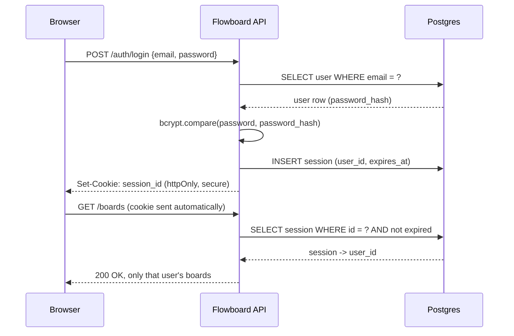

# Week 17: Authentication, Authorization & Security

Right now, anyone can see and modify any board in Flowboard — there's no concept of "who's asking." This week fixes that with real user accounts: hashed passwords, secure session-based login, and every route scoped so a user can only ever touch their own data. This is also where you build the security instincts that separate a toy project from something safe to put in front of real users.

---

## Module 1: Password Hashing & Signup

### 1. A Security Mindset

* **Lecture & Concepts:**
    * Before writing auth code, it's worth naming the actual threats: someone reading your database directly (should never reveal real passwords), someone guessing passwords by brute force (should be slow and rate-limited), and someone stealing a logged-in user's session (should be time-limited and revocable). Every decision this week traces back to one of these three.
    * **Secure defaults**: never store a password in a form that could be read back out. **Least privilege**: a request should only ever be able to touch data it's explicitly allowed to.

### 2. Hashing, Not Encrypting, Passwords

* **Lecture & Concepts:**
    * **Encryption** is reversible — you can decrypt it back to the original if you have the key. **Hashing** is one-way by design: `bcrypt.hash(password)` produces a string that cannot be turned back into the original password, only compared against a fresh attempt with `bcrypt.compare()`.
    * `bcrypt`'s "salt rounds" (a cost factor, typically 10–12) control how computationally expensive hashing is — deliberately slow, so brute-forcing a stolen hash database is impractical even though the algorithm itself is well known.

* **In-Depth Example:**
    ```bash
    npm install bcryptjs
    ```
    ```ts
    // src/services/authService.ts
    import bcrypt from 'bcryptjs';
    import { UserModel } from '../models/userModel';

    export const AuthService = {
      async signup(email: string, password: string) {
        const existing = await UserModel.findByEmail(email);
        if (existing) throw new Error('An account with this email already exists');

        const passwordHash = await bcrypt.hash(password, 12);
        return UserModel.create(email, passwordHash);
      },
    };
    ```

* **Class Exercise: Build Real Signup**
    1. Add a `users` Model/Service/Controller trio following Week 15's layering.
    2. Implement `AuthService.signup` exactly as shown, wired to `POST /api/v1/auth/signup`.
    3. Confirm in Neon's dashboard that the stored `password_hash` looks nothing like the real password.

---

## Module 2: Session-Based Login

### 1. Why Sessions Over JWT, Here

* **Lecture & Concepts:**
    * A **stateless token** (like a JWT) is self-contained — the server doesn't need to look anything up to trust it, which is convenient, but it means the server *can't revoke it* before it naturally expires. If a token is stolen, it stays valid until expiry no matter what you do.
    * A **session** is the opposite: the server stores a record of "this session id is currently valid for this user," and the client only ever holds an opaque, random session identifier in a cookie. This makes sessions instantly revocable (delete the row, the session is dead everywhere) — the more secure default for a real web application, which is why it's the primary pattern here. JWTs remain a reasonable choice for stateless, service-to-service API auth, covered briefly in Module 3.



### 2. Building Real Login

* **Lecture & Concepts:**
    * `httpOnly` on a cookie means client-side JavaScript can't read it at all — even if a malicious script somehow ran on the page (an XSS attack, from Week 8), it couldn't steal the session cookie. `secure` means the cookie is only ever sent over HTTPS.

* **In-Depth Example:**
    ```bash
    npm install cookie-parser
    npm install -D @types/cookie-parser
    ```
    ```ts
    // src/services/authService.ts (continued)
    import { SessionModel } from '../models/sessionModel';

    export const AuthService = {
      // ...signup from Module 1
      async login(email: string, password: string) {
        const user = await UserModel.findByEmail(email);
        if (!user) throw new Error('Invalid email or password');

        const valid = await bcrypt.compare(password, user.passwordHash);
        if (!valid) throw new Error('Invalid email or password');

        const session = await SessionModel.create(user.id);
        return session;
      },
      async logout(sessionId: string) {
        await SessionModel.remove(sessionId);
      },
    };
    ```
    ```ts
    // src/controllers/authController.ts
    export const AuthController = {
      async login(req: Request, res: Response) {
        try {
          const session = await AuthService.login(req.body.email, req.body.password);
          res.cookie('session_id', session.id, {
            httpOnly: true,
            secure: process.env.NODE_ENV === 'production',
            sameSite: 'lax',
            expires: session.expiresAt,
          });
          res.status(200).json({ message: 'Logged in' });
        } catch (error) {
          res.status(401).json({ error: (error as Error).message });
        }
      },
      async logout(req: Request, res: Response) {
        await AuthService.logout(req.cookies.session_id);
        res.clearCookie('session_id');
        res.status(200).json({ message: 'Logged out' });
      },
    };
    ```
    * A vague `"Invalid email or password"` error on *both* a wrong email and a wrong password is deliberate — never confirm to an attacker which part was wrong, since that alone leaks which emails have real accounts.

* **Class Exercise: Build Login & Logout**
    1. Add a `sessions` table to your Drizzle schema (`id` as a random token, `userId`, `expiresAt`).
    2. Build `SessionModel`, then `AuthService.login`/`logout` and their controller methods exactly as shown, wired to `POST /auth/login` and `POST /auth/logout`.
    3. Log in via Postman and confirm a `session_id` cookie is set; log out and confirm it's cleared.

---

## Module 3: Protecting Routes & Ownership

### 1. Auth Middleware

* **Lecture & Concepts:**
    * Middleware (Week 15) is exactly the right tool to check "is this request authenticated" once, before it ever reaches a protected route's controller.

* **In-Depth Example:**
    ```ts
    // src/middlewares/requireAuth.ts
    import { Request, Response, NextFunction } from 'express';
    import { SessionModel } from '../models/sessionModel';

    export async function requireAuth(req: Request, res: Response, next: NextFunction) {
      const sessionId = req.cookies.session_id;
      if (!sessionId) return res.status(401).json({ error: 'Not authenticated' });

      const session = await SessionModel.findValid(sessionId);
      if (!session) return res.status(401).json({ error: 'Session expired or invalid' });

      req.userId = session.userId; // attached for every downstream handler
      next();
    }
    ```
    ```ts
    // src/routes/boardRoutes.ts
    router.use(requireAuth); // every route below this line now requires a valid session
    ```

* **Class Exercise: Protect Every Board Route**
    1. Build `requireAuth` exactly as shown (you'll need to extend Express's `Request` type to include `userId` — a small `declare global` block in a `.d.ts` file).
    2. Apply it to all `boards`/`lists`/`tasks` routes.
    3. Confirm every one of those routes now returns `401` without a valid session cookie.

### 2. Scoping Data & Checking Ownership

* **Lecture & Concepts:**
    * Being authenticated answers "who are you." **Authorization** answers "what are you allowed to do" — every query must filter by `req.userId`, and every mutation must confirm the resource actually belongs to that user before allowing a change (`403 Forbidden`, not `404`, when it exists but isn't theirs — recognizable, deliberate wording matters less here than consistently picking one and documenting it).

* **In-Depth Example:**
    ```ts
    // BoardModel.getAllForUser(userId) from Week 16 already scopes reads.
    // Add an ownership check before any mutation:
    async function assertOwnsBoard(boardId: number, userId: number) {
      const board = await BoardModel.findById(boardId);
      if (!board) throw new NotFoundError('Board not found');
      if (board.userId !== userId) throw new ForbiddenError('You do not own this board');
      return board;
    }
    ```

* **Class Exercise: Enforce Ownership Everywhere**
    1. Add an ownership check like the one above before every `update`/`delete` on `boards`, `lists`, and `tasks` (a list/task's ownership traces up through its parent board).
    2. Sign up two separate test users in Postman, and confirm one user genuinely cannot read, update, or delete the other's boards.

### 3. A Word on OAuth/OIDC and API Security

* **Lecture & Concepts:**
    * **OAuth 2.0** and **OIDC** let a user log in via a third party (Google, GitHub) instead of a password you manage yourself — the app never sees the user's actual password, only a token proving the third party vouches for them. Implementing a full OAuth flow is beyond this week's scope, but knowing the shape matters: your app would redirect to the provider, receive a callback with a code, exchange it server-side for user info, then create a session exactly as above.
    * For a stateless, service-to-service API (not a browser client), a short-lived JWT signed with a server secret remains a reasonable choice — the tradeoffs from Module 2 simply flip: convenient statelessness, harder revocation. Recognizing *which* situation you're in is the actual skill.

---

### Week 17: Comprehensive Assignment

**Objective:** Flowboard has real, secure accounts — every board, list, and task is only ever visible to and modifiable by its owner.

**Requirements:**

1. **Signup:** `POST /auth/signup` hashes passwords with `bcrypt` (cost 12) and rejects duplicate emails.
2. **Login/Logout:** `POST /auth/login` sets a secure, `httpOnly` session cookie; `POST /auth/logout` clears it and invalidates the session server-side.
3. **Middleware:** `requireAuth` protects every `boards`/`lists`/`tasks` route, returning `401` without a valid session.
4. **Ownership:** Every mutation checks real ownership, returning `403` when a valid session tries to touch another user's data.
5. **Verification:** Two separate signed-up test users, proven in Postman to only ever see their own boards.
6. **Git:** Committed and pushed via the branch → PR → merge workflow.

**Bonus Challenge:** Add a basic session-cleanup job concept: write (but don't necessarily schedule) a function that deletes all expired sessions from the `sessions` table, and explain in a comment why letting expired sessions pile up indefinitely is a real, if minor, production problem.
