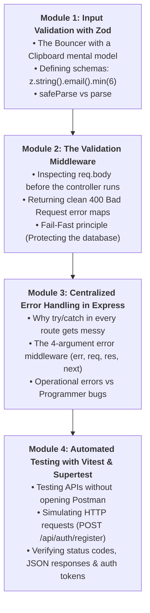
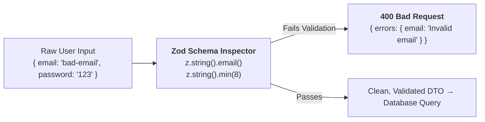
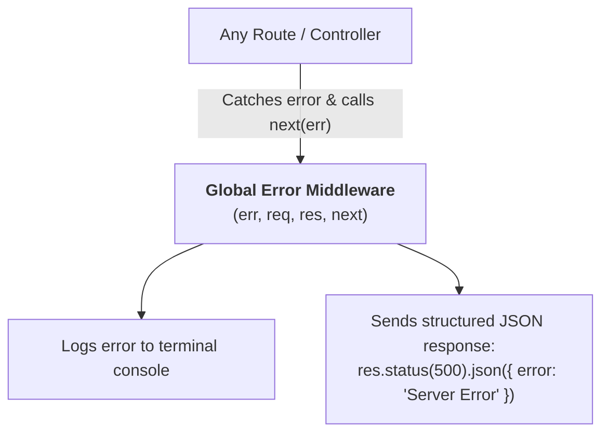

# Week 18: Validation, Error Handling & Testing

Welcome to Week 18! In Weeks 15, 16, and 17, you built the core backend of **Flowboard**: handling routing, writing database queries in PostgreSQL with Drizzle, and securing endpoints with Bcrypt and JWT authentication.

However, your API currently has three critical vulnerabilities:
1. **Dirty Data:** What if a user submits an empty title, a 5,000-character string, or an invalid email?
2. **Ugly Crashes:** What if an unexpected error occurs? Does your server send a clean JSON error response, or does it crash and expose secret database stack traces to the public?
3. **Manual Verification:** Are you still testing 15 endpoints manually by hand in Thunder Client every single time you change a line of code?

This week, you master **Schema-First Input Validation with Zod**, **Centralized Error Handling in Express**, and **Automated Backend Testing with Vitest & Supertest**.

---

## Pedagogical Roadmap



---

## Module 1: Input Validation with Zod

### 1. The Bouncer with a Clipboard Mental Model

> [!NOTE]
> **The Mental Model:**
> If you don't validate user input, your backend is like a nightclub with an open door: anyone can walk in carrying mud, garbage, or weapons.
> **Zod is a Bouncer with a strict Clipboard:**
> - The bouncer checks every incoming visitor (the request body).
> - *"Is your name at least 3 letters? Is your email in proper format? Is your password at least 8 characters with a number?"*
> - If anything fails, the bouncer immediately turns the user away at the front door with a clear explanation (**`400 Bad Request`**), **before they ever touch your database!**



---

### 2. Installing Zod & Defining Schemas

Install Zod in your backend project:
```bash
npm install zod
```

Create `src/schemas/board.schema.ts`:
```ts
// src/schemas/board.schema.ts
import { z } from "zod";

export const createBoardSchema = z.object({
  title: z
    .string({ required_error: "Board title is required" })
    .trim()
    .min(3, "Board title must be at least 3 characters")
    .max(100, "Board title cannot exceed 100 characters"),
  description: z
    .string()
    .trim()
    .max(500, "Description cannot exceed 500 characters")
    .optional()
    .default(""),
});

// Infer the TypeScript type directly from the Zod schema!
export type CreateBoardInput = z.infer<typeof createBoardSchema>;
```

Create `src/schemas/auth.schema.ts`:
```ts
// src/schemas/auth.schema.ts
import { z } from "zod";

export const registerSchema = z.object({
  email: z
    .string({ required_error: "Email is required" })
    .trim()
    .toLowerCase()
    .email("Please provide a valid email address"),
  password: z
    .string({ required_error: "Password is required" })
    .min(8, "Password must be at least 8 characters long"),
});
```

---

## Module 2: The Validation Middleware

Instead of writing manual `if (!title) ...` checks inside every route handler, we write a **reusable validation middleware**:

```ts
// src/middleware/validate.middleware.ts
import { Request, Response, NextFunction } from "express";
import { ZodSchema, ZodError } from "zod";

export function validateBody(schema: ZodSchema) {
  return (req: Request, res: Response, next: NextFunction) => {
    // safeParse does NOT throw an error; it returns a clean result object:
    const result = schema.safeParse(req.body);

    if (!result.success) {
      // Flatten errors into an easy-to-read object:
      const formattedErrors: Record<string, string> = {};
      result.error.errors.forEach((err) => {
        const field = err.path.join(".") || "general";
        formattedErrors[field] = err.message;
      });

      return res.status(400).json({
        error: "Validation failed",
        details: formattedErrors,
      });
    }

    // Replace req.body with the sanitized, trimmed data:
    req.body = result.data;
    next(); // Pass to controller!
  };
}
```

### Using the Middleware on Your Routes:
```ts
import { validateBody } from "../middleware/validate.middleware";
import { createBoardSchema } from "../schemas/board.schema";

// The validation runs BEFORE the route handler executes!
boardRouter.post("/", validateBody(createBoardSchema), async (req, res) => {
  // If we reach this line, req.body is 100% GUARANTEED to be valid!
  const { title, description } = req.body;
  // ... database insert ...
});
```

---

## Module 3: Centralized Error Handling in Express

### 1. Why Centralized Error Handling?

In amateur code, developers wrap every single database query in repetitive `try/catch` blocks. If someone forgets one `try/catch` and an error happens, the server hangs or crashes!

In production Express applications:
1. When an error occurs, you simply pass it to **`next(error)`**.
2. Express catches all errors in one centralized **Global Error Handler**.



---

### 2. The 4-Argument Error Middleware

> [!IMPORTANT]
> Express identifies an error-handling middleware by its **4 parameters**:
> `(err, req, res, next)`
> It **must** be placed at the very bottom of `src/index.ts`, **after all your routes**!

```ts
// src/middleware/error.middleware.ts
import { Request, Response, NextFunction } from "express";

export function errorHandler(err: any, req: Request, res: Response, next: NextFunction) {
  console.error("🔥 Server Error Caught:", err);

  const statusCode = err.statusCode || 500;
  const message = err.message || "An unexpected internal server error occurred.";

  res.status(statusCode).json({
    error: message,
    // Only include technical stack trace in local development:
    ...(process.env.NODE_ENV === "development" && { stack: err.stack }),
  });
}
```

In `src/index.ts`:
```ts
// Mount routes first:
app.use("/api/auth", authRouter);
app.use("/api/boards", boardRouter);

// ⚠️ Global error handler MUST BE LAST:
app.use(errorHandler);
```

---

## Module 4: Automated Testing with Vitest & Supertest

### 1. What is Supertest?

**Supertest** allows you to test your Express API by simulating real HTTP requests (`GET`, `POST`, `DELETE`) in memory without even having to manually start your server on port 5000!

```bash
npm install -D vitest supertest @types/supertest
```

Add test script to `package.json`:
```json
"scripts": {
  "test": "vitest"
}
```

---

### 2. Writing Your First API Test (`auth.test.ts`)

```ts
// src/routes/auth.test.ts
import request from "supertest";
import { describe, it, expect } from "vitest";
import { app } from "../app"; // Your Express app (exported before listen)

describe("Auth API Endpoints", () => {
  it("rejects registration with invalid email format", async () => {
    const res = await request(app)
      .post("/api/auth/register")
      .send({
        email: "not-an-email",
        password: "password123",
      });

    // Verify status code:
    expect(res.status).toBe(400);
    // Verify error response:
    expect(res.body.error).toBe("Validation failed");
    expect(res.body.details.email).toBeDefined();
  });

  it("rejects registration with a password shorter than 8 characters", async () => {
    const res = await request(app)
      .post("/api/auth/register")
      .send({
        email: "valid@lagos.com",
        password: "short", // Only 5 characters!
      });

    expect(res.status).toBe(400);
    expect(res.body.details.password).toContain("at least 8 characters");
  });
});
```

Run `npm test`, and in under 1 second, Vitest runs your tests and reports green checkmarks:
`✓ rejects registration with invalid email format`
`✓ rejects registration with a password shorter than 8 characters`

---

## Module 5: Rookie Traps & Debugging Guide

| Error Message / Trap | Root Cause | How to Fix It |
| :--- | :--- | :--- |
| `TypeError: Cannot read properties of undefined (reading 'safeParse')` | You passed an invalid object into `validateBody()` instead of a Zod schema. | Ensure your schema is defined with `z.object({ ... })`. |
| Error middleware never runs | You omitted the fourth argument `next` in `(err, req, res, next)`. | Express **requires all 4 arguments** to recognize error middleware! |
| Port already in use during testing | `app.listen(5000)` was executed inside the test file. | Separate your Express instance into `app.ts` and call `app.listen()` inside `server.ts`! |

---

## 🎯 Week 18 Hands-on Classroom Exercises

### Level 1: Zod Schema Validation
1. Create `createBoardSchema` and `validateBody` middleware.
2. Connect it to `POST /api/boards`.
3. In Thunder Client, send `{ "title": "ab" }` (too short) and verify that you receive a structured `400 Bad Request` explaining why it failed!

### Level 2: Centralized Error Pipeline
1. Create the 4-argument global error handler.
2. In a test route `GET /api/crash`, intentionally throw `new Error("Database disconnected")`.
3. Verify that your error handler catches it and returns a clean `{ error: "Database disconnected" }` JSON response.

### Level 3: Automated Integration Tests
1. Set up Vitest and Supertest.
2. Write automated tests for `POST /api/boards`:
   - Test 1: Returns `401 Unauthorized` if no token is sent.
   - Test 2: Returns `400 Bad Request` if title is empty.
   - Test 3: Returns `201 Created` with valid title and token!

---

## 📚 Curated Deep-Dive References

* [Zod Official Documentation](https://zod.dev/) — The premier guide to TypeScript-first schema validation.
* [Express.js Error Handling](https://expressjs.com/en/guide/error-handling.html) — Official documentation on error middleware pipelines.
* [Vitest Official Documentation](https://vitest.dev/) — Fast unit and integration testing framework.
* [Supertest GitHub & Guide](https://github.com/ladjs/supertest) — Simulating HTTP requests against Express apps.
