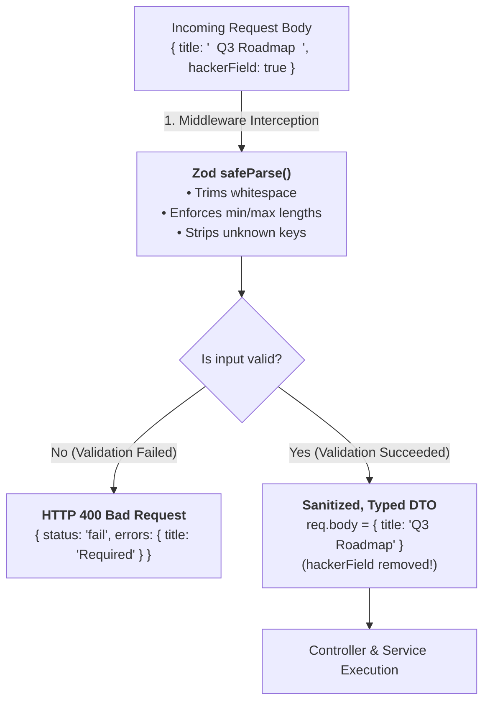
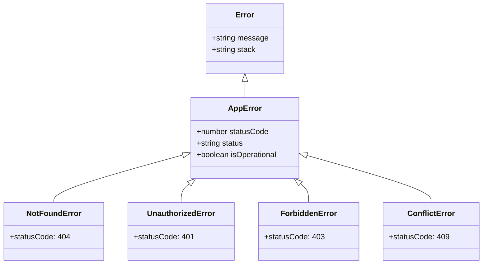
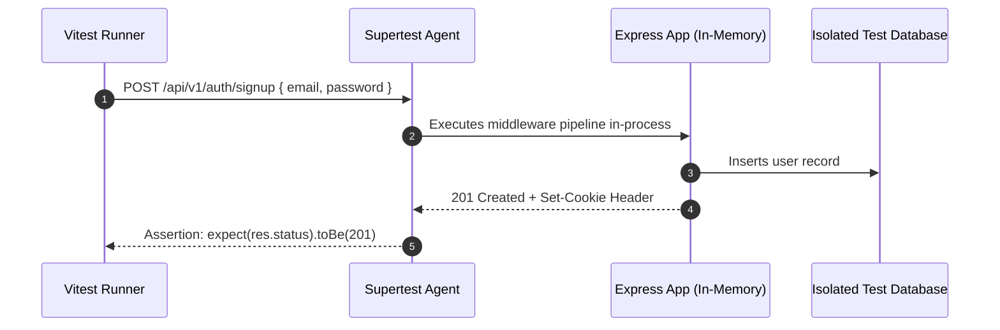

# Week 18: Validation, Error Handling & Testing

In Week 17, you implemented authentication and security rules. However, the API still accepts arbitrary payload shapes, and error responses remain scattered and inconsistent across controllers. This week, you harden Flowboard into a resilient, production-ready system: implementing **Schema-First Input Validation with Zod**, an **Enterprise Centralized Error-Handling Pipeline**, and an automated **Integration Test Suite using Vitest & Supertest**.

---

## Module 1: Schema-First Validation with Zod

### 1. The Core Terminology of Input Validation

| Term | What It Actually Means | Technical Context |
| :--- | :--- | :--- |
| **Fail-Fast Principle** | Halting execution and rejecting invalid requests immediately at the application edge (in middleware) before touching services or database queries. | Protects database connections and prevents corrupted data state. |
| **Schema Parsing** | Validating that raw, untyped runtime inputs match an exact shape and type constraint, stripping malicious extraneous properties. | Zod provides both runtime validation and TypeScript compile-time type inference. |
| **`safeParse()`** | A non-throwing validation method that returns a discriminated union: `{ success: true, data }` or `{ success: false, error: ZodError }`. | Essential for graceful validation error responses without relying on expensive `try/catch` performance hits. |
| **Operational Error** | An expected, known failure scenario during runtime (e.g., invalid email format, expired session, resource not found). | Handled gracefully with predictable HTTP 4xx status codes. |
| **Programmer Error** | A bug or unhandled exception in the code (e.g., calling a method on `undefined`, syntax error). | Caught by global error middleware, logged to monitoring, and returned as HTTP 500. |

---

### 2. Under the Hood: The Zod Parsing & Sanitization Pipeline



---

### 3. Declaring Strict Zod Schemas

```ts
// src/schemas/board.schema.ts
import { z } from 'zod';

export const createBoardSchema = z.object({
  title: z
    .string({ required_error: 'Board title is required.' })
    .trim()
    .min(3, 'Board title must be at least 3 characters long.')
    .max(100, 'Board title cannot exceed 100 characters.'),
  description: z
    .string()
    .trim()
    .max(500, 'Description cannot exceed 500 characters.')
    .optional()
    .default(''),
});

export const updateBoardSchema = createBoardSchema.partial();

export const boardIdParamSchema = z.object({
  id: z.string().uuid('Invalid Board ID format. Must be a valid UUID.'),
});

// Infer TypeScript types directly from Zod schemas
export type CreateBoardInput = z.infer<typeof createBoardSchema>;
export type UpdateBoardInput = z.infer<typeof updateBoardSchema>;
```

```ts
// src/schemas/auth.schema.ts
import { z } from 'zod';

export const signupSchema = z.object({
  email: z
    .string({ required_error: 'Email is required.' })
    .trim()
    .toLowerCase()
    .email('Invalid email address format.'),
  password: z
    .string({ required_error: 'Password is required.' })
    .min(8, 'Password must be at least 8 characters long.')
    .regex(/[A-Z]/, 'Password must contain at least one uppercase letter.')
    .regex(/[0-9]/, 'Password must contain at least one number.'),
});

export const loginSchema = z.object({
  email: z.string().trim().toLowerCase().email('Invalid email format.'),
  password: z.string().min(1, 'Password is required.'),
});
```

---

### 4. Generic Validation Middleware

```ts
// src/middlewares/validate.middleware.ts
import { Request, Response, NextFunction } from 'express';
import { AnyZodObject, ZodError } from 'zod';

interface RequestValidationSchema {
  body?: AnyZodObject;
  query?: AnyZodObject;
  params?: AnyZodObject;
}

export const validateRequest = (schemas: RequestValidationSchema) => {
  return async (req: Request, res: Response, next: NextFunction) => {
    try {
      if (schemas.params) {
        req.params = await schemas.params.parseAsync(req.params);
      }
      if (schemas.query) {
        req.query = await schemas.query.parseAsync(req.query);
      }
      if (schemas.body) {
        req.body = await schemas.body.parseAsync(req.body);
      }
      next();
    } catch (error) {
      if (error instanceof ZodError) {
        // Flatten Zod error issues into a clean field-to-message map
        const fieldErrors = error.errors.reduce<Record<string, string>>((acc, err) => {
          const field = err.path.join('.') || 'general';
          acc[field] = err.message;
          return acc;
        }, {});

        return res.status(400).json({
          status: 'fail',
          message: 'Validation failed. Please review the submitted fields.',
          errors: fieldErrors,
        });
      }
      next(error);
    }
  };
};
```

---

## Module 2: Centralized Error Handling Architecture

### 1. Custom Error Hierarchy

Instead of scattering generic `throw new Error()` throughout your codebase, create a strongly-typed **Error Class Hierarchy**:



```ts
// src/errors/AppError.ts
export class AppError extends Error {
  public readonly statusCode: number;
  public readonly status: 'fail' | 'error';
  public readonly isOperational: boolean;

  constructor(message: string, statusCode: number) {
    super(message);
    this.statusCode = statusCode;
    this.status = `${statusCode}`.startsWith('4') ? 'fail' : 'error';
    this.isOperational = true; // Distinguishes expected errors from uncaught crashes

    Error.captureStackTrace(this, this.constructor);
  }
}

export class NotFoundError extends AppError {
  constructor(message = 'Requested resource not found.') {
    super(message, 404);
  }
}

export class UnauthorizedError extends AppError {
  constructor(message = 'Authentication required.') {
    super(message, 401);
  }
}

export class ForbiddenError extends AppError {
  constructor(message = 'Forbidden: Insufficient permissions.') {
    super(message, 403);
  }
}

export class ConflictError extends AppError {
  constructor(message = 'Resource conflict.') {
    super(message, 409);
  }
}
```

---

### 2. Global Express Error Handler Middleware

```ts
// src/middlewares/error.middleware.ts
import { Request, Response, NextFunction } from 'express';
import { AppError } from '../errors/AppError';

export const globalErrorHandler = (
  err: any,
  _req: Request,
  res: Response,
  _next: NextFunction
) => {
  let error = err;

  // 1. Handle PostgreSQL Unique Constraint Violation (Error Code 23505)
  if (err.code === '23505') {
    error = new AppError('A record with that value already exists.', 409);
  }

  // 2. Handle PostgreSQL Foreign Key Violation (Error Code 23503)
  if (err.code === '23503') {
    error = new AppError('Referenced parent record does not exist.', 400);
  }

  const statusCode = error.statusCode || 500;
  const status = error.status || 'error';
  const isProd = process.env.NODE_ENV === 'production';

  // Production Error Response (Hides sensitive stack traces from attackers)
  if (isProd) {
    if (error.isOperational) {
      return res.status(statusCode).json({
        status,
        message: error.message,
      });
    }

    // Unhandled Programmer Error: Do not leak internal details!
    console.error('🔥 CRITICAL UNHANDLED ERROR:', err);
    return res.status(500).json({
      status: 'error',
      message: 'Something went wrong on our servers. Please try again later.',
    });
  }

  // Development Error Response (Includes full debugging stack trace)
  return res.status(statusCode).json({
    status,
    message: error.message,
    stack: error.stack,
    error: err,
  });
};
```

---

## Module 3: Integration Testing with Vitest & Supertest

### 1. Why Supertest Beats Manual Postman Testing

**Supertest** binds to your Express `app` object in-memory without needing a live, running HTTP server on a port. It dispatches simulated HTTP requests and verifies status codes, JSON response structures, and database state in continuous integration (CI) pipelines:



---

### 2. Setting Up the Test Suite

```bash
npm install -D vitest supertest @types/supertest
```

```ts
// vite.config.ts / vitest.config.ts
import { defineConfig } from 'vitest/config';

export default defineConfig({
  test: {
    globals: true,
    environment: 'node',
    testTimeout: 10000,
  },
});
```

---

### 3. Writing End-to-End API Integration Tests

```ts
// src/__tests__/board.api.test.ts
import { describe, it, expect, beforeAll, afterAll } from 'vitest';
import request from 'supertest';
import { app } from '../app';
import { db } from '../db';
import { users, boards } from '../db/schema';

describe('Flowboard API Endpoints', () => {
  let authCookie: string;
  let testUserId: string;

  beforeAll(async () => {
    // 1. Create authenticated test user session
    const signupRes = await request(app)
      .post('/api/v1/auth/signup')
      .send({
        email: `tester_${Date.now()}@example.com`,
        password: 'Password123!',
      });

    expect(signupRes.status).toBe(201);
    testUserId = signupRes.body.data.user.id;

    // Extract session cookie for authenticated requests
    const loginRes = await request(app)
      .post('/api/v1/auth/login')
      .send({
        email: signupRes.body.data.user.email,
        password: 'Password123!',
      });

    authCookie = loginRes.headers['set-cookie'][0];
  });

  afterAll(async () => {
    // Cleanup test records
    if (testUserId) {
      await db.delete(users);
    }
  });

  it('POST /api/v1/boards - creates a board successfully with valid Zod input', async () => {
    const res = await request(app)
      .post('/api/v1/boards')
      .set('Cookie', authCookie)
      .send({
        title: 'Launch Strategy 2026',
        description: 'Key deliverables for national expansion.',
      });

    expect(res.status).toBe(201);
    expect(res.body.status).toBe('success');
    expect(res.body.data.board.title).toBe('Launch Strategy 2026');
    expect(res.body.data.board.id).toBeDefined();
  });

  it('POST /api/v1/boards - fails with 400 when title is missing or less than 3 characters', async () => {
    const res = await request(app)
      .post('/api/v1/boards')
      .set('Cookie', authCookie)
      .send({
        title: 'No', // Too short (min 3)
      });

    expect(res.status).toBe(400);
    expect(res.body.status).toBe('fail');
    expect(res.body.errors.title).toBeDefined();
  });

  it('GET /api/v1/boards - fails with 401 when request is unauthenticated', async () => {
    const res = await request(app).get('/api/v1/boards'); // No cookie provided

    expect(res.status).toBe(401);
    expect(res.body.status).toBe('fail');
  });
});
```

---

### Common Pitfalls & How to Avoid Them

| Pitfall | Cause | Fix |
| :--- | :--- | :--- |
| **Leaking stack traces in production** | Returning `err.stack` in error middleware without checking `NODE_ENV`. | Send generic error messages in production and log stack traces internally. |
| **Validation after database query** | Validating user input inside the service or model layer. | Validate at the route layer using `validateRequest(schema)` middleware. |
| **Mutating shared test database** | Tests colliding on duplicate email records across parallel runs. | Use unique test emails (`test_${Date.now()}@test.com`) and cleanup tables in `afterAll()`. |

---

### Week 18: Comprehensive Assignment (Backend Capstone Milestone)

**Objective:** Finalize the Flowboard Backend API with edge-level Zod validation, a unified AppError class hierarchy, and automated integration test coverage using Vitest and Supertest.

**Requirements:**
1. **Schema Validation:**
   - Zod schemas declared for User Signup, User Login, Board Creation/Update, and UUID Param validation.
   - `validateRequest` middleware intercepting and parsing `req.body` and `req.params`.
2. **Centralized Error Handling:**
   - `AppError`, `NotFoundError`, `UnauthorizedError`, `ForbiddenError`, and `ConflictError` classes implemented.
   - 4-argument `globalErrorHandler` middleware capturing database constraint codes (`23505`, `23503`) and producing uniform error envelopes.
3. **Integration Test Suite:**
   - Vitest & Supertest test suites covering:
     - User signup and login authentication flow.
     - Board creation validation failure (short title).
     - Unauthorized access rejection on protected routes (`401`).
     - Successful Board CRUD operations.
   - Running `npm run test` executes and passes all test suites.
4. **Git Workflow:**
   - Backend milestone tagged `v1.0.0-backend`, merged into `main`, and pushed to GitHub.

---

## Recommended References & Deep-Dive Resources

### Official Documentation & Standards
- [Zod Official Documentation](https://zod.dev/) — TypeScript-first schema declaration, validation, and type inference guide.
- [Supertest API Reference](https://github.com/ladjs/supertest) — High-level abstraction for testing Node.js HTTP servers with SuperAgent.
- [Vitest Guide: Node Environment](https://vitest.dev/guide/environment.html) — Configuring fast in-memory Node.js test execution.
- [The Twelve-Factor App Methodology](https://12factor.net/) — Standard principles for building scalable, testable, cloud-native web services.

### Recommended Textbooks & Canonical Books
- **Unit Testing Principles, Practices, and Patterns** by Vladimir Khorikov (Manning) — *Foundational guide to writing maintainable, valuable integration tests with high ROI.*
- **Production-Ready Microservices** by Susan J. Fowler (O'Reilly) — *Chapter 4: Robustness, Fault Tolerance, Centralized Error Handling, and Validation.*
- **Clean Architecture: A Craftsman's Guide to Software Structure and Design** by Robert C. Martin (Prentice Hall) — *Separation of concerns, boundary interfaces, and independent testability.*

### Deep Dives & Engineering Guidelines
- [Joyent: Error Handling in Node.js](https://www.joyent.com/node-js/production/design/errors) — The canonical explanation of Operational vs Programmer errors.
- [TypeScript-ESLint: Best Practices for Error Handling](https://typescript-eslint.io/rules/only-throw-error/) — Enforcing strict error inheritance and typed catch clauses.
