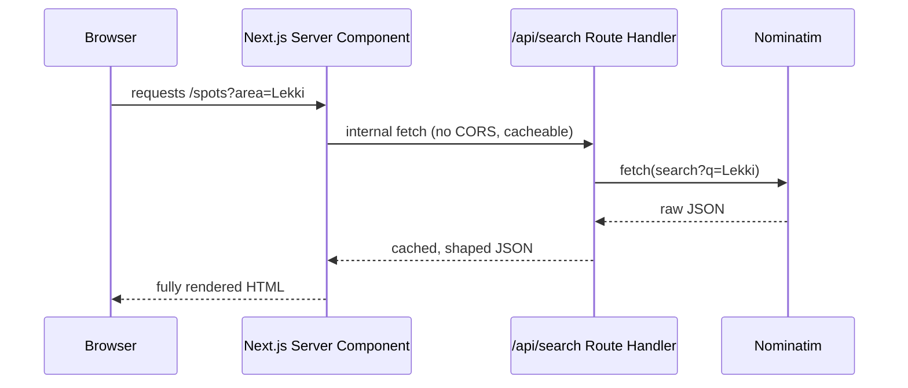

# Week 19: Next.js — The Production React Framework

Your React app from Part III works well, but it has a real limitation: everything renders in the browser, after a blank page loads and JavaScript downloads and runs. This week you meet **Next.js**, the framework most production React teams build on, and use it to solve a genuine problem — safely proxying the Nominatim API — before scaffolding the frontend for your capstone.

---

## Module 1: Why a Meta-Framework?

### 1. What Next.js Adds Over Plain React

* **Lecture & Concepts:**
    * Plain React (via Vite) is a **library** for building UI — it doesn't dictate routing, data fetching, or how a page reaches the browser. Next.js is a **framework** built on React that makes those decisions for you, in ways that solve real production problems: file-based routing (a file's path *is* its URL, no router config needed), and **Server Components** that can fetch data and render HTML on the server, before any JavaScript reaches the browser at all.
    * **SSR (Server-Side Rendering)** generates a page's HTML on the server for each request. **SSG (Static Site Generation)** generates it once, at build time. Both get real content in front of a user faster than a blank page waiting for client-side JavaScript to fetch and render everything — genuinely useful for a page like Lagos Spots' homepage, where the initial spots list doesn't need to wait on the browser at all.

### 2. Server vs. Client Components

* **Lecture & Concepts:**
    * In Next.js's App Router, every component is a **Server Component** by default — it runs only on the server, can directly `await` data, and ships zero JavaScript for itself to the browser. Adding `'use client'` at the top of a file opts a component into being a **Client Component** — necessary for anything using state, effects, or browser-only APIs (`useState`, `onClick`, `localStorage`).
    * The practical rule: default to Server Components; reach for `'use client'` only where interactivity genuinely requires it.

* **Class Exercise: Scaffold the Real Project**
    ```bash
    npx create-next-app@latest lagos-spots-next --typescript --tailwind --app
    ```
    1. Run the command above.
    2. In `app/page.tsx`, remove the boilerplate and render a plain server component: `<h1>Lagos Spots</h1>` with no `'use client'` directive — confirm it renders correctly with zero client-side JavaScript needed for this page.

---

## Module 2: Route Handlers — Solving a Real Problem

### 1. File-Based Routing & Route Handlers

* **Lecture & Concepts:**
    * A file at `app/spots/page.tsx` automatically becomes the `/spots` route — no router configuration file to maintain. Dynamic segments work the same way: `app/spots/[id]/page.tsx` becomes `/spots/:id`, read inside the page via its `params` argument.
    * A **Route Handler** (`app/api/.../route.ts`) is Next.js's direct equivalent of an Express route — it exports functions named after HTTP methods (`GET`, `POST`) and returns a `Response`.

### 2. Why Proxy Nominatim Instead of Calling It From the Browser

* **Lecture & Concepts:**
    * Calling Nominatim directly from client-side code (as you did in Part II/III) works, but has real downsides at production scale: no caching across users, no control over how many requests your app sends to a free third-party service, and every browser directly depends on that third party's availability and rate limits. Routing the request through your own Route Handler fixes all three — you control caching, you can add your own rate limiting, and if you ever swap providers, only one file changes.



* **In-Depth Example:**
    ```ts
    // app/api/search/route.ts
    import { NextRequest, NextResponse } from 'next/server';

    export async function GET(request: NextRequest) {
      const query = request.nextUrl.searchParams.get('q');
      if (!query) {
        return NextResponse.json({ error: 'Missing query parameter "q"' }, { status: 400 });
      }

      const url = `https://nominatim.openstreetmap.org/search?format=json&q=${encodeURIComponent(query)}, Lagos, Nigeria`;
      const response = await fetch(url, {
        headers: { 'Accept-Language': 'en' },
        next: { revalidate: 3600 }, // cache this exact query for 1 hour
      });
      const results = await response.json();

      return NextResponse.json(results);
    }
    ```
    ```tsx
    // app/page.tsx (a Server Component, fetching at request time)
    async function getResults(query: string) {
      const res = await fetch(`${process.env.NEXT_PUBLIC_BASE_URL}/api/search?q=${query}`, {
        cache: 'no-store',
      });
      return res.json();
    }

    export default async function HomePage() {
      const results = await getResults('Lekki');
      return (
        <main>
          <h1>Lagos Spots</h1>
          <ul>{results.map((r: { display_name: string }) => <li key={r.display_name}>{r.display_name}</li>)}</ul>
        </main>
      );
    }
    ```
    * `next: { revalidate: 3600 }` is Next.js's built-in caching hook — the exact caching benefit described above, in one line.

* **Class Exercise: Build the Real Proxy**
    1. Build `/api/search/route.ts` exactly as shown.
    2. Build `HomePage` as an `async` Server Component fetching through your own Route Handler, not Nominatim directly.
    3. Confirm in the Network tab that the browser only ever talks to your own domain — never `nominatim.openstreetmap.org` directly.

---

## Module 3: Connecting to Flowboard — Starting the Capstone Frontend

### 1. Environment Variables & Client-Server Data Flow

* **Lecture & Concepts:**
    * Next.js environment variables prefixed `NEXT_PUBLIC_` are embedded into the client bundle and visible to anyone; unprefixed variables (like a real API secret) stay server-only, readable only inside Server Components and Route Handlers. This distinction matters a great deal once Flowboard's API needs real credentials.
    * A page that needs both a fast initial render *and* interactivity typically mixes both component types: a Server Component fetches the initial data, and a nested Client Component handles clicks/state on top of it.

### 2. Loading States With Suspense

* **Lecture & Concepts:**
    * `<Suspense fallback={...}>` lets one slow-loading part of a page show a fallback while the rest of the page renders immediately — rather than the whole page waiting on the slowest piece of data.

* **In-Depth Example (First Real Flowboard-Connected Page):**
    ```tsx
    // app/boards/page.tsx
    import { Suspense } from 'react';

    async function getBoards() {
      const res = await fetch(`${process.env.FLOWBOARD_API_URL}/api/v1/boards`, {
        headers: { Cookie: `session_id=${/* real session cookie, once auth wiring exists */ ''}` },
        cache: 'no-store',
      });
      if (!res.ok) throw new Error('Failed to load boards');
      return res.json();
    }

    async function BoardsList() {
      const boards = await getBoards();
      return <ul>{boards.map((b: { id: number; title: string }) => <li key={b.id}>{b.title}</li>)}</ul>;
    }

    export default function BoardsPage() {
      return (
        <main>
          <h1>My Boards</h1>
          <Suspense fallback={<p>Loading boards...</p>}>
            <BoardsList />
          </Suspense>
        </main>
      );
    }
    ```

* **Class Exercise: Scaffold the Capstone Frontend**
    1. Create a new Next.js project intended for the Flowboard frontend (or reuse `lagos-spots-next` if you plan to extend it in Part VI — either is valid, this is a real scoping decision you'll formalize in Week 21).
    2. Build `BoardsPage` as shown, pointed at your deployed or locally-running Flowboard API from Part IV.
    3. Confirm it renders real board data, with the `Suspense` fallback visible briefly on a throttled network (DevTools → Network → "Slow 3G").

---

### Week 19: Comprehensive Assignment

**Objective:** A working Next.js app that proxies a real third-party API through its own Route Handler, and a first page reading live data from Flowboard.

**Requirements:**

1. **Scaffold:** A Next.js (App Router, TypeScript, Tailwind) project running via `npm run dev`.
2. **Route Handler:** `/api/search` proxies Nominatim with server-side caching (`revalidate`), never called directly from client code.
3. **Server Component Fetching:** The homepage is an `async` Server Component that fetches through the Route Handler.
4. **Flowboard Connection:** A real page fetches and renders live data from your Flowboard API, wrapped in `<Suspense>` with a visible fallback state.
5. **Environment Variables:** Correct use of `NEXT_PUBLIC_`-prefixed vs. server-only variables, with no secret ever exposed to the client bundle.
6. **Git:** Committed and pushed via the branch → PR → merge workflow.

**Bonus Challenge:** Add a `'use client'` component for a simple search input on the homepage that calls `/api/search` client-side via `fetch` as the user types (debounced, from Week 12's pattern) — a concrete example of mixing Server and Client Components on one page.
