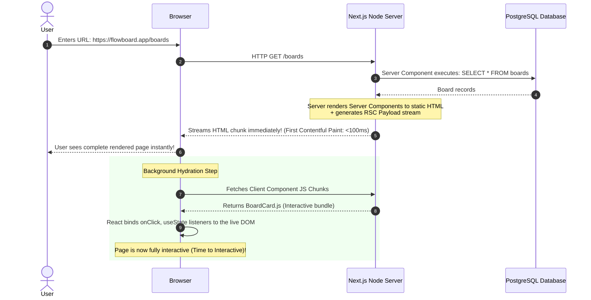
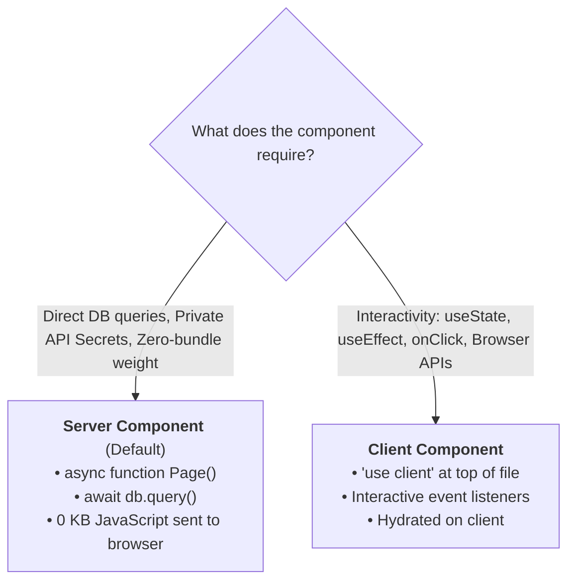
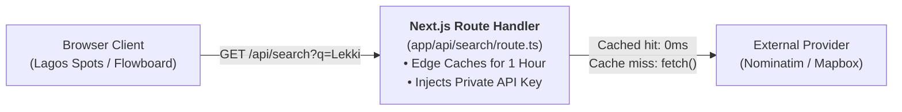

# Week 19: Next.js — The Production React Framework

Client-Side Rendered (CSR) applications suffer from empty initial HTML, delayed time-to-interactive, and search engine indexing penalties. This week, you master **Next.js (App Router)** — the industry-standard full-stack React meta-framework. You will master **React Server Components (RSC)**, **Hydration Mechanics**, **Rendering Strategies (SSR, SSG, ISR)**, **Next.js Route Handlers as Secure API Proxies**, and **Streaming with React Suspense**.

---

## Module 1: The Next.js Paradigm: Server vs. Client Components

### 1. The Core Terminology of Modern React Meta-Frameworks

| Term | What It Actually Means | Technical Context |
| :--- | :--- | :--- |
| **React Server Component (RSC)** | A component that executes **exclusively on the server** during request or build time, emitting raw HTML and serialized payload, with **zero JavaScript shipped to the browser bundle**. | Default in Next.js App Router. Can directly query databases, read server filesystem, and use secrets safely. |
| **Client Component (`'use client'`)** | A component declared with `'use client'` that is pre-rendered on the server and hydrated in the browser to enable interactivity, state, and browser event listeners. | Used for UI requiring `useState`, `useEffect`, `onClick`, or browser APIs (`localStorage`, `window`). |
| **Hydration** | The process where React in the browser downloads component JavaScript, inspects the server-rendered HTML, and attaches event listeners to make the DOM interactive. | Bridges the gap between fast server HTML and dynamic client interactivity. |
| **Serialization Boundary** | The boundary line where data is passed from a Server Component to a Client Component via `props`. | Props **must be JSON-serializable** (primitives, plain objects, arrays). You cannot pass functions or database class instances across this boundary! |
| **Streaming SSR** | Progressively streaming chunks of server-rendered HTML over HTTP as they become ready, instead of waiting for all slow database queries to finish before sending the page. | Enabled via `<Suspense>` boundaries and `loading.tsx`. |

---

### 2. Under the Hood: The RSC & Hydration Execution Lifecycle



---

### 3. Server vs. Client Components: Decision Matrix



| Use Case | Component Type | Reason |
| :--- | :--- | :--- |
| Fetch initial data from PostgreSQL database | **Server Component** | Eliminates network waterfall; keeps database credentials secure on server. |
| Search filter input with live typing state | **Client Component** | Requires `useState` and `onChange` event handlers. |
| Static marketing page or documentation article | **Server Component** | Zero client JavaScript; optimal SEO and Core Web Vitals. |
| Dark mode toggle button reading `localStorage` | **Client Component** | Accesses browser `window` / `localStorage` APIs. |

---

## Module 2: Route Handlers & Secure API Proxying

### 1. Why Proxy External APIs Through Route Handlers?

In Week 9, we fetched OpenStreetMap's Nominatim API directly from client-side JavaScript. In production, this causes three severe problems:
1. **CORS & Rate Limiting:** Third-party APIs throttle requests when thousands of different client browsers spam requests.
2. **Missing Caching:** Every single client request hits the external provider, even for duplicate searches (e.g., "Victoria Island").
3. **Exposed Secrets:** If an API requires a paid secret API key, storing it in client-side code exposes it to theft.

**Next.js Route Handlers (`app/api/.../route.ts`)** solve this by acting as a secure server-side proxy with built-in edge caching:



---

### 2. Implementing a Cached Route Handler

```ts
// app/api/search/route.ts
import { NextRequest, NextResponse } from 'next/server';

export async function GET(request: NextRequest) {
  const searchParams = request.nextUrl.searchParams;
  const query = searchParams.get('q');

  if (!query || query.trim().length < 2) {
    return NextResponse.json(
      { status: 'fail', message: 'Query parameter "q" must be at least 2 characters.' },
      { status: 400 }
    );
  }

  try {
    const encodedQuery = encodeURIComponent(`${query.trim()}, Lagos, Nigeria`);
    const endpoint = `https://nominatim.openstreetmap.org/search?format=json&addressdetails=1&q=${encodedQuery}`;

    // Next.js Extended fetch with Cache Revalidation (ISR)
    const response = await fetch(endpoint, {
      headers: {
        'Accept-Language': 'en',
        'User-Agent': 'FlowboardLagosApp/1.0',
      },
      next: {
        revalidate: 3600, // Cache response at the CDN Edge for 1 hour (3,600 seconds)
      },
    });

    if (!response.ok) {
      throw new Error(`Upstream API failed with status ${response.status}`);
    }

    const data = await response.json();

    return NextResponse.json({
      status: 'success',
      results: data.length,
      data,
    });
  } catch (error: any) {
    console.error('Proxy search failed:', error);
    return NextResponse.json(
      { status: 'error', message: 'Failed to retrieve geospatial data from upstream provider.' },
      { status: 502 } // Bad Gateway
    );
  }
}
```

---

## Module 3: Composing Server & Client Components

### 1. Next.js App Router File Structure

```
app/
├── layout.tsx             # Root layout (HTML, Body, Global Nav)
├── page.tsx               # Homepage (Server Component)
├── loading.tsx            # Global streaming fallback skeleton
├── error.tsx              # Client-side Error Boundary
├── not-found.tsx          # Custom 404 page
├── api/
│   └── search/
│       └── route.ts       # Proxy Route Handler
└── boards/
    ├── page.tsx           # Server Component fetching Flowboard boards
    ├── [id]/
    │   └── page.tsx       # Dynamic route: /boards/:id
    └── components/
        └── CreateBoardModal.tsx  # 'use client' Interactive Modal
```

---

### 2. Connecting Next.js to the Flowboard Backend

```tsx
// app/boards/page.tsx (Async Server Component)
import { Suspense } from 'react';
import { cookies } from 'next/headers';
import Link from 'next/link';
import { CreateBoardButton } from './components/CreateBoardButton';

interface Board {
  id: string;
  title: string;
  description: string;
  createdAt: string;
}

// Data fetching function running directly on the server
async function fetchUserBoards(): Promise<Board[]> {
  const cookieStore = await cookies();
  const sessionCookie = cookieStore.get('session_id')?.value;

  const response = await fetch(`${process.env.FLOWBOARD_API_URL || 'http://localhost:4000'}/api/v1/boards`, {
    headers: {
      Cookie: `session_id=${sessionCookie || ''}`,
    },
    cache: 'no-store', // Always fetch fresh data for authenticated dashboards
  });

  if (!response.ok) {
    if (response.status === 401) {
      throw new Error('UNAUTHORIZED');
    }
    throw new Error('Failed to load boards from backend service.');
  }

  const payload = await response.json();
  return payload.data.boards;
}

// Suspense-wrapped Async List Component
async function BoardsGrid() {
  const boards = await fetchUserBoards();

  if (boards.length === 0) {
    return (
      <div className="text-center py-16 bg-white dark:bg-slate-800 rounded-2xl border border-dashed border-slate-300 dark:border-slate-700">
        <p className="text-slate-500">You haven't created any task boards yet.</p>
      </div>
    );
  }

  return (
    <div className="grid grid-cols-1 md:grid-cols-2 lg:grid-cols-3 gap-6">
      {boards.map((board) => (
        <Link
          key={board.id}
          href={`/boards/${board.id}`}
          className="p-6 bg-white dark:bg-slate-800 rounded-2xl border border-slate-200 dark:border-slate-700 shadow-sm hover:shadow-md hover:-translate-y-1 transition-all"
        >
          <h3 className="text-xl font-bold text-slate-900 dark:text-white mb-2">{board.title}</h3>
          <p className="text-sm text-slate-500 dark:text-slate-400 line-clamp-2">{board.description}</p>
        </Link>
      ))}
    </div>
  );
}

// Main Page Layout
export default function BoardsDashboardPage() {
  return (
    <div className="max-w-7xl mx-auto px-4 sm:px-6 lg:px-8 py-10">
      <div className="flex justify-between items-center mb-8">
        <div>
          <h1 className="text-3xl font-extrabold text-slate-900 dark:text-white">Workspace Boards</h1>
          <p className="text-sm text-slate-500 mt-1">Manage team projects and sprint workflows.</p>
        </div>
        {/* Client Component with Modal Interactivity */}
        <CreateBoardButton />
      </div>

      {/* Streaming Suspense Boundary with Skeleton Fallback */}
      <Suspense
        fallback={
          <div className="grid grid-cols-1 md:grid-cols-2 lg:grid-cols-3 gap-6 animate-pulse">
            {[1, 2, 3].map((n) => (
              <div key={n} className="h-36 bg-slate-200 dark:bg-slate-700 rounded-2xl"></div>
            ))}
          </div>
        }
      >
        <BoardsGrid />
      </Suspense>
    </div>
  );
}
```

---

### Common Pitfalls & How to Avoid Them

| Pitfall | Root Cause | Fix |
| :--- | :--- | :--- |
| **`ReferenceError: window is not defined`** | Accessing `window`, `document`, or `localStorage` inside a Server Component. | Move browser API code into a Client Component wrapped with `'use client'` inside `useEffect`. |
| **Hydration Mismatch Error** | Server-rendered HTML differs from Client-rendered HTML (e.g. `new Date().toLocaleTimeString()` or `Math.random()`). | Render dynamic browser timestamps only after component has mounted on client. |
| **Passing Functions as Props to Client Components** | Non-serializable values crossing the Server-to-Client serialization boundary. | Pass JSON-serializable primitives/objects or use **Server Actions** (`'use server'`). |

---

### Week 19: Comprehensive Assignment

**Objective:** Scaffold the full-stack Flowboard frontend with Next.js App Router, implement a cached Route Handler proxy for geospatial lookups, and connect server-rendered pages to the Flowboard Express API.

**Requirements:**
1. **Next.js Project Setup:**
   - Initialized with `create-next-app` using TypeScript, Tailwind CSS v4, and App Router.
   - Configured `NEXT_PUBLIC_` vs server-only environment variables in `.env.local`.
2. **Cached Route Handler Proxy:**
   - `GET /api/search` implemented proxying Nominatim queries with edge revalidation (`next: { revalidate: 3600 }`).
3. **Server Component Data Fetching:**
   - `/boards` dashboard rendered as an async Server Component reading cookies and querying the Flowboard backend API.
   - Wrapped in `<Suspense>` with animated loading skeleton states.
4. **Interactive Client Component Composition:**
   - Interactive `CreateBoardButton` component declared with `'use client'` managing modal open/close states.
5. **Git Workflow:**
   - Developed on branch `feature/nextjs-fullstack`, merged via Pull Request, and pulled locally.

---

## Recommended References & Deep-Dive Resources

### Official Documentation & Standards
- [Next.js App Router Documentation](https://nextjs.org/docs/app) — The comprehensive guide to Server Components, dynamic routing, caching, and Route Handlers.
- [React Server Components RFC (GitHub)](https://github.com/reactjs/rfcs/blob/main/text/0188-server-components.md) — The original engineering specification for React Server Components.
- [Vercel Next.js Deployment Best Practices](https://vercel.com/docs/frameworks/nextjs) — Serverless functions, Edge Middleware, and ISR caching on Vercel.

### Recommended Textbooks & Canonical Books
- **Real-World Next.js** by Michele Riva (Packt) — *Production architecture, incremental static regeneration (ISR), and performance optimization.*
- **Patterns.dev: Modern Web App Design Patterns** by Addy Osmani and Lydia Hallie — *Deep dive into SSR, SSG, Streaming, Islands Architecture, and Progressive Hydration.* (Available free online at `patterns.dev`).

### Deep Dives & Architectural Guides
- [Lee Robinson: How React Server Components Work Under the Hood](https://leerob.io/blog/react-server-components) — Visualizing the wire format, serialization boundaries, and bundle elimination.
- [Next.js Caching and Revalidation Guide](https://nextjs.org/docs/app/building-your-application/caching) — Complete breakdown of the 4 caching layers in Next.js.
