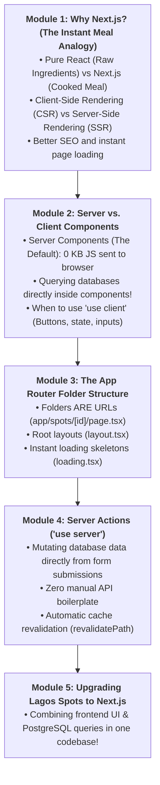

# Week 19: Next.js — The Production React Framework

Welcome to Week 19 and welcome to **Part V: Production Full-Stack Development**!

In Weeks 11–14, you built frontend React apps with Vite. In Weeks 15–18, you built backend Express APIs with PostgreSQL. They were two separate projects: running on two separate ports (`5173` and `5000`), with separate terminals and separate deployments.

In modern web development, the lines between frontend and backend have merged into **Full-Stack Frameworks**. The undisputed king of modern full-stack web development is **Next.js**.

Created by Vercel, Next.js gives you:
- React on both the server and the browser.
- Blazing-fast page loads with **Server-Side Rendering (SSR)**.
- The ability to query databases directly inside your React components with **React Server Components (RSC)**.
- Built-in API endpoints and server actions in the same project!

This week, you master the **Next.js App Router**, **Server vs. Client Components**, **Server Actions**, and full-stack architecture.

---

## Pedagogical Roadmap



---

## Module 1: Why Next.js? (The Instant Meal Analogy)

### 1. The Raw Ingredients vs The Cooked Meal

> [!NOTE]
> **The Mental Model:**
> - **Pure Client-Side React (Vite):** You order food at a restaurant, and the waiter brings you **raw rice, raw onions, and raw chicken** to your table. You have to wait while your phone's browser compiles and cooks the meal on your screen. If your phone has a slow processor or poor battery, the page takes seconds to appear!
> - **Next.js (Server-Side Rendering):** The master chef in the kitchen (the server) cooks the entire meal to perfection and serves a steaming, delicious plate of food directly to your table (**fully rendered HTML**). The user sees the completed webpage **in milliseconds**, even on slow 3G mobile networks!

```mermaid
sequenceDiagram
    participant User as User's Mobile Phone
    participant Server as Next.js Server

    User->>Server: Visits https://lagosspots.app
    Note over Server: Server executes React code & queries PostgreSQL
    Server-->>User: Delivers fully formed HTML with text, images & cards!
    User-->>User: User sees page INSTANTLY! (&lt;100ms)
    Note over User: React loads in background to enable button clicks (Hydration)
```

---

### 2. Creating a Next.js App

Run the official Next.js installer:

```bash
npx create-next-app@latest lagos-spots-next --typescript --tailwind --eslint --app --src-dir --no-turbopack
```

Select:
- TypeScript: **Yes**
- Tailwind CSS: **Yes**
- `src/` directory: **Yes**
- App Router: **Yes**

Run `npm run dev` and open `http://localhost:3000`!

---

## Module 2: Server Components vs. Client Components

Next.js introduces the biggest evolution in React history: **React Server Components (RSC)**.

### 1. Server Components (The Default in Next.js)

In the Next.js `app` folder, **every component is a Server Component by default**.
- It runs **strictly on the server**.
- It ships **ZERO kilobytes of JavaScript to the browser** (saving mobile data for your users!).
- You can mark the function as `async` and **query your database directly inside the component**:

```tsx
// src/app/page.tsx (A React Server Component!)
import { db } from "@/db";
import { spots } from "@/db/schema";

// Direct database query right inside your React component!
export default async function HomePage() {
  const allSpots = await db.select().from(spots);

  return (
    <main className="max-w-4xl mx-auto p-6">
      <h1 className="text-3xl font-bold mb-6">Explore Lagos Spots</h1>
      <div className="grid grid-cols-2 gap-4">
        {allSpots.map((spot) => (
          <article key={spot.id} className="p-4 bg-white rounded border shadow-sm">
            <h3 className="font-bold text-lg">{spot.name}</h3>
            <p className="text-sm text-slate-500">📍 {spot.area}</p>
          </article>
        ))}
      </div>
    </main>
  );
}
```

Notice that there are no `useState`, `useEffect`, `fetch()`, or `isLoading` spinners needed here! The server queries the database and renders the HTML directly!

---

### 2. When to Use Client Components (`'use client'`)

If a component needs **user interactivity**:
- Clicking a button with `onClick`
- Storing form input with `useState`
- Browser APIs like `localStorage` or `window`

You add the directive **`'use client'`** at the very top of that specific file:

```tsx
// src/components/FavoriteButton.tsx
"use client"; // Marks this specific component as an interactive Client Component!

import { useState } from "react";

export function FavoriteButton({ spotId }: { spotId: string }) {
  const [isSaved, setIsSaved] = useState(false);

  return (
    <button
      onClick={() => setIsSaved(!isSaved)}
      className="text-sm px-3 py-1 rounded border mt-2"
    >
      {isSaved ? "❤️ Favorited" : "🤍 Save"}
    </button>
  );
}
```

> [!TIP]
> **The Golden Rule:** Keep your page layout and data fetching as Server Components. Only push `'use client'` down to the small, interactive buttons and inputs that actually need it!

---

## Module 3: The App Router Folder Structure

In Next.js, **your folders on your computer define your website's URL routes**:

```
src/app/
├── layout.tsx            # Global Root Layout (Navbar, Footer, HTML skeleton)
├── page.tsx              # Home Page (/)
├── loading.tsx           # Automatic Loading Skeleton while database queries run!
├── submit/
│   └── page.tsx          # URL: /submit
└── spots/
    └── [id]/             # Dynamic Route!
        └── page.tsx      # URL: /spots/123
```

### Dynamic Routes with `[id]`
To build a place details page at `/spots/:id`:
Create `src/app/spots/[id]/page.tsx`:

```tsx
// src/app/spots/[id]/page.tsx
import { db } from "@/db";
import { spots } from "@/db/schema";
import { eq } from "drizzle-orm";
import { notFound } from "next/navigation";

export default async function SpotDetailPage({ params }: { params: { id: string } }) {
  const [spot] = await db.select().from(spots).where(eq(spots.id, params.id));

  if (!spot) {
    notFound(); // Next.js automatically shows a beautiful 404 page!
  }

  return (
    <div className="max-w-2xl mx-auto p-6 bg-white rounded shadow mt-8">
      <h1 className="text-3xl font-extrabold">{spot.name}</h1>
      <p className="text-slate-500 mt-1">📍 {spot.area}</p>
      <p className="mt-4 text-slate-700">{spot.description}</p>
    </div>
  );
}
```

---

## Module 4: Server Actions (`'use server'`)

In traditional web development, to submit a form, you had to:
1. Write a frontend form with `onSubmit` and `fetch('/api/spots')`.
2. Write a backend Express route with `app.post('/api/spots')`.
3. Handle JSON serialization and status codes on both sides.

In Next.js, you can write a **Server Action**: an asynchronous function that runs directly on the server when a standard HTML form is submitted!

```tsx
// src/app/submit/page.tsx
import { db } from "@/db";
import { spots } from "@/db/schema";
import { redirect } from "next/navigation";
import { revalidatePath } from "next/cache";

export default function SubmitSpotPage() {
  // 🟢 Server Action: Runs directly on the server!
  async function createSpot(formData: FormData) {
    "use server"; // Marks function as a Server Action

    const name = formData.get("name") as string;
    const area = formData.get("area") as string;
    const description = formData.get("description") as string;

    if (!name || !area) return;

    // Direct database insert:
    await db.insert(spots).values({
      name: name.trim(),
      area: area.trim(),
      description: description ? description.trim() : "",
    });

    // Clear cached homepage so the new spot shows up immediately:
    revalidatePath("/");

    // Redirect user back to home page:
    redirect("/");
  }

  return (
    <div className="max-w-md mx-auto p-6 bg-white rounded shadow mt-8">
      <h2 className="text-2xl font-bold mb-4">Submit a New Spot</h2>
      <form action={createSpot} className="space-y-4">
        <div>
          <label className="block text-xs font-semibold mb-1">Spot Name</label>
          <input name="name" required className="w-full border p-2 rounded text-sm" />
        </div>
        <div>
          <label className="block text-xs font-semibold mb-1">Area</label>
          <input name="area" required className="w-full border p-2 rounded text-sm" />
        </div>
        <div>
          <label className="block text-xs font-semibold mb-1">Description</label>
          <textarea name="description" className="w-full border p-2 rounded text-sm" />
        </div>
        <button type="submit" className="w-full bg-orange-600 text-white font-bold py-2 rounded">
          Submit Place
        </button>
      </form>
    </div>
  );
}
```

---

## Module 5: Rookie Traps & Debugging Guide

| Error Message / Trap | Root Cause | How to Fix It |
| :--- | :--- | :--- |
| `useState is not defined in Server Component` | You tried using `useState` or `useEffect` inside a Server Component. | Add `"use client";` at the very first line of the file. |
| `Cannot pass functions as props to Client Component` | You tried passing a server function directly across the serialization boundary. | Pass plain JSON data (strings, numbers, objects), or pass a Server Action. |
| Page does not update after creating a record | Next.js cached the page data for speed. | Call `revalidatePath("/")` inside your Server Action after database mutations. |

---

## 🎯 Week 19 Hands-on Classroom Exercises

### Level 1: Scaffolding Your Next.js App
1. Initialize a new Next.js project with App Router and Tailwind.
2. Edit `src/app/page.tsx` and verify that changes appear instantly in your browser.
3. Configure `layout.tsx` with a shared header showing "Lagos Spots — Full-Stack Edition".

### Level 2: Database Query in a Server Component
1. Connect your Neon PostgreSQL database to Next.js using Drizzle.
2. Inside `src/app/page.tsx`, directly query your `spots` table and render real place cards on the homepage.
3. Add a `loading.tsx` file to display an automatic loading skeleton while the database queries run!

### Level 3: Form Submission with Server Actions
1. Build `src/app/submit/page.tsx`.
2. Write a Server Action that inserts a new place into PostgreSQL and calls `revalidatePath("/")`.
3. Test submitting a spot and watch the homepage update automatically with the new place!

---

## 📚 Curated Deep-Dive References

* [Next.js Official Documentation: App Router](https://nextjs.org/docs/app) — The authoritative guide to Next.js routing, caching, and server actions.
* [React Official Documentation: Server Components](https://react.dev/reference/rsc/server-components) — Understanding the architecture of Server Components.
* [The Valley of Code: Next.js](https://thevalleyofcode.com/nextjs/) — Flavio Copes' beginner guide to full-stack React.
