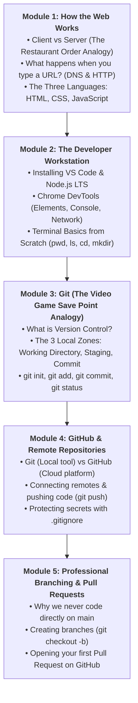
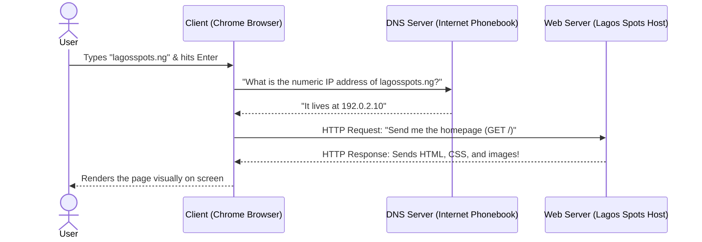
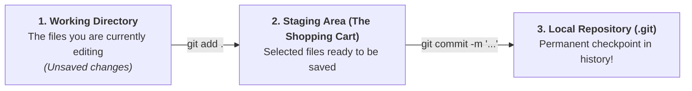
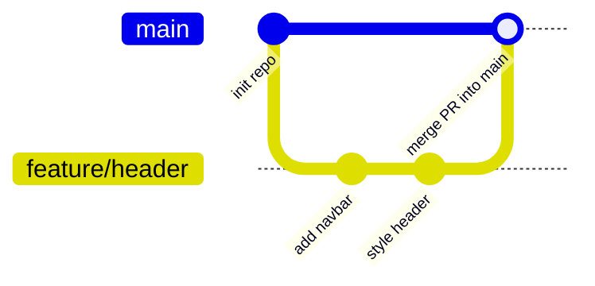

# Week 1: Dev Environment, Git & GitHub, How the Web Works

Welcome to the **Comprehensive Full-Stack Development Course** at Lagos Data School! 

Whether you have never written a single line of code in your life or have dabbled with small scripts, this course is designed to take you from a complete beginner all the way to building, testing, and deploying production-grade web applications.

Before writing code, every professional software engineer needs three fundamental things:
1. **A clear mental model of how the web actually works.**
2. **A professional development environment** configured on their computer.
3. **A version control safety net (Git & GitHub)** so your code is never lost or accidentally overwritten.

This week, you will set up your developer workstation, master Git, and initialize the project you will build and evolve throughout this course: **Lagos Spots** — a real directory of places around Lagos (restaurants, arts, study spots, and nightlife).

---

## Pedagogical Roadmap



---

## Module 1: How the Web Works (The Restaurant Order Analogy)

### 1. The Client-Server Model

Every interaction on the internet follows a simple two-party conversation:

> [!NOTE]
> **The Mental Model:**
> - **The Client (Customer):** Your web browser (Google Chrome, Safari, or a smartphone). The client places orders by requesting web pages or images.
> - **The Server (The Kitchen):** A computer connected to the internet running 24/7. It listens for orders, retrieves files from disk or a database, and serves the response back to the client.



---

### 2. What is an IP Address & DNS?

Computers do not communicate using human names like `lagosspots.ng`. They communicate using numeric **IP Addresses** (e.g., `192.0.2.10`).

> [!TIP]
> **DNS (Domain Name System)** is simply the **Contacts List / Phonebook of the Internet**.
> When you want to call your friend Tunde, you don't memorize his 11-digit phone number — you tap "Tunde" in your contacts, and your phone looks up the number. DNS does the exact same thing for domain names!

---

### 3. The Three Building Blocks of the Web

Every webpage you visit is constructed from three distinct technologies:

| Language | Role | Real-World Analogy |
| :--- | :--- | :--- |
| **HTML** *(HyperText Markup Language)* | Content, structure, headings, paragraphs, and forms. | **The Skeleton & Brickwork** |
| **CSS** *(Cascading Style Sheets)* | Colors, fonts, layout, spacing, and mobile responsiveness. | **The Paint, Interior Decor & Clothing** |
| **JavaScript** *(JS)* | Interactivity, search filtering, button clicks, and live API data. | **The Brain, Muscles & Electrical Wiring** |

---

## Module 2: The Developer Workstation & Terminal Basics

### 1. Essential Tools to Install
1. **VS Code (Visual Studio Code):** Download from [code.visualstudio.com](https://code.visualstudio.com). The world's most popular code editor.
2. **Node.js LTS (Long Term Support):** Download from [nodejs.org](https://nodejs.org).
3. **Git:** Download from [git-scm.com](https://git-scm.com).
4. **Google Chrome:** For its built-in Developer Tools.

---

### 2. Terminal Basics from Scratch

As a software engineer, you will use the **Terminal (Command Line)** every day. Think of the terminal as navigating your computer using text instead of clicking mouse icons:

| Command | What It Means | Plain English Explanation |
| :--- | :--- | :--- |
| **`pwd`** | **P**rint **W**orking **D**irectory | *"Where am I right now?"* Shows your current folder path. |
| **`ls`** (or `dir` on Windows) | **L**i**s**t | *"What files and folders are inside this directory?"* |
| **`cd <folder>`** | **C**hange **D**irectory | Moves you into a folder (e.g., `cd Desktop`). |
| **`cd ..`** | Change Directory (Up) | Moves you back up one folder level. |
| **`mkdir <name>`** | **M**a**k**e **D**irectory | Creates a brand new folder. |
| **`touch <file>`** | Touch / Create file | Creates an empty new file (e.g., `touch index.html`). |
| **`code .`** | Open in VS Code | Opens the current folder inside VS Code! |

---

### 🏋️ Try It in Your Terminal Now (Drill 1)
Open your terminal (Terminal on Mac, Git Bash / PowerShell on Windows) and run:
```bash
# 1. Check where you are:
pwd

# 2. Go to your Desktop:
cd Desktop

# 3. Create a project folder:
mkdir lagos-spots
cd lagos-spots

# 4. Open the folder in VS Code:
code .
```

---

## Module 3: Git (The Video Game Save Point Analogy)

### 1. What is Version Control?

Have you ever saved files like this?
- `final_project.html`
- `final_project_v2.html`
- `final_project_real_final_EDITED.html`

This creates chaos. If something breaks, you don't know which file worked or what changed.

> [!NOTE]
> **The Mental Model:** **Git** is a time machine and a **Save Point system** for your code (just like checkpoints in a video game).
> Every time you reach a working milestone, you create a "Commit" (a save checkpoint). If your code breaks tomorrow, you can instantly roll back to any past checkpoint in history!

---

### 2. The Three Local Zones of Git

To understand Git, you only need to understand three zones on your computer:



1. **Working Directory:** The actual files on your computer you are currently typing in.
2. **Staging Area (The Shopping Cart):** You selectively choose *which* files you want to include in your next save checkpoint using **`git add`**.
3. **Local Repository:** The permanent history ledger saved on your machine using **`git commit`**.

---

### 3. Step-by-Step Git Commands

#### First-Time Git Configuration (Do this once):
```bash
git config --global user.name "Your Name"
git config --global user.email "your.email@example.com"
```

#### The Daily Git Cycle:
```bash
# 1. Initialize Git in your project folder (only once per project):
git init

# 2. Check the status of your files (Are changes staged?):
git status

# 3. Add files to the staging cart:
git add README.md       # Adds a single file
git add .               # Adds ALL modified files in current folder

# 4. Save a permanent checkpoint with a descriptive message:
git commit -m "feat: initialize Lagos Spots project structure"

# 5. View your project history:
git log --oneline
```

---

## Module 4: GitHub & Remote Repositories

### 1. Git vs. GitHub

- **Git:** The free tool installed on your computer that tracks file history. (Works 100% offline).
- **GitHub:** A cloud website that hosts your Git repositories online so you can backup your code, collaborate with teammates, and deploy to the web.

---

### 2. Pushing Your Code to GitHub

1. Go to [github.com](https://github.com) and click **"New Repository"**.
2. Name it `lagos-spots` and leave it Public. Do not check "Add a README" (we already have our local repo).
3. Connect your local project to GitHub and push:

```bash
# 1. Rename default branch to 'main':
git branch -M main

# 2. Connect local folder to GitHub remote URL:
git remote add origin https://github.com/<your-username>/lagos-spots.git

# 3. Push code to GitHub (-u sets default upstream branch):
git push -u origin main
```

Refresh your GitHub browser page — your files are now safely backed up in the cloud!

---

### 3. Protecting Secrets with `.gitignore`

Never push private API keys, database passwords, or heavy system files to GitHub!
Create a file named **`.gitignore`** in your project root:

```gitignore
# Operating system files
.DS_Store
Thumbs.db

# Dependencies
node_modules/

# Secrets and environment variables
.env
.env.local
```

---

## Module 5: Professional Branching & Pull Requests

### 1. Why Branches?

In professional engineering teams, **developers NEVER write code directly on the `main` branch**.
If two engineers edit `main` at the same time, they break each other's work.

Instead, you create a **Branch** (an isolated workspace copy). You build and test your feature on your branch, and when it is finished, you merge it back into `main` via a **Pull Request (PR)**.



---

### 2. The Feature Branch Workflow

```bash
# 1. Create and switch to a new feature branch:
git checkout -b feature/header
# (Or modern syntax: git switch -c feature/header)

# 2. Make your code changes in VS Code...

# 3. Stage and commit on your branch:
git add .
git commit -m "feat: add initial header and navbar structure"

# 4. Push your branch to GitHub:
git push -u origin feature/header
```

5. Go to your repository on GitHub: click **"Compare & pull request"**.
6. Review your changes and click **"Merge pull request"**!
7. Switch back to `main` locally and pull the merged changes:
   ```bash
   git checkout main
   git pull origin main
   ```

---

## Module 6: Rookie Traps & Debugging Guide

| Error Message / Trap | Root Cause | How to Fix It |
| :--- | :--- | :--- |
| `fatal: not a git repository` | You ran a `git` command in a folder that was never initialized. | Run `git init` or check your current folder with `pwd`. |
| Trapped in a strange black terminal window (**Vim**) | Git opened the Vim text editor because you ran `git commit` without `-m "..."`. | Press `Esc`, type `:wq` and press `Enter` to save and exit! |
| `fatal: remote origin already exists` | You tried running `git remote add origin` twice. | Check with `git remote -v`, or remove it with `git remote remove origin`. |
| GitHub rejects your password during `git push` | GitHub no longer accepts account passwords for command line operations. | Use a **GitHub Personal Access Token (PAT)** or configure an **SSH Key**. |

---

## 🎯 Week 1 Hands-on Classroom Exercises

### Level 1: Terminal Mastery
1. Using only your terminal, create a directory called `web-drills`.
2. Inside it, create two files: `index.html` and `README.md`.
3. Open the directory in VS Code using `code .`.

### Level 2: First Git Repository
1. Initialize Git inside `web-drills`.
2. In `README.md`, type: `"# Full-Stack Development Drills"`.
3. Check `git status`, stage the file with `git add README.md`, and commit with `git commit -m "docs: add initial README"`.
4. Inspect your commit history with `git log --oneline`.

### Level 3: Initializing the Lagos Spots Project
1. Create your official `lagos-spots` project repository on GitHub.
2. Clone or initialize the repository on your local computer.
3. Create a feature branch: `feature/readme-setup`.
4. Write a descriptive `README.md` explaining what Lagos Spots is (a directory of food, study, and nightlife spots in Lagos).
5. Push the branch, open a Pull Request on GitHub, and merge it into `main`!

---

## 📚 Curated Deep-Dive References

* [The Valley of Code: Git Tutorial](https://thevalleyofcode.com/git/) — Flavio Copes' gentle, beginner-focused guide to Git.
* [The Valley of Code: The Command Line](https://thevalleyofcode.com/command-line/) — Essential CLI commands and tips.
* [GitHub Skills: Introduction to GitHub](https://skills.github.com/) — Free, interactive GitHub tutorials.
* [MDN Web Docs: How the Web Works](https://developer.mozilla.org/en-US/docs/Learn/Common_questions/Web_mechanics/How_does_the_Internet_work) — Comprehensive overview of internet architecture.
