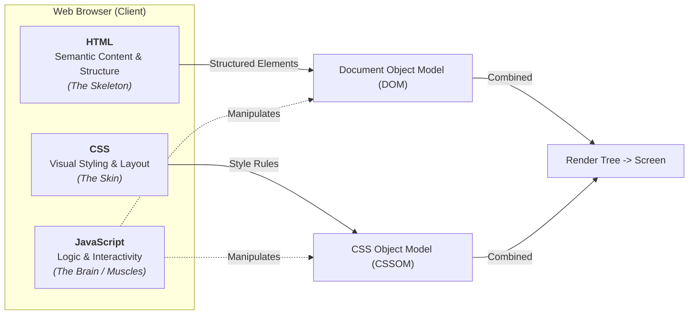
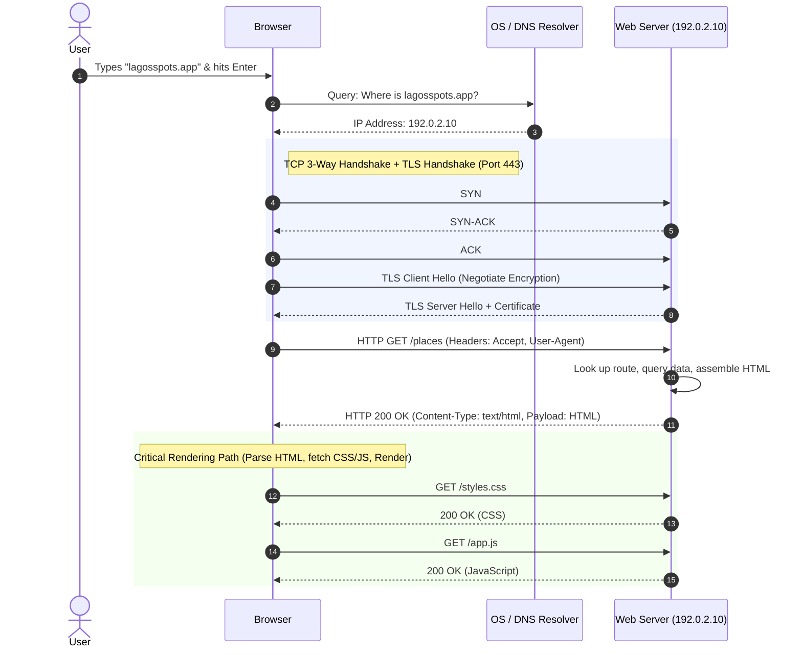
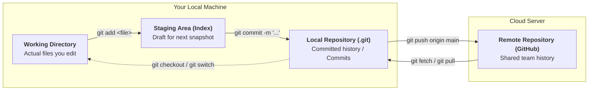
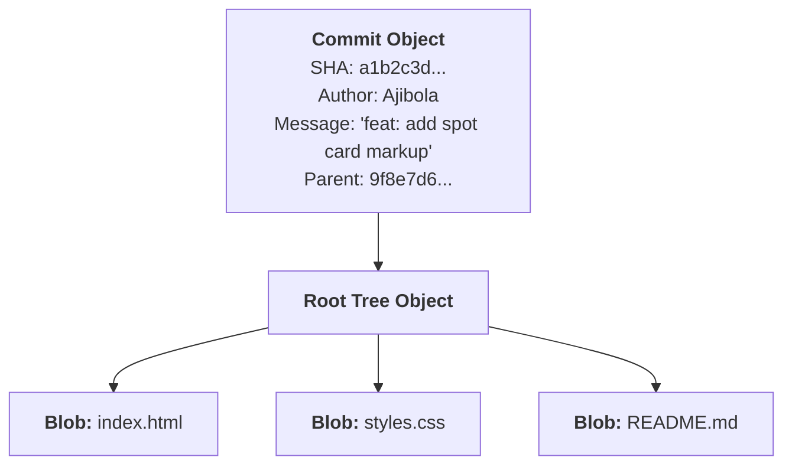
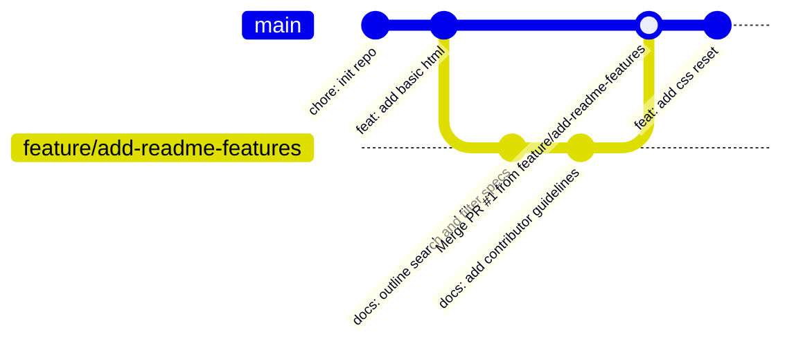

# Week 1: Dev Environment, Git & GitHub, How the Web Works

Welcome to Full-Stack Development. Before writing a single line of a real page, you need three things: a working toolset, an understanding of what actually happens when someone visits a website, and a safety net for your work that isn't just "the last time I saved the file." This week gives you all three, and opens the project you'll keep building and rebuilding for the rest of the course: **Lagos Spots** — a real directory of places around Lagos (restaurants, hangouts, study spots, events) that people can search, filter, and add to.

---

## Module 1: How the Web Actually Works

### 1. The Core Terminology of the Web

To communicate effectively as an engineer, you need precise terminology for the systems that power every web interaction:

| Term | What It Actually Means | Why It Matters / Real-World Context |
| :--- | :--- | :--- |
| **Client (User Agent)** | The software or device initiating an action (e.g., Google Chrome, Safari, a mobile app, or a CLI script like `curl`). | It parses and renders resources (HTML, CSS, JS) and handles user interaction. |
| **Server (Host)** | A computer connected to the internet running software (like Nginx, Node.js, or Apache) configured to listen for and respond to incoming network requests. | Stores data, executes business logic, and serves files to clients. |
| **IP Address** | A unique numerical identifier assigned to every device connected to a network (IPv4: `192.0.2.10`, IPv6: `2001:0db8::1`). | Computers cannot route packets using human names like `lagosspots.app`; they route strictly by IP. |
| **DNS (Domain Name System)** | A globally distributed hierarchical database that translates human-readable domain names into numerical IP addresses. | The "phonebook" of the internet. Without DNS, users would have to memorize raw IP addresses. |
| **Port** | A 16-bit number (0–65535) identifying a specific application or service running on a host computer. | Web traffic uses Port `80` (HTTP) and Port `443` (HTTPS). Local development typically uses ports like `3000`, `5173`, or `8080`. |
| **Protocol (HTTP / HTTPS)** | A standardized set of rules governing how two computers format and transmit messages. | HTTP is plaintext. HTTPS adds **TLS/SSL encryption** so passwords, session tokens, and data cannot be intercepted in transit. |

---

### 2. The Three Languages of the Web: Separation of Concerns

Every website is built from three distinct technologies. Understanding their strict division of responsibility prevents architectural anti-patterns:



1. **HTML (HyperText Markup Language):** Describes *what* is on the page. It carries meaning (semantics) — headings, paragraphs, lists, forms, and landmark sections. HTML contains no presentation rules or dynamic calculation logic.
2. **CSS (Cascading Style Sheets):** Describes *how* things look and are positioned. It controls colors, typography, spacing, responsive grid layouts, and visual transitions. CSS does not define content.
3. **JavaScript (JS):** Describes *what happens* when events occur. It fetches data asynchronously from APIs, validates user inputs on the fly, updates the DOM without full page reloads, and manages application state.

* **Class Exercise: Take Apart a Real Directory Site**
    1. Open a real site that lists places — Google Maps, TripAdvisor, or EatDrinkLagos.
    2. Point out what is HTML (place names, addresses, ratings, structural list tags), what is CSS (card border radius, flexbox alignment, badge colors), and what is JS (interactive search filter, map zooming, bookmarking a spot).
    3. Right-click anywhere on the page and choose **"Inspect"** to open DevTools. Look at the live HTML nodes.

---

### 3. Under the Hood: The Request/Response Lifecycle

When you type `https://lagosspots.app/places` into a browser address bar and press **Enter**, a precise sequence of low-level networking events takes place:



#### Step-by-Step Mechanics:
1. **URL Parsing:** The browser breaks down `https://lagosspots.app:443/places`:
   - **Scheme:** `https` (secure HTTP)
   - **Host:** `lagosspots.app`
   - **Port:** `443` (implicit default for HTTPS)
   - **Path:** `/places`
2. **DNS Resolution:** The browser checks its local cache $\to$ OS hosts file & cache $\to$ queries your ISP's recursive DNS resolver $\to$ queries Root, TLD (`.app`), and Authoritative DNS servers to get `192.0.2.10`.
3. **TCP Connection & TLS Handshake:** 
   - A **TCP 3-Way Handshake** (`SYN` $\to$ `SYN-ACK` $\to$ `ACK`) establishes a reliable, ordered byte-stream connection.
   - A **TLS (Transport Layer Security) Handshake** verifies the server's SSL certificate and negotiates a shared symmetric encryption key.
4. **HTTP Request Transmission:** The browser formats and sends an HTTP request over the encrypted tunnel:
   ```http
   GET /places HTTP/1.1
   Host: lagosspots.app
   User-Agent: Mozilla/5.0 (Macintosh; Intel Mac OS X 10_15_7)
   Accept: text/html,application/xhtml+xml
   Accept-Language: en-US,en;q=0.9
   ```
5. **Server Processing & HTTP Response:** The server processes the request and responds with a status line, headers, and the document body:
   ```http
   HTTP/1.1 200 OK
   Content-Type: text/html; charset=UTF-8
   Content-Length: 4210
   Cache-Control: max-age=3600

   <!DOCTYPE html>
   <html lang="en">
     <head>...</head>
     <body>...</body>
   </html>
   ```
6. **Critical Rendering Path:** The browser reads the HTML stream token-by-token:
   - Constructs the **DOM Tree** (nodes for elements, attributes, text).
   - Encounters `<link rel="stylesheet">`, sends secondary HTTP request, builds the **CSSOM Tree**.
   - Combines DOM + CSSOM into the **Render Tree** (calculates layout coordinates $\to$ paints pixels on screen).

---

### 4. Anatomy of HTTP Status Codes

Every HTTP response includes a 3-digit status code communicating the outcome:

| Range | Category | Common Examples | Meaning & Practical Context |
| :--- | :--- | :--- | :--- |
| **`1xx`** | Informational | `101 Switching Protocols` | Handshake upgrade (e.g., upgrading HTTP to WebSockets). |
| **`2xx`** | Success | `200 OK`<br>`201 Created`<br>`204 No Content` | • `200`: Standard successful response.<br>• `201`: Resource successfully created (e.g., new spot added via `POST`).<br>• `204`: Succeeded, but no response body returned (e.g., `DELETE`). |
| **`3xx`** | Redirection | `301 Moved Permanently`<br>`304 Not Modified` | • `301`: Resource has a permanent new URL.<br>• `304`: Cached copy is still fresh; browser does not need to re-download. |
| **`4xx`** | Client Error | `400 Bad Request`<br>`401 Unauthorized`<br>`403 Forbidden`<br>`404 Not Found` | • `400`: Malformed payload / validation failure.<br>• `401`: Missing or invalid authentication token.<br>• `403`: Authenticated, but user lacks permission.<br>• `404`: Requested URL/resource does not exist. |
| **`5xx`** | Server Error | `500 Internal Server Error`<br>`502 Bad Gateway`<br>`503 Service Unavailable` | • `500`: Unhandled crash/exception in backend code.<br>• `502`/`503`: Upstream server down or overloaded. |

* **Class Exercise: Watch a Real Request in DevTools**
    1. Open Chrome/Firefox DevTools (`Cmd+Opt+I` on Mac, `Ctrl+Shift+I` on Windows).
    2. Go to the **Network** tab and check **"Preserve log"** and **"Disable cache"**.
    3. Visit any website and reload.
    4. Click the very first request (the root document). Inspect the **Headers** (Request vs Response), **Status Code**, and the raw **Response** HTML.

---

### 5. Developer Tooling & Workspace Setup

Professional development requires a standard environment:
1. **VS Code (Visual Studio Code):** The industry standard extensible code editor.
2. **Terminal (CLI / Command Line Interface):** Text-based interface to run scripts, start dev servers, and execute Git commands.
3. **Browser DevTools:**
   - **Elements Tab:** Live DOM tree inspection and realtime CSS modification.
   - **Console Tab:** Realtime JavaScript execution, error stack traces, and `console.log()` output.
   - **Network Tab:** Complete timeline of HTTP requests, payload payloads, headers, and asset sizes.

* **Class Exercise: Workspace Initialization**
    1. Install VS Code from `code.visualstudio.com`.
    2. Create a project directory: `mkdir lagos-spots && cd lagos-spots`.
    3. Open the entire directory in VS Code: `code .` (or open the folder from the VS Code GUI).
    4. Open the integrated terminal (`Ctrl+\`` or `Terminal > New Terminal`).

---

## Module 2: Version Control with Git & GitHub

### 1. Git Mental Model: The Four Areas

**Git is a Distributed Version Control System (DVCS)** that tracks changes to files over time as cryptographic snapshots. **GitHub is a cloud hosting service** for Git repositories.

To understand Git, you must understand the four distinct storage areas on your machine:



1. **Working Directory:** The actual physical files on your hard drive you are currently editing.
2. **Staging Area (Index):** A preparation buffer. You selectively stage modified files to define *what* goes into the next snapshot.
3. **Local Repository (`.git/` folder):** A complete database containing all committed snapshots, branch pointers, and project history on your machine.
4. **Remote Repository (GitHub):** A centralized cloud copy allowing collaboration, backup, and automated deployment pipelines.

---

### 2. Under the Hood: What is a Commit?

A Git commit is **not** a diff of lines changed; it is a **complete snapshot** of all files at that moment in time.



- Every commit receives a unique 40-character **SHA-1 (or SHA-256) hash** (e.g., `faae6df...`) derived from its file contents, author, timestamp, and parent commit hash.
- Because parent hashes are chained together, **Git history is an immutable Directed Acyclic Graph (DAG)**. You cannot alter a past commit without changing all subsequent commit hashes.
- **`HEAD`:** A special pointer that indicates which commit/branch your working directory is currently based on.

---

### 3. Step-by-Step Command Lifecycle

```bash
# 1. Initialize a new local Git repository
cd lagos-spots
git init

# 2. Check the status of the four areas
git status

# 3. Stage changes (Move files from Working Directory to Staging Area)
git add README.md       # Stage a specific file
git add .               # Stage all modified and new files in current directory

# 4. Commit (Save the staged snapshot into the Local Repository)
git commit -m "chore: initialize lagos-spots project structure"

# 5. View history
git log --oneline --graph
```

#### Commit Message Best Practices (Conventional Commits):
Write commit messages in the imperative mood with standardized prefixes:
- `feat:` A new user-facing feature (`feat: add category filter buttons`).
- `fix:` A bug fix (`fix: correct broken image link in spot card`).
- `docs:` Documentation changes only (`docs: update README with API spec`).
- `style:` Formatting/CSS tweaks with no logic change (`style: adjust card padding`).
- `refactor:` Code restructuring without changing behavior (`refactor: extract helper function`).
- `chore:` Maintenance, configs, build tools (`chore: add .gitignore file`).

---

### 4. Connecting to GitHub & Synchronizing

```bash
# 1. Rename default branch to 'main'
git branch -M main

# 2. Add remote origin URL (Link local repo to GitHub)
git remote add origin https://github.com/<your-username>/lagos-spots.git

# 3. Verify remote configuration
git remote -v

# 4. Push local commits to remote repository (-u sets upstream tracking)
git push -u origin main
```

#### Understanding `.gitignore`:
Never commit temporary files, credentials, or bulky dependencies to Git. A `.gitignore` file at the repository root tells Git to ignore matching patterns:
```gitignore
# Operating System files
.DS_Store
Thumbs.db

# Dependencies (generated by package managers)
node_modules/

# Environment variables & secrets
.env
.env.local

# Build output
dist/
build/
```
> [!IMPORTANT]
> Files must be ignored **before** they are staged. If you previously committed a file and later add it to `.gitignore`, Git will continue tracking it. You must un-track it using: `git rm --cached <filename>`.

---

### 5. Branching, Merging & Pull Requests

A **branch** in Git is simply a lightweight, movable pointer to a commit. Creating a branch costs virtually zero memory and allows isolated feature development.



#### Step-by-Step Feature Branch Workflow:
1. **Create and switch to a feature branch:**
   ```bash
   git switch -c feature/add-readme-features
   # (Older equivalent: git checkout -b feature/add-readme-features)
   ```
2. **Make changes, stage, and commit:**
   ```bash
   git add README.md
   git commit -m "docs: document planned features for Lagos Spots"
   ```
3. **Push the feature branch to GitHub:**
   ```bash
   git push -u origin feature/add-readme-features
   ```
4. **Open a Pull Request (PR) on GitHub:**
   - A PR requests that the repository maintainer merge changes from `feature/add-readme-features` into `main`.
   - Allows code review, discussion, automated CI checks, and diff inspection.
5. **Merge PR on GitHub & Pull Locally:**
   ```bash
   # Switch back to main on your local machine
   git switch main
   
   # Synchronize local main with the merged remote main
   git pull origin main
   
   # (Optional) Delete the local feature branch now that it is merged
   git branch -d feature/add-readme-features
   ```

---

### 6. Common Pitfalls & How to Avoid Them

1. **`git commit` without `git add`:**
   - *Problem:* Running `git commit -m "..."` outputs "no changes added to commit".
   - *Reason:* Git requires explicit staging. You must run `git add <files>` first so Git knows what to include in the snapshot.
2. **Working directly on `main` branch:**
   - *Problem:* Committing experimental or broken code directly to `main` makes collaboration risky.
   - *Best Practice:* Always create a feature branch (`feature/<name>`) for any non-trivial change.
3. **Accidental Merge Conflicts:**
   - *Why they happen:* When two branches modify the **exact same line** of a file differently, Git cannot automatically guess which version is correct.
   - *Resolution:* Git marks the file with conflict markers (`<<<<<<< HEAD`, `=======`, `>>>>>>>`). You manually choose the correct code in VS Code, stage the file (`git add`), and run `git commit`.

---

### Week 1: Comprehensive Assignment

**Objective:** Scaffold the `lagos-spots` project, establish a professional Git workflow on GitHub, and verify low-level network communication in browser DevTools.

**Requirements:**
1. **Environment:** VS Code installed with the `lagos-spots` directory opened as the root workspace.
2. **Git Repository:** Initialized local Git repository with a `.gitignore` configured to ignore `.DS_Store` and temporary files.
3. **Repository History:** Minimum of 3 clean, descriptive commits following conventional commit prefixes (`chore:`, `feat:`, `docs:`).
4. **GitHub Remote & PR Workflow:**
   - Project pushed to GitHub under your account.
   - Created a feature branch `feature/readme-roadmap`.
   - Added detailed specifications in `README.md` (description of Lagos Spots, target audience, list of categories: Food, Study, Nightlife, Events).
   - Opened a Pull Request on GitHub, merged it into `main`, and ran `git pull` locally to synchronize.
5. **DevTools Network Analysis:**
   - Open DevTools on any live directory or news website.
   - In your assignment submission notes, document:
     - The **HTTP Method** and **Status Code** of the first request.
     - The value of the `Content-Type` response header.
     - The total transfer size (in KB) of all assets loaded on the initial page load.

---

## Recommended References & Deep-Dive Resources

### Official Documentation & Standards
- [MDN Web Docs: How the Web Works](https://developer.mozilla.org/en-US/docs/Learn/Getting_started_with_the_web/How_the_Web_works) — Comprehensive guide on network requests, DNS lookups, and web asset parsing.
- [Git SCM Official Documentation & Pro Git Book](https://git-scm.com/doc) — The definitive, free open-source manual on Git commands and distributed object graph internals.
- [GitHub Documentation: GitHub Flow](https://docs.github.com/en/get-started/using-github/github-flow) — Official guide to branching, pull requests, and code review workflows.
- [RFC 9110: HTTP Semantics](https://datatracker.ietf.org/doc/html/rfc9110) — The official IETF internet standard specification for HTTP methods, headers, and status codes.

### Recommended Textbooks & Canonical Books
- **Pro Git (2nd Edition)** by Scott Chacon and Ben Straub (Apress) — *Chapters 1–3: Git Basics, Branching, and Distributed Workflows.* (Available free online at `git-scm.com/book`).
- **High Performance Browser Networking** by Ilya Grigorik (O'Reilly) — *Chapters 1–4: Primer on Latency, TCP 3-Way Handshake, UDP, and TLS Encryption.*
- **Computer Networking: A Top-Down Approach (8th Edition)** by James Kurose and Keith Ross (Pearson) — *Chapter 2: Application Layer (DNS, HTTP/HTTPS architectures).*

### Interactive Tools & Visual Learning
- [LearnGitBranching.js.org](https://learngitbranching.js.org/) — Interactive sandbox visualizer for mastering commits, branches, rebasing, and merges.
- [Visualizing Git Concepts](https://git-school.github.io/visualizing-git/) — Real-time animated graph rendering of Git DAG nodes during staging and commits.
