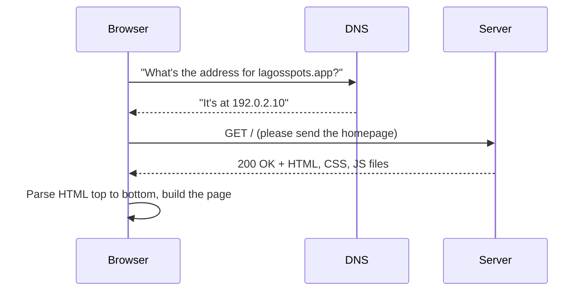
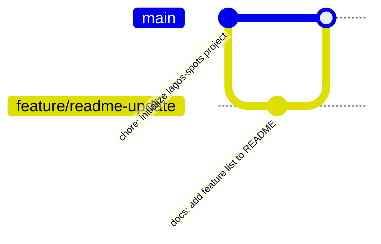

# Week 1: Dev Environment, Git & GitHub, How the Web Works

Welcome to Full-Stack Development. Before writing a single line of a real page, you need three things: a working toolset, an understanding of what actually happens when someone visits a website, and a safety net for your work that isn't just "the last time I saved the file." This week gives you all three, and opens the project you'll keep building and rebuilding for the rest of the course: **Lagos Spots** — a real directory of places around Lagos (restaurants, hangouts, study spots, events) that people can search, filter, and add to.

---

## Module 1: How the Web Actually Works

### 1. The Three Languages of the Web

* **Lecture & Concepts:**
    * Every website you've ever used is built from three technologies, each with one job:
        1. **HTML** describes *what's on the page* — this heading, this list of places, this form. It carries content and meaning, nothing else.
        2. **CSS** describes *how it looks* — colors, spacing, layout, which category badge is orange and which is green.
        3. **JavaScript** describes *what happens when someone interacts with it* — clicking a category filter, submitting the "Add a Spot" form, favoriting a place.
    * A useful way to keep these straight: HTML is the *content*, CSS is the *presentation*, JS is the *behavior*. None of them can do another's job well — you don't lay out a grid in HTML, and you don't store a list of places in CSS.

* **Class Exercise: Take Apart a Real Directory Site**
    1. Open a real site that lists places — Google Maps, TripAdvisor, or a restaurant-finder app.
    2. Point out what's HTML (the place names, addresses, the list itself), what's CSS (colors, the card layout, spacing), and what's JS (search-as-you-type, clicking a filter chip, a "Save" button reacting instantly).
    3. Right-click anywhere on the page and choose **"Inspect."** This opens the browser's DevTools, showing the actual HTML the browser built. You'll live in this panel for the rest of the course.

---

### 2. Client, Server, and the Request/Response Cycle

* **Lecture & Concepts:**
    * A **server** is just a computer somewhere that stores files and answers requests. A **client** is the browser making those requests. When you type a web address, your browser doesn't already have the page — it has to ask for it.
    * Before your browser can even ask, it needs an address. **DNS (Domain Name System)** is the phonebook of the internet: it turns a human-readable name (`lagosspots.app`) into a numeric IP address a computer can actually connect to.
    * Once your browser has an IP address, it sends an **HTTP request**. The server sends back an **HTTP response** — usually HTML, CSS, and JS files. The browser then reads that HTML top to bottom and builds the page you see.



* **Class Exercise: Watch a Real Request**
    1. Open DevTools (F12 or `Cmd+Opt+I`), go to the **Network** tab, and check "Preserve log."
    2. Visit any website and reload the page.
    3. Click the very first request in the list (usually named `/` or the domain itself). Look at the **Status** (should be `200`), and scroll the **Response** tab to see the raw HTML that came back — this is exactly what the diagram above describes, happening in real time.

---

### 3. Tools of the Trade

* **Lecture & Concepts:**
    * You need exactly two tools to start: a code editor and a browser.
    * **VS Code** is the editor we'll use all course — free, fast, and the closest thing the industry has to a standard.
    * The browser's **DevTools** is your most-used debugging tool from this point forward. Two panels matter immediately:
        * **Elements/Inspector:** shows the *live* structure the browser built (which can differ from the original HTML once JS has run).
        * **Console:** where you'll read errors and print debugging output, starting in earnest in Week 6.

* **Class Exercise: Set Up Your Workspace**
    1. Install VS Code from `code.visualstudio.com`.
    2. Create a folder named `lagos-spots` anywhere sensible on your machine — this is the project folder for the entire course.
    3. Open that *folder* in VS Code (`File > Open Folder`), not just a single file.
    4. Open the integrated terminal (`Terminal > New Terminal`) — you'll use it constantly starting today.

---

## Module 2: Version Control with Git & GitHub

### 1. Why Version Control?

* **Lecture & Concepts:**
    * Right now, your only backup is whatever is on your laptop. If you break something at 11 PM the night before an assignment is due, there's no way back.
    * **Git** is a tool that saves labeled snapshots of your project over time, called **commits**. You can always see what changed, when, and — critically — go back.
    * **Git and GitHub are not the same thing.** Git tracks history *on your machine*. GitHub is a website that hosts a copy of that history remotely, giving you a backup, a shareable link, and (starting today) the exact workflow real engineering teams use.

* **In-Depth Example (First Commit, Terminal):**
    ```bash
    cd lagos-spots
    git init
    git add .
    git commit -m "chore: initialize lagos-spots project"
    ```
    * `git init` turns the folder into a Git repository — run once, at the very start.
    * `git add .` **stages** every changed file — tells Git "include all of this in the next snapshot."
    * `git commit -m "..."` saves the snapshot. Write commit messages that describe *what changed*, not "update" or "fix stuff."

* **Class Exercise: Your First Commit**
    1. Inside `lagos-spots`, create a `README.md` file with a short paragraph describing the app: what places it lists, who it's for, what makes it useful.
    2. Run the three commands above.
    3. Run `git log` and confirm your commit shows up with your message.

---

### 2. Connecting to GitHub

* **Lecture & Concepts:**
    * `git remote add origin <url>` links your local repo to an empty one on GitHub. `git push` uploads your commits there for the first time (and every time after).
    * `.gitignore` tells Git which files to *never* track — things like `node_modules/` (installed packages, huge and regenerable) or `.env` (secrets). You'll add real entries to this file starting in Week 5.

* **In-Depth Example:**
    ```bash
    # After creating an empty repository named "lagos-spots" on github.com:
    git remote add origin https://github.com/<your-username>/lagos-spots.git
    git branch -M main
    git push -u origin main
    ```

* **Class Exercise: Push to GitHub**
    1. Create a new, empty repository on github.com named `lagos-spots` — don't let it auto-generate a README, you already have one.
    2. Run the three commands above with your real GitHub username and repo URL.
    3. Refresh the GitHub page and confirm `README.md` is there.

---

### 3. Branching, Merging & Pull Requests

* **Lecture & Concepts:**
    * A **branch** is an independent line of work — a safe place to make changes without touching the working version on `main`. You'll build this habit now, even solo, because it's exactly how you'll collaborate with a team later.
    * `git branch <name>` creates a branch; `git switch <name>` (or the older `git checkout <name>`) moves you onto it. Once your work is done, you **merge** it back into `main`.
    * A **Pull Request (PR)** is GitHub's way of reviewing a branch's changes before merging — even alone, opening a PR for every feature builds a habit of writing a clear description of *why* a change exists.



* **Class Exercise: Your First Branch & PR**
    1. Run `git switch -c feature/readme-update` to create and switch to a new branch.
    2. Edit `README.md`: add a short bullet list of planned features (search, category filters, favorites, submit-a-spot).
    3. Commit the change, then `git push -u origin feature/readme-update`.
    4. On GitHub, open a Pull Request from `feature/readme-update` into `main`, write a one-line description, and merge it.
    5. Back in your terminal: `git switch main`, then `git pull` to bring the merged change down locally.

---

### Week 1: Comprehensive Assignment

**Objective:** Stand up the Lagos Spots project and its Git/GitHub workflow — the foundation every following week builds on.

**Requirements:**

1. **Environment:** VS Code installed, `lagos-spots` folder created and opened as a workspace.
2. **Repository:** `lagos-spots` is a Git repository with at least 3 real commits (not "update" or "wip").
3. **GitHub:** The repository is pushed to GitHub under your account, and `README.md` describes the app's concept and lists its planned features.
4. **Branch Workflow:** At least one feature branch was created, pushed, opened as a Pull Request, and merged into `main` — and you pulled that merge back down locally.
5. **DevTools Check:** In your assignment notes, write one sentence describing what you saw in the Network tab's Response for any real site you inspected this week.

**Bonus Challenge:** Research what an **HTTP status code** is, and find three real examples in the Network tab of sites you visit today (e.g., `200`, `304`, `404`). Note what each one means.
