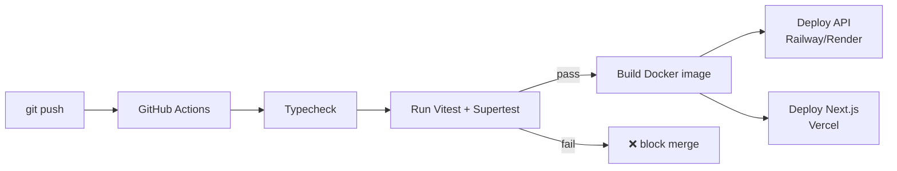

# Week 20: Docker, CI/CD & Deployment

Flowboard and its Next.js frontend both work locally, but "works on my machine" isn't a real deliverable. This week you package Flowboard so it runs identically anywhere, automate testing so a broken change can never quietly reach production, and put both apps on real, public URLs — talking to each other for real.

---

## Module 1: Docker Fundamentals

### 1. Images vs. Containers

* **Lecture & Concepts:**
    * A **Docker image** is a complete, frozen snapshot of everything an app needs to run — the OS layer, Node.js, your dependencies, your code. A **container** is a running instance of that image. The core promise: an image built once behaves identically on your laptop, a teammate's laptop, and a production server, because it's not relying on whatever happens to already be installed on the host machine.

### 2. Writing a Real `Dockerfile`

* **In-Depth Example:**
    ```dockerfile
    # flowboard-api/Dockerfile
    FROM node:24-slim

    WORKDIR /app

    COPY package.json package-lock.json ./
    RUN npm ci

    COPY . .
    RUN npm run build

    EXPOSE 3000
    CMD ["node", "dist/server.js"]
    ```
    * `npm ci` (not `npm install`) is deliberate here — it installs *exactly* what's in `package-lock.json`, byte for byte, which is what you want for a reproducible build, whereas `npm install` can subtly update versions.
    * `COPY package.json package-lock.json ./` happens *before* `COPY . .` deliberately — Docker caches each step, so as long as dependencies haven't changed, rebuilding after a code-only change skips reinstalling everything from scratch.

* **Class Exercise: Build Your First Image**
    1. Add a `build` script to `flowboard-api`'s `package.json` (`"build": "tsc"`) if you haven't already, compiling to a `dist/` folder.
    2. Write the `Dockerfile` above.
    3. Run `docker build -t flowboard-api .` and then `docker run -p 3000:3000 flowboard-api` — confirm the API responds at `localhost:3000` exactly as it does outside Docker.

### 3. `docker-compose` for Local Development

* **Lecture & Concepts:**
    * Running the API container *and* a local Postgres container together, wired to talk to each other, is exactly what `docker-compose` orchestrates from one file — genuinely useful for onboarding a new teammate who shouldn't need to manually install Postgres just to run the project.

* **In-Depth Example:**
    ```yaml
    # docker-compose.yml
    services:
      api:
        build: .
        ports:
          - "3000:3000"
        environment:
          DATABASE_URL: postgres://postgres:postgres@db:5432/flowboard
        depends_on:
          - db
      db:
        image: postgres:16
        environment:
          POSTGRES_PASSWORD: postgres
          POSTGRES_DB: flowboard
        ports:
          - "5432:5432"
        volumes:
          - pgdata:/var/lib/postgresql/data
    volumes:
      pgdata:
    ```

* **Class Exercise: Run the Full Stack Locally**
    1. Write `docker-compose.yml` as shown.
    2. Run `docker compose up`, then run your Drizzle migrations against this local containerized Postgres.
    3. Confirm the API, running fully inside Docker, correctly reads/writes to the also-containerized database.

---

## Module 2: Continuous Integration With GitHub Actions

### 1. Why Automate Testing

* **Lecture & Concepts:**
    * Your Week 18 test suite is only useful if it actually runs on every change — relying on remembering to run `npx vitest` by hand before every push doesn't scale, especially with more than one person touching the codebase.
    * **GitHub Actions** runs a defined workflow automatically whenever code is pushed or a Pull Request is opened, and reports pass/fail directly on GitHub.

### 2. Writing a Real CI Workflow

* **In-Depth Example:**
    ```yaml
    # .github/workflows/ci.yml
    name: CI

    on:
      push:
        branches: [main]
      pull_request:

    jobs:
      test:
        runs-on: ubuntu-latest
        steps:
          - uses: actions/checkout@v4
          - uses: actions/setup-node@v4
            with:
              node-version: 24
          - run: npm ci
          - run: npx tsc --noEmit
          - run: npx vitest run
            env:
              DATABASE_URL: ${{ secrets.TEST_DATABASE_URL }}
    ```
    * **Repository secrets** (`Settings → Secrets and variables → Actions` on GitHub) store real values like `TEST_DATABASE_URL` without ever committing them to the repo — referenced in a workflow with `${{ secrets.NAME }}`.

* **Class Exercise: Wire Up Real CI**
    1. Add `TEST_DATABASE_URL` as a repository secret, pointing at your Week 18 disposable test database.
    2. Add `.github/workflows/ci.yml` exactly as shown.
    3. Push a deliberately broken test (an assertion you know will fail) and confirm GitHub shows a red ❌ on the commit. Fix it, push again, and confirm it turns green ✅.

---

## Module 3: Deploying for Real

### 1. Deploying the Next.js Frontend to Vercel

* **Lecture & Concepts:**
    * You already deployed a React SPA to Vercel in Week 14 — deploying a Next.js app works the same way, except Vercel (which is built by the same team as Next.js) automatically detects and correctly runs Server Components, Route Handlers, and caching, none of which a plain static host could serve correctly.

### 2. Deploying the API

* **Lecture & Concepts:**
    * Railway and Render both build directly from a `Dockerfile` if one exists, or auto-detect a Node.js app otherwise — either is a reasonable choice for Flowboard. The key production step regardless of host: setting real environment variables (`DATABASE_URL` pointing at your **production** Neon database, not the test one) in the platform's dashboard, never committed to the repo.

* **Class Exercise: Deploy Both Apps**
    1. Deploy `flowboard-api` to Railway or Render, either from its `Dockerfile` or the platform's native Node.js build — set `DATABASE_URL` as a real environment variable in the dashboard.
    2. Deploy the Week 19 Next.js frontend to Vercel, setting `FLOWBOARD_API_URL` (server-only) to the now-live API's real URL.
    3. Open the live frontend URL and confirm it successfully loads real, live boards from the live, deployed API — not `localhost` anywhere.



---

### Week 20: Comprehensive Assignment

**Objective:** *(Milestone: Both apps live, connected, with green CI.)*

**Requirements:**

1. **Docker:** A working `Dockerfile` for `flowboard-api`, building and running correctly via `docker build`/`docker run`.
2. **Compose:** `docker-compose.yml` runs the API and a local Postgres together, correctly connected.
3. **CI:** `.github/workflows/ci.yml` runs typechecking and the full test suite on every push/PR, using a repository secret for the test database — proven to both fail and pass at different points.
4. **Deployment:** The Next.js frontend is live on Vercel; the API is live on Railway or Render with production environment variables set in the dashboard, not the repo.
5. **End-to-End:** The deployed frontend successfully reads real data from the deployed API.
6. **Git:** Committed and pushed via the branch → PR → merge workflow.

**Bonus Challenge:** Add a second CI job that only runs on `pull_request` events and comments a summary of test results — or simply research and note in a comment how Vercel's own automatic PR preview deployments (seen back in Week 14) relate to what you just built by hand for the API side.
