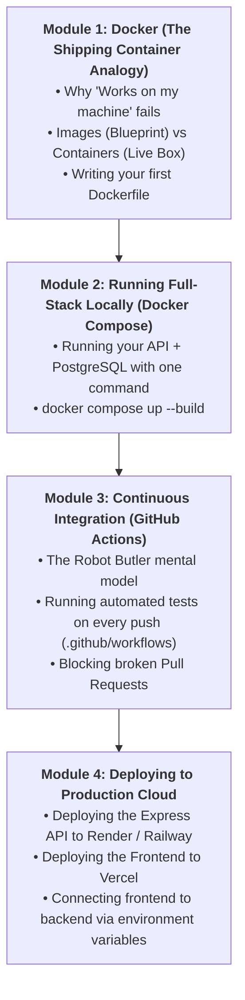
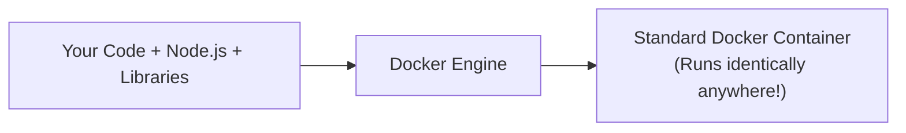
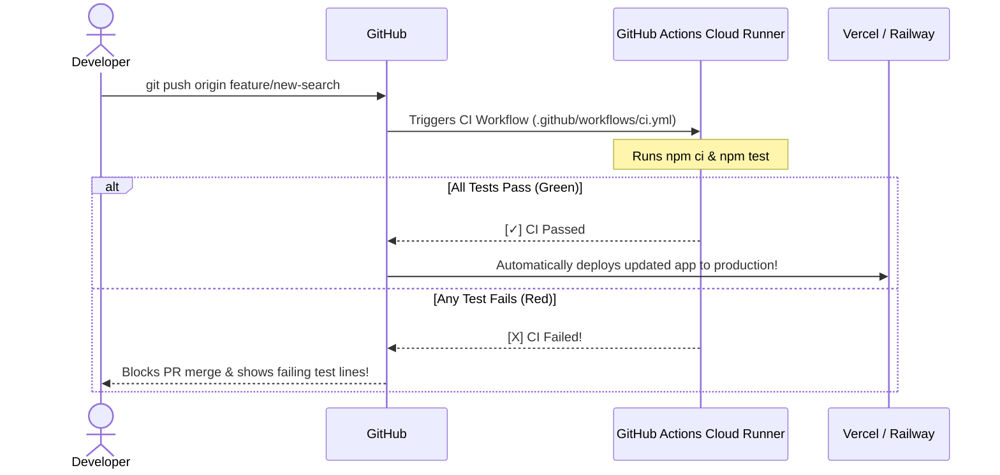
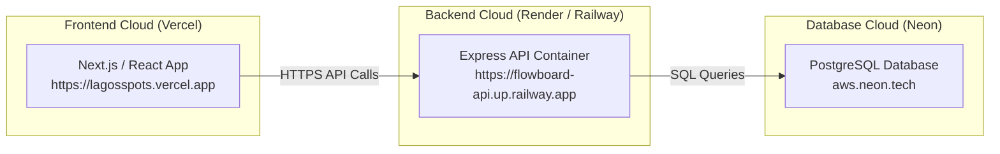

# Week 20: Docker, CI/CD & Deployment

Welcome to Week 20! You have built both sides of the full-stack equation: an authenticated, tested Express API connected to PostgreSQL, and a modern Next.js frontend.

However, as every software engineer eventually learns:
**"It works on my machine!" is the most dangerous phrase in software development.**
- What if your colleague's laptop has a different Node.js version installed?
- What if your cloud server runs Linux, but you developed on a Mac or Windows?
- What if someone pushes broken code to GitHub and breaks production for all users?

This week, you master **DevOps & Deployment**: packaging your app with **Docker Containers**, automating tests on every commit with **GitHub Actions (CI/CD)**, and deploying your full-stack architecture to the live internet on **Railway, Render, and Vercel**.

---

## Pedagogical Roadmap



---

## Module 1: Docker (The Shipping Container Analogy)

### 1. The Shipping Container Mental Model

> [!NOTE]
> **The Mental Model:**
> Before the 1950s, transporting goods on cargo ships was chaos: sacks of flour, barrels of oil, and boxes of electronics were all shaped differently and constantly broke in transit.
> The shipping industry invented the **Standardized Steel Container**. Ships and cranes don't care what is inside the box — they just load standard containers.
> 
> **Docker does the exact same thing for software:**
> It packs your code, Node.js runtime, system libraries, and configs into a standardized container. Whether you run it on a MacBook, a Windows PC, or an AWS cloud server, **it behaves 100% identically!**



---

### 2. Docker Image vs Docker Container

| Concept | Analogy | Description |
| :--- | :--- | :--- |
| **Dockerfile** | The Recipe | A text file with instructions on how to bake the cake. |
| **Docker Image** | The Baked Cake / Blueprint | A frozen, read-only snapshot built from the Dockerfile. |
| **Docker Container** | Slicing & Eating the Cake | A live, running instance of an image in memory. |

---

### 3. Writing a Clean, Simple `Dockerfile`

Inside your `flowboard-api` folder, create a file named `Dockerfile`:

```dockerfile
# 1. Start with official lightweight Node.js Linux environment
FROM node:20-alpine

# 2. Set working folder inside the container
WORKDIR /app

# 3. Copy package manifests first (optimizes layer caching!)
COPY package*.json ./

# 4. Install dependencies
RUN npm install

# 5. Copy the rest of your application code
COPY . .

# 6. Build TypeScript code to dist/
RUN npm run build

# 7. Expose the port your server listens on
EXPOSE 5000

# 8. Command to start the server when container launches
CMD ["node", "dist/index.js"]
```

---

## Module 2: Multi-Container Setup with Docker Compose

Running an API, a PostgreSQL database, and configuring network ports manually is tedious. **Docker Compose** lets you define and launch multiple services with a single command!

Create `docker-compose.yml` in your project root:

```yaml
version: "3.8"

services:
  # 1. Flowboard Backend API Service
  api:
    build: .
    container_name: flowboard_api
    ports:
      - "5000:5000"
    environment:
      - PORT=5000
      - DATABASE_URL=postgresql://postgres:secret123@db:5432/flowboard
      - JWT_SECRET=production-secret-key
    depends_on:
      - db

  # 2. Local PostgreSQL Database Service
  db:
    image: postgres:16-alpine
    container_name: flowboard_db
    ports:
      - "5432:5432"
    environment:
      - POSTGRES_USER=postgres
      - POSTGRES_PASSWORD=secret123
      - POSTGRES_DB=flowboard
    volumes:
      - pgdata:/var/lib/postgresql/data

volumes:
  pgdata: # Keeps your database data safe on disk!
```

### The Magic Command:
```bash
# Launch entire backend + database:
docker compose up --build

# Stop everything:
docker compose down
```

---

## Module 3: Continuous Integration (GitHub Actions)

### 1. The Robot Butler Mental Model

> [!NOTE]
> **The Mental Model:** Imagine hiring a **Robot Butler** that watches your GitHub repository 24/7.
> Every time you or a teammate creates a Pull Request, the Robot Butler:
> 1. Clones your code onto an isolated cloud server.
> 2. Installs dependencies.
> 3. Runs your automated test suite (`npm test`).
> 4. If all tests pass $\to$ gives a green checkmark!
> 5. If any test fails $\to$ sounds an alarm and **blocks you from merging broken code into `main`!**



---

### 2. Creating a CI Workflow (`.github/workflows/ci.yml`)

Create the directory and file: `.github/workflows/ci.yml`:

```yaml
name: CI Pipeline

on:
  push:
    branches: [main]
  pull_request:
    branches: [main]

jobs:
  test-and-build:
    runs-on: ubuntu-latest

    steps:
      # 1. Download repository code
      - name: Check out repository code
        uses: actions/checkout@v4

      # 2. Set up Node.js LTS
      - name: Set up Node.js
        uses: actions/setup-node@v4
        with:
          node-version: 20
          cache: "npm"

      # 3. Clean install dependencies
      - name: Install dependencies
        run: npm ci

      # 4. Run automated test suite
      - name: Run Vitest Suite
        run: npm test

      # 5. Verify production build succeeds
      - name: Build project
        run: npm run build
```

---

## Module 4: Deploying Full-Stack to the Cloud

In professional web development, frontend and backend are deployed to specialized cloud environments:



### 1. Deploying the Backend API (Render or Railway)
1. Go to [railway.app](https://railway.app) or [render.com](https://render.com).
2. Connect your GitHub account and select `flowboard-api`.
3. In Environment Variables, set:
   - `DATABASE_URL` (From your Neon PostgreSQL dashboard)
   - `JWT_SECRET` (A strong random string)
   - `NODE_ENV=production`
4. Click **Deploy**. In under 2 minutes, you will receive your live backend URL:
   `https://flowboard-api.up.railway.app`.

### 2. Deploying the Frontend (Vercel)
1. In your frontend Next.js / Vite project, create an environment variable:
   `NEXT_PUBLIC_API_URL=https://flowboard-api.up.railway.app`
2. Push to GitHub and deploy on [vercel.com](https://vercel.com).
3. In Vercel Project Settings $\to$ Environment Variables, paste your `NEXT_PUBLIC_API_URL`.
4. Your full-stack application is now live on the global internet!

---

## Module 5: Rookie Traps & Debugging Guide

| Error Message / Trap | Root Cause | How to Fix It |
| :--- | :--- | :--- |
| `Docker daemon is not running` | Docker Desktop is not opened on your computer. | Open the Docker Desktop application and wait until the whale icon is steady. |
| CORS Error in production browser | Your Express backend doesn't allow your Vercel domain. | In backend CORS config, allow your live frontend domain: `cors({ origin: 'https://lagosspots.vercel.app' })`. |
| GitHub Action fails with `npm ci can only install with an existing package-lock.json` | You forgot to commit `package-lock.json` to Git. | Run `npm install` locally, commit `package-lock.json`, and push to GitHub. |

---

## 🎯 Week 20 Hands-on Classroom Exercises

### Level 1: Dockerize Your Express API
1. Write a `Dockerfile` for your Flowboard API.
2. Build the Docker image locally: `docker build -t flowboard-api .`
3. Run the container: `docker run -p 5000:5000 flowboard-api` and test `GET /api/health`!

### Level 2: GitHub Actions CI Automation
1. Create `.github/workflows/ci.yml`.
2. Push to a branch and open a Pull Request on GitHub.
3. Watch the GitHub Actions tab run your tests in real time and report green checkmarks!

### Level 3: Ship Full-Stack Live!
1. Deploy your Express API to Railway or Render.
2. Connect your live Vercel frontend to your cloud backend.
3. Log in, create a board, and show your live working full-stack project to your classmates!

---

## 📚 Curated Deep-Dive References

* [The Valley of Code: Docker Tutorial](https://thevalleyofcode.com/docker/) — Flavio Copes' gentle introduction to Docker containers.
* [Docker Official Documentation: Get Started](https://docs.docker.com/get-started/) — Visual step-by-step container guide.
* [GitHub Actions Official Documentation](https://docs.github.com/en/actions) — Building automated CI/CD workflows.
* [Railway & Render Deployment Guides](https://docs.railway.app/) — Deploying Node.js and PostgreSQL web services.
