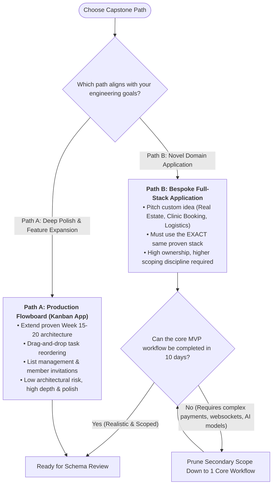
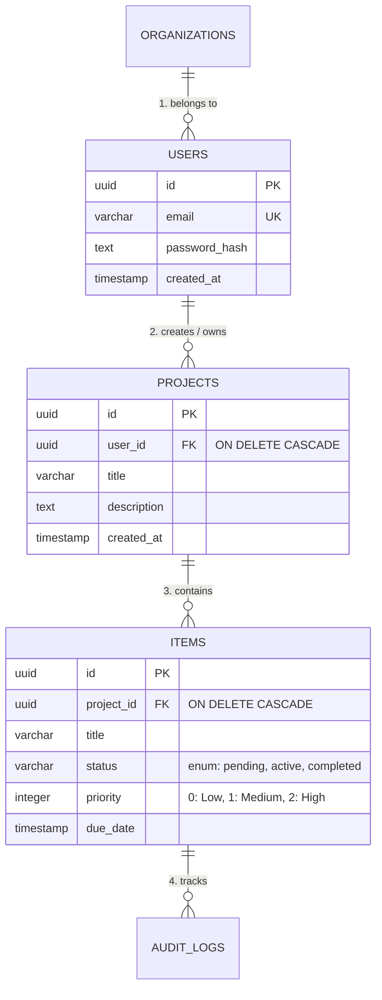
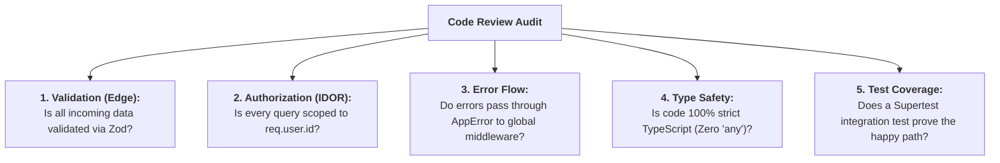

# Week 21: Capstone Build Week 1 — Scoping & Foundations

All core software engineering disciplines — semantic HTML, CSS layout systems, modern TypeScript, React, Next.js App Router, Express REST APIs, PostgreSQL relational modeling, authentication security, Zod validation, automated testing, Docker containerization, and CI/CD pipelines — have been formally taught. In Weeks 21 and 22, you synthesize these tools into a single, cohesive, production-deployed **Full-Stack Capstone Project**.

This week focuses on **Product Scoping**, **Critical Path Modeling**, **Relational Schema Architecture**, and establishing the **Minimum Viable Product (MVP)** foundation.

---

## Module 1: Product Scoping & Engineering Tradeoffs

### 1. The Core Terminology of Technical Scoping

| Term | What It Actually Means | Technical Context |
| :--- | :--- | :--- |
| **Minimum Viable Product (MVP)** | The smallest possible slice of a product that delivers the core value proposition to end users end-to-end. | Prevents starting dozens of half-finished features; ensures one complete user workflow is built and hardened. |
| **Scope Creep** | The uncontrolled expansion of project requirements as development progresses, without adjustments to time or resources. | The primary reason software projects fail deadlines. Must be aggressively countered by pruning secondary features. |
| **Critical User Path (Happy Path)** | The sequential journey a user takes through an application to achieve their primary goal (e.g., Signup $\to$ Create Board $\to$ Add Task $\to$ Mark Complete). | Must function flawlessly before auxiliary features (avatars, dark mode, social logins) are built. |
| **Non-Functional Requirements (NFRs)** | System qualities such as security (AuthN/AuthZ), performance ($<200\text{ms}$ API response), reliability, and testability. | Architectural constraints that must be built into the foundation, not bolted on at the end. |

---

### 2. Choosing Your Capstone Path

---

### 3. The Scope Downsizing Matrix: What to Keep vs. What to Cut

When building under tight engineering timelines, apply the **MoSCoW Prioritization Framework**:

| Priority Level | Description | Capstone Examples (Keep vs. Cut) |
| :--- | :--- | :--- |
| **Must Have (P0 - MVP)** | Essential to the core workflow; app fails without it. | • Secure Session Login / Signup • Relational CRUD with foreign keys • Server-side Zod validation • Protected user data scoping (IDOR defense) |
| **Should Have (P1)** | High value, but app still functions without it. | • Real-time search filtering • Optimistic UI state updates • Error toast notifications |
| **Could Have (P2)** | Nice-to-have if time permits. | • User avatar uploads • Due date calendar picker • Export to CSV/JSON |
| **Won't Have (P3 - Cut!)** | Explicitly out of scope for Capstone MVP. | • Third-party OAuth (Google/GitHub) • Live WebSocket multiplayer • Real payment gateways (use mock flow instead) |

---

## Module 2: Data Modeling Workshop

### 1. From User Stories to Relational Entity Schemas

Before writing backend code, convert user stories into a formalized **Entity-Relationship Diagram (ERD)**:

---

### 2. Schema Architecture Review Checklist

Before executing migrations on your production database, verify these relational integrity rules:

1. **Foreign Key Deletion Rules:**
   - Does every `references(() => table.id)` have an explicit `{ onDelete: 'cascade' }` or `{ onDelete: 'restrict' }`?
   - *Why:* Prevents orphaned rows or accidental database deadlocks.
2. **Unique Constraints & Indexes:**
   - Are unique business keys (e.g., `email`, `slug`) marked with `.unique()`?
   - Are foreign key columns indexed for fast join performance?
3. **Data Type Precision:**
   - Are textual fields constrained with maximum lengths (e.g., `varchar('title', { length: 150 })`) rather than unbounded `text` where appropriate?
   - Are timestamps configured with `{ withTimezone: true }`?

---

## Module 3: Engineering Discipline & 1:1 Code Review

### 1. Daily Standup Cadence

Structure build sessions around a 10-minute standup answering three questions:
1. **What concrete milestone did you complete yesterday?** (e.g., "Implemented Zod validation on task creation endpoints").
2. **What single deliverable will you complete today?** (e.g., "Build the Next.js Server Component dashboard").
3. **What blockers or unknown technical risks are slowing you down?** (e.g., "CORS cookie rejection between Vercel and Railway").

---

### 2. Production Code Review Checklist

During 1:1 reviews with instructors and peers, every Pull Request is audited against these 5 pillars:

---

### Week 21: Comprehensive Assignment

**Objective:** Lock in your capstone technical scope, receive instructor approval on your database ERD, generate Drizzle migrations, and build the end-to-end authenticated core happy path.

**Requirements:**
1. **1-Page Technical Specification Document:**
   - Problem statement and target user.
   - Core MVP workflow (step-by-step user path).
   - Explicit "Out of Scope" list.
   - Full ERD diagram sketch.
2. **Database Provisioning & Migrations:**
   - PostgreSQL schema declared in Drizzle ORM and successfully migrated to a live cloud database.
3. **Core Backend Endpoints:**
   - User authentication routes (`signup`, `login`, `logout`) operational with Bcrypt hashing and session cookies.
   - Core entity CRUD routes operational with Zod validation.
4. **Initial Next.js Frontend Wiring:**
   - Next.js application scaffolded with App Router and Tailwind CSS.
   - Authenticated dashboard page successfully reading data from backend via Server Components.
5. **Git Workflow:**
   - Work managed on feature branches (`feature/capstone-auth`, `feature/capstone-schema`), committed with conventional commits, and opened as PRs.
