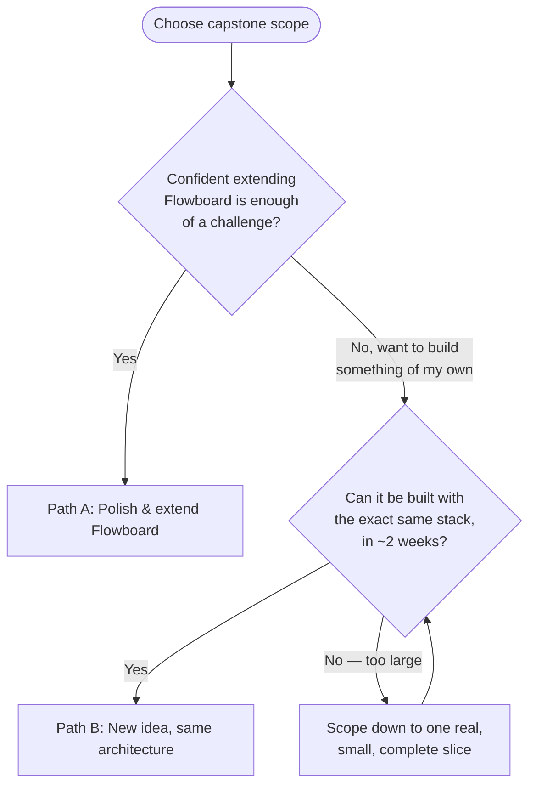

# Week 21: Capstone Build Week 1 — Scoping & Foundations

Every tool has now been taught. This week and next, students apply all of it to one final, real, deployed project. The three daily sessions shift format: Monday is structured scoping, Tuesday and Wednesday become office-hours-style build time with active 1:1 code review — the instructor's role moves from lecturing to unblocking.

---

## Module 1: Choosing the Real Scope

### 1. Two Legitimate Paths

* **Facilitation Notes:**
    * **Path A — Extend Flowboard:** Take the existing Trello-style API and its Next.js frontend (started Week 19) and finish them into one cohesive, polished product — real-time-feeling updates, drag-to-reorder lists, a genuinely pleasant UI. Lower research risk, since the architecture is already proven; the challenge is depth and polish.
    * **Path B — A New Idea, Same Architecture:** Students pitch their own concept, but it must use the *exact* proven stack: Next.js + Express (or Next.js Route Handlers alone, if the idea doesn't need a separately-deployed API) + Postgres/Drizzle + session auth + Zod + tests + Docker/CI + deployed. This is real ownership, at the cost of more unknowns to work through under time pressure.
    * Either path is legitimate — the deliverable checklist at the end of Week 22 is identical either way. Steer a student away from Path B only if their idea can't realistically fit the remaining two weeks (a common failure mode: scoping something that needs real-time multiplayer, payments, or a large dataset — redirect toward a smaller, real slice of the idea instead of the whole thing).

### 2. A Scoping Conversation, Not Just a Form

* **Facilitation Notes:** For each student, walk through: What's the single core user action this app must support end to end? (Not a feature list — one real workflow, done completely.) What's explicitly *out* of scope for these two weeks? Which of the 7 final deliverable requirements (Week 22) is the riskiest for this specific idea, and what's the plan for it?

* **Workshop Activity: Write a One-Page Scope Doc**
    1. Each student writes: the app's one-sentence purpose, its core user workflow, its real data model (a rough ER sketch, same style as Week 16's), and an explicit "not doing this" list.
    2. 1:1 review with the instructor before any code is written this week — this is the highest-leverage 15 minutes of the entire capstone.

---

## Module 2: Data Modeling Workshop

### 1. From Idea to Schema

* **Facilitation Notes:** Every capstone idea, however different, reduces to the same exercise Week 16 already taught: identify the real entities, their relationships, and which fields actually matter for the core workflow — resist the urge to model every field a "real" version of the product might eventually need.

* **Workshop Activity: Schema Review**
    1. Each student sketches their real Drizzle schema (tables, columns, foreign keys) for their scoped idea.
    2. Pair students up to review each other's schema for one thing specifically: "what happens when X is deleted — does everything reference it correctly cascade or restrict?"
    3. Instructor reviews and approves each schema before migrations are written — a wrong foreign key relationship discovered in Week 22 costs real time.

---

## Module 3: Build Time & Code Review Discipline

### 1. Structuring Tuesday/Wednesday as Real Office Hours

* **Facilitation Notes:** Rather than new lecture content, these two sessions run as: a 10-minute stand-up (what did you finish yesterday, what's today's one goal, what's blocking you), then heads-down build time with the instructor circulating for 1:1 unblocking, ending with a short demo of whatever real progress was made — even five minutes of working code beats a full session of silent, unshared struggle.

### 2. A Real Code Review Checklist

* **Facilitation Notes:** Use this same checklist for every 1:1 review this week and next — it's a distillation of the course's actual standards, not a new one:
    * Does every write endpoint validate input (Week 18)?
    * Is every mutation scoped to the authenticated user, with a real ownership check (Week 17)?
    * Are errors handled through the central handler, not scattered `try/catch` blocks with inconsistent shapes (Week 18)?
    * Is there at least one real test covering the core workflow (Week 18)?
    * Naming: does a function or variable's name honestly describe what it does, with no comment needed to explain "what" (only "why," where genuinely non-obvious)?

* **Supplementary Reading (Introduced Now, Not Before):** This is the right week to point students at *Clean Code*, *Code Complete*, and *Design Patterns* — not as required reading, but as a reference for the specific question "how do I make this specific function/class better," asked about their own real code rather than a generic example.

---

### Week 21: Comprehensive Assignment

**Objective:** A locked, realistic scope, an approved data model, and real, working progress on the core workflow.

**Requirements:**

1. **Scope Doc:** A one-page written scope (purpose, core workflow, data model sketch, explicit exclusions), reviewed 1:1 with the instructor.
2. **Schema:** A Drizzle schema matching the approved data model, migrated to a real database.
3. **Progress:** By Wednesday's end, the core workflow's happy path works end to end for at least one piece of it (e.g., a user can sign up, log in, and create the app's primary resource) — not necessarily styled or polished yet.
4. **Git:** A real repository (or repositories, if frontend/backend are separate), with commits reflecting real, incremental progress — not one giant commit at the end of the week.

**Bonus Challenge:** Write a `README.md` for the capstone project as if handing it off to a new engineer — setup instructions, environment variables needed, and how to run the test suite. A real team would expect this to exist from day one, not written after the fact.
