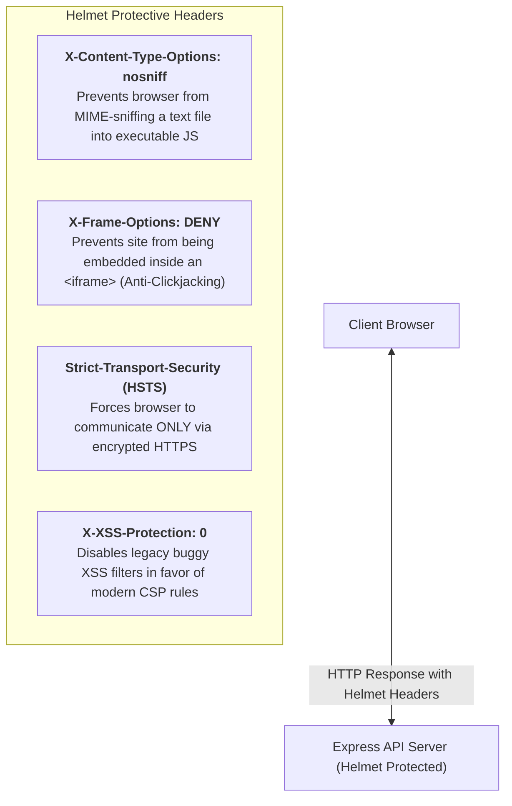
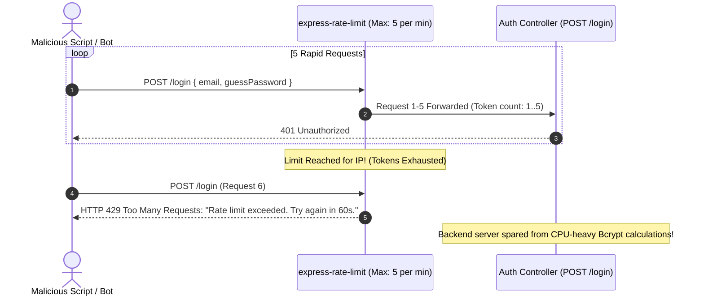
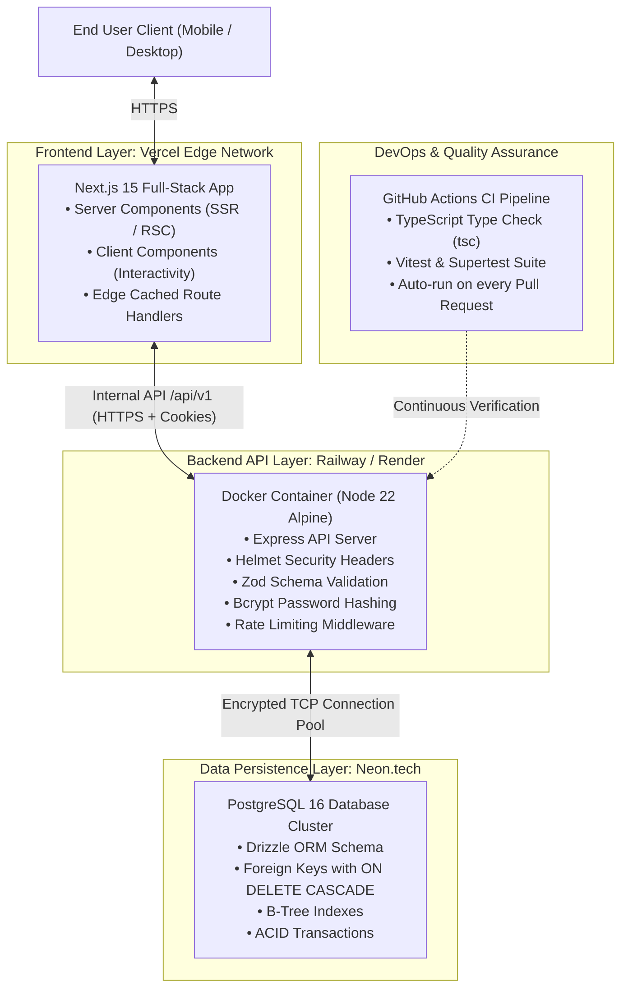
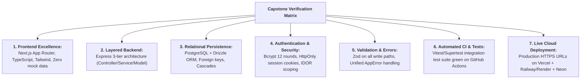

# Week 22: Capstone Build Week 2 & Demo Day

This is the final week of the Full-Stack Software Engineering curriculum. In the first half of the week, you execute **Production Hardening**: applying HTTP security headers with **Helmet**, rate-limiting authentication vectors with **Express Rate Limit**, implementing request observability with **Morgan**, and conducting a comprehensive **Pre-Launch Readiness Audit**. The week culminates in **Demo Day** — a live, 10-minute technical presentation of your deployed full-stack system.

---

## Module 1: Production Hardening & Observability

### 1. The Core Terminology of Production Hardening

| Term | What It Actually Means | Technical Context |
| :--- | :--- | :--- |
| **Defense-in-Depth** | A security strategy employing multiple layered defenses so that if one security barrier fails, subsequent layers prevent exploitation. | E.g., combining Zod edge validation + Bcrypt hashing + HttpOnly cookies + Helmet headers + Database foreign key restrictions. |
| **Security Headers (`helmet`)** | Standardized HTTP response headers instructing the browser to restrict dangerous behaviors (clickjacking, MIME sniffing, cross-origin scripting). | `X-Content-Type-Options: nosniff`, `X-Frame-Options: DENY`, `Strict-Transport-Security`. |
| **Rate Limiting** | Restricting the number of HTTP requests a single client (IP address) can make within a specified time window (e.g., max 10 requests per 15 minutes on `/auth/login`). | Thwarts brute-force password guessing, credential stuffing, and DoS spam attacks. |
| **Structured Logging** | Recording server events in a consistent, machine-readable format (JSON or formatted Apache streams) containing HTTP method, path, status, latency, and timestamps. | Essential for diagnosing production outages and tracking slow database queries. |
| **Production Readiness Review (PRR)** | A systematic audit verifying that all functional, security, performance, monitoring, and deployment criteria are satisfied prior to public launch. | Prevents broken releases and ensures zero debug credentials remain in production code. |

---

### 2. Under the Hood: Security Headers Breakdown

When Express sends a response through `app.use(helmet())`, Helmet automatically attaches 15+ protective HTTP headers:



---

### 3. Under the Hood: Rate Limiting Sliding Window Algorithm

`express-rate-limit` tracks incoming requests by client IP address in a memory or Redis bucket:



---

### 4. Complete Production Hardened Server Configuration

```ts
// src/index.ts
import express, { Request, Response, NextFunction } from 'express';
import helmet from 'helmet';
import cors from 'cors';
import morgan from 'morgan';
import rateLimit from 'express-rate-limit';
import cookieParser from 'cookie-parser';
import { globalErrorHandler } from './middlewares/error.middleware';
import boardRoutes from './routes/board.routes';
import authRoutes from './routes/auth.routes';

const app = express();
const PORT = process.env.PORT || 4000;
const isProd = process.env.NODE_ENV === 'production';

// 1. Security Headers (Helmet)
app.use(helmet());

// 2. HTTP Request Logger (Morgan)
// 'combined' provides standard Apache logs in production; 'dev' provides colored output locally
app.use(morgan(isProd ? 'combined' : 'dev'));

// 3. CORS Configuration
app.use(
  cors({
    origin: process.env.CLIENT_ORIGIN || 'http://localhost:3000',
    credentials: true, // Allow cookies across origins
    methods: ['GET', 'POST', 'PUT', 'PATCH', 'DELETE', 'OPTIONS'],
    allowedHeaders: ['Content-Type', 'Authorization'],
  })
);

// 4. Body & Cookie Parsers
app.use(express.json({ limit: '10kb' })); // Prevents large payload DoS attacks
app.use(cookieParser());

// 5. Global API Rate Limiter
const generalLimiter = rateLimit({
  windowMs: 15 * 60 * 1000, // 15 minutes
  max: 300,                  // 300 requests per IP per window
  standardHeaders: true,    // Return rate limit info in `RateLimit-*` headers
  legacyHeaders: false,
  message: { status: 'fail', message: 'Too many requests. Please slow down.' },
});
app.use('/api', generalLimiter);

// 6. Strict Auth Endpoint Rate Limiter (Brute-Force Defense)
const authLimiter = rateLimit({
  windowMs: 15 * 60 * 1000, // 15 minutes
  max: 10,                   // Max 10 attempts per 15 minutes
  message: { status: 'fail', message: 'Too many authentication attempts. Please try again in 15 minutes.' },
});
app.use('/api/v1/auth', authLimiter);

// 7. Mount Routers
app.use('/api/v1/auth', authRoutes);
app.use('/api/v1/boards', boardRoutes);

// 8. Health Check Endpoint
app.get('/health', (_req: Request, res: Response) => {
  res.status(200).json({ status: 'ok', environment: process.env.NODE_ENV, timestamp: new Date().toISOString() });
});

// 9. Centralized Error Handling Middleware (Registered LAST)
app.use(globalErrorHandler);

app.listen(PORT, () => {
  console.log(`🛡️ Production Hardened API running on port ${PORT} [${process.env.NODE_ENV || 'development'}]`);
});
```

---

## Module 2: The Production System Topology



---

## Module 3: Demo Day Presentation Framework

### 1. Presentation Structure (10 Minutes Total)

Demo Day is a professional presentation delivered to instructors, peers, and industry guests. Follow this structured 4-part framework:

| Time | Presentation Phase | What to Cover & Deliver |
| :--- | :--- | :--- |
| **1 Min** | **Executive Summary & Problem Statement** | • State the product name and 1-sentence value proposition.<br>• Who is the target user and what core pain point does this solve? |
| **5 Mins** | **Live End-to-End Application Demo** | • **Live Production URL only** (No localhost, no slides!).<br>• Demonstrate the complete Critical User Path: User Signup $\to$ Session Login $\to$ Create Resource $\to$ Mutate/Reorder $\to$ Real-time feedback.<br>• Demonstrate 1 error recovery state (e.g. form validation or unauthorized access). |
| **2 Mins** | **Architecture & Technical Tradeoffs** | • Walk through your system architecture diagram.<br>• Explain **one non-trivial engineering decision** (e.g., why Drizzle over Prisma, why Stateful Sessions over JWT, or how you prevented race conditions in search). |
| **2 Mins** | **Technical Q&A Defense** | • Answer questions regarding database design, scaling bottlenecks, and security boundaries. |

---

### 2. The 7-Pillar Capstone Deliverable Rubric

Every capstone is evaluated against these seven strict professional engineering benchmarks:



---

### Week 22: Comprehensive Assignment — Final Capstone Submission

**Objective:** Submit, deploy, and present your hardened full-stack capstone project on live production infrastructure.

**Requirements:**
1. **Verification of All 7 Checklist Pillars:**
   - Frontend live on Vercel; Backend API live on Railway/Render; PostgreSQL database on Neon.
   - 100% strict TypeScript with zero compile warnings.
2. **Production Hardening Installed:**
   - Helmet security headers active.
   - General and auth-specific rate limiters active.
   - Morgan structured logging active.
3. **Automated CI Green Check:**
   - GitHub Actions pipeline passing all test suites on `main` branch.
4. **Live Presentation:**
   - Delivered live 10-minute technical demonstration and architecture defense.
5. **Project Documentation:**
   - Comprehensive `README.md` containing architectural diagram, system prerequisites, local setup instructions, environment variable schema, and API endpoint documentation.
6. **Retrospective Reflection:**
   - A written engineering reflection summarizing:
     - Architectural trade-offs made during development.
     - Features intentionally pruned to protect MVP stability.
     - The next 2 technical scaling initiatives if the application were to support 100,000 active users.

---

### Congratulations! 🎓
From your first `git init` and HTML boilerplate in Week 1 to architecting a production-hardened, tested, containerized, and deployed full-stack system in Week 22 — you have mastered the complete engineering stack.
