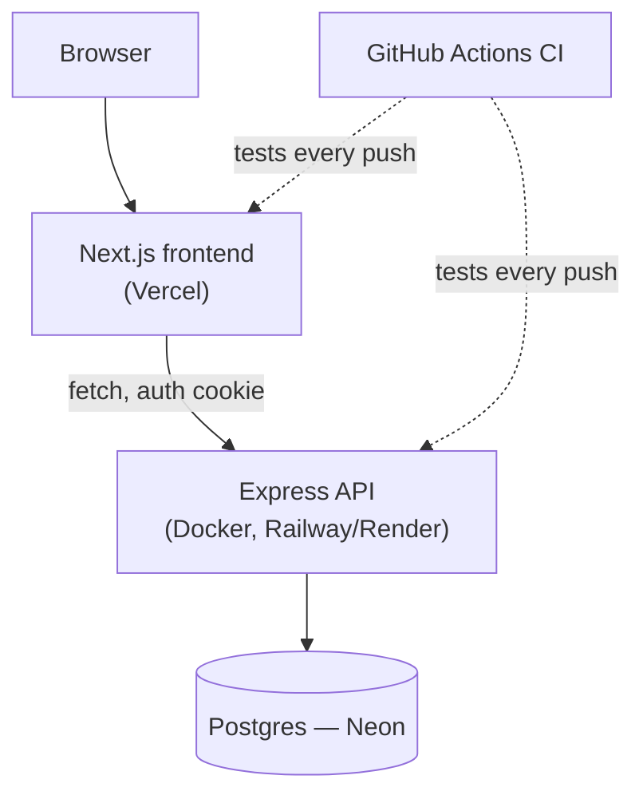

# Week 22: Capstone Build Week 2 & Demo Day

The final week. Monday and Tuesday finish the build and add the production-hardening details every deployed API should have but that haven't been formally taught yet. Wednesday is Demo Day — each student presents a real, live, deployed application, end to end.

---

## Module 1: Production Hardening

### 1. Security Headers With Helmet

* **Lecture & Concepts:**
    * Browsers respect a set of HTTP response headers that reduce whole classes of attack — `helmet` is a single Express middleware that sets sane defaults for all of them in one line, instead of researching and setting each header manually.

* **In-Depth Example:**
    ```bash
    npm install helmet
    ```
    ```ts
    import helmet from 'helmet';
    app.use(helmet());
    ```

### 2. Rate Limiting

* **Lecture & Concepts:**
    * Without a limit, nothing stops a script from hammering `/auth/login` thousands of times a minute, attempting to brute-force a password. A **general** rate limiter protects the whole API reasonably; a **stricter, dedicated** limiter on `/auth/login` specifically matters far more, since that's the actual brute-force target.

* **In-Depth Example:**
    ```bash
    npm install express-rate-limit
    ```
    ```ts
    import rateLimit from 'express-rate-limit';

    const generalLimiter = rateLimit({ windowMs: 15 * 60 * 1000, max: 300 });
    const loginLimiter = rateLimit({ windowMs: 15 * 60 * 1000, max: 10 });

    app.use(generalLimiter);
    app.use('/api/v1/auth/login', loginLimiter);
    ```

### 3. Real Request Logging

* **Lecture & Concepts:**
    * A silent failure in production — a request that errors with nothing recorded anywhere — is worse than a noisy one. `morgan` logs every request's method, path, status, and response time in one line; production teams at real scale typically graduate to structured JSON logging (`pino`) queryable in a tool like Datadog, worth knowing the name of even without setting it up here.

* **In-Depth Example:**
    ```bash
    npm install morgan
    ```
    ```ts
    import morgan from 'morgan';
    app.use(morgan('combined'));
    ```

* **Workshop Activity: Harden the Real Capstone API**
    1. Add `helmet`, a general rate limiter, and a stricter login-specific limiter to the capstone's real Express app (or the equivalent Route Handler-level protection, if the capstone is Next.js-only).
    2. Add `morgan` logging, and confirm real request logs appear in the console during local testing.
    3. Re-run the full test suite (Week 18) and CI pipeline (Week 20) to confirm nothing broke.

---

## Module 2: Final Polish & Deployment Hardening

### 1. A Real Pre-Launch Pass

* **Facilitation Notes:** With hardening done, remaining time goes to closing gaps against the final checklist below — genuinely finishing the core workflow's edge cases (what does the UI show on a real error? an empty state?) rather than starting new features this late.


*The shape every student's finished system should match, whatever the specific idea.*

* **Workshop Activity: Dress Rehearsal**
    1. Each student runs their own demo, out loud, to one other student, timed to 5 minutes.
    2. The listening student notes anything confusing or broken — fix real issues found here before the actual Demo Day, not during it.

---

## Module 3: Demo Day

### 1. Format

* **Facilitation Notes:** Suggested structure per student (10 minutes total): 1 minute — what the app does and who it's for; 5 minutes — live demo of the real, deployed app (not localhost, not slides); 2 minutes — one real technical decision explained (why Postgres over an alternative, why this data model, what was hardest); 2 minutes — questions.

### 2. Final Deliverable Checklist

Every capstone, regardless of the specific idea, should satisfy all seven:

1. **Frontend:** Next.js (TS), Tailwind, real routing, real data — no mock/placeholder data left.
2. **Backend:** Express or Next.js Route Handlers, layered architecture, Postgres via Drizzle.
3. **Auth:** Real signup/login with hashed passwords and secure sessions; data scoped per user.
4. **Validation & Errors:** Zod on every write path; one centralized error handler.
5. **Tests & CI:** Vitest/Supertest coverage, passing automatically in GitHub Actions.
6. **Security:** `helmet`, rate limiting (general + auth-specific), no secrets committed.
7. **Deployment:** Live URLs for both frontend and backend, connected, working end to end.

* **Facilitation Notes:** Use this checklist as the actual grading rubric — it's the same one carried since the course's very first outline, so nothing here should be a surprise this late.

---

### Week 22: Comprehensive Assignment — Final Capstone Submission

**Objective:** A complete, hardened, deployed, tested full-stack application, presented live.

**Requirements:**

1. **All Seven Checklist Items:** Satisfied and verifiable live, not just claimed.
2. **Hardening:** `helmet`, general + login-specific rate limiting, and request logging in place.
3. **Demo:** A real, live, 10-minute presentation following the format above.
4. **Repository:** A clean, real commit history (via the branch → PR → merge workflow used all course) and a `README.md` sufficient for a stranger to run the project locally.
5. **Reflection:** A short written note (a paragraph is enough) on what was cut from scope, and what the very next feature would be if the project continued.

**Course Complete.** From `git init` in Week 1 to a live, tested, deployed, authenticated full-stack application in Week 22 — every piece was real, shipped, and yours.
