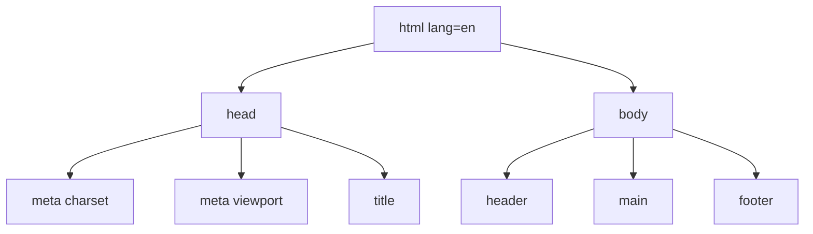

# Week 2: HTML Fundamentals

This week you build the real skeleton of Lagos Spots: a page structure a browser (and a screen reader) can actually understand, a listing of places, and a form for submitting new ones. Nothing will look good yet — that's CSS's job, starting next week. Right now, the goal is *meaning*: every tag should describe what something *is*, not how it should look.

---

## Module 1: Document Structure

### 1. The Boilerplate

* **Lecture & Concepts:**
    * Every HTML5 document starts from the same minimal skeleton:
        * `<!DOCTYPE html>` — must be the very first line. Tells the browser to render in modern, standards-compliant mode.
        * `<html lang="en">` — the root element wrapping everything else. The `lang` attribute isn't optional in practice: screen readers use it to choose pronunciation rules, and it's a real accessibility requirement.
        * `<head>` — metadata *about* the page. Nothing in here is visible.
        * `<body>` — everything a visitor actually sees.



* **In-Depth Example:**
    ```html
    <!DOCTYPE html>
    <html lang="en">
      <head>
        <meta charset="UTF-8">
        <meta name="viewport" content="width=device-width, initial-scale=1.0">
        <title>Lagos Spots — Find Your Next Spot</title>
      </head>
      <body>
        <!-- everything visible goes here -->
      </body>
    </html>
    ```
    * `meta charset="UTF-8"` lets the page correctly display any character or emoji.
    * `meta name="viewport"` tells mobile browsers to render at the device's actual width instead of a zoomed-out desktop layout — skip this and every phone visitor gets a tiny, pinch-to-zoom version of your page.

* **Class Exercise: Scaffold `index.html`**
    1. Inside `lagos-spots`, create `index.html`.
    2. Type out the full boilerplate above by hand.
    3. Save and open the file directly in your browser (double-click it, or drag it into a tab).

---

### 2. Semantic Structure: `header`, `nav`, `main`, `section`, `footer`

* **Lecture & Concepts:**
    * Before generic `<div>`s existed as the only option, HTML5 added tags that describe a section's *role* on the page — this is called **semantic HTML**. Screen readers, browsers, and search engines all use these to understand your page's structure without reading every word.
    * **`<header>`:** introductory content for the page (or a section) — typically a logo and navigation.
    * **`<nav>`:** a block of navigation links.
    * **`<main>`:** the one, unique, primary content of the page. Only one per page.
    * **`<section>`:** a distinct, thematic grouping of content — like "the list of spots" or "the submit form."
    * **`<article>`:** content that could stand alone and make sense on its own — a perfect fit for one individual spot card.
    * **`<footer>`:** closing content — copyright, secondary links.

* **In-Depth Example (Lagos Spots' real skeleton):**
    ```html
    <body>
      <header>
        <h1>Lagos Spots</h1>
        <nav>
          <ul>
            <li><a href="index.html">Home</a></li>
            <li><a href="submit.html">Add a Spot</a></li>
          </ul>
        </nav>
      </header>

      <main>
        <section id="search">
          <!-- search bar goes here, Week 6 -->
        </section>

        <section id="spots-list">
          <!-- spot cards go here -->
        </section>
      </main>

      <footer>
        <p>&copy; 2026 Lagos Spots.</p>
      </footer>
    </body>
    ```

* **Class Exercise: Build the Real Skeleton**
    1. Inside `<body>`, build exactly the structure above: `header` with a logo and `nav`, `main` with two empty `section`s (`#search` and `#spots-list`), and a `footer`.
    2. Save and refresh. Confirm nothing looks styled — that's expected, and correct, at this stage.

---

## Module 2: Content Tags & Attributes

### 1. Headings, Paragraphs & Attributes

* **Lecture & Concepts:**
    * Headings (`<h1>`–`<h6>`) define a hierarchy of importance — they are **not** a font-size tool. Use exactly one `<h1>` per page.
    * `<p>` wraps a block of text.
    * **`id`** is a unique label for exactly *one* element on the page — used for linking to a specific spot or for JavaScript to find it later.
    * **`class`** is a reusable label you can put on *many* elements — the main way CSS (and later, JS) targets groups of things the same way.

* **In-Depth Example:**
    ```html
    <article class="spot-card" id="spot-terra-kulture">
      <h3 class="spot-card__title">Terra Kulture</h3>
      <p class="spot-card__description">Art gallery, restaurant, and live music space in Victoria Island.</p>
    </article>
    ```
    * Notice `id="spot-terra-kulture"` is unique to this one spot, while `class="spot-card"` will repeat on every card.

* **Class Exercise: Build Your First Real Spots**
    1. Inside `#spots-list`, add 4–5 `<article class="spot-card">` elements, each with a real (or realistic) Lagos place: a name (`<h3>`), and a one-sentence description (`<p>`).
    2. Give each `<article>` a unique `id` based on its name.

---

### 2. Lists, Links & Images

* **Lecture & Concepts:**
    * **Lists (`<ul>`/`<ol>`/`<li>`):** an unordered list (`<ul>`) is the correct tag for navigation links or a set of category tags — not just visual bullet points.
    * **Links (`<a href="...">`):** requires `href`. **Absolute** links (`https://...`) point elsewhere on the web. **Relative** links (`submit.html`) point to another file in your own project.
    * **Images (``):** a self-closing tag requiring `src` (the image path) and `alt` (a text description). `alt` matters for three real reasons: screen readers, broken-image fallback text, and search engines. If an image is purely decorative, use `alt=""` rather than omitting it.

* **In-Depth Example:**
    ```html
    <article class="spot-card">
      
      <h3 class="spot-card__title">Terra Kulture</h3>
      <ul class="spot-card__tags">
        <li>Art</li>
        <li>Restaurant</li>
      </ul>
      <p class="spot-card__description">Art gallery, restaurant, and live music space.</p>
      <a href="spot-detail.html">View details</a>
    </article>
    ```

* **Class Exercise: Add Images, Tags & Links**
    1. Create an `assets` folder; add a placeholder image for each spot (or use any royalty-free image).
    2. Add an `` to each `.spot-card` with a real, descriptive `alt`.
    3. Add a `<ul class="spot-card__tags">` with 1–2 `<li>` category tags per card (e.g., "Food," "Study," "Nightlife").
    4. Add a relative link `<a href="submit.html">Add a Spot</a>` inside the nav.

---

## Module 3: Building the "Add a Spot" Form

### 1. Form Basics

* **Lecture & Concepts:**
    * A `<form>` groups a set of inputs meant to be submitted together. Every real input needs an associated `<label>` — clicking the label should focus the input, and screen readers depend on this pairing.
    * Useful input types beyond plain text: `<select>` for a fixed set of choices (a spot's category), `<textarea>` for multi-line text (a description).
    * `required` and `minlength` are built-in **validation attributes** — the browser refuses to submit the form until they're satisfied, with zero JavaScript.

* **In-Depth Example (The real Add-a-Spot form):**
    ```html
    <form id="submit-spot-form">
      <div class="form-field">
        <label for="spot-name">Spot name</label>
        <input type="text" id="spot-name" name="name" required>
      </div>

      <div class="form-field">
        <label for="spot-category">Category</label>
        <select id="spot-category" name="category" required>
          <option value="">Choose one…</option>
          <option value="food">Food</option>
          <option value="study">Study</option>
          <option value="nightlife">Nightlife</option>
          <option value="events">Events</option>
        </select>
      </div>

      <div class="form-field">
        <label for="spot-area">Area (e.g. Lekki, Yaba)</label>
        <input type="text" id="spot-area" name="area" required>
      </div>

      <div class="form-field">
        <label for="spot-description">Description</label>
        <textarea id="spot-description" name="description" minlength="10" required></textarea>
      </div>

      <button type="submit">Add Spot</button>
    </form>
    ```

* **Class Exercise: Build the Real Form**
    1. Create `submit.html` using the same boilerplate, header, and footer as `index.html`.
    2. Inside `<main>`, add the exact form above.
    3. Test the browser's built-in validation: try submitting with the name field empty and confirm the browser blocks it with a native message.

---

### 2. Accessibility Checklist

* **Lecture & Concepts:** Three habits to build now, before they're afterthoughts:
    1. Every `<input>`/`<select>`/`<textarea>` has a `<label for="...">` matching its `id`.
    2. Every meaningful `` has descriptive `alt` text; decorative images get `alt=""`.
    3. Exactly one `<h1>` per page, and headings never skip a level just for size (e.g. don't jump from `<h1>` to `<h4>`).

* **Class Exercise: Audit Both Pages**
    1. Run through the checklist above on both `index.html` and `submit.html`.
    2. Fix anything that fails.

---

### Week 2: Comprehensive Assignment

**Objective:** Ship a semantically valid, accessible two-page Lagos Spots site: a homepage listing real spots, and a working submit form.

**Requirements:**

1. **`index.html`:** Valid boilerplate; `header` (logo + `nav`) with a link to `submit.html`; `main` with a `#search` section (empty for now) and a `#spots-list` section containing at least 4 `.spot-card` articles (image with real `alt`, name, category tags, description); `footer`.
2. **`submit.html`:** Same boilerplate/header/footer, with the full "Add a Spot" form (name, category `select`, area, description `textarea`, submit button), every field properly labeled.
3. **Accessibility:** Passes the 3-point checklist above on both pages.
4. **Git:** Both files committed and pushed, following the branch → PR → merge workflow from Week 1.

**Bonus Challenge:** Add a `spot-detail.html` page (same boilerplate) with a placeholder heading and a "Back to all spots" link to `index.html` — you'll wire this into real dynamic content once JavaScript enters the picture in Week 6.
