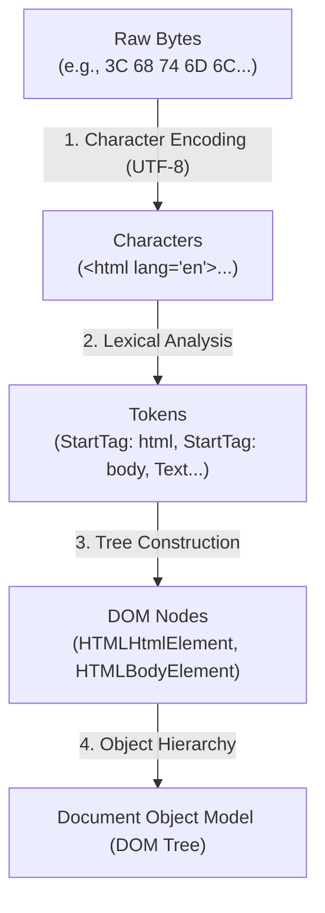
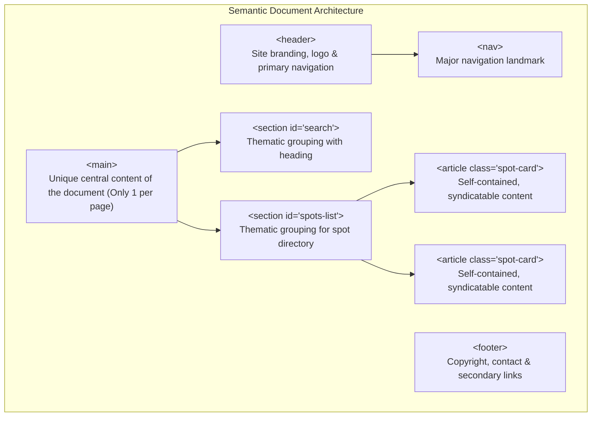
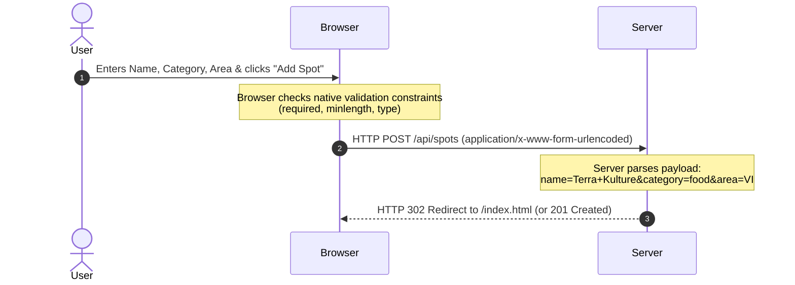

# Week 2: HTML Fundamentals

This week you build the semantic skeleton of Lagos Spots: an accessible, structured document that browsers, search engine indexers, and assistive technologies (like screen readers) can parse reliably. Nothing will look styled yet — that is CSS's job, starting next week. Right now, the goal is **meaning (semantics)**: every tag must describe what the content *is*, not how it should look.

---

## Module 1: Document Structure & The Document Object Model (DOM)

### 1. The Core Terminology of HTML

| Term | What It Actually Means | Why It Matters / Technical Context |
| :--- | :--- | :--- |
| **HTML Tag** | The syntax delimiter enclosed in angle brackets (e.g., `<p>`, `</p>`, ``). | Instructs the browser tokenizer where an element starts and ends. |
| **HTML Element** | The complete node consisting of the opening tag, attributes, text/child content, and closing tag (e.g., `<p class="bio">Hello</p>`). | The fundamental building block of the web page. |
| **HTML Attribute** | Key-value pairs inside an opening tag providing metadata or behavioral configuration (e.g., `id="spot-1"`, `required`). | Configures element behavior, identity, and accessibility relationships. |
| **DOM (Document Object Model)** | The in-memory tree data structure constructed by the browser engine after parsing HTML tokens. | JavaScript manipulates the live DOM tree in memory, not the raw HTML text file. |
| **Accessibility Tree** | A parallel tree structure generated by the browser from the DOM, consumed exclusively by screen readers and assistive devices. | Missing semantic tags or broken label associations strip nodes from the Accessibility Tree. |
| **Semantic HTML** | Using HTML tags according to their standardized human and machine meaning (`<nav>`, `<article>`, `<main>`) rather than generic containers (`<div>`, `<span>`). | Directly impacts Search Engine Optimization (SEO), accessibility (WCAG compliance), and keyboard navigation. |

---

### 2. Under the Hood: How Browsers Parse HTML to Build the DOM

When your browser receives raw HTML bytes over the network, it executes a four-stage ingestion pipeline:



1. **Bytes to Characters:** The browser reads binary bytes and decodes them into characters using the character encoding specified in `<meta charset="UTF-8">`.
2. **Tokenization (Lexical Analysis):** The HTML tokenizer scans characters and produces distinct tokens: `StartTag: <html>`, `StartTag: <head>`, `Character: Lagos Spots`, `EndTag: </head>`.
3. **Tree Construction:** As tokens are emitted, the browser matches opening and closing tags to create parent-child **Node objects** in memory (`HTMLHeadingElement`, `HTMLParagraphElement`).
4. **DOM Tree:** The result is a hierarchical tree of objects that JavaScript can dynamically query and mutate.

---

### 3. The HTML5 Boilerplate Deconstructed

Every valid modern HTML5 document requires this foundational skeleton:

```html
<!DOCTYPE html>
<html lang="en">
  <head>
    <meta charset="UTF-8">
    <meta name="viewport" content="width=device-width, initial-scale=1.0">
    <meta name="description" content="Discover curated restaurants, study spots, and hangouts across Lagos.">
    <title>Lagos Spots — Discover Your Next Favorite Place</title>
  </head>
  <body>
    <!-- User-visible content goes here -->
  </body>
</html>
```

#### Line-by-Line Technical Rationale:
- `<!DOCTYPE html>`: **Document Type Declaration**. Tells the browser rendering engine to parse the page in standard HTML5 mode. Omitting this triggers legacy **"Quirks Mode"**, causing unpredictable layout and CSS rendering bugs.
- `<html lang="en">`: The root element wrapping everything. The `lang` attribute dictates the primary language, allowing screen readers to select the correct phonetic pronunciation engine and helping translation tools.
- `<head>`: Contains document metadata, character sets, viewport configurations, SEO descriptions, and links to external stylesheets/scripts. **Nothing inside `<head>` renders directly on the visual canvas.**
- `<meta charset="UTF-8">`: Declares **UTF-8 (8-bit Unicode Transformation Format)** character encoding. UTF-8 natively supports all world languages, diacritics, mathematical symbols, and emojis (e.g., 🇳🇬, 📍) without character corruption (*mojibake*).
- `<meta name="viewport" content="width=device-width, initial-scale=1.0">`:
  - `width=device-width`: Sets the virtual viewport width to match the physical device's screen width in CSS pixels (e.g., 390px on an iPhone), preventing mobile browsers from defaulting to a zoomed-out 980px desktop canvas.
  - `initial-scale=1.0`: Sets the initial zoom ratio to 100% when the page is first loaded.
- `<title>`: Defines the document title displayed in browser tabs, search engine results pages (SERPs), and bookmarks.
- `<body>`: Contains the entire renderable tree that users see and interact with on screen.

---

### 4. Semantic Page Landmarks: Replacing "Div Soup"

Before HTML5, developers wrapped everything in generic `<div>` containers with custom class names (`<div id="header">`, `<div class="nav-links">`). This anti-pattern is known as **"Div Soup"**. It robs search bots and screen readers of structural context.

HTML5 introduces dedicated **landmark elements**:



| Semantic Tag | Specification & Role | When to Use vs When NOT to Use |
| :--- | :--- | :--- |
| `<header>` | Introductory container for a page or `<article>`, typically holding headings, logos, or search bars. | Use for top-level headers or section headings. Do not confuse with `<head>` or `<h1>`. |
| `<nav>` | Declares a section containing major navigational links. | Use for site menus, pagination, or table of contents. Do not wrap every single `<a>` tag in `<nav>`. |
| `<main>` | Represents the dominant, unique content of the `<body>`. | Must be unique per document; do not include content repeated across pages (like sidebars, headers, footers). |
| `<section>` | A standalone generic thematic section of a document, typically with an introductory heading. | Use to group related content (e.g., "Trending Spots", "Submit a Spot"). Use a plain `<div>` if grouping solely for CSS styling. |
| `<article>` | A self-contained composition intended to be independently distributable or reusable (e.g., a blog post, a spot directory card, a product item). | Use for spot cards, comments, or news items that make sense in isolation (e.g., in an RSS feed). |
| `<aside>` | Content tangentially related to the content around it (sidebars, callout boxes, related links). | Use for secondary sidebars, glossaries, or author bios. |
| `<footer>` | Closing metadata for a section or document (author, copyright, terms). | Use at the bottom of pages or within standalone `<article>` cards. |

* **In-Depth Example (Lagos Spots' Semantic Skeleton):**
    ```html
    <body>
      <header>
        <a href="index.html" class="logo">Lagos Spots 📍</a>
        <nav aria-label="Main Navigation">
          <ul>
            <li><a href="index.html">Explore Spots</a></li>
            <li><a href="submit.html">Add a Spot</a></li>
          </ul>
        </nav>
      </header>

      <main>
        <section id="search" aria-labelledby="search-heading">
          <h2 id="search-heading">Find Places in Lagos</h2>
          <!-- Search input and category filter chips go here -->
        </section>

        <section id="spots-list" aria-labelledby="spots-heading">
          <h2 id="spots-heading">Curated Spots</h2>
          <!-- Articles/Cards will be inserted here -->
        </section>
      </main>

      <footer>
        <p>&copy; 2026 Lagos Spots. Built for the community.</p>
      </footer>
    </body>
    ```

* **Class Exercise: Scaffold `index.html`**
    1. Inside `lagos-spots`, create `index.html`.
    2. Write the complete HTML5 boilerplate and semantic landmark skeleton above.
    3. Open the file in Chrome, open DevTools, and expand the Elements tab to inspect the live node hierarchy.

---

## Module 2: Content Markup, Attributes & Media

### 1. Headings, Text Formatting & Element Identity

- **Heading Hierarchy (`<h1>` to `<h6>`):**
  - Defines the document outline. Screen reader users frequently navigate pages by jumping between headings.
  - **Golden Rule:** Exactly **one** `<h1>` per page representing the main topic.
  - **Never skip levels:** Transitioning from `<h1>` directly to `<h4>` breaks accessibility parsing.
- **Text Containers:**
  - `<p>`: Paragraphs of prose.
  - `<strong>`: Indicates serious importance or urgency (rendered bold by default, announced with inflection by screen readers).
  - `<em>`: Indicates conversational emphasis (rendered italic by default).
- **Element Identity Attributes:**
  - `id`: Must be globally unique across the entire DOM tree. Used as anchor targets (`href="#spots-list"`) and direct DOM query hooks.
  - `class`: Reusable classification identifier shared across multiple elements for CSS styling and batch JS selection.

```html
<article class="spot-card" id="spot-bogobiri">
  <h3 class="spot-card__title">Bogobiri House</h3>
  <p class="spot-card__description">
    A vibrant boutique hotel, African art gallery, and live music hub in <strong>Ikoyi</strong>.
  </p>
</article>
```

---

### 2. Hyperlinks, Lists & Media Assets

#### Hyperlinks (`<a>`):
The `href` (Hypertext Reference) attribute specifies the destination URL:
- **Absolute URLs:** Points to an external domain (`href="https://en.wikipedia.org/wiki/Lagos"`). Requires protocol (`https://`).
- **Relative URLs:** Points to a file in the same project (`href="submit.html"` or `href="/pages/about.html"`).
- **Fragment Identifiers:** Links to a specific `id` on the same page (`href="#spots-list"`).
- **`target="_blank"` with Security:** When opening external links in a new tab, always pair with `rel="noopener noreferrer"` to prevent malicious tab manipulation (*tabnabbing*).

#### Lists (`<ul>`, `<ol>`, `<li>`):
- `<ul>`: Unordered list for collections where order does not convey meaning (navigation menus, category tags).
- `<ol>`: Ordered list where sequence matters (step-by-step cooking recipe, leaderboard rankings).
- `<li>`: List item child element.

#### Images (``):
`` is an empty (void/self-closing) element:
- `src`: Path to the image file.
- `alt`: Alternative text description.
  - **Screen Readers:** Reads this description aloud to visually impaired users.
  - **Network Failure:** Displays in place of the image if the network request fails.
  - **SEO:** Used by web crawlers to index image content.
  - **Decorative Rule:** If an image is purely cosmetic (e.g., an abstract background blob), use `alt=""` so assistive tools safely ignore it. Never omit the `alt` attribute entirely.

```html
<article class="spot-card" id="spot-terra-kulture">
  
  <h3 class="spot-card__title">Terra Kulture</h3>
  <ul class="spot-card__tags">
    <li>Art Gallery</li>
    <li>Restaurant</li>
    <li>Theatre</li>
  </ul>
  <p class="spot-card__description">
    A renowned cultural center featuring Nigerian cuisine, art exhibitions, and theatrical stage plays.
  </p>
  <a href="https://maps.google.com" target="_blank" rel="noopener noreferrer">View on Map</a>
</article>
```

* **Class Exercise: Populate Lagos Spots**
    1. Create an `assets/` directory in your project.
    2. Inside `#spots-list` in `index.html`, add 4 comprehensive `<article class="spot-card">` cards representing real Lagos venues (e.g., *Terra Kulture (VI)*, *Bogobiri (Ikoyi)*, *CCX Lounge (VI)*, *University of Lagos Library (Yaba)*).
    3. Include complete headings, descriptions, category tag lists, and descriptive `alt` text for each image.

---

## Module 3: Forms & Native Validation

### 1. Form Mechanics: How Forms Send Data

A `<form>` collects user inputs and submits them to a server endpoint. When submitted natively (without JavaScript interception), the browser executes an HTTP request based on two crucial form attributes:



1. **`action`:** The URL/endpoint where the form data will be transmitted (e.g., `/api/spots` or `submit.html`).
2. **`method`:** The HTTP verb:
   - `GET`: Appends form data directly to the URL as query parameters (`/search?q=yaba&category=study`). Used for search queries and read operations.
   - `POST`: Packages form data inside the HTTP request body (`application/x-www-form-urlencoded` or `multipart/form-data`). Used when creating or modifying server-side data.
3. **`name` Attribute (Critical):** Every input **must** have a `name` attribute. The `name` becomes the key in the transmitted key-value pair. **An input missing `name` is completely ignored during form submission.**

---

### 2. Input Types & Built-In Validation API

HTML5 includes client-side validation built directly into the browser engine:

| Control | Tag & Type | Purpose & Attributes |
| :--- | :--- | :--- |
| **Text Input** | `<input type="text">` | Single-line text input (`minlength="3"`, `maxlength="50"`). |
| **Select Dropdown** | `<select>` + `<option>` | Constrained menu selection (`required`). |
| **Textarea** | `<textarea>` | Multi-line text input for descriptions and bios. |
| **Labels** | `<label for="inputId">` | Connects clickable text to an input control. |
| **Submit Button** | `<button type="submit">` | Triggers form validation and dispatch. |

* **In-Depth Example (`submit.html` — The Complete Add-a-Spot Form):**
    ```html
    <!DOCTYPE html>
    <html lang="en">
      <head>
        <meta charset="UTF-8">
        <meta name="viewport" content="width=device-width, initial-scale=1.0">
        <title>Add a New Spot — Lagos Spots</title>
      </head>
      <body>
        <header>
          <a href="index.html">Lagos Spots 📍</a>
          <nav>
            <ul>
              <li><a href="index.html">Explore Spots</a></li>
              <li><a href="submit.html" aria-current="page">Add a Spot</a></li>
            </ul>
          </nav>
        </header>

        <main>
          <h1>Recommend a Lagos Spot</h1>
          <p>Know a great hangout, restaurant, or co-working space? Add it to the community directory.</p>

          <form action="#" method="POST" id="add-spot-form">
            <div class="form-group">
              <label for="spot-name">Spot Name</label>
              <input 
                type="text" 
                id="spot-name" 
                name="spotName" 
                placeholder="e.g. Workstation Bar Beach" 
                required 
                minlength="3"
              >
            </div>

            <div class="form-group">
              <label for="spot-category">Category</label>
              <select id="spot-category" name="category" required>
                <option value="">Select a category...</option>
                <option value="food">Food & Dining</option>
                <option value="study">Co-working & Study</option>
                <option value="nightlife">Nightlife & Drinks</option>
                <option value="events">Arts & Events</option>
              </select>
            </div>

            <div class="form-group">
              <label for="spot-area">Lagos Area / Neighborhood</label>
              <input 
                type="text" 
                id="spot-area" 
                name="area" 
                placeholder="e.g. Victoria Island, Yaba, Lekki Phase 1" 
                required
              >
            </div>

            <div class="form-group">
              <label for="spot-description">Description & Highlights</label>
              <textarea 
                id="spot-description" 
                name="description" 
                rows="4" 
                placeholder="What makes this spot special? (Ambiance, fast Wi-Fi, signature dishes...)" 
                required 
                minlength="15"
              ></textarea>
            </div>

            <button type="submit">Submit Spot for Review</button>
          </form>
        </main>

        <footer>
          <p>&copy; 2026 Lagos Spots.</p>
        </footer>
      </body>
    </html>
    ```

---

### 3. Accessibility (a11y) Core Rules

Building accessible software is a fundamental professional requirement:

1. **Explicit Label Association:**
   - Every input **must** be tied to a `<label>`.
   - The `<label>` element's `for` attribute must match the `<input>` element's `id` attribute exactly (`for="spot-name"` $\leftrightarrow$ `id="spot-name"`).
   - *Why:* Clicking the label automatically focuses the input (larger click/tap target), and screen readers announce the label text when the user tabs into the field.
2. **Interactive Elements:**
   - Use `<button>` for actions (triggering modals, submitting forms).
   - Use `<a>` for navigation (changing URL or scrolling to an anchor).
   - **Anti-pattern:** `<div onclick="...">` is invisible to keyboard navigation and screen readers.
3. **Logical Focus Order:**
   - Keep the DOM hierarchy aligned with the visual flow of the page so keyboard `Tab` navigation moves predictably top-to-bottom, left-to-right.

---

### 4. Common Pitfalls & How to Avoid Them

| Mistake | What Breaks | The Correct Fix |
| :--- | :--- | :--- |
| Missing `name` on form inputs | Input values are dropped when form is submitted. | Ensure every `<input>`, `<select>`, `<textarea>` has a unique `name` attribute. |
| Skipping heading levels (`<h1>` $\to$ `<h3>`) | Screen reader outline navigation becomes confusing. | Maintain a strict numerical sequence (`<h1>` $\to$ `<h2>` $\to$ `<h3>`). |
| Empty or generic `alt` text (`alt="image"`) | Visually impaired users receive zero context. | Describe what is depicted in the photo contextually. |
| Nesting interactive elements (`<button><a href="#">Click</a></button>`) | Invalid HTML; browser event bubbling triggers conflicting actions. | Use either an `<a>` or a `<button>`, never both nested. |

---

### Week 2: Comprehensive Assignment

**Objective:** Build a valid, fully semantic, accessible two-page foundation for Lagos Spots (`index.html` and `submit.html`) with zero CSS styling.

**Requirements:**
1. **`index.html` (Homepage):**
   - Valid HTML5 doctype, UTF-8 charset, responsive viewport metadata, and informative title.
   - Semantic landmarks: `<header>`, `<nav>`, `<main>`, `<section id="search">`, `<section id="spots-list">`, and `<footer>`.
   - At least 4 distinct `<article class="spot-card">` elements containing:
     - An `` with descriptive `alt` text.
     - An `<h3>` title.
     - A `<ul>` list of category tags.
     - A `<p>` description.
     - An `<a>` link pointing to an external map or details page.
2. **`submit.html` (Add a Spot):**
   - Shared header, navigation, and footer.
   - A complete `<form>` with `action`, `method="POST"`, and explicitly paired `<label for="...">` elements for every field:
     - Text input for Spot Name (required, minlength 3).
     - Select dropdown for Category (required with placeholder option).
     - Text input for Area/Neighborhood (required).
     - Textarea for Description (required, minlength 15).
     - Submit button with `type="submit"`.
3. **Validation & Accessibility Audit:**
   - Zero HTML validation errors when tested with the W3C Markup Validation Service.
   - Passed keyboard navigation test (able to `Tab` through all links and form inputs smoothly).
4. **Git Workflow:**
   - Changes developed on branch `feature/semantic-markup`, pushed to GitHub, merged via Pull Request, and pulled locally.
