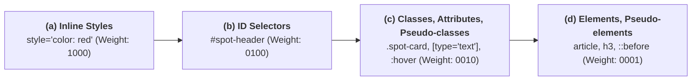
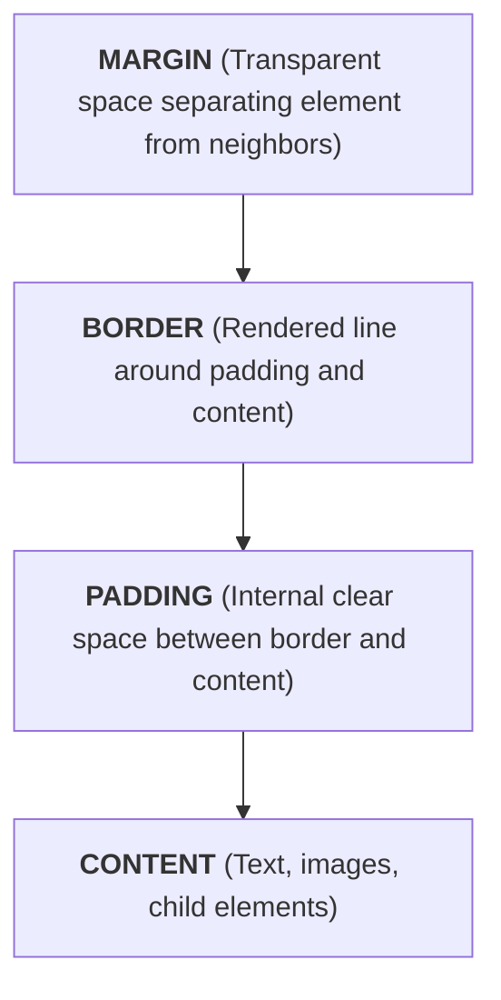
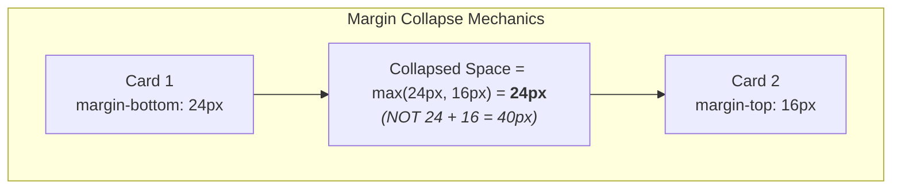
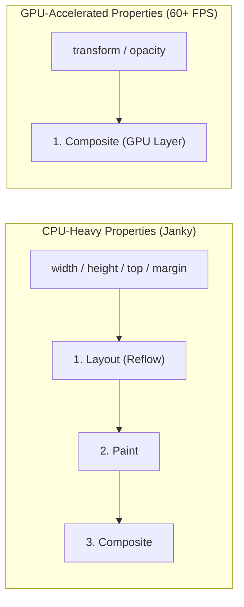

# Week 3: CSS Fundamentals

Lagos Spots now has a solid, semantic HTML foundation, but it displays only with the browser's rudimentary default styles (the **User-Agent stylesheet**). This week, you take complete control over presentation: typography, colors, spacing, the CSS Box Model, the Cascade, and the **BEM (Block Element Modifier)** methodology. Layout systems (Flexbox and Grid) are introduced in Week 4 — this week focuses on mastering individual element geometry, styling rules, and specificity mechanics.

---

## Module 1: The CSS Cascade, Specificity & Selectors

### 1. The Core Terminology of CSS

| Term | What It Actually Means | Technical Context |
| :--- | :--- | :--- |
| **CSSOM (CSS Object Model)** | The in-memory tree of style rules parsed by the browser engine from stylesheets and `<style>` blocks. | Merged with the DOM to build the **Render Tree**. |
| **The Cascade** | The deterministic algorithm the browser uses to resolve conflicting CSS rules targeting the same element. | Considers Origin & Importance $\to$ Specificity $\to$ Source Order. |
| **Specificity** | A weight score calculated from the types of selectors used in a rule. | High-specificity rules override lower-specificity rules regardless of source file order. |
| **Inheritance** | The mechanism where certain CSS properties applied to a parent element automatically pass down to its descendants. | Properties like `color`, `font-family`, and `line-height` inherit; geometry properties like `margin`, `padding`, and `border` do not. |
| **Rule Set** | A selector followed by a declaration block: `selector { property: value; }`. | The basic syntax unit of CSS. |

---

### 2. Under the Hood: The Specificity Calculation Formula

When multiple rules target the same element and define conflicting properties, CSS resolves the conflict using a 4-part numerical weight tuple: **`(a, b, c, d)`**.



| Selector Example | Score Tuple `(a, b, c, d)` | Total Weight Score | Description |
| :--- | :--- | :--- | :--- |
| `p` | `(0, 0, 0, 1)` | 1 | Single element selector |
| `.spot-card` | `(0, 0, 1, 0)` | 10 | Single class selector |
| `.spot-card h3` | `(0, 0, 1, 1)` | 11 | 1 class + 1 element |
| `.spot-card.spot-card--featured` | `(0, 0, 2, 0)` | 20 | 2 classes |
| `#spots-list .spot-card:hover` | `(0, 1, 1, 0)` | 110 | 1 ID + 1 class + 1 pseudo-class |
| `<article style="background: red;">` | `(1, 0, 0, 0)` | 1000 | Inline HTML attribute |

#### The 3 Cascade Rules:
1. **Importance & Origin:** Developer styles beat User-Agent (browser default) styles. `!important` flags beat everything (avoid using `!important` as it breaks the cascade).
2. **Specificity:** The selector with the higher tuple `(a, b, c, d)` wins. Comparison is left-to-right (an ID `(0,1,0,0)` beats any number of classes `(0,0,99,0)`).
3. **Source Order:** If two conflicting rules have the **exact same specificity**, the rule written **latest (lower down)** in the stylesheet wins.

---

### 3. Selector Types & Pseudo-Classes

```css
/* 1. Element Selector (Low specificity) */
p {
  line-height: 1.6;
  color: #333333;
}

/* 2. Class Selector (Standard workhorse of maintainable CSS) */
.spot-card {
  background-color: #ffffff;
}

/* 3. Descendant Combinator (Matches h3 anywhere inside .spot-card) */
.spot-card h3 {
  margin-top: 0;
}

/* 4. Child Combinator (Matches ONLY direct children <li> of .spot-card__tags) */
.spot-card__tags > li {
  list-style: none;
}

/* 5. Pseudo-Classes (Matches dynamic UI state) */
.spot-card:hover {
  border-color: #f5a623;
}

/* 6. Accessible Focus Indicator */
input:focus-visible {
  outline: 2px solid #2563eb;
  outline-offset: 2px;
}
```

* **Class Exercise: Linking External CSS**
    1. Create a `styles.css` file in your repository.
    2. Add `<link rel="stylesheet" href="styles.css">` inside `<head>` in `index.html` and `submit.html`.
    3. Test with a global background reset: `body { background-color: #f8fafc; font-family: sans-serif; }`.

---

## Module 2: The CSS Box Model & Display Properties

### 1. Under the Hood: Box Model Mathematics

Every element in the DOM is rendered as a rectangular box composed of four concentric layers:



#### The `box-sizing` Mathematical Formula:
Consider an element with CSS: `width: 300px; padding: 20px; border: 5px solid black; margin: 15px;`.

| Property | `box-sizing: content-box` (Legacy Default) | `box-sizing: border-box` (Modern Standard) |
| :--- | :--- | :--- |
| **Content Width** | $300\text{px}$ | $300 - (2 \times 20) - (2 \times 5) = \mathbf{250\text{px}}$ |
| **Padding (Left + Right)** | $20 + 20 = 40\text{px}$ | $20 + 20 = 40\text{px}$ |
| **Border (Left + Right)** | $5 + 5 = 10\text{px}$ | $5 + 5 = 10\text{px}$ |
| **Rendered On-Screen Width** | $300 + 40 + 10 = \mathbf{350\text{px}}$ *(Overflows layout!)* | $\mathbf{300\text{px}}$ *(Matches specified width!)* |

> [!TIP]
> **The Universal Box-Sizing Reset:** Always apply this at the top of your stylesheet to ensure predictable layout sizing across all elements:
> ```css
> *, *::before, *::after {
>   box-sizing: border-box;
>   margin: 0;
>   padding: 0;
> }
> ```

---

### 2. Under the Hood: Margin Collapsing

Vertical margins of adjacent block-level elements in normal document flow **collapse** into a single margin equal to the largest of the two margins, rather than adding together:



- Horizontal margins **never** collapse.
- Margins on flex items or grid items **never** collapse.
- Padding and borders **never** collapse.

---

### 3. Display Modes: Block vs. Inline vs. Inline-Block

| Display Mode | Line Break Behavior | Respects `width` / `height`? | Respects Vertical `margin` / `padding`? | Common HTML Tags |
| :--- | :--- | :--- | :--- | :--- |
| `display: block` | Starts on a new line; stretches to fill 100% of parent width. | **Yes** | **Yes** | `<div>`, `<p>`, `<h1>`–`<h6>`, `<article>`, `<section>` |
| `display: inline` | Stays in the flow of text; width equals content only. | **No** (ignored) | Padding works visually, but vertical margins are ignored and do not push sibling lines. | `<span>`, `<a>`, `<strong>`, `<em>` |
| `display: inline-block` | Stays inline with text flow, but behaves as a block internally. | **Yes** | **Yes** | Category chips, pill badges, buttons |
| `display: none` | Completely removes element from the Render Tree. | N/A | Takes up 0px space on screen. | Hidden modals, inactive tabs |

---

## Module 3: Typography, Color & GPU-Accelerated Transitions

### 1. Typography & Web-Safe Font Stacks

```css
body {
  /* System font stack with fallbacks */
  font-family: -apple-system, BlinkMacSystemFont, "Segoe UI", Roboto, Helvetica, Arial, sans-serif;
  font-size: 16px;          /* 1rem base size */
  line-height: 1.5;         /* Unitless line-height for optimal readability */
  color: #1e293b;           /* Slate-800 text color (softer than harsh pure #000000) */
  background-color: #f8fafc; /* Slate-50 off-white background */
}
```

- **Relative Units (`rem` vs `em` vs `px`):**
  - `px`: Absolute pixel units. Does not scale if the user modifies default browser font size.
  - `rem` (**Root EM**): Relative to the root `<html>` font size (default $1\text{rem} = 16\text{px}$). Preferred for font sizes, padding, and margins for accessibility.
  - `em`: Relative to the *current element's* computed font size. Useful for padding buttons proportionally to their font size.

---

### 2. Under the Hood: Transitions & Hardware Acceleration

When creating hover effects, animating layout properties (`width`, `height`, `top`, `margin`) causes the browser CPU to recalculate page geometry (**Reflow/Layout**) and repaint pixels (**Repaint**), resulting in visual jank:



To create smooth 60fps animations, animate **`transform`** (for movement and scaling) and **`opacity`** (for fading):

```css
.spot-card {
  background-color: #ffffff;
  border: 1px solid #e2e8f0;
  border-radius: 8px;
  padding: 1.25rem;
  margin-bottom: 1.5rem;
  
  /* Hardware-accelerated transition */
  transition: transform 200ms ease-out, box-shadow 200ms ease-out, border-color 200ms ease-out;
}

.spot-card:hover {
  transform: translateY(-4px); /* Moves card up 4px smoothly */
  box-shadow: 0 10px 15px -3px rgba(0, 0, 0, 0.1), 0 4px 6px -2px rgba(0, 0, 0, 0.05);
  border-color: #cbd5e1;
}
```

---

## Module 4: Architecture & BEM (Block Element Modifier)

### 1. What is BEM and Why Do We Use It?

As projects scale, stylesheets quickly degrade into specificity wars and unintended style collisions. **BEM** is an industry standard naming methodology designed to keep CSS flat, modular, and self-documenting:

```mermaid
classDiagram
    class Block {
        .spot-card
        (Standalone component)
    }
    class Element {
        .spot-card__title
        .spot-card__image
        .spot-card__tags
        (Tied to the Block with __)
    }
    class Modifier {
        .spot-card--featured
        .spot-card--verified
        (Variant state with --)
    }
    Block <|-- Element
    Block <|-- Modifier
```

1. **Block (`.block`):** A standalone component entity with independent meaning (`.spot-card`, `.navbar`, `.btn`).
2. **Element (`.block__element`):** A part of a block that has no standalone meaning and is semantically tied to its parent (`.spot-card__title`, `.spot-card__image`, `.spot-card__badge`). Joined by a double underscore `__`.
3. **Modifier (`.block--modifier` or `.block__element--modifier`):** A flag on a block or element that changes appearance or behavior (`.spot-card--featured`, `.btn--primary`). Joined by a double hyphen `--`.

#### The BEM Advantage: Specificity Flatness:
By using single class selectors (`.spot-card__title`), all rules have an identical specificity of **`(0, 0, 1, 0)`**. You eliminate nested selector chains like `.main div section article h3`, making your code predictable and collision-free.

---

### 2. Multi-File Architecture: `base.css` and `components.css`

Organize your CSS logically into separate files:

```css
/* base.css — Resets, Typography & Global Variables */
*, *::before, *::after {
  box-sizing: border-box;
  margin: 0;
  padding: 0;
}

body {
  font-family: -apple-system, BlinkMacSystemFont, "Segoe UI", Roboto, sans-serif;
  line-height: 1.5;
  background-color: #f8fafc;
  color: #1e293b;
  padding: 1.5rem;
}

img {
  max-width: 100%;
  height: auto;
  display: block;
}

/* components.css — Component-Specific BEM Rules */
.spot-card {
  background: #ffffff;
  border: 1px solid #e2e8f0;
  border-radius: 8px;
  padding: 1.25rem;
  margin-bottom: 1.5rem;
  transition: transform 200ms ease, box-shadow 200ms ease;
}

.spot-card--featured {
  border: 2px solid #f59e0b;
  box-shadow: 0 4px 6px -1px rgba(245, 158, 11, 0.15);
}

.spot-card__image {
  border-radius: 6px;
  margin-bottom: 1rem;
}

.spot-card__title {
  font-size: 1.25rem;
  font-weight: 600;
  color: #0f172a;
  margin-bottom: 0.5rem;
}

.spot-card__tags {
  display: flex;
  gap: 0.5rem;
  list-style: none;
  margin-bottom: 0.75rem;
}

.spot-card__tag {
  display: inline-block;
  font-size: 0.75rem;
  font-weight: 500;
  padding: 0.25rem 0.6rem;
  background-color: #eff6ff;
  color: #1d4ed8;
  border-radius: 9999px; /* Pill shape */
}

.spot-card__description {
  font-size: 0.95rem;
  color: #475569;
  margin-bottom: 1rem;
}
```

---

### 3. Common Pitfalls & How to Avoid Them

| Pitfall | Why It Causes Problems | The Professional Solution |
| :--- | :--- | :--- |
| Forgetting `box-sizing: border-box` | Padding increases total element size, causing layout breakages and horizontal scrollbars. | Include the universal `* { box-sizing: border-box; }` reset on line 1. |
| Using IDs for styling (`#spot-card`) | Specificity score `(0,1,0,0)` makes overriding rules in modifiers nearly impossible. | Style exclusively with BEM class selectors `(0,0,1,0)`. |
| Animating `width`, `height`, or `top` | Triggers expensive CPU reflows resulting in stuttering hover animations. | Animate `transform: translateY()` and `opacity` for smooth GPU execution. |
| Removing focus outlines (`outline: none`) without fallback | Destroys accessibility for keyboard users navigating via `Tab`. | Use `:focus-visible { outline: 2px solid #2563eb; }`. |

---

### Week 3: Comprehensive Assignment

**Objective:** Fully style the two-page Lagos Spots application using modern CSS resets, the Box Model, accessible typography, GPU-accelerated transitions, and BEM modular architecture.

**Requirements:**
1. **Reset & Box Model:**
   - Universal `box-sizing: border-box` reset applied across all elements and pseudo-elements.
   - Default margins and padding normalized.
2. **Typography & Styling:**
   - Professional font stack with fallbacks applied to `body`.
   - Clear visual hierarchy with distinct font sizes and weights for titles, descriptions, and tags.
3. **Component Architecture (BEM):**
   - Styles split into `base.css` and `components.css`, linked in order in `<head>`.
   - Every class name follows BEM (`.spot-card`, `.spot-card__title`, `.spot-card__tag`, etc.).
   - At least one spot card styled with a modifier class (`.spot-card--featured`).
4. **Interactivity & Polish:**
   - Pill-shaped category tag chips (`.spot-card__tag`) using `display: inline-block` or `flex` with rounded borders.
   - Smooth hover transition on `.spot-card` animating `transform` and `box-shadow`.
   - Form fields on `submit.html` styled with distinct focus states (`:focus-visible`).
5. **Git Workflow:**
   - Developed on branch `feature/css-styling-bem`, committed with conventional commit messages, merged via PR, and pulled locally.
