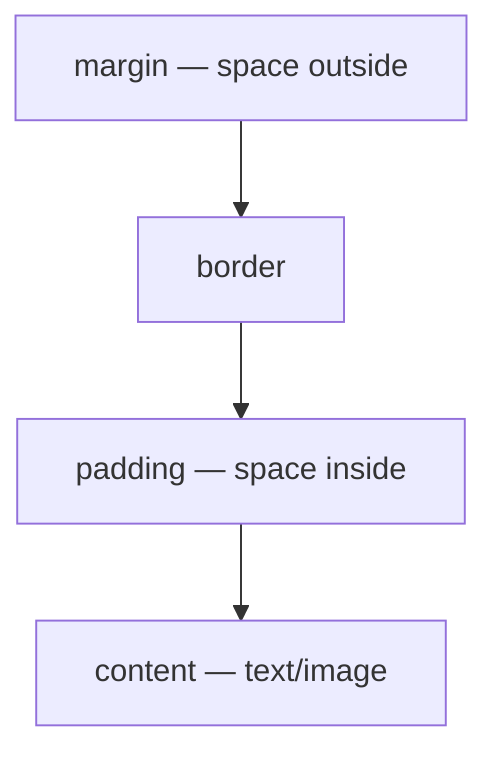

# Week 3: CSS Fundamentals

Lagos Spots has real structure now, but it looks like a plain document — every browser's default styling, nothing more. This week you give it real appearance: fonts, colors, spacing, and a naming system that keeps your CSS readable as the project grows. Layout (making things sit side-by-side or in a grid) is deliberately saved for next week — this week is entirely about styling individual elements correctly.

---

## Module 1: Adding CSS & Selectors

### 1. Three Ways to Add CSS

* **Lecture & Concepts:**
    1. **External (best practice):** one `.css` file linked from every HTML page. Keeps styling separate from structure, reusable everywhere.
    2. **Internal:** a `<style>` block inside one HTML file's `<head>`. Fine for a one-off prototype, but doesn't scale to a multi-page site.
    3. **Inline:** a `style="..."` attribute directly on a tag. Avoid this — it mixes concerns and can't be reused or overridden cleanly.
    * We use external CSS from day one, linked with `<link rel="stylesheet" href="styles.css">` in the `<head>`.

* **Class Exercise: Link Your Stylesheet**
    1. Create `styles.css` in the project root.
    2. Add `<link rel="stylesheet" href="styles.css">` to the `<head>` of both `index.html` and `submit.html`.
    3. In `styles.css`, write `body { background-color: #fafafa; }` and confirm the page background changes on refresh.

---

### 2. Selectors & Specificity

* **Lecture & Concepts:**
    * **Element selector:** `p { }` — targets every `<p>` on the page.
    * **Class selector:** `.spot-card { }` — targets every element with `class="spot-card"`.
    * **ID selector:** `#search { }` — targets the one element with that `id`.
    * **Descendant selector:** `.spot-card h3 { }` — targets an `<h3>` *inside* any `.spot-card`.
    * **Pseudo-classes:** `.spot-card:hover { }` — applies only while the user's cursor is over the element.
    * **Specificity** decides which rule wins when two rules target the same element: ID beats class, class beats element. When specificity ties, whichever rule is written *later* in the file wins. This is why component-specific classes (not IDs) are the default choice for styling — they're reusable and easy to override predictably.

* **In-Depth Example:**
    ```css
    /* Element selector — applies everywhere, use sparingly */
    p {
      line-height: 1.5;
    }

    /* Class selector — the workhorse of real CSS */
    .spot-card {
      background-color: white;
    }

    /* Descendant selector */
    .spot-card h3 {
      margin-top: 0;
    }

    /* Pseudo-class */
    .spot-card:hover {
      cursor: pointer;
    }
    ```

* **Class Exercise: Style by Class**
    1. Add a `.spot-card` rule setting a white background and some `padding`.
    2. Add a `.spot-card:hover` rule that changes the `background-color` slightly, so cards visibly react to the mouse.

---

## Module 2: The Box Model

### 1. Content, Padding, Border, Margin

* **Lecture & Concepts:**
    * Every HTML element is a rectangular box made of four layers, from the inside out: **content**, **padding** (space inside the border), **border**, and **margin** (space outside the border, between elements).
    * By default, `width`/`height` apply only to the *content* box — adding padding or a border makes the element visually bigger than the width you set. `box-sizing: border-box` fixes this by making `width` include padding and border, which is far more predictable and is what real projects set globally.



* **In-Depth Example:**
    ```css
    * {
      box-sizing: border-box;
    }

    .spot-card {
      padding: 16px;
      border: 1px solid #e0e0e0;
      margin-bottom: 16px;
    }
    ```

* **Class Exercise: Apply the Box Model**
    1. Add `* { box-sizing: border-box; }` at the very top of `styles.css` — this one rule will save you real confusion for the rest of the course.
    2. Give `.spot-card` real `padding`, a subtle `border`, and `margin-bottom` so cards don't touch each other.

---

### 2. `display`: Block vs. Inline vs. Inline-Block

* **Lecture & Concepts:**
    * `block` elements (like `<div>`, `<p>`, `<section>`) take the full available width and always start on a new line.
    * `inline` elements (like `<a>`, `<span>`) only take up as much width as their content, and sit in the flow of text — but `width`/`height`/vertical `margin` don't apply to them.
    * `inline-block` behaves like `inline` for flow, but *does* respect `width`/`height`/margin — useful for something like a category tag chip.

* **Class Exercise: Turn Tags Into Chips**
    1. Give `.spot-card__tags li` (from Week 2's tag list) `display: inline-block;` plus some `padding` and a `border-radius`, so tags look like small pill-shaped chips instead of a vertical bullet list.

---

## Module 3: Typography, Color & Basic Interactivity

### 1. Fonts, Color & Backgrounds

* **Lecture & Concepts:**
    * `font-family` is a **stack** — a comma-separated fallback list, since not every visitor has every font installed: `font-family: "Inter", Arial, sans-serif;`.
    * `color` sets text color; `background-color` sets an element's fill. Both accept named colors (`white`), hex (`#1a1a1a`), or `rgb()`/`hsl()` functions.
    * `line-height` (usually a unitless number like `1.5`) controls the vertical space between lines of text — the single biggest lever for readability.

* **In-Depth Example (Lagos Spots' real typography):**
    ```css
    body {
      font-family: "Inter", Arial, sans-serif;
      color: #1a1a1a;
      line-height: 1.5;
    }

    .spot-card__title {
      font-size: 1.25rem;
      font-weight: 600;
    }

    .spot-card__description {
      color: #555;
      font-size: 0.95rem;
    }
    ```

* **Class Exercise: Style the Real Content**
    1. Set a real `font-family` stack on `body`.
    2. Style `.spot-card__title` and `.spot-card__description` with distinct sizes/weights so the hierarchy is visually obvious even before any layout work.

---

### 2. Transitions

* **Lecture & Concepts:**
    * `transition` animates a property change smoothly instead of snapping instantly — commonly paired with `:hover`.
    * Syntax: `transition: <property> <duration> <easing>;` — e.g. `transition: background-color 0.2s ease;`.

* **Class Exercise: Smooth the Hover Effect**
    1. Add `transition: transform 0.15s ease, box-shadow 0.15s ease;` to `.spot-card`.
    2. On `.spot-card:hover`, add `transform: translateY(-2px);` and a subtle `box-shadow` — the card should now lift smoothly on hover instead of jumping.

---

## Module 4: BEM & Organizing Real CSS

### 1. The BEM Naming Convention

* **Lecture & Concepts:**
    * **BEM** stands for **Block, Element, Modifier** — a naming convention that keeps class names self-explanatory and avoids specificity fights.
        * **Block:** a standalone component — `spot-card`.
        * **Element:** a part of that block, joined with `__` — `spot-card__title`.
        * **Modifier:** a variant of a block or element, joined with `--` — `spot-card--featured`.
    * The payoff: reading a class name alone tells you exactly what it is and where it belongs, without needing to check the HTML.

* **In-Depth Example:**
    ```css
    .spot-card { }
    .spot-card__title { }
    .spot-card__description { }
    .spot-card--featured {
      border-color: #f5a623;
    }
    ```
    ```html
    <article class="spot-card spot-card--featured">
      <h3 class="spot-card__title">Terra Kulture</h3>
    </article>
    ```

* **Class Exercise: Rename Everything to BEM**
    1. Audit every class name in your HTML and CSS; rename anything that doesn't follow `block`, `block__element`, or `block--modifier`.
    2. Add a `.spot-card--featured` modifier and apply it to one real spot card.

---

### 2. Splitting Into Multiple Files

* **Lecture & Concepts:**
    * As a stylesheet grows, one giant file becomes hard to navigate. A common split: `base.css` (resets, `body`, typography defaults) and `components.css` (`.spot-card`, `.form-field`, etc.), both linked in `<head>` in that order.

* **Class Exercise: Split the Stylesheet**
    1. Create `base.css` (the `*` reset, `body` styles) and `components.css` (everything else).
    2. Link both, `base.css` first, in every HTML page's `<head>`.
    3. Delete the now-empty `styles.css`.

---

### Week 3: Comprehensive Assignment

**Objective:** Fully style Lagos Spots' existing HTML — no layout system yet, purely box model, typography, and BEM organization.

**Requirements:**

1. **Reset & Box Model:** A global `box-sizing: border-box` reset; every `.spot-card` has clear padding, a border, and spacing between cards.
2. **Typography:** A real font stack on `body`; distinct, deliberate sizing for the title vs. description text.
3. **Interactivity:** A smooth `:hover` transition on `.spot-card`.
4. **BEM:** Every class name in the project follows Block / Block\_\_Element / Block--Modifier, with at least one real modifier in use.
5. **Organization:** CSS split into `base.css` and `components.css`, both linked from every page.
6. **Git:** Committed and pushed via the branch → PR → merge workflow.

**Bonus Challenge:** Style the "Add a Spot" form's `.form-field` groups and the submit button so the form is legible and pleasant to use, even without a layout system yet — you'll only need small box-model and typography tweaks to make a real difference.
