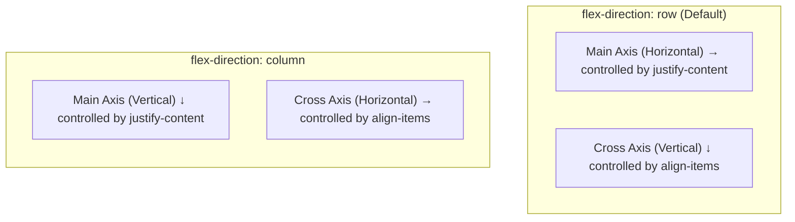
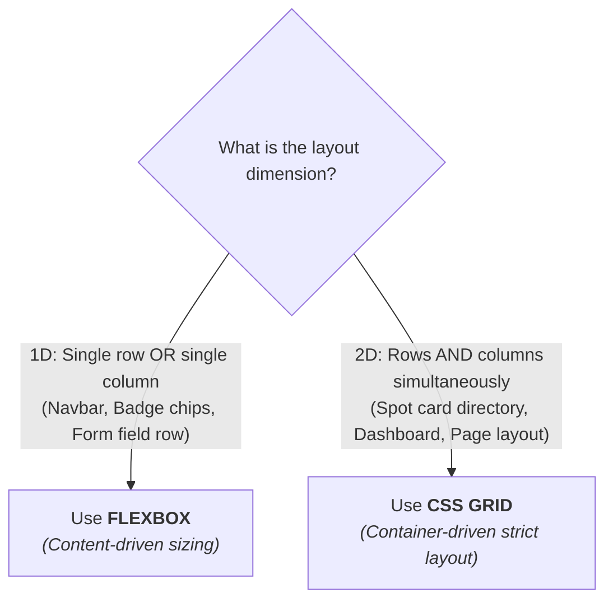
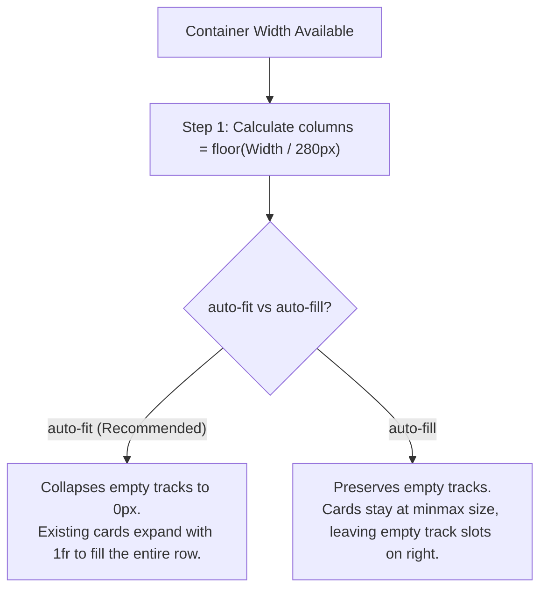
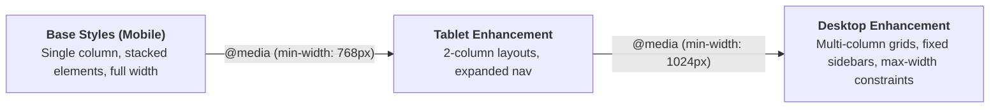

# Week 4: CSS Layout — Flexbox & Grid

In Week 3, you styled individual components in isolation. However, every element still stacks vertically in the browser's default document flow. This week, you take complete control of **multi-dimensional layout**: building a flexible navigation bar, aligning components precisely within cards using **Flexbox (1D Layout)**, creating an auto-responsive directory grid with **CSS Grid (2D Layout)**, and orchestrating responsive breakpoints with a **Mobile-First** architecture.

---

## Module 1: Flexbox — One-Dimensional Layout

### 1. The Core Terminology of Flexbox

| Term | What It Actually Means | Technical Context |
| :--- | :--- | :--- |
| **Flex Container** | The parent element with `display: flex` or `display: inline-flex`. | Establishes a new **Flex Formatting Context** for all direct children. |
| **Flex Items** | The direct child elements inside a flex container. | Their geometry is calculated according to the Flexbox algorithm. |
| **Main Axis** | The primary direction along which flex items are laid out. | Set by `flex-direction`: `row` (horizontal, default) or `column` (vertical). |
| **Cross Axis** | The axis perpendicular to the main axis. | If main axis is horizontal (`row`), cross axis is vertical (`column`), and vice-versa. |
| **`justify-content`** | Distributes items along the **Main Axis**. | Values: `flex-start`, `center`, `flex-end`, `space-between`, `space-around`, `space-evenly`. |
| **`align-items`** | Aligns items along the **Cross Axis**. | Values: `stretch` (default), `center`, `flex-start`, `flex-end`, `baseline`. |
| **`gap`** | Native spacing between flex items. | Replaces fragile `margin` hacks on child elements. |

---

### 2. Under the Hood: The Main Axis vs. Cross Axis System



> [!IMPORTANT]
> When you change `flex-direction` from `row` to `column`, **the axes flip!** `justify-content` now controls vertical spacing, and `align-items` controls horizontal alignment.

---

### 3. Under the Hood: Flex Item Sizing Mathematics

Every flex item has three properties controlling its size:
$$\text{flex shorthand: } \mathbf{flex: <grow> <shrink> <basis>;}$$

1. **`flex-basis`:** The initial size of the item before remaining space is distributed (e.g., `200px`, `20%`, or `auto`).
2. **`flex-grow`:** Defines how much of the **positive remaining free space** in the container the item will absorb.
   - If container has $600\text{px}$ width and two items have `flex-basis: 200px`, remaining space is $600 - 400 = 200\text{px}$.
   - If item A has `flex-grow: 1` and item B has `flex-grow: 3`, total grow weight is $4$. Item A gets $\frac{1}{4} \times 200 = 50\text{px}$ (total $250\text{px}$); Item B gets $\frac{3}{4} \times 200 = 150\text{px}$ (total $350\text{px}$).
3. **`flex-shrink`:** Defines how much an item will shrink when the total size of all items **exceeds** container size (negative free space).

#### Common Flex Shorthands:
- `flex: 0 1 auto;` (Default): Does not grow, shrinks if necessary, initial size based on content.
- `flex: 1 1 0;` or `flex: 1;`: Grows and shrinks equally from a 0px baseline (creates perfectly equal-width columns regardless of content length).
- `flex: 0 0 250px;`: Fixed-width sidebar (never grows, never shrinks).

* **In-Depth Example: The Lagos Spots Navigation Bar**
    ```css
    /* Header Flex Container */
    .header {
      display: flex;
      justify-content: space-between; /* Brand left, nav links right */
      align-items: center;            /* Perfectly centered vertically */
      padding: 1rem 2rem;
      background-color: #ffffff;
      border-bottom: 1px solid #e2e8f0;
    }

    /* Navigation Flex Container */
    .nav__list {
      display: flex;
      align-items: center;
      gap: 1.5rem;                   /* 24px clean gap between links */
      list-style: none;
    }
    ```

---

## Module 2: CSS Grid — Two-Dimensional Layout

### 1. The Core Terminology of CSS Grid

| Term | What It Actually Means | Technical Context |
| :--- | :--- | :--- |
| **Grid Container** | Element with `display: grid`. | Establishes a 2D coordinate grid formatting context. |
| **Grid Track** | The space between two adjacent grid lines (a row or a column). | Defined by `grid-template-columns` and `grid-template-rows`. |
| **Fractional Unit (`fr`)** | Represents a fraction of the available free space in the grid container. | `1fr 2fr` divides available space into $\frac{1}{3}$ and $\frac{2}{3}$. |
| **`repeat()` Function** | Shorthand notation for repeating tracks. | `repeat(3, 1fr)` equals `1fr 1fr 1fr`. |
| **`minmax(min, max)`** | Sets a size range for a track. | `minmax(250px, 1fr)` means "at least 250px wide, but grow to fill available space." |
| **`auto-fit` vs `auto-fill`** | Auto-placement keywords that calculate track count dynamically. | Enables zero-media-query responsive card grids. |

---

### 2. Flexbox vs. CSS Grid: Architectural Decision Matrix



---

### 3. Under the Hood: The Auto-Responsive Grid Algorithm

The industry-standard formula for responsive card grids without writing media queries is:
```css
#spots-list {
  display: grid;
  grid-template-columns: repeat(auto-fit, minmax(280px, 1fr));
  gap: 1.5rem;
}
```



#### How the Browser Calculates This:
1. **On a Mobile Screen ($375\text{px}$):**
   - $375\text{px}$ can only fit one $280\text{px}$ column.
   - Result: 1 column stretching to fill the full width ($1\text{fr} = 375\text{px}$).
2. **On a Tablet Screen ($768\text{px}$):**
   - $768\text{px}$ can comfortably fit two $280\text{px}$ columns plus gap ($280 \times 2 + 24 = 584\text{px} \le 768\text{px}$).
   - Result: 2 equal-width columns sharing available space.
3. **On a Desktop Screen ($1200\text{px}$):**
   - Fits four columns automatically ($280 \times 4 + \text{gaps} \le 1200\text{px}$).
   - Result: 4 equal columns.

---

## Module 3: Responsive Web Design & Mobile-First Architecture

### 1. What is Mobile-First Design?

**Mobile-First** is an architectural strategy where:
1. **Base styles** (outside any media query) are written for the smallest screens (mobile viewport).
2. **`@media (min-width: ...)`** media queries are introduced progressively to enhance the layout as screen real estate increases.



#### Why Mobile-First Beats Desktop-First:
- **Performance:** Mobile devices process less overriding CSS.
- **Simplicity:** Adding rules with `min-width` is additive and clean; overriding complex desktop grids with `max-width` causes bloated CSS.

---

### 2. Standard Responsive Breakpoints

| Breakpoint Name | Target Devices | CSS Media Query | Typical Layout Strategy |
| :--- | :--- | :--- | :--- |
| **Base (Mobile)** | Phones ($320\text{px}$ – $767\text{px}$) | *(No query / Default)* | Stacked vertical flow, hamburger menu, $100\%$ width cards. |
| **Medium (`md`)** | Tablets ($768\text{px}$ – $1023\text{px}$) | `@media (min-width: 768px)` | Horizontal navigation, 2-column forms/cards. |
| **Large (`lg`)** | Laptops / Desktops ($\ge 1024\text{px}$) | `@media (min-width: 1024px)` | Max-width content wrapper, multi-column directory grid. |

---

### 3. Concrete Implementation: Lagos Spots Complete Layout

```css
/* ==========================================================================
   Page Layout & Wrapper Constraints
   ========================================================================== */
.page-container {
  width: 100%;
  max-width: 1200px; /* Prevents line lengths from stretching on ultrawide monitors */
  margin: 0 auto;    /* Centers container horizontally */
  padding: 0 1.25rem;
}

/* ==========================================================================
   Responsive Header (Mobile-First)
   ========================================================================== */
.header {
  display: flex;
  flex-direction: column; /* Stack logo and nav vertically on mobile */
  gap: 1rem;
  padding: 1rem 0;
  border-bottom: 1px solid #e2e8f0;
}

.nav__list {
  display: flex;
  gap: 1rem;
  list-style: none;
}

/* Tablet & Desktop Header Enhancement */
@media (min-width: 768px) {
  .header {
    flex-direction: row;      /* Switch to single row */
    justify-content: space-between;
    align-items: center;
  }
}

/* ==========================================================================
   Spots Directory Grid
   ========================================================================== */
.spots-grid {
  display: grid;
  grid-template-columns: repeat(auto-fit, minmax(280px, 1fr));
  gap: 1.5rem;
  margin-top: 2rem;
}

/* ==========================================================================
   Internal Card Flexbox Alignment
   ========================================================================== */
.spot-card {
  display: flex;
  flex-direction: column; /* Allows footer/button to pin to bottom */
  height: 100%;
  background: #ffffff;
  border: 1px solid #e2e8f0;
  border-radius: 8px;
  padding: 1.25rem;
}

.spot-card__header {
  display: flex;
  justify-content: space-between;
  align-items: flex-start;
  gap: 0.5rem;
  margin-bottom: 0.75rem;
}

.spot-card__description {
  flex-grow: 1; /* Pushes the card link/action to the very bottom */
  margin-bottom: 1rem;
}
```

---

### 4. Common Pitfalls & How to Avoid Them

| Pitfall | Cause | Fix |
| :--- | :--- | :--- |
| **Flex child text overflowing** | Default `min-width: auto` on flex items prevents text truncation from working. | Add `min-width: 0;` to the flex child element. |
| **Horizontal page scrolling on mobile** | Fixed pixel widths (e.g., `width: 500px`) overflowing mobile viewports. | Use fluid widths (`width: 100%`, `max-width: 500px`). |
| **Desktop-first media query tangle** | Using `@media (max-width: ...)` creates messy specificity overrides. | Refactor to mobile-first using only `@media (min-width: ...)`. |
| **Using Flexbox for 2D grids** | Relying on `flex-wrap` and manual percentage widths (`width: 33.33%`) leads to uneven trailing items. | Use CSS Grid with `repeat(auto-fit, minmax(..., 1fr))`. |

---

### Week 4: Comprehensive Assignment

**Objective:** Transform Lagos Spots into a fully responsive, multi-page application utilizing Flexbox for 1D component alignment, CSS Grid for the directory listing, and Mobile-First responsive media queries.

**Requirements:**
1. **Navigation & Header:**
   - Mobile: Logo and navigation stacked vertically with clean spacing.
   - Tablet/Desktop (`min-width: 768px`): Header switches to a horizontal flex row with space-between distribution.
2. **Spots Directory Grid:**
   - `#spots-list` rendered as a responsive CSS Grid using `repeat(auto-fit, minmax(280px, 1fr))`.
   - Grid items align cleanly and stretch equally across all screen sizes without horizontal scrolling.
3. **Internal Card Flex Layout:**
   - Card headers align place titles and category badges on a single flex row.
   - Card description uses `flex-grow: 1` inside a column flexbox to ensure all card buttons/links align consistently at the bottom of cards in the same row.
4. **Form Grid (`submit.html`):**
   - Form fields laid out in a 2-column CSS grid on tablet/desktop, gracefully collapsing to a single column on mobile viewports.
5. **Layout Constraints:**
   - Entire application wrapped in a `.page-container` with a `max-width: 1200px` centered on the viewport (`margin: 0 auto`).
6. **Git Workflow:**
   - Developed on branch `feature/responsive-flex-grid`, merged via Pull Request, and pulled locally.

---

## Recommended References & Deep-Dive Resources

### Official Documentation & Standards
- [MDN Web Docs: CSS Flexible Box Layout](https://developer.mozilla.org/en-US/docs/Web/CSS/CSS_Flexible_Box_Layout) — In-depth guide to Flexbox axes, alignment, and space distribution algorithms.
- [MDN Web Docs: CSS Grid Layout](https://developer.mozilla.org/en-US/docs/Web/CSS/CSS_Grid_Layout) — Complete technical specification of two-dimensional grid tracks, areas, and auto-placement.
- [W3C CSS Grid Layout Module Level 2](https://www.w3.org/TR/css-grid-2/) — Official W3C standard defining subgrid and implicit track algorithms.

### Recommended Textbooks & Canonical Books
- **CSS Grid Layout: Ready to Use Solutions for Web Designers** by Rachel Andrew (A Book Apart) — *Practical, pattern-driven guide to designing responsive layouts with CSS Grid.*
- **Responsive Web Design (2nd Edition)** by Ethan Marcotte (A Book Apart) — *The foundational textbook that introduced the concepts of fluid grids, flexible images, and media queries.*
- **Layout Land & Modern Layouts** by Jen Simmons — *Visual and structural walkthroughs of intrinsic web design.*

### Interactive Learning Games & Cheatsheets
- [CSS-Tricks: A Complete Guide to Flexbox](https://css-tricks.com/snippets/css/a-guide-to-flexbox/) — The industry's most referenced visual Flexbox cheatsheet.
- [CSS-Tricks: A Complete Guide to CSS Grid](https://css-tricks.com/snippets/css/complete-guide-grid/) — The industry's most referenced visual CSS Grid cheatsheet.
- [Flexbox Froggy](https://flexboxfroggy.com/) & [Grid Garden](https://cssgridgarden.com/) — Interactive puzzle games for mastering layout properties.
