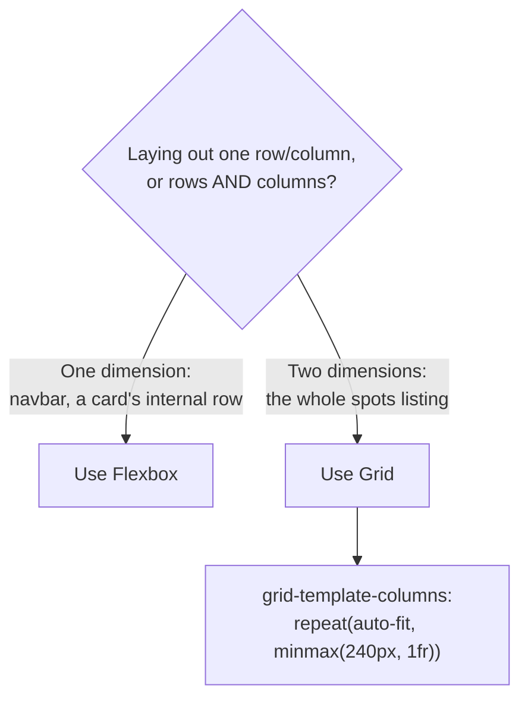

# Week 4: CSS Layout — Flexbox & Grid

Every element in Lagos Spots currently stacks straight down the page, one under the next — the browser's default. This week you take control of layout: a real navbar, a card whose internal pieces sit exactly where you want, and a responsive grid of spot cards that rearranges itself across screen sizes without a single extra line of JavaScript.

---

## Module 1: Flexbox — One-Dimensional Layout

### 1. The Flex Container

* **Lecture & Concepts:**
    * Flexbox lays out children of a container along a **single axis** — a row or a column. Turn any element into a flex container with `display: flex;`.
    * Key container properties:
        * `flex-direction`: `row` (default) or `column`.
        * `justify-content`: alignment along the **main axis** (`flex-start`, `center`, `space-between`, `space-around`).
        * `align-items`: alignment along the **cross axis** (`stretch` default, `center`, `flex-start`, `flex-end`).
        * `gap`: consistent spacing between children — no more margin-hacking.

* **In-Depth Example (The Real Navbar):**
    ```css
    header {
      display: flex;
      justify-content: space-between;
      align-items: center;
      padding: 16px 24px;
    }

    header nav ul {
      display: flex;
      gap: 20px;
      list-style: none;
    }
    ```

* **Class Exercise: Lay Out the Header**
    1. Make `header` a flex container with `justify-content: space-between` (logo on the left, nav on the right) and `align-items: center` (vertically centered).
    2. Make the `nav ul` a flex row with `gap` between links, and remove its default bullet points with `list-style: none`.

---

### 2. Flex Items Inside a Card

* **Lecture & Concepts:**
    * Flexbox is just as useful *inside* a component as it is for page-level layout. A spot card's title and category chip sitting on the same row, with the chip pushed to the right, is a one-line flex rule — no floats, no absolute positioning.

* **In-Depth Example:**
    ```css
    .spot-card__header {
      display: flex;
      justify-content: space-between;
      align-items: flex-start;
      gap: 8px;
    }
    ```
    ```html
    <div class="spot-card__header">
      <h3 class="spot-card__title">Terra Kulture</h3>
      <span class="spot-card__badge">Art</span>
    </div>
    ```

* **Class Exercise: Flex Inside the Card**
    1. Wrap each card's title and its first category tag in a `<div class="spot-card__header">`.
    2. Apply the flex rule above so the tag sits flush right against the title.

---

## Module 2: CSS Grid — Two-Dimensional Layout

### 1. Grid Fundamentals

* **Lecture & Concepts:**
    * Where Flexbox handles one dimension well, **Grid** is built for two — rows *and* columns at once, which is exactly the shape of a card listing.
    * `display: grid;` turns an element into a grid container. `grid-template-columns` defines the column tracks. `gap` spaces both rows and columns consistently.
    * The real power move for a responsive card grid, with zero media queries: `grid-template-columns: repeat(auto-fit, minmax(240px, 1fr));`. This tells the browser: "fit as many 240px-minimum columns as will comfortably fit, and stretch them evenly to fill the row."



* **In-Depth Example (The Real Spots Grid):**
    ```css
    #spots-list {
      display: grid;
      grid-template-columns: repeat(auto-fit, minmax(240px, 1fr));
      gap: 20px;
    }
    ```

* **Class Exercise: Grid the Spots List**
    1. Apply the grid rule above to `#spots-list`.
    2. Resize your browser window and watch the number of columns change automatically — no media query written yet.

---

### 2. When Grid Alone Isn't Enough

* **Lecture & Concepts:**
    * `grid-template-areas` lets you name regions of a layout and place elements into them by name — most useful for full-page layouts (header/sidebar/main/footer) rather than repeating cards, so we won't force it onto the spots grid. Know the name; you'll reach for it on a future page layout that genuinely needs named regions.

---

## Module 3: Responsive Design

### 1. Media Queries & Mobile-First

* **Lecture & Concepts:**
    * A **media query** applies CSS conditionally, based on screen characteristics: `@media (min-width: 768px) { ... }` applies only when the viewport is at least 768px wide.
    * **Mobile-first** means writing your *default* (unqualified) CSS for the smallest screen, then using `min-width` media queries to add complexity as the screen grows — rather than the reverse. It's less CSS overall, and it matches how most real traffic arrives (phones first).

* **In-Depth Example:**
    ```css
    /* Mobile default: search bar and nav stack vertically */
    header {
      flex-direction: column;
      align-items: flex-start;
      gap: 12px;
    }

    /* From tablet width up: back to a horizontal row */
    @media (min-width: 768px) {
      header {
        flex-direction: row;
        align-items: center;
      }
    }
    ```

* **Class Exercise: Make the Header Responsive**
    1. Set `header`'s *default* (mobile) layout to a vertical flex column.
    2. Add a `min-width: 768px` media query switching it back to a horizontal row.
    3. Test both states using DevTools' device toolbar (`Cmd/Ctrl+Shift+M`).

---

### 2. Testing Across Real Breakpoints

* **Lecture & Concepts:**
    * Three breakpoints cover the vast majority of real devices: **mobile** (< 768px, default styles), **tablet** (≥ 768px), and **desktop** (≥ 1200px, often just wider max-widths and more grid columns rather than a full relayout).
    * `max-width` on a page's main content wrapper (e.g., `1100px`, centered with `margin: 0 auto`) keeps text lines from becoming absurdly wide on large monitors — a detail that's easy to forget once flex/grid make everything "just work" on medium screens.

* **Class Exercise: Full Responsive Pass**
    1. Add a `.page-wrapper` around `<main>`'s content with `max-width: 1100px; margin: 0 auto;`.
    2. Add a `min-width: 1200px` media query bumping the spots grid's `minmax()` first value up slightly, so cards don't stretch too wide on large screens.
    3. Test the whole page at mobile, tablet, and desktop widths in DevTools.

---

### Week 4: Comprehensive Assignment

**Objective:** A fully laid-out, responsive Lagos Spots homepage using Flexbox for one-dimensional layout and Grid for the spots listing.

**Requirements:**

1. **Flexbox:** The header (logo + nav) and each card's internal title/badge row both use Flexbox correctly.
2. **Grid:** `#spots-list` is a responsive grid using `auto-fit`/`minmax`, requiring zero manual breakpoint columns.
3. **Responsive:** A mobile-first media query strategy with at least one real breakpoint change (e.g., the header's `flex-direction`).
4. **Content Width:** A `.page-wrapper` with a sensible `max-width`, centered on the page.
5. **Verification:** Confirm the page looks correct at three real widths (mobile, tablet, desktop) using DevTools.
6. **Git:** Committed and pushed via the branch → PR → merge workflow.

**Bonus Challenge:** Lay out the "Add a Spot" form's fields as a two-column grid on tablet/desktop widths (`grid-template-columns: 1fr 1fr` inside a `min-width` media query), collapsing back to a single column on mobile.
