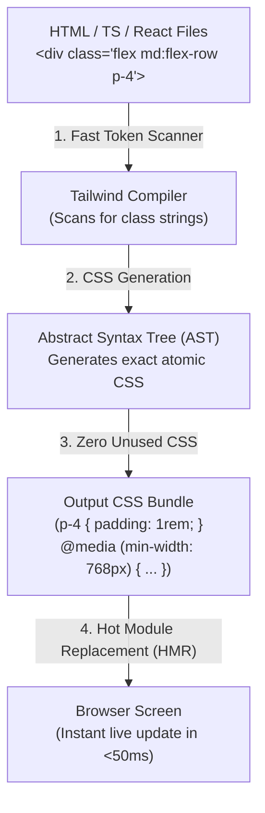
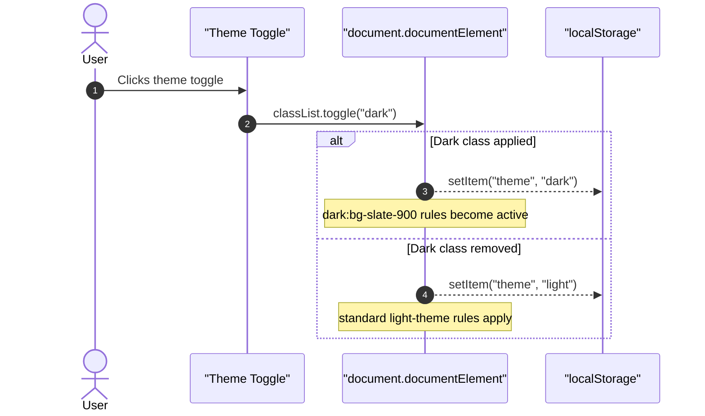

# Week 5: Tailwind CSS & Modern CSS Workflow

Having mastered the CSS Box Model, Specificity, Flexbox, and Grid by writing raw CSS, you now understand the underlying mechanisms that govern styling in web browsers. In this week, you transition to the industry-standard workflow used in modern full-stack development: **Tailwind CSS**, a utility-first CSS engine, powered by **Vite**, a blazing-fast modern build tool and dev server.

---

## Module 1: Utility-First CSS & Modern Build Tooling

### 1. The Core Terminology of Modern CSS Workflows

| Term | What It Actually Means | Technical Context |
| :--- | :--- | :--- |
| **Utility-First CSS** | Composing small, single-purpose utility classes (`flex`, `p-4`, `text-center`, `rounded-lg`) directly in HTML markup rather than writing custom semantic CSS classes (`.spot-card`). | Eliminates the need to invent arbitrary class names and prevents bloated, ever-growing stylesheets. |
| **Build Tool / Bundler (Vite)** | A developer tool that provides a rapid local development server (using native browser ES Modules) and bundles assets into optimized production code. | Replaces manual file opening with automated compilation, Hot Module Replacement (HMR), and minification. |
| **Just-In-Time (JIT) Engine** | Tailwind's on-demand compiler that scans your template files for class names and generates *only the exact CSS rules you actually use*. | Results in ultra-lightweight production stylesheets (typically under $10\text{KB}$ gzipped), regardless of project size. |
| **Variants / Modifiers** | Prefixes added to utility classes to apply styles conditionally: responsive (`md:`), state-based (`hover:`, `focus:`), or theme-based (`dark:`). | Compiles into standard CSS media queries or pseudo-class selectors. |
| **Design Tokens** | Standardized, named design variables (colors, spacing scale, border radius, font sizes) defined in your theme configuration. | Enforces consistent design language across an engineering team. |

---

### 2. Under the Hood: How Tailwind CSS & Vite Work Together

When developing a modern web application, Vite and the Tailwind v4 compiler execute an automated pipeline:



1. **Native ES Module Dev Server:** When you run `npm run dev`, Vite starts a local HTTP server (`http://localhost:5173`). Unlike legacy bundlers (like Webpack) that bundle the entire application before serving, Vite serves files on-demand over native browser ES imports, achieving instant startup.
2. **Static Source Scanning:** As you edit code, the Tailwind scanner tokenizes every word in your HTML/TS files.
3. **Atomic CSS Output:** Tailwind generates the exact matching CSS rule in memory and injects it via **Hot Module Replacement (HMR)** into the running browser in under $50\text{ms}$ without reloading the page.
4. **Production Tree-Shaking:** During `npm run build`, Tailwind ensures zero unused classes make it into the final `dist/` bundle.

---

### 3. Setting Up Vite & Tailwind CSS v4

```bash
# 1. Scaffold a fresh Vite project with TypeScript support
npm create vite@latest lagos-spots-web -- --template vanilla-ts

# 2. Enter project directory and install dependencies
cd lagos-spots-web
npm install

# 3. Install Tailwind CSS v4 and its official Vite plugin
npm install tailwindcss @tailwindcss/vite
```

#### Configuring `vite.config.ts`:
```ts
import { defineConfig } from 'vite';
import tailwindcss from '@tailwindcss/vite';

export default defineConfig({
  plugins: [
    tailwindcss(),
  ],
});
```

#### Configuring the Entry Stylesheet (`src/style.css`):
In Tailwind v4, setup requires a single CSS entry import:
```css
@import "tailwindcss";

/* Define Custom Design Tokens via @theme */
@theme {
  --color-brand-primary: #ea580c; /* Orange-600 */
  --color-brand-secondary: #0f172a; /* Slate-900 */
  
  --color-category-food: #f59e0b;
  --color-category-study: #3b82f6;
  --color-category-nightlife: #8b5cf6;
  --color-category-events: #10b981;
}
```

---

## Module 2: Core Utility Mastery

### 1. Spacing, Typography & Layout Scale

Tailwind uses a numeric scale where **$1\text{ unit} = 0.25\text{rem} = 4\text{px}$**:

| Utility | CSS Property Output | Rendered Value |
| :--- | :--- | :--- |
| `p-2` / `m-2` | `padding: 0.5rem;` / `margin: 0.5rem;` | $8\text{px}$ |
| `p-4` / `m-4` | `padding: 1rem;` / `margin: 1rem;` | $16\text{px}$ (1 base REM) |
| `p-6` / `m-6` | `padding: 1.5rem;` / `margin: 1.5rem;` | $24\text{px}$ |
| `p-8` / `m-8` | `padding: 2rem;` / `margin: 2rem;` | $32\text{px}$ |
| `gap-4` | `gap: 1rem;` | $16\text{px}$ (Flex / Grid gap) |
| `text-sm` / `text-lg` | `font-size: 0.875rem;` / `font-size: 1.125rem;` | $14\text{px}$ / $18\text{px}$ |
| `rounded-lg` / `rounded-full` | `border-radius: 0.5rem;` / `border-radius: 9999px;` | $8\text{px}$ / Pill shape |

---

### 2. Under the Hood: How Responsive Prefixes Compile

Tailwind is **mobile-first** by default. Unprefixed utilities apply to all screen sizes. Prefixed utilities (`sm:`, `md:`, `lg:`, `xl:`) apply from that breakpoint upward:

| Tailwind Class | Breakpoint Query Generated Under the Hood |
| :--- | :--- |
| `flex-col md:flex-row` | ```css<br>.flex-col { flex-direction: column; }<br>@media (min-width: 768px) {<br>  .md\:flex-row { flex-direction: row; }<br>}<br>``` |
| `w-full md:w-1/2 lg:w-1/3` | Mobile: $100\%$ width $\to$ Tablet: $50\%$ width $\to$ Desktop: $33.33\%$ width |

---

### 3. Rebuilding the Lagos Spots Card in Tailwind

```html
<article class="flex flex-col bg-white border border-slate-200 rounded-xl p-5 shadow-sm hover:shadow-md hover:-translate-y-1 transition-all duration-200">
  <!-- Card Header -->
  <div class="flex justify-between items-start gap-3 mb-3">
    <h3 class="text-xl font-bold text-slate-900">Terra Kulture</h3>
    <span class="inline-block text-xs font-semibold px-2.5 py-1 rounded-full bg-amber-100 text-amber-800">
      Food & Culture
    </span>
  </div>

  <!-- Image -->
  

  <!-- Description -->
  <p class="text-sm text-slate-600 flex-grow mb-4">
    A renowned cultural center featuring authentic Nigerian delicacies, an art gallery, and live theatrical performances in Victoria Island.
  </p>

  <!-- Card Action -->
  <a 
    href="https://maps.google.com" 
    target="_blank" 
    rel="noopener noreferrer" 
    class="inline-flex justify-center items-center px-4 py-2 text-sm font-medium text-white bg-orange-600 hover:bg-orange-700 rounded-lg transition-colors"
  >
    View on Google Maps &rarr;
  </a>
</article>
```

---

## Module 3: Dark Mode & Dynamic Theming

### 1. Under the Hood: Dark Mode Strategy

Tailwind enables dark mode styling via the **`dark:` variant modifier**.



#### How the CSS Rule Compiles:
When `class="dark"` is added to `<html>`:
- `class="bg-white dark:bg-slate-900"` compiles to:
  ```css
  .bg-white { background-color: rgb(255 255 255); }
  .dark .dark\:bg-slate-900 { background-color: rgb(15 23 42); }
  ```

---

### 2. Preventing Flash of Unstyled Theme (FOUT)

If a user prefers dark mode, reading `localStorage` inside a deferred script or after the page renders causes a jarring white flash (**FOUT**).

To prevent this, place a synchronous inline script inside the `<head>` before the browser renders the `<body>`:

```html
<!-- index.html <head> -->
<script>
  // Prevent Flash of Unstyled Theme (FOUT)
  if (
    localStorage.getItem('theme') === 'dark' ||
    (!('theme' in localStorage) && window.matchMedia('(prefers-color-scheme: dark)').matches)
  ) {
    document.documentElement.classList.add('dark');
  } else {
    document.documentElement.classList.remove('dark');
  }
</script>
```

#### Wiring the Toggle Button in TypeScript (`src/main.ts`):
```ts
const themeToggleBtn = document.getElementById('theme-toggle');

themeToggleBtn?.addEventListener('click', () => {
  const isDark = document.documentElement.classList.toggle('dark');
  localStorage.setItem('theme', isDark ? 'dark' : 'light');
});
```

---

### 3. Common Pitfalls & How to Avoid Them

| Pitfall | Why It Fails | The Correct Solution |
| :--- | :--- | :--- |
| **Dynamic class interpolation**<br>`class={`bg-${color}-500`}` | Tailwind scans source files with static regex *at build time*. It cannot execute JavaScript variables at runtime. | Use complete, unbroken class names or a lookup object map:<br>`const colorMap = { food: 'bg-amber-500', study: 'bg-blue-500' };`<br>`class={colorMap[category]}` |
| **Overusing `@apply`** | Recreating `.card { @apply p-4 bg-white; }` defeats the purpose of utility-first CSS and resurrects specificity conflicts. | Use utility classes directly in markup. Reusable components belong in component frameworks (React in Week 11). |
| **Missing root container constraints** | Omitting `max-w` containers causes layouts to stretch endlessly on wide displays. | Use `max-w-7xl mx-auto px-4 sm:px-6 lg:px-8`. |

---

### Week 5: Comprehensive Assignment

**Objective:** Migrate the entire Lagos Spots application to a modern Vite + Tailwind CSS v4 environment, featuring a responsive navigation bar, themed category badges, a responsive card grid, and a persistent dark mode toggle.

**Requirements:**
1. **Tooling & Setup:**
   - Scaffolded with `npm create vite@latest` (Vanilla TypeScript).
   - Configured with `@tailwindcss/vite` plugin in `vite.config.ts`.
   - Custom `@theme` tokens defined in `src/style.css`.
2. **Complete Component Migration:**
   - **Header:** Responsive flex layout (`flex-col md:flex-row md:justify-between`).
   - **Spot Cards:** Rebuilt with Tailwind utilities (`border`, `rounded-xl`, `shadow-sm`, `hover:shadow-md`, `transition`).
   - **Category Badges:** Themed with custom category colors (`bg-opacity` backgrounds and matching text colors).
   - **Grid:** `#spots-list` styled with `grid grid-cols-1 md:grid-cols-2 lg:grid-cols-3 gap-6`.
   - **Form (`submit.html`):** Restyled with Tailwind form inputs (`rounded-lg`, `border-slate-300`, `focus:ring-2 focus:ring-orange-500`).
3. **Dark Mode Implementation:**
   - Theme toggle button in header.
   - Zero-FOUT inline script in `<head>`.
   - Full dark mode styling (`dark:bg-slate-900`, `dark:text-white`, `dark:border-slate-800`, `dark:bg-slate-800`).
   - Theme preference persisted in `localStorage`.
4. **Git Workflow:**
   - Developed on branch `feature/tailwind-migration`, merged via Pull Request, and pulled locally.

---

## Recommended References & Deep-Dive Resources

### Official Documentation & Standards
- [Tailwind CSS v4 Documentation](https://tailwindcss.com/docs) — Official guide for utility-first styling, CSS theme variables, and JIT compilation.
- [Vite Official Guide](https://vite.dev/guide/) — Next-generation frontend tooling and native ES module development server documentation.
- [MDN Web Docs: prefers-color-scheme](https://developer.mozilla.org/en-US/docs/Web/CSS/@media/prefers-color-scheme) — Standards guide for detecting operating system light/dark mode preferences.

### Recommended Textbooks & Canonical Books
- **Refactoring UI** by Adam Wathan and Steve Schoger — *The definitive design guide for developers: practical heuristics for layout, hierarchy, spacing, and color theory.*
- **Modern CSS: Master the Key Concepts of CSS for Modern Web Development** by Alex Libby (Apress) — *Explores modern build tools, PostCSS pipelines, and utility-first architecture.*

### Deep Dives & Optimization Articles
- [web.dev: Building a Theme Switch Component](https://web.dev/building-a-theme-switch-component/) — Zero-FOUT inline script strategies and accessible toggle controls.
- [Tailwind CSS: Dynamic Class Names Pitfall](https://tailwindcss.com/docs/content-configuration#dynamic-class-names) — Explaining static extraction mechanics and why string concatenation fails in JIT compilers.
