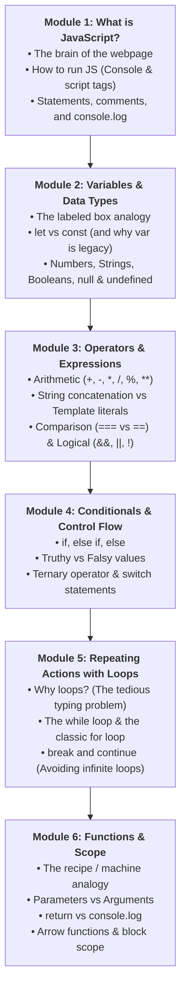
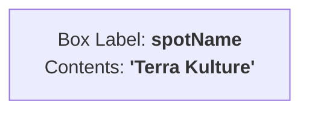
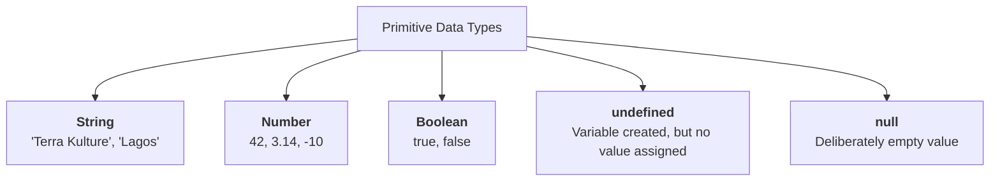
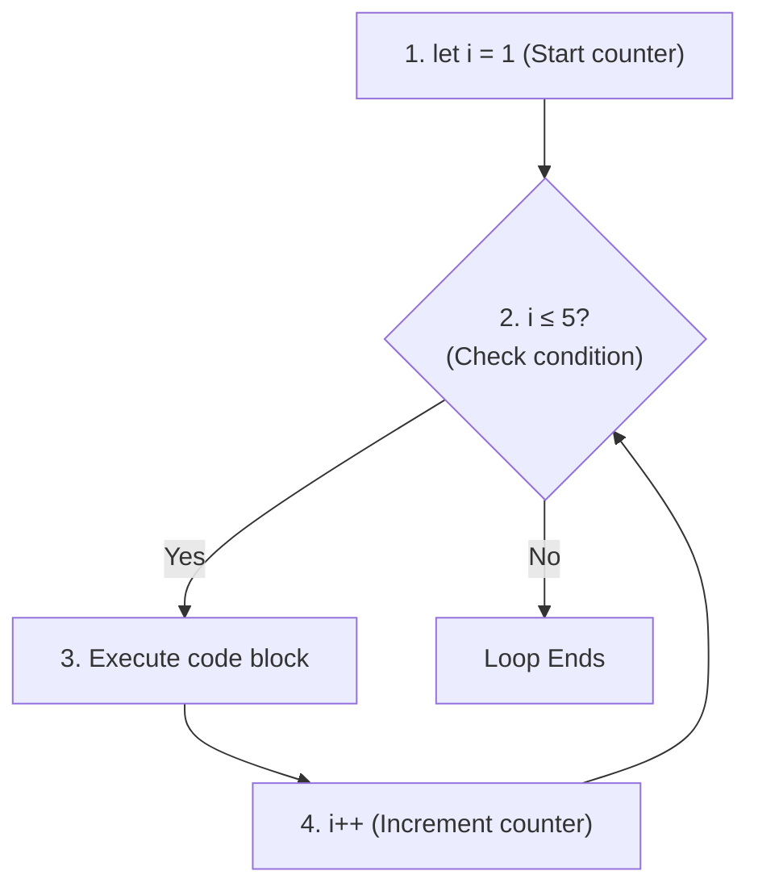
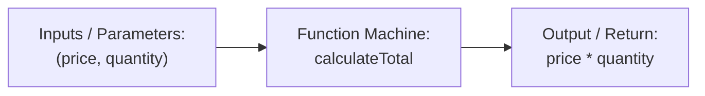

# Week 6: JavaScript Fundamentals

Welcome to Week 6! Over the past five weeks, you constructed the visual foundation of **Lagos Spots**: structuring pages with HTML, styling with CSS, crafting responsive layouts with Flexbox and Grid, and streamlining design with Tailwind CSS.

However, up until today, your webpage has been a **static poster**. If a user clicks a button, types into a search bar, or tries to filter spots by category, nothing happens.

This week, you enter the world of programming: **JavaScript**. You will learn how computers think, how to store information in variables, how to perform calculations, how to make decisions with conditionals, and how to create reusable logic with functions.

---

## Pedagogical Roadmap



---

## Module 1: What is JavaScript & How Does It Run?

### 1. The Three Languages of the Web (Review)

| Technology | Role | Analogy |
| :--- | :--- | :--- |
| **HTML** | Content & Structure | The skeleton and bricks |
| **CSS** | Styling & Visual Presentation | The paint, interior decor, and clothes |
| **JavaScript** | Behavior, Logic & Interactivity | The brain, muscles, and electrical wiring |

JavaScript allows your webpage to **calculate prices, respond to clicks, validate forms, fetch live data from servers**, and update the screen without reloading.

---

### 2. How to Run JavaScript

You have three easy ways to run JavaScript right now:

#### 1. In the Browser Console (Instant Experimentation):
Press `F12` (or `Cmd + Option + J` on Mac / `Ctrl + Shift + J` on Windows) in Google Chrome. Click the **Console** tab. Type:
```js
console.log("Hello, Lagos!");
```
Press **Enter**, and you will see the output immediately!

#### 2. Inside an HTML file (`<script>` tag):
You can write JavaScript directly inside an HTML file:
```html
<script>
  console.log("Running from inside HTML!");
</script>
```

#### 3. In an External File (The Professional Standard):
Create a file named `script.js` and link it in your `index.html`:
```html
<!-- In index.html: place right before closing </body> tag, or use defer in <head> -->
<script defer src="script.js"></script>
```

---

### 3. Syntax Rules: Statements, Comments, & Case Sensitivity

```js
// 1. Single-line comment: The browser ignores this line completely

/* 
   2. Multi-line comment:
   Useful for explaining longer logic or temporarily disabling code.
*/

// 3. Statements end with a semicolon (recommended for clean code):
console.log("Welcome to Lagos Data School");

// 4. JavaScript is CASE-SENSITIVE:
let spotName = "Bogobiri";
let SPOTNAME = "Terra Kulture";
// These are two completely different variables!
```

---

## Module 2: Variables & Primitive Data Types

### 1. Variables: The Labeled Box Analogy

> [!NOTE]
> **The Mental Model:** A **variable** is like a labeled storage box in your room. 
> 1. You write a label on the box (the variable name).
> 2. You put something inside it (the value).
> 3. Whenever you need that item later, you refer to the box by its label.



In modern JavaScript, there are only two keywords you should use to create variables:

| Keyword | Reassignable? | When to Use |
| :--- | :--- | :--- |
| **`const`** | **No** (Constant) | **Default choice!** Use whenever the value shouldn't change (e.g., website name, API URLs, fixed settings). |
| **`let`** | **Yes** | Use when the value **will change later** (e.g., counters, user input, search query, toggles). |
| *`var`* | *Legacy* | ⚠️ *Do not use in modern code.* It behaves unpredictably outside block scopes. |

```js
// Using const for things that stay constant:
const appName = "Lagos Spots";
const maxSearchResults = 20;

// appName = "Abuja Spots"; // 🔴 ERROR: Assignment to constant variable!

// Using let for things that change:
let activeCategory = "All";
console.log(activeCategory); // "All"

activeCategory = "Food"; // 🟢 Allowed! Value updated
console.log(activeCategory); // "Food"
```

#### Variable Naming Rules:
- Use **camelCase** for variable names (e.g., `spotName`, `userAge`, `isFavorite`).
- Cannot start with a number (e.g., `let 1stPlace` is illegal).
- Cannot use reserved words like `let`, `class`, `function`, `return`.

---

### 2. The 5 Core Primitive Data Types

Every value in JavaScript has a **type**. You can check any value's type using the `typeof` operator:



#### 1. String (Text):
Enclosed in single quotes `'...'`, double quotes `"..."`, or backticks `` `...` ``:
```js
const city = "Lagos";
const neighborhood = 'Yaba';
console.log(typeof city); // "string"
```

#### 2. Number (Integers & Decimals):
JavaScript uses a single type for all numbers (whole numbers and decimals):
```js
const rating = 4.8;
const entryFee = 2500;
console.log(typeof rating); // "number"
```

#### 3. Boolean (True or False):
Only two possible values: `true` or `false`. Essential for making decisions:
```js
const isOpen = true;
const isFree = false;
console.log(typeof isOpen); // "boolean"
```

#### 4. `undefined` vs `null` (The Empty Values):
> [!TIP]
> - **`undefined`**: The browser's default for "a box that exists, but nothing was ever placed in it yet."
> - **`null`**: The developer explicitly saying "this box is intentionally empty."

```js
let phoneNumber; 
console.log(phoneNumber); // undefined (declared without a value)

let selectedSpot = null; // Deliberately set to "nothing" until user picks a spot
console.log(selectedSpot); // null
```

---

## Module 3: Operators & Expressions

### 1. Arithmetic Operators
```js
const price = 5000;
const vat = 375;

console.log(price + vat); // 5375 (Addition)
console.log(price - 1000); // 4000 (Subtraction)
console.log(price * 2);    // 10000 (Multiplication)
console.log(price / 2);    // 2500 (Division)
console.log(10 % 3);       // 1 (Remainder / Modulo: 10 divided by 3 has 1 left over)
console.log(2 ** 3);       // 8 (Exponentiation: 2 raised to the power of 3)
```

---

### 2. Strings: Concatenation vs Template Literals

In older JavaScript, you joined strings with `+` (concatenation). In modern JavaScript, you use **Template Literals** with backticks `` ` `` and `${expression}`:

```js
const spotName = "Nike Art Gallery";
const area = "Lekki";

// 🔴 Old way (clunky and easy to miss spaces):
const oldMessage = spotName + " is located in " + area + ".";

// 🟢 Modern Template Literals (Clean & Powerful):
const message = `${spotName} is located in ${area}.`;
console.log(message); // "Nike Art Gallery is located in Lekki."

// You can even calculate inside ${}:
const ticketPrice = 1500;
console.log(`Two tickets cost ₦${ticketPrice * 2}`); // "Two tickets cost ₦3000"
```

---

### 3. Comparison Operators (The Strict Equality Rule)

When comparing values, JavaScript produces a boolean (`true` or `false`):

```js
const age = 20;

console.log(age > 18);  // true
console.log(age >= 21); // false
console.log(age < 50);  // true
```

#### Strict (`===`) vs Loose (`==`):
> [!CAUTION]
> Always use **Strict Equality (`===`)** and **Strict Inequality (`!==`)**.
> - `===` checks both **Value AND Type**.
> - `==` converts types behind your back (coercion), causing bizarre bugs!

```js
// The Danger of Loose Equality (==):
console.log(5 == "5");   // true (Number coerced to string!)
console.log(0 == "");    // true (Both converted to 0!)
console.log(false == 0); // true

// The Safety of Strict Equality (===):
console.log(5 === "5");  // false (Number is not String!)
console.log(0 === "");   // false
console.log(5 !== "5");  // true
```

---

### 4. Logical Operators: `&&`, `||`, and `!`

| Operator | Name | Rule | Example |
| :--- | :--- | :--- | :--- |
| **`&&`** | **AND** | `true` only if **BOTH** sides are true. | `isWeekend && isSunny` |
| **`\|\|`** | **OR** | `true` if **AT LEAST ONE** side is true. | `isHoliday \|\| isWeekend` |
| **`!`** | **NOT** | Flips boolean: `!true` becomes `false`. | `!isOpen` |

```js
const hasTicket = true;
const isVip = false;

// AND: Must have ticket AND be VIP
console.log(hasTicket && isVip); // false

// OR: Needs either a ticket OR VIP pass
console.log(hasTicket || isVip); // true

// NOT: Negation
console.log(!hasTicket); // false
```

---

## Module 4: Conditionals & Control Flow

### 1. `if`, `else if`, and `else`

Conditionals allow your program to make decisions:

```js
const budget = 4000;

if (budget >= 10000) {
  console.log("You can visit a luxury restaurant in Ikoyi!");
} else if (budget >= 3000) {
  console.log("You can enjoy great food and arts at Terra Kulture!");
} else {
  console.log("Visit Freedom Park for a budget-friendly stroll!");
}
```

---

### 2. Truthy and Falsy Values

In JavaScript, any value can be evaluated inside an `if` condition. JavaScript converts values to booleans automatically:

There are only **8 Falsy values** in JavaScript. Memorize them:
1. `false`
2. `0`
3. `-0`
4. `""` (empty string)
5. `null`
6. `undefined`
7. `NaN` (Not a Number)
8. `0n` (BigInt zero)

**Everything else is Truthy!** Even `[]` (empty array) and `{}` (empty object) are truthy.

```js
const searchInput = ""; // Empty string is falsy

if (searchInput) {
  console.log("Searching for:", searchInput);
} else {
  console.log("Please enter a search term!"); // This runs!
}
```

---

### 3. The Ternary Operator (`? :`)

A clean, 1-line shortcut for simple `if/else` decisions:
```js
// Syntax: condition ? valueIfTrue : valueIfFalse

const entryFee = 0;
const label = entryFee === 0 ? "Free Entry" : `₦${entryFee}`;

console.log(label); // "Free Entry"
```

---

## Module 5: Repeating Actions with Loops

### 1. Why Do We Need Loops?

Imagine you have 10 spots to display on the page. Without loops, you would have to write 10 copy-pasted lines. Loops allow you to **repeat an action until a condition is met**.

---

### 2. The Classic `for` Loop

A `for` loop has 3 parts separated by semicolons:
`for (initialization; condition; increment)`



```js
// Count from 1 to 5:
for (let i = 1; i <= 5; i++) {
  console.log(`Spot #${i}`);
}
```

---

### 3. The `while` Loop

Best used when you don't know in advance how many times you need to loop:
```js
let ticketsRemaining = 3;

while (ticketsRemaining > 0) {
  console.log(`Ticket sold! Remaining: ${ticketsRemaining}`);
  ticketsRemaining--; // Decrease by 1 each time
}

console.log("Sold out!");
```

> [!WARNING]
> **The Infinite Loop Trap:** Always ensure the loop variable changes! If you forget `ticketsRemaining--`, the condition will stay `true` forever and freeze your browser tab!

---

## Module 6: Functions & Scope

### 1. What is a Function? (The Recipe Analogy)

> [!NOTE]
> **The Mental Model:** A function is a reusable kitchen recipe or machine.
> 1. You give it **ingredients** (inputs, called **parameters**).
> 2. It follows a set of **instructions** (the function body).
> 3. It produces a **finished meal** (output, called the **return value**).



---

### 2. Function Declarations vs Calling a Function

```js
// 1. Defining (Declaring) the function:
function calculateTotalPrice(ticketPrice, quantity) {
  const total = ticketPrice * quantity;
  return total; // Sends the result back to whoever called the function
}

// 2. Invoking (Calling) the function with real values (arguments):
const order1 = calculateTotalPrice(2500, 2);
console.log(`Total: ₦${order1}`); // "Total: ₦5000"

const order2 = calculateTotalPrice(1500, 4);
console.log(`Total: ₦${order2}`); // "Total: ₦6000"
```

> [!IMPORTANT]
> **`return` vs `console.log`:**
> - `console.log()` only prints text to the screen for you to see. It does **not** give the value back to the rest of your program.
> - `return` actually hands the value back so you can store it in a variable or use it in further calculations.

---

### 3. Arrow Functions (Modern ES6+ Syntax)

In modern web development, you will see **Arrow Functions** (`=>`) everywhere:

```js
// Traditional Function Declaration:
function add(a, b) {
  return a + b;
}

// Modern Arrow Function:
const addArrow = (a, b) => {
  return a + b;
};

// Concise Arrow Function (Implicit return if 1 single line):
const addShort = (a, b) => a + b;

console.log(addShort(10, 20)); // 30
```

---

### 4. Scope: Global vs Block Scope

> [!TIP]
> **The Rooms Analogy:** Variables declared inside `{}` curly braces are like items inside a private bedroom. People outside in the hallway cannot see or touch them!

```js
const globalCity = "Lagos"; // Global Scope: Accessible everywhere

if (true) {
  const localSpot = "Terra Kulture"; // Block Scope: Only exists inside this { }
  console.log(globalCity); // "Lagos" (Can see outside!)
  console.log(localSpot);  // "Terra Kulture"
}

console.log(globalCity); // "Lagos"
// console.log(localSpot); // 🔴 ReferenceError: localSpot is not defined!
```

---

## Module 7: Rookie Traps & Debugging Guide

| Error Message | What Happened | How to Fix It |
| :--- | :--- | :--- |
| `ReferenceError: spotName is not defined` | You tried to use a variable before creating it, or misspelled its name. | Check spelling, make sure it was declared with `let` or `const` in accessible scope. |
| `TypeError: Assignment to constant variable` | You tried to reassign a variable created with `const`. | If the value needs to change, change `const` to `let`. |
| `SyntaxError: Unexpected token` | You missed a comma, closing bracket `}`, or quotation mark. | Look at the line number in the console and verify matching quotes and brackets. |
| String Math Surprise: `"5" + 2` equals `"52"` | The `+` operator with any string joins them together instead of adding. | Convert strings to numbers first using `Number("5") + 2`. |

---

## 🎯 Week 6 Hands-on Classroom Exercises

### Level 1: Variable & Operator Drills
1. Create a `const` variable for your favorite place in Lagos.
2. Create a `let` variable for the entrance fee.
3. Use a template literal to log: `"Visiting [place] costs ₦[fee]."`
4. Reassign the fee to a discounted price and log it again.

### Level 2: Conditionals & Decision Making
Write a function `checkAdmission(age, fee)`:
- If age is under 5, return `"Free for children!"`
- If fee is 0, return `"Free entry for everyone!"`
- Otherwise, return `"Admission fee is ₦[fee]."`

### Level 3: Loops & Lagos Spots Array Renderer
1. Create an array of 4 spot names: `["Terra Kulture", "Bogobiri", "Nike Art Gallery", "Freedom Park"]`.
2. Write a `for` loop that logs:
   `"1. Terra Kulture"`
   `"2. Bogobiri"`
   `"3. Nike Art Gallery"`
   `"4. Freedom Park"`
3. Write an arrow function `formatSpot(name, index)` that takes a name and index and returns the formatted string.

---

## 📚 Curated Deep-Dive References

* [JavaScript.info: Hello, world!](https://javascript.info/hello-world) — The gentlest, clearest starting point for JavaScript beginners.
* [JavaScript.info: Variables](https://javascript.info/variables) — Deep dive into `let`, `const`, and naming conventions.
* [JavaScript.info: Data Types](https://javascript.info/types) — Visual explanations of strings, numbers, booleans, and null/undefined.
* [The Valley of Code: JavaScript Basics](https://thevalleyofcode.com/javascript/) — Flavio Copes' friendly handbook on variables, operators, and loops.
* [The Valley of Code: Functions](https://thevalleyofcode.com/javascript/functions) — Plain-English guide to functions and arrow syntax.
* [MDN Web Docs: JavaScript First Steps](https://developer.mozilla.org/en-US/docs/Learn/JavaScript/First_steps) — Mozilla's beginner guide to JavaScript mechanics.
