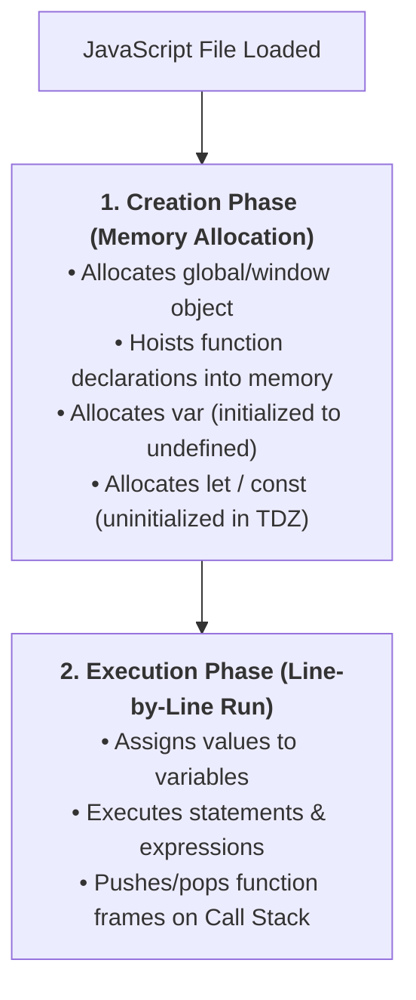
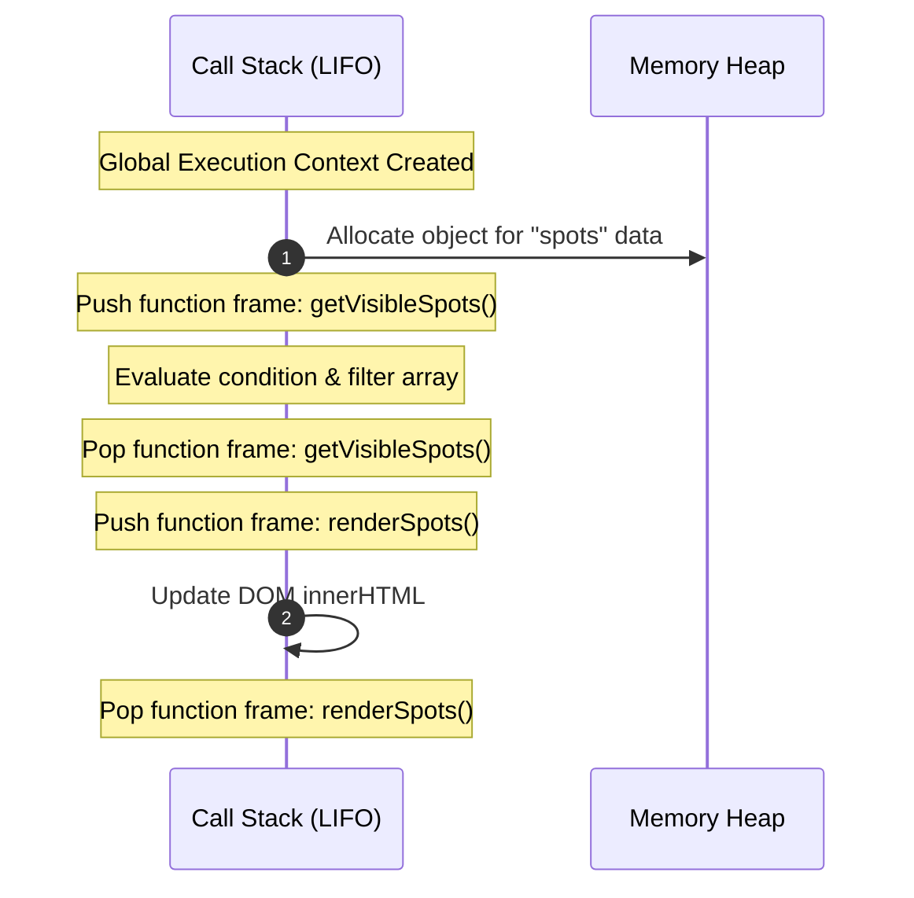
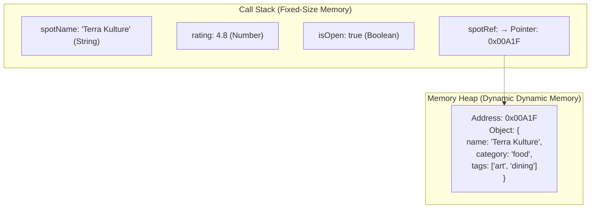
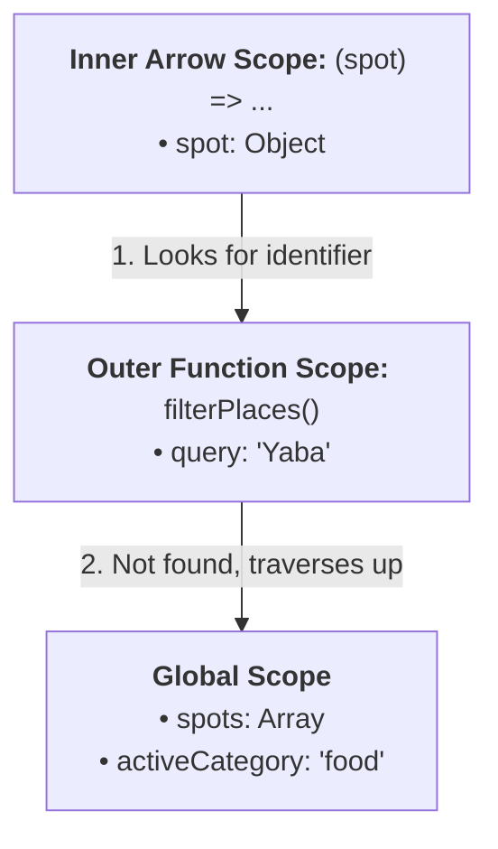

# Week 6: JavaScript Fundamentals

Lagos Spots has semantic structure and Tailwind styling, but it remains a static document. This week marks your transition into **client-side programming**: understanding how the JavaScript engine executes code in memory, how variables and data types behave under the hood, how the scope chain resolves identifiers, and how to drive the UI dynamically from data structures rather than hardcoded HTML.

---

## Module 1: The JavaScript Runtime & Execution Model

### 1. The Core Terminology of JavaScript

| Term | What It Actually Means | Technical Context |
| :--- | :--- | :--- |
| **ECMAScript (ES)** | The standardized specification for scripting languages (ECMA-262) maintained by TC39. | JavaScript is the concrete implementation of the ECMAScript standard in browsers and Node.js. |
| **JavaScript Engine (V8, JavaScriptCore, SpiderMonkey)** | The C++ program inside a browser that parses, compiles (JIT), and executes JavaScript code. | Chrome/Edge/Node.js use **V8**; Safari uses **JavaScriptCore**; Firefox uses **SpiderMonkey**. |
| **Call Stack** | A Last-In, First-Out (LIFO) data structure that tracks active function calls and their execution contexts. | Primitives and stack frames are stored here; stack overflow occurs when recursive calls exceed maximum stack depth. |
| **Memory Heap** | An unorganized region of memory allocated dynamically for reference types (Objects, Arrays, Functions). | Pointers/references live on the Call Stack, pointing to the heap addresses. |
| **Execution Context** | An abstract environment containing the evaluated code, its lexical scope, variable bindings, and `this` reference. | A **Global Execution Context** is created on startup; each function call pushes a new **Function Execution Context**. |
| **Temporal Dead Zone (TDZ)** | The period between entering a block scope and the physical declaration line of a `let` or `const` variable. | Accessing a variable in its TDZ throws a fatal `ReferenceError`. |

---

### 2. Under the Hood: How the JavaScript Engine Runs Code

When a script loads in the browser, the JavaScript engine processes it in two distinct phases:





---

### 3. Script Loading Strategies: `async` vs `defer` vs `type="module"`

```mermaid
gantt
    title Browser Script Loading Timeline
    dateFormat X
    axisFormat %s

    section Regular Script in Head
    HTML Parser         :done, 0, 3
    Download Script     :crit, 3, 6
    Execute Script      :crit, 6, 8
    Resume HTML Parser  :done, 8, 12

    section Script Async
    HTML Parser         :done, 0, 6
    Download Script     :active, 1, 4
    Execute Script (Blocks Parser) :crit, 6, 8
    Resume HTML Parser  :done, 8, 12

    section Script Defer / type="module" (Recommended)
    HTML Parser         :done, 0, 8
    Download Script in Background :active, 1, 5
    Execute Script (After DOM Ready) :crit, 8, 10
```

Placing scripts improperly in `<head>` blocks the HTML tokenizer from building the DOM (**parser blocking**).



- `<script src="app.js">`: **Blocks HTML parsing** while downloading and executing.
- `<script async src="app.js">`: Downloads in parallel with HTML parsing, but executes the moment download completes (may execute before DOM is fully constructed; unpredictable order).
- `<script defer src="app.js">` / `<script type="module" src="main.ts">`: **Downloads in parallel without blocking parsing**, and executes strictly in document order *after* the DOM is fully constructed.

---

## Module 2: Variables, Types & Memory Allocation

### 1. `const` vs `let` vs `var` (Scope & Hoisting)

| Keyword | Scope Level | Hoisted? | Reassignable? | Redeclarable? | Memory / TDZ Behavior |
| :--- | :--- | :--- | :--- | :--- | :--- |
| **`const`** | **Block `{ }`** | Yes (in TDZ) | **No** (Immutable binding) | **No** | Throws `ReferenceError` if accessed before declaration. Must be initialized immediately. |
| **`let`** | **Block `{ }`** | Yes (in TDZ) | **Yes** | **No** | Throws `ReferenceError` if accessed before declaration. Ideal for counters/toggles. |
| **`var`** | **Function / Global** | Yes (to `undefined`) | **Yes** | **Yes** | Leaks out of `if` blocks and `for` loops. Deprecated in modern engineering. |

#### Block Scope Demonstration:
```ts
if (true) {
  var leakedVar = 'I leak into the outer scope!';
  let scopedLet = 'I only exist within these curly braces!';
  const scopedConst = 'I also only exist within these braces!';
}

console.log(leakedVar);   // 'I leak into the outer scope!' (Pollutes scope!)
// console.log(scopedLet);   // Uncaught ReferenceError: scopedLet is not defined
// console.log(scopedConst); // Uncaught ReferenceError: scopedConst is not defined
```

---

### 2. Primitive Types vs. Reference Types: The Memory Model

JavaScript has 7 primitive types and 1 complex reference type:



1. **Primitives (Stored directly on Call Stack, passed by value):**
   - `string`: Textual data (`'Lagos'`).
   - `number`: 64-bit double precision floating point (`42`, `3.14`).
   - `boolean`: `true` or `false`.
   - `undefined`: Variable declared, but no value assigned yet (engine default).
   - `null`: Intentional absence of any object value.
   - `bigint`: Arbitrary precision integer (`9007199254740991n`).
   - `symbol`: Unique, immutable identifier (`Symbol('id')`).
2. **Reference Types (Stored on Heap, pointer on Call Stack, passed by reference):**
   - `Object`, `Array`, `Function`, `Date`, `Map`, `Set`.

---

### 3. Under the Hood: Type Coercion & Equality

#### Truthy vs. Falsy Values:
JavaScript implicitly coerces values to booleans in conditionals (`if (val)`). There are exactly **8 falsy values**:
- `false`, `0`, `-0`, `0n`, `""` (empty string), `null`, `undefined`, `NaN`.
- *Everything else is truthy*, including `[]` (empty array), `{}` (empty object), `"0"`, and `"false"`.

#### Strict Equality (`===`) vs Loose Equality (`==`):
- `===` (**Strict Equality**): Compares **Value AND Type**. No type conversion occurs.
- `==` (**Loose Equality**): Performs **Implicit Type Coercion** before comparing. Leads to erratic bugs:
  - `0 == ""` $\to$ `true` (Both coerced to number `0`).
  - `false == "0"` $\to$ `true`.
  - `null == undefined` $\to$ `true`.
  - `0 === ""` $\to$ `false` (Number vs String). Always use `===`.

#### Logical OR (`||`) vs. Nullish Coalescing (`??`):
- `||` returns the right-hand operand if the left is **any falsy value** (`false`, `0`, `""`, `null`, `undefined`).
- `??` returns the right-hand operand **ONLY if the left is `null` or `undefined`**.

```ts
// Scenario: A free Lagos spot with ticket price of 0 Naira
const admissionFee = 0;

const fallbackWithOR = admissionFee || 1500; // WRONG! 0 is falsy, returns 1500
const fallbackWithNullish = admissionFee ?? 1500; // CORRECT! 0 is valid, returns 0

console.log(fallbackWithOR);      // 1500 (Incorrectly charges free spots)
console.log(fallbackWithNullish); // 0    (Correctly preserves 0)
```

---

## Module 3: Functions, Scope & Closures

### 1. Function Types: Declarations vs Expressions vs Arrow Functions

```ts
// 1. Function Declaration (Hoisted to top of scope; has own 'this')
function calculateDistance(x1: number, y1: number, x2: number, y2: number): number {
  return Math.hypot(x2 - x1, y2 - y1);
}

// 2. Function Expression (Not hoisted; stored in variable)
const calculateDistanceExp = function(x1: number, y1: number, x2: number, y2: number): number {
  return Math.hypot(x2 - x1, y2 - y1);
};

// 3. Arrow Function (Concise syntax; lexically binds 'this'; modern standard)
const calculateDistanceArrow = (x1: number, y1: number, x2: number, y2: number): number =>
  Math.hypot(x2 - x1, y2 - y1);
```

---

### 2. Under the Hood: Lexical Scope & The Scope Chain

JavaScript uses **Lexical (Static) Scoping**: variable resolution is determined by the physical location of the code in the file, not where a function is called.



When a variable is evaluated:
1. The engine checks the **Current Local Scope**.
2. If not found, it traverses outward to the **Parent Lexical Scope**.
3. It continues up the **Scope Chain** until it reaches the **Global Scope**.
4. If still not found, it throws a `ReferenceError`.

---

## Module 4: Data-Driven UI Rendering

### 1. The Spot Data Model & Rendering Logic

Instead of hardcoding 50 cards in HTML, we store spots as an array of data objects and write a pure rendering function:

```ts
// src/main.ts

// 1. Define the Spot data structure
interface Spot {
  id: string;
  name: string;
  category: 'food' | 'study' | 'nightlife' | 'events';
  area: string;
  description: string;
  imageUrl: string;
}

// 2. Define the source dataset
const spots: Spot[] = [
  {
    id: 'terra-kulture',
    name: 'Terra Kulture',
    category: 'food',
    area: 'Victoria Island',
    description: 'Art gallery, authentic Nigerian restaurant, and live theatre performance hall.',
    imageUrl: '/assets/terra-kulture.jpg',
  },
  {
    id: 'bogobiri',
    name: 'Bogobiri House',
    category: 'events',
    area: 'Ikoyi',
    description: 'Boutique hotel, African art gallery, open-mic poetry, and live Afrobeat music hub.',
    imageUrl: '/assets/bogobiri.jpg',
  },
  {
    id: 'workstation',
    name: 'Workstation Bar Beach',
    category: 'study',
    area: 'Victoria Island',
    description: 'High-speed internet co-working hub with uninterrupted power and coffee bar.',
    imageUrl: '/assets/workstation.jpg',
  },
  {
    id: 'hard-rock',
    name: 'Hard Rock Cafe',
    category: 'nightlife',
    area: 'Oniru',
    description: 'Beachfront American diner with rock memorabilia, live DJ sets, and cocktail lounge.',
    imageUrl: '/assets/hardrock.jpg',
  },
];

// 3. Pure filtering function
function getVisibleSpots(allSpots: Spot[], selectedCategory: string): Spot[] {
  if (selectedCategory === 'all') {
    return allSpots;
  }
  return allSpots.filter((spot) => spot.category === selectedCategory);
}

// 4. DOM Rendering function
function renderSpots(spotsToRender: Spot[]): void {
  const container = document.getElementById('spots-list');
  if (!container) return;

  if (spotsToRender.length === 0) {
    container.innerHTML = `
      <div class="col-span-full py-12 text-center text-slate-500">
        <p class="text-lg font-medium">No spots found in this category.</p>
      </div>
    `;
    return;
  }

  container.innerHTML = spotsToRender
    .map(
      (spot) => `
      <article class="flex flex-col bg-white dark:bg-slate-800 border border-slate-200 dark:border-slate-700 rounded-xl p-5 shadow-sm hover:shadow-md transition-all" id="${spot.id}">
        <div class="flex justify-between items-start gap-2 mb-3">
          <h3 class="text-lg font-bold text-slate-900 dark:text-white">${spot.name}</h3>
          <span class="text-xs font-semibold px-2.5 py-1 rounded-full bg-orange-100 text-orange-800 dark:bg-orange-950 dark:text-orange-300 capitalize">
            ${spot.category}
          </span>
        </div>
        <p class="text-xs font-medium text-slate-500 dark:text-slate-400 mb-2">📍 ${spot.area}</p>
        <p class="text-sm text-slate-600 dark:text-slate-300 flex-grow mb-4">${spot.description}</p>
        <button class="w-full py-2 px-4 text-sm font-medium text-white bg-orange-600 hover:bg-orange-700 rounded-lg transition-colors">
          View Details
        </button>
      </article>
    `
    )
    .join('');
}

// Initial page render
renderSpots(spots);
```

---

### 2. Common Pitfalls & How to Avoid Them

| Pitfall | Cause | Solution |
| :--- | :--- | :--- |
| `Uncaught TypeError: Cannot set properties of null (setting 'innerHTML')` | Script ran before the DOM element `#spots-list` existed in the DOM. | Use `<script type="module" defer>` in `<head>` and check `if (!container) return;`. |
| `Uncaught ReferenceError: X is not defined` (TDZ violation) | Attempted to use a `let` or `const` variable before its line of declaration. | Declare variables at the top of their enclosing scope block. |
| Coercion bugs with `==` | `0 == ""` evaluates to `true`. | Always configure ESLint rule `eqeqeq: ["error", "always"]` to enforce `===`. |
| Floating point arithmetic inaccuracy | `0.1 + 0.2` equals `0.30000000000000004` due to IEEE-754 binary floating-point representation. | Store financial currency amounts in minor units (e.g., Kobo or Cents as integers) rather than fractional Naira/Dollars. |

---

### Week 6: Comprehensive Assignment

**Objective:** Transform Lagos Spots into a data-driven client-side application where the spot directory renders dynamically from structured data models, featuring clean scope boundaries and strict equality filtering.

**Requirements:**
1. **Module Linking & Tooling:**
   - `main.ts` linked via `<script type="module" defer src="/src/main.ts">`.
   - ESLint and Prettier enabled with zero warnings on `==` or unused variables.
2. **Data Structure:**
   - Defined `Spot` data model interface.
   - Initialized `spots` array containing at least 5 complete spot objects across multiple Lagos areas (VI, Ikoyi, Yaba, Lekki).
3. **Data-Driven Rendering:**
   - `renderSpots(spots)` generates HTML dynamically via array transformation and DOM insertion.
   - All hardcoded `.spot-card` HTML removed from `index.html`.
4. **Pure Filtering Function:**
   - Implemented `getVisibleSpots(allSpots, category)` with strict equality `===`.
   - Tested filtering logic for `'all'`, `'food'`, `'study'`, `'nightlife'`, `'events'`.
5. **Git Workflow:**
   - Developed on branch `feature/js-data-rendering`, merged via Pull Request, and pulled locally.
