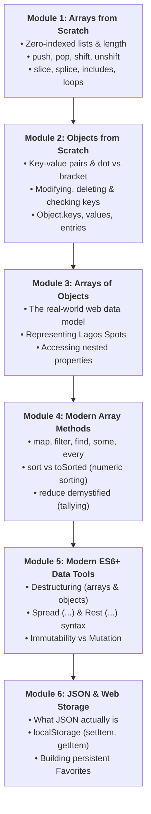
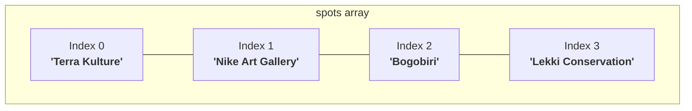
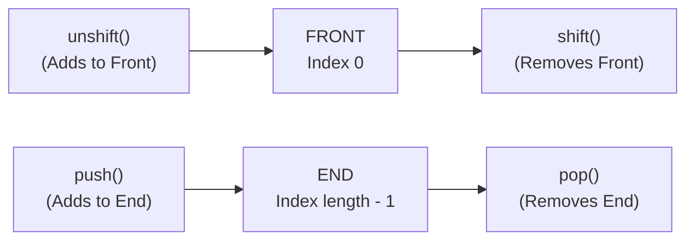
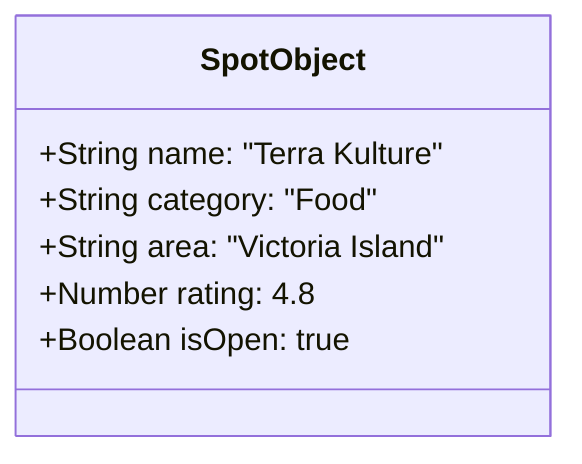
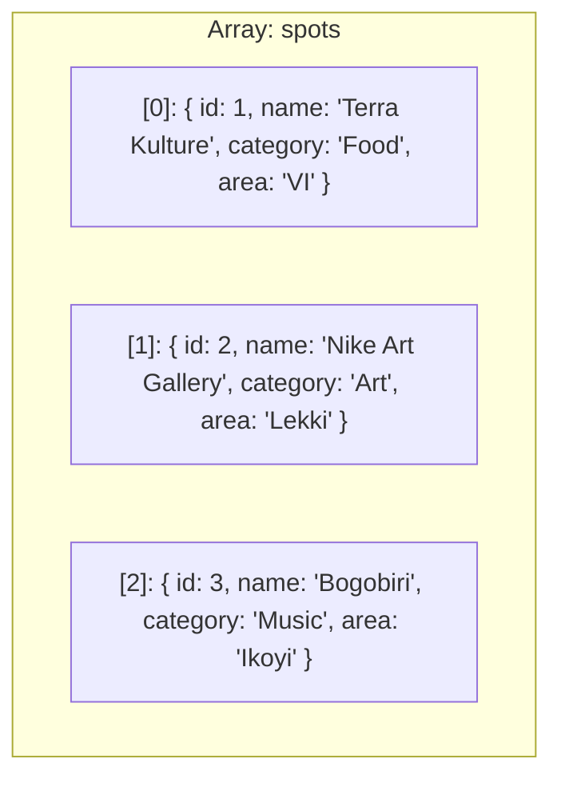
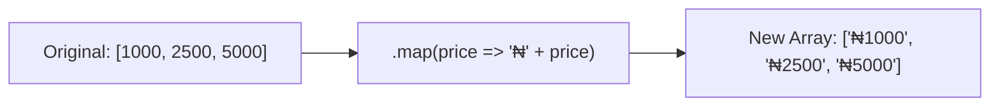
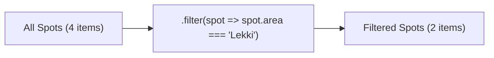
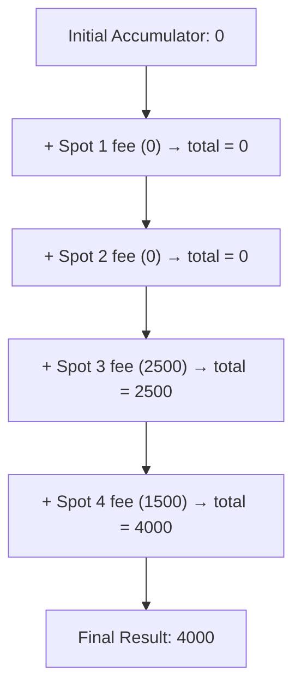
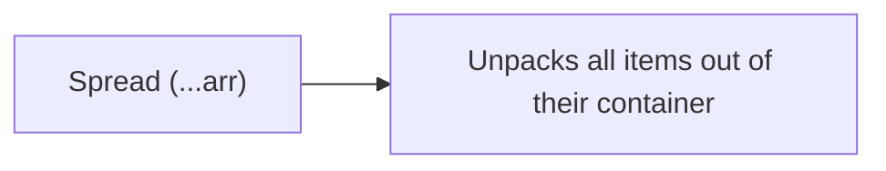

# Week 7: Arrays, Objects & Data Structures

Welcome to Week 7! In Week 6, you learned the building blocks of JavaScript: variables, data types, operators, conditionals, and functions. 

Until now, we have mostly stored single pieces of information (like a single spot name or a single price). But real web applications — like **Lagos Spots**, Instagram, or Twitter — don't handle isolated values. They manage collections: lists of places, user profiles with multiple attributes, search results, and shopping carts.

This week, you will learn how to organize, manipulate, and persist data using **Arrays**, **Objects**, **Higher-Order Array Methods**, and the **Web Storage API (`localStorage`)**. We will start from zero-based basics and build all the way to modern production techniques.

---

## Pedagogical Roadmap



---

## Module 1: Arrays from Scratch

### 1. What is an Array? (The Mental Model)

> [!NOTE]
> **The Mental Model:** Imagine an egg carton, an ice-cube tray, or a pill organizer with numbered slots. Each compartment holds a value, and each compartment is numbered in exact sequence, starting at **0**.

An **Array** is an ordered collection of values. In JavaScript, you define an array using square brackets `[]`, separating each item with a comma.

```js
// An array of strings representing popular Lagos spots
const spots = ["Terra Kulture", "Nike Art Gallery", "Bogobiri", "Lekki Conservation Centre"];

// An array of numbers (e.g., entrance fees in Naira)
const fees = [0, 5000, 2500, 1500];

// An empty array (ready to receive data later)
const userFavorites = [];
```

### 2. Zero-Based Indexing & The `.length` Property

In programming, counting almost always starts at **0**, not 1:
- The first element is at index `0`.
- The second element is at index `1`.
- The third element is at index `2`.



#### Accessing Elements:
```js
const fruits = ["Mango", "Banana", "Pawpaw", "Orange"];

console.log(fruits[0]); // "Mango" (First element)
console.log(fruits[1]); // "Banana" (Second element)
console.log(fruits[99]); // undefined (Index does not exist!)
```

#### The `.length` Property & Accessing the Last Element:
`.length` tells you how many items are in the array:
```js
console.log(fruits.length); // 4

// The last item is ALWAYS at index (length - 1):
console.log(fruits[fruits.length - 1]); // "Orange"

// Modern JavaScript shortcut (ES2022+): .at()
console.log(fruits.at(-1)); // "Orange" (Negative index counts backwards from the end!)
console.log(fruits.at(-2)); // "Pawpaw"
```

#### Modifying Elements:
Arrays are mutable. You can reassign any position directly:
```js
fruits[1] = "Pineapple"; // Replaces "Banana"
console.log(fruits); // ["Mango", "Pineapple", "Pawpaw", "Orange"]
```

---

### 3. Essential Array Methods (Adding & Removing)

Think of an array as a queue of people at a bus stop:



#### Adding & Removing at the End (Fastest):
* **`.push(item)`**: Adds one or more items to the **end** of the array. Returns the new length.
* **`.pop()`**: Removes the **last** item from the array. Returns the removed item.

```js
const lagosAreas = ["Ikeja", "Yaba", "Victoria Island"];

lagosAreas.push("Lekki");
console.log(lagosAreas); // ["Ikeja", "Yaba", "Victoria Island", "Lekki"]

const removedArea = lagosAreas.pop();
console.log(removedArea); // "Lekki"
console.log(lagosAreas);   // ["Ikeja", "Yaba", "Victoria Island"]
```

#### Adding & Removing at the Beginning:
* **`.unshift(item)`**: Adds one or more items to the **beginning** of the array.
* **`.shift()`**: Removes the **first** item from the array and shifts everything else left.

```js
lagosAreas.unshift("Surulere");
console.log(lagosAreas); // ["Surulere", "Ikeja", "Yaba", "Victoria Island"]

const firstItem = lagosAreas.shift();
console.log(firstItem);  // "Surulere"
console.log(lagosAreas); // ["Ikeja", "Yaba", "Victoria Island"]
```

---

### 4. Searching, Slicing & Combining Arrays

#### Searching: `.includes()` and `.indexOf()`
```js
const markets = ["Balogun", "Oshodi", "Tejuosho", "Computer Village"];

// .includes() returns a true/false boolean
console.log(markets.includes("Balogun"));  // true
console.log(markets.includes("Mile 12"));  // false

// .indexOf() returns the numeric index, or -1 if not found
console.log(markets.indexOf("Tejuosho")); // 2
console.log(markets.indexOf("Mile 12"));  // -1
```

#### `.slice()` (Non-destructive) vs `.splice()` (Destructive)
> [!IMPORTANT]
> - **`.slice(start, end)`**: Copies a portion of an array **without modifying the original**.
> - **`.splice(start, count, ...items)`**: Removes or replaces items directly inside the original array (**mutates**).

```js
const items = ["A", "B", "C", "D", "E"];

// 1. .slice() - Non-destructive (safe)
const sliceCopy = items.slice(1, 4); // From index 1 up to (not including) index 4
console.log(sliceCopy); // ["B", "C", "D"]
console.log(items);     // ["A", "B", "C", "D", "E"] (Original unchanged!)

// 2. .splice() - Destructive (modifies original)
const deleted = items.splice(2, 2); // At index 2, remove 2 items
console.log(deleted);   // ["C", "D"]
console.log(items);     // ["A", "B", "E"] (Original has been changed!)
```

#### Converting between Arrays and Strings:
```js
// Array to String: .join(separator)
const tags = ["Food", "Art", "Nightlife"];
console.log(tags.join(" | ")); // "Food | Art | Nightlife"

// String to Array: .split(separator)
const csvString = "Lekki,VI,Ikoyi,Yaba";
const areasArray = csvString.split(",");
console.log(areasArray); // ["Lekki", "VI", "Ikoyi", "Yaba"]
```

---

### 5. How to Loop Through an Array

Before learning fancy methods, master the three ways to iterate over an array:

#### 1. The Classic `for` Loop (Index-based):
Best when you explicitly need the numeric index.
```js
const spots = ["Bogobiri", "Terra Kulture", "Freedom Park"];

for (let i = 0; i < spots.length; i++) {
  console.log(`Spot #${i + 1}: ${spots[i]}`);
}
```

#### 2. The Modern `for...of` Loop (Clean & Readable):
Best when you just want each item directly without dealing with index counters.
```js
for (const spot of spots) {
  console.log(`Visiting: ${spot}`);
}
```

#### 3. The `.forEach()` Method (Functional loop):
Takes a callback function that runs once for each element.
```js
spots.forEach((spot, index) => {
  console.log(`${index}: ${spot}`);
});
```

---

### 🏋️ Try It in Your Console Now (Drill 1)
Open Chrome DevTools (`Cmd + Option + J` on Mac, `Ctrl + Shift + J` on Windows) and run:
```js
const myCart = ["Suya", "Jollof Rice"];
myCart.push("Zobo");
myCart.unshift("Puff Puff");
console.log(myCart); // What is the first item? What is myCart.length?
console.log("Has Zobo?", myCart.includes("Zobo"));
```

---

## Module 2: Objects from Scratch

### 1. What is an Object? (The Mental Model)

> [!NOTE]
> **The Mental Model:** An array is a numbered list (`[0, 1, 2]`). An **Object** is a labeled folder, an ID card, or a dictionary entry. Instead of numbers, each value has a meaningful name called a **key** (or property).

An object is a collection of **key-value pairs** wrapped in curly braces `{}`:



```js
const spot = {
  name: "Terra Kulture",
  category: "Food",
  area: "Victoria Island",
  rating: 4.8,
  isOpen: true
};
```

---

### 2. Accessing Properties: Dot Notation vs Bracket Notation

There are two ways to read values from an object:

| Syntax | Example | When to Use |
| :--- | :--- | :--- |
| **Dot Notation** | `spot.name` | Use by default for clean, readable code when the key name is standard. |
| **Bracket Notation** | `spot["name"]` | **Mandatory** when the key has spaces/hyphens or when the key is stored in a dynamic variable. |

```js
const user = {
  firstName: "Opeyemi",
  lastName: "Akintunde",
  "home address": "Yaba, Lagos", // Key with a space requires quotes
  role: "admin"
};

// 1. Dot Notation:
console.log(user.firstName); // "Opeyemi"

// 2. Bracket Notation with literal string:
console.log(user["home address"]); // "Yaba, Lagos" (Dot notation user.home address is a syntax error!)

// 3. Bracket Notation with a Dynamic Variable:
const propertyToLookup = "role";
console.log(user[propertyToLookup]); // "admin"
console.log(user.propertyToLookup);   // undefined (Looking for a literal property called "propertyToLookup"!)
```

---

### 3. Adding, Modifying & Deleting Properties

Objects in JavaScript are dynamic — you can add, change, or delete properties at any time:

```js
const spot = {
  name: "Bogobiri",
  area: "Ikoyi"
};

// Adding new properties:
spot.category = "Art & Culture";
spot.rating = 4.6;

// Modifying an existing property:
spot.rating = 4.9;

// Deleting a property:
delete spot.area;

console.log(spot);
// { name: "Bogobiri", category: "Art & Culture", rating: 4.9 }
```

#### Checking if a property exists:
```js
console.log("rating" in spot);   // true
console.log("area" in spot);     // false

// Or using optional chaining (?.) to prevent crashes on undefined:
console.log(spot?.contact?.phone); // undefined (safe, does NOT crash!)
```

---

### 4. Inspecting Objects: `Object.keys()`, `values()`, and `entries()`

When you need to loop over an object or convert its contents into an array:

```js
const openingHours = {
  mon: "9am - 6pm",
  wed: "9am - 8pm",
  fri: "9am - 11pm"
};

// 1. Object.keys() -> Array of property names
console.log(Object.keys(openingHours));
// ["mon", "wed", "fri"]

// 2. Object.values() -> Array of property values
console.log(Object.values(openingHours));
// ["9am - 6pm", "9am - 8pm", "9am - 11pm"]

// 3. Object.entries() -> Array of [key, value] pairs
console.log(Object.entries(openingHours));
// [ ["mon", "9am - 6pm"], ["wed", "9am - 8pm"], ["fri", "9am - 11pm"] ]
```

---

### 🏋️ Try It in Your Console Now (Drill 2)
```js
const lagosUser = {
  name: "Bisi",
  favoriteSpot: "Nike Art Gallery",
  visitCount: 3
};

// 1. Increment visit count by 1
lagosUser.visitCount += 1;

// 2. Add a new boolean property 'isVerified' set to true
lagosUser.isVerified = true;

// 3. Log the keys of this user object
console.log("Keys:", Object.keys(lagosUser));
```

---

## Module 3: The Full-Stack Bridge — Arrays of Objects

In real-world web development, almost every API response you receive from a backend is an **Array of Objects**:
- A list of tweets
- A catalog of products
- A directory of **Lagos Spots**



### Working with an Array of Objects:

```js
const spots = [
  { id: 1, name: "Terra Kulture", category: "Food", area: "Victoria Island", fee: 0 },
  { id: 2, name: "Nike Art Gallery", category: "Art", area: "Lekki", fee: 0 },
  { id: 3, name: "Bogobiri House", category: "Music", area: "Ikoyi", fee: 2500 },
  { id: 4, name: "Lekki Conservation Centre", category: "Nature", area: "Lekki", fee: 1500 }
];

// How to access data inside the collection:
console.log(spots[0].name);       // "Terra Kulture"
console.log(spots[1].area);       // "Lekki"
console.log(spots[2]["category"]); // "Music"

// Looping through to print a formatted list:
for (const spot of spots) {
  const feeLabel = spot.fee === 0 ? "Free Entry" : `₦${spot.fee.toLocaleString()}`;
  console.log(`📍 ${spot.name} (${spot.area}) — ${feeLabel}`);
}
```

---

## Module 4: Modern Higher-Order Array Methods

Now that you know how arrays and objects work, we can move from old-fashioned `for` loops to **declarative array methods**. These methods make your code shorter, cleaner, and less prone to off-by-one errors.

> [!NOTE]
> A **Higher-Order Function** is simply a function that accepts another function as an argument. In these methods, the function you pass in is called a **callback**.

---

### 1. `.map()` — Transforming Data (1-to-1)

> [!TIP]
> **Mental Model:** A factory conveyor belt. Every item on the belt enters a machine, gets transformed, and comes out as a new item. The resulting array **always has the exact same length** as the original.



```js
const numbers = [1, 2, 3, 4, 5];
const doubled = numbers.map(num => num * 2);
console.log(doubled); // [2, 4, 6, 8, 10]

// Real-world Lagos Spots Example:
// Extract just the spot names into an array of strings:
const spotNames = spots.map(spot => spot.name);
console.log(spotNames);
// ["Terra Kulture", "Nike Art Gallery", "Bogobiri House", "Lekki Conservation Centre"]

// Generating HTML cards dynamically:
const cardList = spots.map(spot => {
  return `<div class="spot-card"><h3>${spot.name}</h3><p>${spot.area}</p></div>`;
});
console.log(cardList[0]);
// '<div class="spot-card"><h3>Terra Kulture</h3><p>Victoria Island</p></div>'
```

---

### 2. `.filter()` — Selecting Items That Pass a Test

> [!TIP]
> **Mental Model:** A security guard at a gate or a tea strainer. It examines each item. If the callback returns `true`, the item gets through into the new array. If `false`, it is excluded.



```js
// Example 1: Filtering numbers
const testScores = [45, 82, 90, 33, 76];
const passingScores = testScores.filter(score => score >= 50);
console.log(passingScores); // [82, 90, 76]

// Example 2: Real-world Lagos Spots filter:
// Get all free spots
const freeSpots = spots.filter(spot => spot.fee === 0);
console.log(freeSpots);
// [{ id: 1, name: "Terra Kulture"... }, { id: 2, name: "Nike Art Gallery"... }]

// Get all spots located in Lekki:
const lekkiSpots = spots.filter(spot => spot.area === "Lekki");
console.log(lekkiSpots.length); // 2
```

---

### 3. `.find()` vs `.findIndex()` — Finding a Single Item

* **`.find()`**: Returns the **first element** that matches the condition, or `undefined` if no match exists.
* **`.findIndex()`**: Returns the **numeric position (index)** of the first match, or `-1`.

```js
// User clicked on spot with ID 3:
const selectedSpot = spots.find(spot => spot.id === 3);
console.log(selectedSpot.name); // "Bogobiri House"

const missingSpot = spots.find(spot => spot.id === 999);
console.log(missingSpot); // undefined (Safe to check if (!missingSpot))
```

---

### 4. `.some()` and `.every()` — Boolean Checks

* **`.some()`**: Returns `true` if **at least one** item passes the test.
* **`.every()`**: Returns `true` only if **every single item** passes the test.

```js
// Are there any free spots in Lagos?
const hasFreeSpots = spots.some(spot => spot.fee === 0);
console.log(hasFreeSpots); // true

// Are all spots free?
const areAllFree = spots.every(spot => spot.fee === 0);
console.log(areAllFree); // false
```

---

### 5. `.sort()` vs `.toSorted()` — Sorting Without the Trap

> [!CAUTION]
> **The Beginner Sorting Trap:** By default, JavaScript's `.sort()` converts everything to strings and sorts alphabetically!
> ```js
> [10, 5, 20, 1].sort(); // [1, 10, 20, 5] -> WRONG! "10" comes before "5" in the dictionary!
> ```
> To sort numbers correctly, you **must** provide a comparison function: `(a, b) => a - b`.

Furthermore, `.sort()` **mutates** (alters) the original array. Modern JavaScript (ES2023+) introduced **`.toSorted()`**, which returns a sorted copy and leaves the original untouched:

```js
const prices = [5000, 1500, 2500, 0];

// Ascending sort (cheapest first): a - b
const cheapestFirst = prices.toSorted((a, b) => a - b);
console.log(cheapestFirst); // [0, 1500, 2500, 5000]
console.log(prices);        // [5000, 1500, 2500, 0] (Original preserved!)

// Descending sort (most expensive first): b - a
const expensiveFirst = prices.toSorted((a, b) => b - a);
console.log(expensiveFirst); // [5000, 2500, 1500, 0]

// Sorting strings alphabetically: localeCompare
const alphabetically = spots.toSorted((a, b) => a.name.localeCompare(b.name));
console.log(alphabetically.map(s => s.name));
```

---

### 6. `.reduce()` Demystified — The Accumulator

> [!NOTE]
> **The Mental Model:** Think of `.reduce()` as a cash register or a tally counter. You start with an initial total (`accumulator = 0`). For each item in the array, you add its value to the total and pass the running total to the next item.



```js
const cartAmounts = [1200, 3500, 2000, 800];

// Summing an array of numbers:
const totalSpent = cartAmounts.reduce((accumulator, currentAmount) => {
  return accumulator + currentAmount;
}, 0); // 0 is the starting value of accumulator

console.log(`Total: ₦${totalSpent}`); // "Total: ₦7500"
```

#### Real-World Example: Counting Spots by Category
`.reduce()` can also build objects:
```js
const sampleCategories = ["Food", "Art", "Food", "Music", "Food", "Art"];

const categoryCounts = sampleCategories.reduce((acc, category) => {
  acc[category] = (acc[category] || 0) + 1;
  return acc;
}, {});

console.log(categoryCounts);
// { Food: 3, Art: 2, Music: 1 }
```

---

## Module 5: Modern ES6+ Data Tools

### 1. Destructuring Assignment (Unpacking Values)

Destructuring is a convenient shorthand that lets you unpack properties from objects or elements from arrays into distinct variables:

#### Object Destructuring:
```js
const spot = {
  name: "Terra Kulture",
  category: "Food",
  area: "Victoria Island",
  rating: 4.8
};

// The old way:
// const name = spot.name;
// const area = spot.area;

// The modern Destructuring way:
const { name, area, rating, fee = 0 } = spot; // fee has a default value if missing!

console.log(name);   // "Terra Kulture"
console.log(area);   // "Victoria Island"
console.log(fee);    // 0 (Default applied!)
```

#### Destructuring in Function Parameters (Industry Standard):
```js
// Instead of writing function renderCard(spot) and doing spot.name everywhere:
function renderCard({ name, area, category }) {
  return `<article><h3>${name}</h3><p>${area} · ${category}</p></article>`;
}

console.log(renderCard(spot));
// '<article><h3>Terra Kulture</h3><p>Victoria Island · Food</p></article>'
```

#### Array Destructuring:
```js
const coords = [6.4281, 3.4219]; // Latitude, Longitude for Lagos
const [lat, lng] = coords;

console.log("Latitude:", lat);   // 6.4281
console.log("Longitude:", lng); // 3.4219
```

---

### 2. Spread Operator (`...`) & Immutability

> [!IMPORTANT]
> In modern frontend development (and React in particular), you should **never mutate existing state directly**. Instead, create a **shallow copy** with the changes applied. The spread operator (`...`) makes this effortless.



#### Copying & Adding to Arrays:
```js
const originalFavorites = [1, 2, 3];

// 🔴 MUTATING (Avoid):
// originalFavorites.push(4);

// 🟢 IMMUTABLE (Best Practice):
const updatedFavorites = [...originalFavorites, 4];
console.log(originalFavorites); // [1, 2, 3] (Untouched!)
console.log(updatedFavorites);  // [1, 2, 3, 4]
```

#### Merging & Updating Objects:
```js
const originalSpot = { id: 1, name: "Terra Kulture", rating: 4.5 };

// Create a copy with an updated rating and a new property:
const updatedSpot = {
  ...originalSpot,
  rating: 4.9, // Overwrites previous rating
  isFeatured: true // Adds new property
};

console.log(originalSpot.rating); // 4.5 (Untouched!)
console.log(updatedSpot.rating);   // 4.9
console.log(updatedSpot.isFeatured); // true
```

---

## Module 6: Data Persistence with JSON & `localStorage`

### 1. What is JSON? (JavaScript Object Notation)

When your JavaScript application closes or the user refreshes the browser, all memory variables (`spots`, `favorites`) vanish into thin air. To keep data saved, we store it in the browser's **`localStorage`**.

However, `localStorage` can **only store text (strings)**. It cannot store live JavaScript objects or arrays.

This is why we use **JSON**: a standard text format representing structured data.

```mermaid
sequenceDiagram
    autonumber
    participant App as JS Memory (Live Array)
    participant JSON as JSON Engine
    participant Storage as Browser localStorage (Disk)

    Note over App: favorites = [1, 2, 4]
    App->>JSON: JSON.stringify(favorites)
    JSON-->>App: "[1,2,4]" (String)
    App->>Storage: localStorage.setItem('user_favs', "[1,2,4]")

    Note over Storage: User refreshes page next day
    Storage->>App: localStorage.getItem('user_favs') &rarr; "[1,2,4]"
    App->>JSON: JSON.parse("[1,2,4]")
    JSON-->>App: [1, 2, 4] (Live JS Array restored!)
```

* **`JSON.stringify(value)`**: Converts a JavaScript object or array into a **JSON string**.
* **`JSON.parse(string)`**: Converts a JSON string back into a **live JavaScript object or array**.

```js
const student = { name: "Tunde", cohort: 7, skills: ["HTML", "CSS", "JS"] };

// Convert to text:
const jsonString = JSON.stringify(student);
console.log(typeof jsonString); // "string"
console.log(jsonString); // '{"name":"Tunde","cohort":7,"skills":["HTML","CSS","JS"]}'

// Convert back to object:
const restoredStudent = JSON.parse(jsonString);
console.log(typeof restoredStudent); // "object"
console.log(restoredStudent.name);   // "Tunde"
```

---

### 2. The `localStorage` API

The browser provides a global `localStorage` object with 4 core methods:

| Method | Purpose | Example |
| :--- | :--- | :--- |
| **`.setItem(key, value)`** | Stores a key-value string pair. | `localStorage.setItem('theme', 'dark');` |
| **`.getItem(key)`** | Retrieves value by key, or returns `null` if missing. | `localStorage.getItem('theme'); // 'dark'` |
| **`.removeItem(key)`** | Deletes a specific key. | `localStorage.removeItem('theme');` |
| **`.clear()`** | Deletes all data for this domain. | `localStorage.clear();` |

---

### 3. Step-by-Step Hands-on: Building Persistent Favorites for Lagos Spots

Here is the exact code pattern you will use in Lagos Spots to toggle and save favorites across page reloads:

```js
const STORAGE_KEY = "lagos_spots_favorites";

// 1. Function to read saved favorites from storage safely:
function getSavedFavorites() {
  const savedData = localStorage.getItem(STORAGE_KEY);
  if (!savedData) {
    return []; // Return empty array if nothing was saved yet
  }
  try {
    return JSON.parse(savedData);
  } catch (error) {
    console.error("Corrupted storage data:", error);
    return [];
  }
}

// 2. Function to save favorites to storage:
function saveFavorites(favoritesArray) {
  localStorage.setItem(STORAGE_KEY, JSON.stringify(favoritesArray));
}

// 3. Function to toggle a spot's favorite status:
function toggleFavorite(spotId) {
  const currentFavorites = getSavedFavorites();
  let updatedFavorites;

  if (currentFavorites.includes(spotId)) {
    // If already in favorites, remove it:
    updatedFavorites = currentFavorites.filter(id => id !== spotId);
    console.log(`Removed spot #${spotId} from favorites.`);
  } else {
    // If not in favorites, add it immutably:
    updatedFavorites = [...currentFavorites, spotId];
    console.log(`Added spot #${spotId} to favorites.`);
  }

  saveFavorites(updatedFavorites);
  return updatedFavorites;
}

// Try it:
console.log("Initial favorites:", getSavedFavorites());
toggleFavorite(1); // Adds spot 1
toggleFavorite(2); // Adds spot 2
console.log("After adding:", getSavedFavorites()); // [1, 2]
toggleFavorite(1); // Removes spot 1
console.log("After removing:", getSavedFavorites()); // [2]
```

---

## Module 7: Rookie Traps & Debugging Guide

| Error Message / Trap | What Caused It | How to Fix It |
| :--- | :--- | :--- |
| `TypeError: Cannot read properties of undefined (reading 'name')` | You attempted `spots[10].name`, but index 10 does not exist. | Check that the array item exists first, or use optional chaining: `spots[10]?.name`. |
| `TypeError: spots.map is not a function` | The variable `spots` is not an array (it might be `null`, `undefined`, or an object). | Log `typeof spots` or `Array.isArray(spots)` to verify what data type you are handling. |
| Numbers sorting out of order: `[1, 10, 2, 25]` | You called `.sort()` without a compare function. | Use `arr.toSorted((a, b) => a - b)` for ascending numeric sorting. |
| Storing raw objects in `localStorage`: `"[object Object]"` | You called `localStorage.setItem('user', user)` without stringifying. | Always convert to string: `localStorage.setItem('user', JSON.stringify(user))`. |
| Off-by-one error: `arr[arr.length]` | An array of 5 items has indices 0 through 4. `arr[5]` is out of bounds! | The last item is always `arr[arr.length - 1]` or `arr.at(-1)`. |

---

## 🎯 Week 7 Hands-on Classroom Exercises

### Level 1: Basic Warmups
1. Create an array of 5 places you love in Lagos.
2. Add a new place to the end using `.push()`.
3. Remove the first place using `.shift()`.
4. Log the total number of places and the last place in the array using `.at(-1)`.

### Level 2: Real Data Transformation
Given this dataset:
```js
const mySpots = [
  { id: 1, name: "Terra Kulture", category: "Food", fee: 0 },
  { id: 2, name: "Hard Rock Cafe", category: "Nightlife", fee: 10000 },
  { id: 3, name: "Freedom Park", category: "Art", fee: 500 },
  { id: 4, name: "Nike Art Gallery", category: "Art", fee: 0 }
];
```
1. Use `.filter()` to extract only the spots with `fee === 0` (Free entry).
2. Use `.map()` to return an array of strings formatted like: `"Terra Kulture (Food)"`.
3. Use `.find()` to find the spot with `id === 3`.
4. Use `.some()` to check if there are any spots with `category === "Nightlife"`.

### Level 3: Project Integration (Lagos Spots)
1. In your `script.js`, replace any hardcoded spot arrays with an array of at least 6 spot objects with properties: `id`, `name`, `category`, `area`, `description`, `fee`, and `rating`.
2. Write a function `filterByCategory(allSpots, selectedCategory)` that returns all spots if category is `'All'`, or filters by the chosen category.
3. Implement `toggleFavorite(spotId)` with `localStorage` so a user can save places to their personal list and have them persist when refreshing the browser!

---

## 📚 Curated Deep-Dive References

* [JavaScript.info: Arrays](https://javascript.info/array) — Complete visual beginner guide to array basics, queues, and stacks.
* [JavaScript.info: Array Methods](https://javascript.info/array-methods) — Visual breakdown of `.map()`, `.filter()`, `.reduce()`, and `.splice()`.
* [JavaScript.info: Objects](https://javascript.info/object) — Key-value pairs, references, and property deletion.
* [The Valley of Code: JavaScript Arrays](https://thevalleyofcode.com/javascript/arrays) — Flavio Copes' gentle, accessible overview of array manipulation.
* [MDN Web Docs: Array Reference](https://developer.mozilla.org/en-US/docs/Web/JavaScript/Reference/Global_Objects/Array) — The definitive reference for every array method.
* [MDN Web Docs: Working with Objects](https://developer.mozilla.org/en-US/docs/Web/JavaScript/Guide/Working_with_objects) — Object literals, bracket notation, and properties.
* [MDN Web Docs: Window.localStorage](https://developer.mozilla.org/en-US/docs/Web/API/Window/localStorage) — Browser storage documentation and quotas.
