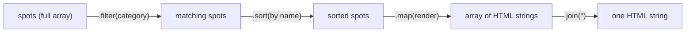
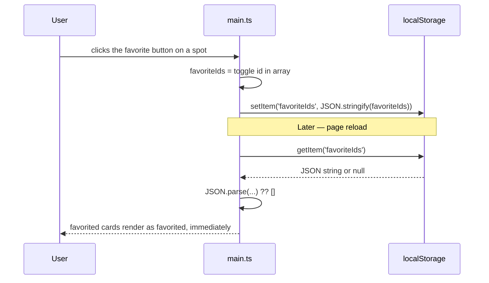

# Week 7: Arrays, Objects & Data Structures

Last week you rendered Lagos Spots' cards from a real array and filtered them by category using `.filter()`, treating it as a black box. This week you open that box: real array methods, cleaner ways to read and copy objects, and your first taste of data that survives a page refresh — a real "favorites" list, saved to the browser itself.

---

## Module 1: Array Methods on Real Data

### 1. `.map()`, `.filter()`, `.find()`

* **Lecture & Concepts:**
    * `.map(fn)` transforms every item in an array into something new, returning a **new array** of the same length — exactly what `renderSpots` already does, turning spot objects into HTML strings.
    * `.filter(fn)` returns a **new array** containing only the items where `fn` returns `true` — this is what powered last week's category filter.
    * `.find(fn)` returns the **first single item** matching a condition, or `undefined` if none match — the right tool for "get me the one spot with this id," which you'll need the moment a spot has its own detail view.
    * None of these three methods change the original array — they all return a new one. This matters: mutating arrays in place causes bugs that are hard to trace once more of the app depends on the same data.



* **In-Depth Example:**
    ```ts
    function findSpotById(spots, id) {
      return spots.find((spot) => spot.id === id);
    }
    ```

* **Class Exercise: Add `findSpotById`**
    1. Give every object in your `spots` array a unique `id` field (e.g. `'terra-kulture'`).
    2. Write `findSpotById(spots, id)` and confirm it in the console with a real, existing id and a fake one.

---

### 2. `.sort()` and `.reduce()`

* **Lecture & Concepts:**
    * `.sort(compareFn)` reorders an array **in place** (the one common exception to "arrays methods don't mutate" — worth remembering exactly because it's the exception) based on a comparison function returning a negative, zero, or positive number.
    * `.reduce(fn, initialValue)` folds an entire array down into a single value — a sum, a count, or a grouped object. It's the most flexible array method and often the hardest to read at first; a category count is a genuinely useful, concrete way to learn it.

* **In-Depth Example (Real Category Counts):**
    ```ts
    function countByCategory(spots) {
      return spots.reduce((counts, spot) => {
        counts[spot.category] = (counts[spot.category] ?? 0) + 1;
        return counts;
      }, {});
    }
    // countByCategory(spots) -> { food: 3, study: 1, nightlife: 1 }
    ```

* **Class Exercise: Sort and Count**
    1. Write a function `sortByName(spots)` that returns a **copy** of the array sorted alphabetically by name — use `[...spots].sort(...)` so the original `spots` array is never mutated.
    2. Write `countByCategory` exactly as shown, and display each category filter button's count next to its label (e.g., "Food (3)").

---

## Module 2: Objects — Destructuring, Spread & Rest

### 1. Destructuring

* **Lecture & Concepts:**
    * Destructuring pulls named properties out of an object into their own variables in one line, instead of repeating `spot.name`, `spot.category`, etc.

* **In-Depth Example:**
    ```ts
    function renderSpotCard(spot) {
      const { name, category, area, description } = spot;
      return `
        <article class="spot-card" data-id="${spot.id}">
          <h3>${name}</h3>
          <p>${area} · ${category}</p>
          <p>${description}</p>
        </article>
      `;
    }
    ```

* **Class Exercise: Refactor `renderSpots`**
    1. Extract a `renderSpotCard(spot)` function using destructuring, as shown.
    2. Update `renderSpots` to call `spots.map(renderSpotCard).join('')` instead of building the markup inline.

---

### 2. Spread, Rest & Immutable Updates

* **Lecture & Concepts:**
    * The **spread operator** (`...`) copies an object's or array's contents into a new one. It's the standard way to update an object *without mutating the original* — `{ ...spot, favorited: true }` creates a new object identical to `spot`, except `favorited` is now `true`.
    * **Rest parameters** collect any remaining arguments into a real array: `function logAll(first, ...rest) { }`.
    * `Object.keys()`, `Object.values()`, and `Object.entries()` turn an object into an array you can `.map()`/`.filter()` over — exactly what you need to render the category-count object from Module 1 as a list of buttons.

* **In-Depth Example:**
    ```ts
    // Immutable update: mark one spot as favorited without touching the original array
    function toggleFavorite(spots, id) {
      return spots.map((spot) =>
        spot.id === id ? { ...spot, favorited: !spot.favorited } : spot
      );
    }

    // Turning the category-count object into real DOM content
    const counts = countByCategory(spots);
    Object.entries(counts).forEach(([category, count]) => {
      console.log(`${category}: ${count} spot(s)`);
    });
    ```

* **Class Exercise: Build `toggleFavorite`**
    1. Write `toggleFavorite` exactly as shown — note it returns a **new** array, it doesn't mutate `spots`.
    2. In the console, call it with a real id and confirm the returned array has that one spot's `favorited` flipped, while the original `spots` variable is untouched.

---

## Module 3: Nested Data & Persisting to `localStorage`

### 1. Nested Objects

* **Lecture & Concepts:**
    * Real data is rarely flat. A spot might reasonably carry a nested `hours` object (`{ open: '09:00', close: '22:00' }`) or `location` (`{ lat, lng }`). Destructuring handles nesting too: `const { hours: { open, close } } = spot;`.

* **Class Exercise: Add Nested Data**
    1. Add a nested `hours: { open, close }` object to each spot in your array.
    2. Update `renderSpotCard` to display `${hours.open} – ${hours.close}` using nested destructuring.

---

### 2. JSON & `localStorage`

* **Lecture & Concepts:**
    * `localStorage` only stores **strings** — nothing else. `JSON.stringify(value)` converts a real JS value (an array, an object) into a string; `JSON.parse(string)` converts it back.
    * `localStorage.setItem(key, value)` saves a string under a key; `localStorage.getItem(key)` reads it back (or returns `null` if nothing's been saved yet); `localStorage.removeItem(key)` deletes it.



* **In-Depth Example:**
    ```ts
    const FAVORITES_KEY = 'lagos-spots:favorite-ids';

    function loadFavoriteIds() {
      const raw = localStorage.getItem(FAVORITES_KEY);
      return raw ? JSON.parse(raw) : [];
    }

    function saveFavoriteIds(ids) {
      localStorage.setItem(FAVORITES_KEY, JSON.stringify(ids));
    }
    ```

* **Class Exercise: Persist Real Favorites**
    1. Write `loadFavoriteIds` and `saveFavoriteIds` exactly as shown.
    2. On page load, call `loadFavoriteIds()` and use the result to mark the matching cards as favorited when rendering.
    3. When a favorite button is clicked, update the favorites array and immediately call `saveFavoriteIds`.
    4. Refresh the page and confirm your favorited spots are still marked — this is real persistence, no backend involved yet.

---

### Week 7: Comprehensive Assignment

**Objective:** Rebuild Lagos Spots' data layer on clean array/object fundamentals, with real favorites that survive a refresh.

**Requirements:**

1. **Array Methods:** `findSpotById`, `sortByName`, and `countByCategory` implemented exactly as covered, none of them mutating the original `spots` array.
2. **Destructuring:** `renderSpotCard` uses object destructuring for all fields it reads.
3. **Immutability:** `toggleFavorite` returns a new array via `.map()` + spread — the original array is never mutated directly.
4. **Nested Data:** Each spot has a nested `hours` object, correctly destructured and displayed.
5. **Persistence:** Favorite spot IDs persist to `localStorage` as JSON and are restored correctly on page reload.
6. **Git:** Committed and pushed via the branch → PR → merge workflow.

**Bonus Challenge:** Add a "Sort by" dropdown (name vs. area) that re-renders the spots list using your `sortByName`-style function, generalized to accept the sort key as a parameter.
