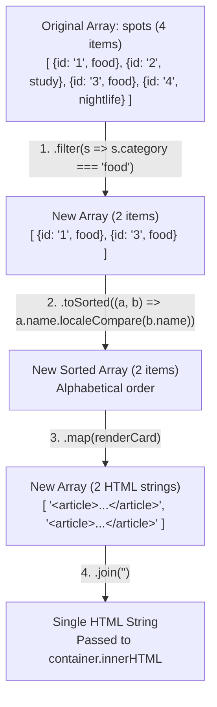
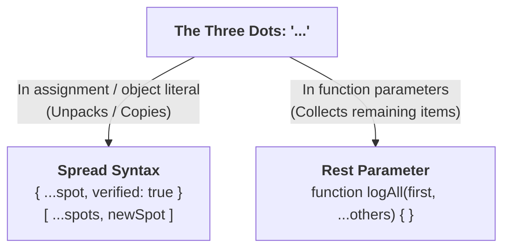
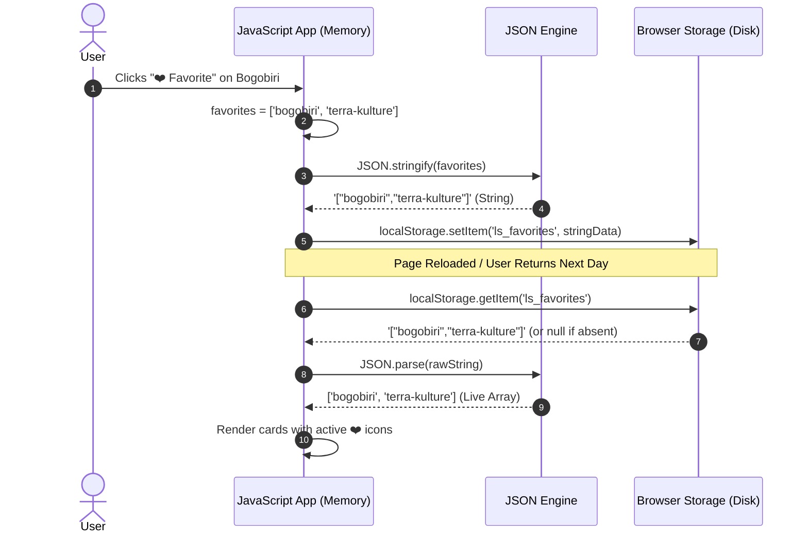

# Week 7: Arrays, Objects & Data Structures

In Week 6, you rendered Lagos Spots dynamically from a basic array. This week, you dive into the data manipulation mechanics that power production JavaScript and React applications: **Higher-Order Array Methods**, **Immutable State Updates**, **Object Destructuring & Spread Syntax**, and client-side data persistence via the **Web Storage API (`localStorage`)**.

---

## Module 1: Higher-Order Array Methods & Functional Transformations

### 1. The Core Terminology of Array Operations

| Term | What It Actually Means | Technical Context |
| :--- | :--- | :--- |
| **Higher-Order Function (HOF)** | A function that accepts another function as an argument (a callback) or returns a function. | `.map()`, `.filter()`, and `.reduce()` are built-in array HOFs. |
| **Pure Function** | A function that given the same arguments always returns the same output, producing **zero side effects** (does not mutate external variables or DOM). | The bedrock of predictable software and React state management. |
| **Immutability** | Treating data structures as unchangeable once created. Instead of modifying an existing array/object, you return a brand new copy with changes applied. | Prevents subtle race conditions and unexpected state corruption across modules. |
| **Shallow Copy** | A duplicate containing top-level primitive values, but retaining shared memory references to nested objects/arrays. | Created via spread `[...arr]` or `{ ...obj }`. |
| **Deep Copy** | A duplicate where all levels of nested objects/arrays are cloned into completely new memory addresses. | Created natively via `structuredClone(obj)`. |

---

### 2. The Core Array Methods: Under the Hood



| Method | Return Value | Mutates Original Array? | Primary Use Case in Lagos Spots |
| :--- | :--- | :--- | :--- |
| **`.map(callback)`** | **New Array** (same length) | **No** | Transforming an array of Spot objects into an array of HTML card strings or React elements. |
| **`.filter(callback)`** | **New Array** ($\le$ original length) | **No** | Filtering spots by selected category or search query string. |
| **`.find(callback)`** | **First matching item** or `undefined` | **No** | Retrieving a single Spot object by its unique `id` when a user opens a detail modal. |
| **`.some(callback)`** | **Boolean** (`true`/`false`) | **No** | Checking if at least one spot matches a condition (e.g., is any spot open after 10 PM?). |
| **`.every(callback)`** | **Boolean** (`true`/`false`) | **No** | Validating that all items meet validation criteria. |
| **`.sort(compareFn)`** | **Original Array** (reordered) | <span style="color:red; font-weight:bold;">YES (Mutates!)</span> | Sorting spots. Always sort a shallow copy: `[...spots].sort()` or use modern `spots.toSorted()`. |
| **`.reduce(callback, init)`** | **Accumulator Value** (Any type) | **No** | Aggregating an array into a single summary value (e.g., category count dictionary, total cost). |

---

### 3. Under the Hood: Tracing `.reduce()`

`.reduce()` is the most versatile array method. It folds an array into any data type (an object, a number, a Map) by passing an accumulator from item to item.

```ts
interface SpotSummary {
  category: string;
}

const sampleSpots: SpotSummary[] = [
  { category: 'food' },
  { category: 'study' },
  { category: 'food' },
  { category: 'events' },
  { category: 'food' },
];

// Count spots per category
const categoryCounts = sampleSpots.reduce<Record<string, number>>((accumulator, currentSpot) => {
  const cat = currentSpot.category;
  accumulator[cat] = (accumulator[cat] ?? 0) + 1;
  return accumulator;
}, {});
```

#### Step-by-Step Execution Trace:
| Iteration | `currentSpot.category` | `accumulator` State Entering Callback | Action Performed | Return Value to Next Iteration |
| :--- | :--- | :--- | :--- | :--- |
| **Initial** | — | `{}` | Initial value passed | `{}` |
| **Step 1** | `'food'` | `{}` | `(undefined ?? 0) + 1 = 1` | `{ food: 1 }` |
| **Step 2** | `'study'` | `{ food: 1 }` | `(undefined ?? 0) + 1 = 1` | `{ food: 1, study: 1 }` |
| **Step 3** | `'food'` | `{ food: 1, study: 1 }` | `(1 ?? 0) + 1 = 2` | `{ food: 2, study: 1 }` |
| **Step 4** | `'events'` | `{ food: 2, study: 1 }` | `(undefined ?? 0) + 1 = 1` | `{ food: 2, study: 1, events: 1 }` |
| **Step 5** | `'food'` | `{ food: 2, study: 1, events: 1 }` | `(2 ?? 0) + 1 = 3` | `{ food: 3, study: 1, events: 1 }` |

---

## Module 2: Objects, Destructuring & Immutable Updates

### 1. Destructuring Assignment (Objects & Arrays)

Destructuring extracts properties into standalone variables with optional renaming and defaults:

```ts
interface Spot {
  id: string;
  name: string;
  category: string;
  area: string;
  rating?: number;
  contact?: { phone: string; email: string };
}

const spot: Spot = {
  id: 'terra-kulture',
  name: 'Terra Kulture',
  category: 'food',
  area: 'Victoria Island',
  contact: { phone: '+234800000000', email: 'info@terrakulture.com' },
};

// 1. Basic destructuring with defaults and renaming
const { name: spotTitle, area, rating = 4.5 } = spot;
console.log(spotTitle); // 'Terra Kulture'
console.log(rating);    // 4.5 (Default applied because rating was undefined)

// 2. Nested destructuring
const { contact: { email } = {} } = spot;
console.log(email);     // 'info@terrakulture.com'

// 3. Destructuring directly in function parameters (Standard React pattern)
function renderSpotBadge({ category, area }: Spot): string {
  return `<span class="badge">${area} · ${category}</span>`;
}
```

---

### 2. Spread (`...`) vs Rest (`...`) Syntax

Although both use the three-dot `...` operator, their purpose depends entirely on context:



#### Immutable State Update Patterns:
```ts
// Scenario 1: Adding a new spot to an existing array (Without .push mutation)
const updatedSpots = [...spots, newSpot];

// Scenario 2: Deleting a spot by ID
const remainingSpots = spots.filter((s) => s.id !== deletedSpotId);

// Scenario 3: Updating a property on a single spot immutably
const toggledFavorites = spots.map((s) => {
  if (s.id === targetId) {
    return { ...s, isFavorite: !s.isFavorite }; // New object with flipped boolean
  }
  return s; // Unchanged reference
});
```

---

### 3. Object Inspection Utilities

```ts
const categoryCounts = { food: 5, study: 2, nightlife: 4 };

// 1. Object.keys() -> Array of keys: ['food', 'study', 'nightlife']
const categories = Object.keys(categoryCounts);

// 2. Object.values() -> Array of values: [5, 2, 4]
const totalSpots = Object.values(categoryCounts).reduce((sum, count) => sum + count, 0);

// 3. Object.entries() -> Array of [key, value] tuples
// Transforming dictionary into HTML category filter buttons:
const filterButtonsHTML = Object.entries(categoryCounts)
  .map(([cat, count]) => `
    <button class="filter-btn" data-category="${cat}">
      ${cat.toUpperCase()} (${count})
    </button>
  `)
  .join('');
```

---

## Module 3: Data Persistence with Web Storage

### 1. Web Storage Architecture: `localStorage` vs `sessionStorage`

| Feature | `localStorage` | `sessionStorage` | Cookies (`document.cookie`) |
| :--- | :--- | :--- | :--- |
| **Persistence Lifetime** | Survives browser restarts indefinitely until explicitly cleared by user/app. | Survives only as long as the specific browser tab is open. | Configurable via `Expires` / `Max-Age` headers. |
| **Storage Capacity** | $\approx 5\text{MB}$ per origin. | $\approx 5\text{MB}$ per origin. | $\approx 4\text{KB}$ total. |
| **Network Overhead** | Purely client-side; never sent over HTTP requests. | Purely client-side; never sent over HTTP requests. | Automatically attached to every HTTP request header to matching domain. |
| **API Synchronicity** | Synchronous blocking I/O on the main thread. | Synchronous blocking I/O on the main thread. | Synchronous string parsing. |

---

### 2. Under the Hood: The Serialization Lifecycle

`localStorage` can **only store UTF-16 string key-value pairs**. It cannot store live JavaScript Objects, Sets, or Functions directly. Attempting `localStorage.setItem('user', { id: 1 })` results in `"[object Object]"`.



---

### 3. Production Storage Wrapper Pattern with Error Handling

`JSON.parse()` throws a fatal `SyntaxError` if storage has been corrupted, and `localStorage.setItem()` throws a `QuotaExceededError` if the disk is full or storage is disabled by private browsing:

```ts
// src/services/storage.ts

const FAVORITES_KEY = 'lagos_spots_favorites_v1';

export function getStoredFavoriteIds(): string[] {
  try {
    const raw = localStorage.getItem(FAVORITES_KEY);
    if (!raw) return [];
    const parsed = JSON.parse(raw);
    return Array.isArray(parsed) ? parsed : [];
  } catch (error) {
    console.warn('Failed to parse favorites from localStorage:', error);
    return [];
  }
}

export function setStoredFavoriteIds(ids: string[]): void {
  try {
    localStorage.setItem(FAVORITES_KEY, JSON.stringify(ids));
  } catch (error) {
    console.error('Failed to save favorites to localStorage:', error);
  }
}

export function toggleFavoriteId(spotId: string): string[] {
  const currentFavorites = getStoredFavoriteIds();
  const exists = currentFavorites.includes(spotId);
  
  const updatedFavorites = exists
    ? currentFavorites.filter((id) => id !== spotId)
    : [...currentFavorites, spotId];

  setStoredFavoriteIds(updatedFavorites);
  return updatedFavorites;
}
```

---

### 4. Common Pitfalls & How to Avoid Them

| Pitfall | Consequence | Professional Fix |
| :--- | :--- | :--- |
| **Mutating arrays with `.sort()`** | `spots.sort()` mutates original dataset in place, causing unpredictable render state bugs. | Copy before sorting: `[...spots].sort()` or `spots.toSorted()`. |
| **Shallow Copy of nested structures** | `{ ...spot }` copies the outer object, but `spot.location` still shares the same memory reference. Modifying `copy.location.lat` corrupts original! | Use `structuredClone(spot)` when deep cloning is required. |
| **Unprotected `JSON.parse()`** | Malformed data or null input can crash the application with unhandled exceptions. | Always wrap `JSON.parse()` in a `try/catch` block with fallback values. |

---

### Week 7: Comprehensive Assignment

**Objective:** Upgrade Lagos Spots' data pipeline using pure array transformations, immutable updates, and a persistent client-side Favorites management system.

**Requirements:**
1. **Array Utility Functions:**
   - `findSpotById(spots, id)` implemented cleanly returning a single `Spot` or `undefined`.
   - `sortSpots(spots, 'name' | 'area')` implemented returning a sorted clone without mutating original data.
   - `getCategoryCounts(spots)` implemented via `.reduce()` returning a `{ category: count }` dictionary.
2. **Category Chip Count Badges:**
   - Category filter buttons rendered dynamically using `Object.entries(getCategoryCounts(spots))`, displaying live counts (e.g., "Food (3)", "Study (2)").
3. **Persistent Favorites Feature:**
   - Every spot card has a favorite toggle button (❤️ icon).
   - Clicking favorite updates the list immutably and serializes the array of favorite IDs to `localStorage`.
   - On page refresh, favorited spots immediately render with active favorited styling.
4. **Git Workflow:**
   - Developed on branch `feature/array-methods-favorites`, merged via Pull Request, and pulled locally.

---

## Recommended References & Deep-Dive Resources

### Official Documentation & Standards
- [MDN Web Docs: Indexed Collections (Array)](https://developer.mozilla.org/en-US/docs/Web/JavaScript/Reference/Global_Objects/Array) — Specification and method index for `.map()`, `.filter()`, `.reduce()`, and immutable array utilities.
- [MDN Web Docs: Object Reference](https://developer.mozilla.org/en-US/docs/Web/JavaScript/Reference/Global_Objects/Object) — Deep dive into object prototypes, property descriptors, and `Object.entries()`.
- [MDN Web Docs: Web Storage API (`localStorage`)](https://developer.mozilla.org/en-US/docs/Web/API/Web_Storage_API) — Client-side key-value persistence mechanisms and storage limits.

### Recommended Textbooks & Canonical Books
- **Composing Software: An Exploration of Functional Programming and Object Composition in JavaScript** by Eric Elliott — *Mastering pure functions, higher-order array methods, and immutability.*
- **You Don't Know JS Yet: Objects & Classes** by Kyle Simpson — *Under-the-hood analysis of object property access, prototypes, and references.*
- **Functional JavaScript** by Michael Fogus (O'Reilly) — *Practical patterns for manipulating collections, data pipelines, and currying in JavaScript.*

### Deep Dives & Performance Guides
- [JavaScript.info: Array Methods](https://javascript.info/array-methods) — Visual guide to mutating vs non-mutating array operations.
- [MDN Web Docs: structuredClone()](https://developer.mozilla.org/en-US/docs/Web/API/structuredClone) — The native web standard for deep copying complex nested object graphs.
