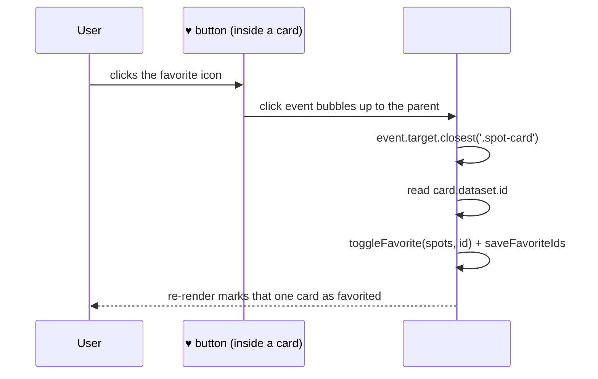

# Week 8: The DOM, Events & Browser APIs

So far, `renderSpots` rebuilds the entire spots list's `innerHTML` every time anything changes. That's worked, but it hides two real problems worth confronting directly: rebuilding everything is wasteful once a list grows, and stitching raw strings together with user-submitted text (like a spot's description) is a genuine security risk. This week you learn the DOM API properly, wire up real event handling with delegation, and make the "Add a Spot" form actually add a spot.

---

## Module 1: The DOM API

### 1. Selecting & Creating Elements

* **Lecture & Concepts:**
    * `document.querySelector(selector)` returns the first matching element (or `null`); `document.querySelectorAll(selector)` returns all matches as a static list.
    * `document.createElement(tag)` builds a new, detached element in memory. `element.append(...)` adds children to it. `parent.appendChild(el)` / `parent.append(el)` attaches it to the page. Nothing appears until an element is actually attached somewhere inside `document.body`.
    * `element.dataset` reads/writes `data-*` attributes as a plain object — `data-id="terra-kulture"` becomes `element.dataset.id`, which is exactly how you'll identify *which* spot a click happened on.

* **In-Depth Example:**
    ```ts
    function createSpotCardElement(spot) {
      const card = document.createElement('article');
      card.className = 'spot-card';
      card.dataset.id = spot.id;

      const title = document.createElement('h3');
      title.textContent = spot.name;

      card.append(title);
      return card;
    }
    ```

* **Class Exercise: Build One Card the DOM Way**
    1. Write `createSpotCardElement(spot)` as shown, adding elements for area, category, and description the same way (`createElement` + `textContent` + `append`).
    2. In the console, call it with one real spot object and `document.body.append(...)` the result — confirm a real card appears.

---

### 2. `textContent` vs. `innerHTML` — Why It Matters Here

* **Lecture & Concepts:**
    * `element.textContent = value` sets **plain text** — anything in `value` is displayed literally, never interpreted as HTML.
    * `element.innerHTML = value` parses `value` **as HTML**. If `value` ever contains a real visitor's text (like a spot's description from the Add-a-Spot form) without any escaping, a malicious visitor could submit a description containing a `<script>` tag or an `onerror` attribute that runs in every other visitor's browser — this class of bug is called **XSS (Cross-Site Scripting)**, and it's a real, common vulnerability in production apps that render user content carelessly.
    * The fix is simple: use `textContent` for anything that came from user input, and reserve `innerHTML` for markup you wrote yourself.

* **In-Depth Example (The Vulnerable vs. Safe Version):**
    ```ts
    // Vulnerable: a description like `` executes.
    descriptionEl.innerHTML = spot.description;

    // Safe: the same string is displayed as harmless, literal text.
    descriptionEl.textContent = spot.description;
    ```

* **Class Exercise: Audit and Fix**
    1. Find every place your code currently sets `innerHTML` with a spot's `name`, `area`, or `description`.
    2. Rewrite `renderSpotCard`/`createSpotCardElement` to build each field with `createElement` + `textContent` instead of a template-literal string, for every field that could plausibly come from a real user submission.

---

## Module 2: Events & Delegation

### 1. `addEventListener` and Event Objects

* **Lecture & Concepts:**
    * `element.addEventListener('click', handler)` runs `handler` every time that element is clicked. The handler receives an **event object** carrying details — `event.target` is the exact element that was actually clicked, which may be a child of the element you attached the listener to.

### 2. Event Delegation

* **Lecture & Concepts:**
    * Attaching a separate listener to every single favorite button doesn't scale — every re-render would mean re-attaching all of them, and it's easy to forget one. **Event delegation** attaches **one listener** to a stable parent element, and uses `event.target` (plus `.closest()`) to figure out which child was actually clicked.
    * `event.target.closest(selector)` walks up from the clicked element until it finds one matching `selector` — exactly what you need to find the enclosing `.spot-card` no matter which inner element (an icon, a span) was technically clicked.



* **In-Depth Example:**
    ```ts
    spotsList.addEventListener('click', (event) => {
      const favoriteBtn = event.target.closest('.spot-card__favorite');
      if (!favoriteBtn) return; // the click wasn't on a favorite button

      const card = favoriteBtn.closest('.spot-card');
      const id = card.dataset.id;

      spots = toggleFavorite(spots, id);
      saveFavoriteIds(spots.filter((s) => s.favorited).map((s) => s.id));
      renderSpots(spots);
    });
    ```

* **Class Exercise: Delegate the Favorite Click**
    1. Add a `<button class="spot-card__favorite">♥</button>` inside each rendered card.
    2. Attach **one** click listener on `#spots-list`, exactly as shown, instead of one per card.
    3. Confirm clicking any card's favorite button toggles and persists correctly, and that newly rendered cards work without re-attaching anything.

---

### 3. Real Form Submission

* **Lecture & Concepts:**
    * A `<form>`'s default behavior on submit is to reload the page and send the data to a server — not what you want yet. `event.preventDefault()` inside a `submit` listener stops that.
    * `new FormData(form)` reads every named field's current value in one step, which you can then convert into a plain object with `Object.fromEntries(formData)`.

* **In-Depth Example:**
    ```ts
    submitSpotForm.addEventListener('submit', (event) => {
      event.preventDefault();

      const formData = new FormData(submitSpotForm);
      const newSpot = {
        id: crypto.randomUUID(),
        ...Object.fromEntries(formData),
        favorited: false,
      };

      spots = [...spots, newSpot];
      renderSpots(spots);
      submitSpotForm.reset();
    });
    ```
    * `crypto.randomUUID()` is a built-in browser API that generates a real, unique id — no library needed.

* **Class Exercise: Wire Up the Real Form**
    1. Implement the submit handler above on `submit.html`'s form.
    2. Submit a real new spot and confirm it appears immediately (this page won't share state with `index.html` yet — that's expected until a real backend exists in Part IV).
    3. Add basic inline error display: if `formData.get('description').length < 10`, show a message instead of adding the spot (reuse the `minlength` validation concept from Week 2, now enforced in JS too).

---

## Module 3: Browser Storage Recap & a Bonus Web API

### 1. `localStorage` vs. `sessionStorage`

* **Lecture & Concepts:**
    * `localStorage` persists until explicitly cleared — survives closing the browser entirely. `sessionStorage` clears when the tab closes. Favorites belong in `localStorage`; something like "which filter tab was last open in this tab" is a reasonable `sessionStorage` candidate.

### 2. `IntersectionObserver` (Optional)

* **Lecture & Concepts:**
    * `IntersectionObserver` lets you run code when an element scrolls into view — the standard way to build "load more as you scroll" or lazy-load images, without a manual `scroll` event listener (which fires constantly and is expensive to compute against).

* **Class Exercise (Bonus): Lazy-Load Card Images**
    1. Set each card's `` `src` from a `data-src` attribute instead of `src` directly.
    2. Use an `IntersectionObserver` to set the real `src` only once the card scrolls near the viewport.

---

### Week 8: Comprehensive Assignment

**Objective:** A fully interactive, safely rendered Lagos Spots: real DOM construction, delegated events, and a working submit form.

**Requirements:**

1. **Safe Rendering:** No user-controllable field (`name`, `area`, `description`) is ever inserted via `innerHTML` — all built with `createElement`/`textContent`.
2. **Delegation:** Exactly one click listener on `#spots-list` handles every card's favorite button, using `event.target.closest()`.
3. **Form Handling:** The "Add a Spot" form uses `event.preventDefault()`, `FormData`, and adds a real new spot object to the in-memory array, re-rendering immediately.
4. **Validation:** At least one real validation rule enforced in JS (not just the HTML attribute), with a visible error message on failure.
5. **Git:** Committed and pushed via the branch → PR → merge workflow.

**Bonus Challenge:** Implement the `IntersectionObserver` lazy-loading exercise above, and explain in a one-line comment why it's more efficient than a `scroll` event listener.
