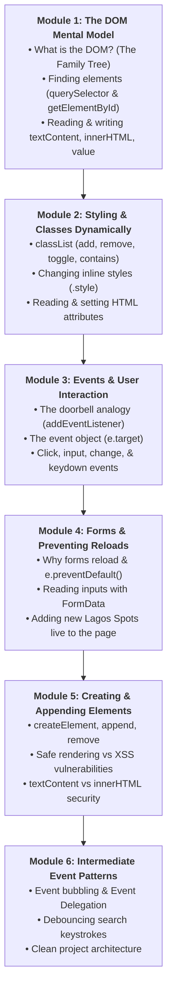
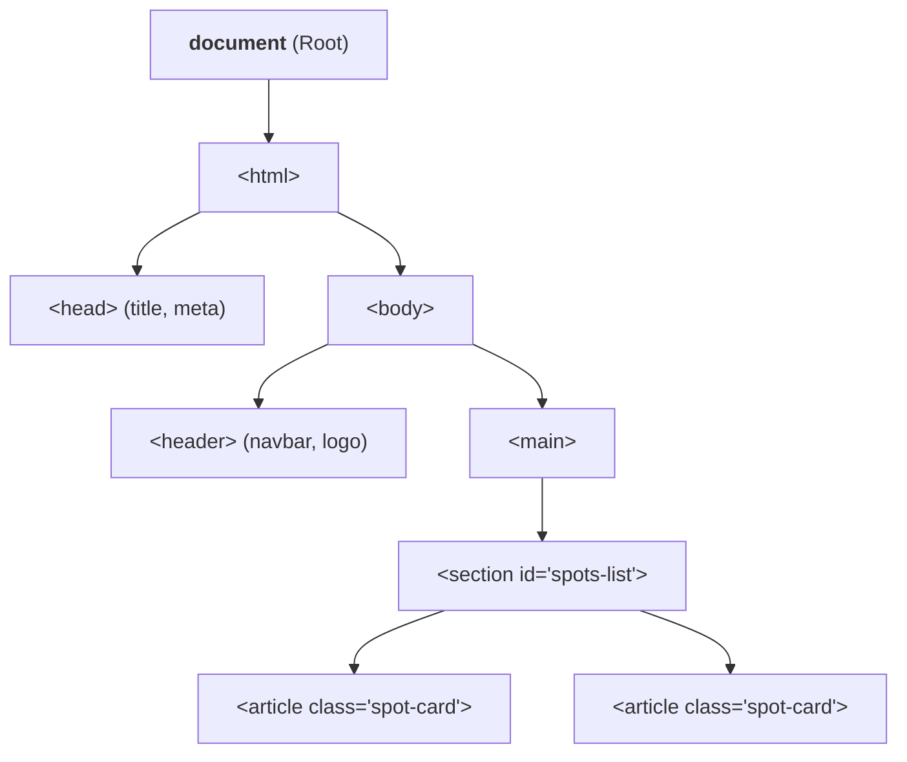
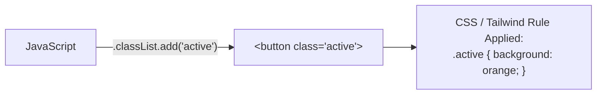
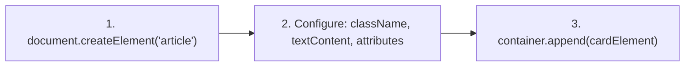
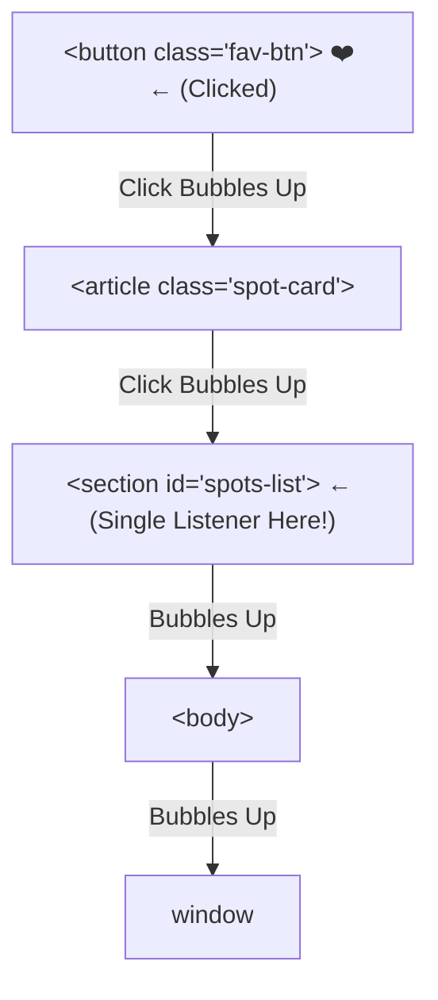
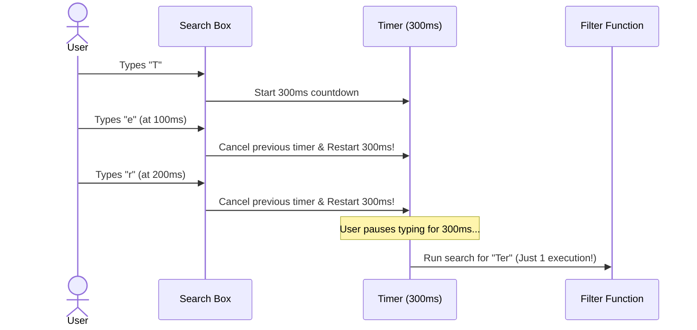

# Week 8: The DOM, Events & Browser APIs

Welcome to Week 8! In Weeks 6 and 7, you learned the core JavaScript language: how to store variables, write functions, loop through data, and manipulate arrays of objects. But up until now, our code has mostly lived inside the browser console.

This week, you unlock the real superpower of JavaScript: **making webpages alive and interactive**. You will learn how JavaScript talks to HTML and CSS via the **Document Object Model (DOM)**, how to listen for user clicks, typing, and submissions with **Events**, and how to build dynamic user interfaces without reloading the page.

---

## Pedagogical Roadmap



---

## Module 1: The DOM Mental Model & Selecting Elements

### 1. What is the DOM? (The Mental Model)

> [!NOTE]
> **The Mental Model:** When a browser loads an HTML file, it doesn't just display raw text. It parses the HTML and turns every tag (`<h1>`, `<div>`, `<button>`) into an interactive JavaScript object. This giant tree of connected objects is called the **Document Object Model (DOM)**.
> 
> Think of the DOM as a **Family Tree**. The browser gives you a global remote control named `document` to inspect, select, change, or delete any branch of this tree.



---

### 2. How to Select Elements on the Page

Before you can change an element, you must first **find it**. Modern JavaScript gives you two primary tools:

| Method | What It Selects | Example |
| :--- | :--- | :--- |
| **`document.querySelector(cssSelector)`** | Finds the **first** element that matches any valid CSS selector. | `document.querySelector('.spot-card')` |
| **`document.querySelectorAll(cssSelector)`** | Finds **all** elements matching the selector and returns a list (`NodeList`). | `document.querySelectorAll('.filter-btn')` |
| **`document.getElementById(id)`** | Finds a single element by its exact `id` attribute (very fast). | `document.getElementById('spots-list')` |

```js
// 1. Selecting by ID:
const spotsContainer = document.getElementById("spots-list");
// Or using querySelector with CSS #id:
const searchInput = document.querySelector("#search-input");

// 2. Selecting by Class Name:
const firstCard = document.querySelector(".spot-card");

// 3. Selecting Multiple Elements:
const allFilterButtons = document.querySelectorAll(".filter-btn");

console.log(`Found ${allFilterButtons.length} filter buttons!`);
```

> [!WARNING]
> **Rookie Mistake:** `querySelector()` returns `null` if the element doesn't exist (or if your script runs before the HTML has loaded). Always check your selectors carefully!

---

### 3. Reading & Changing Content: `textContent` vs `innerHTML` vs `value`

Once you have grabbed an element, you can read or change what is inside it:

```js
const heading = document.querySelector("h1");

// 1. textContent — Reads or writes pure text (Safe & Fast)
console.log(heading.textContent); // "Explore Lagos"
heading.textContent = "Discover the Best Spots in Lagos!";

// 2. innerHTML — Reads or parses HTML tags (Use carefully!)
const badge = document.querySelector(".badge");
badge.innerHTML = "<strong>FEATURED</strong>";

// 3. .value — Reads or writes the text inside input fields & textareas
const searchField = document.querySelector("#search-input");
console.log(searchField.value); // Whatever the user typed
searchField.value = "Lekki";    // Sets input text programmatically
```

---

## Module 2: Styling & Classes Dynamically

You should almost never change styles by setting huge CSS text strings manually. Instead, modern web development manipulates **CSS classes** using **`classList`**.



### The `classList` API

```js
const modal = document.querySelector("#detail-modal");

// 1. Add a class:
modal.classList.add("is-visible");

// 2. Remove a class:
modal.classList.remove("hidden");

// 3. Toggle a class (If present, removes it; if absent, adds it!):
modal.classList.toggle("dark-mode");

// 4. Check if a class exists (Returns true or false):
if (modal.classList.contains("is-visible")) {
  console.log("The modal is currently open!");
}
```

### Direct Inline Styles (`element.style`)
For dynamic values calculated on the fly (like positioning or custom colors):
```js
const progressBar = document.querySelector(".progress-bar");
progressBar.style.width = "75%";
progressBar.style.backgroundColor = "#ea580c"; // Notice camelCase for background-color!
```

---

### 🏋️ Try It in Your Console Now (Drill 1)
Open any webpage in your browser, press `F12` (or `Cmd + Option + J`), and type:
```js
// Change the page background color:
document.body.style.backgroundColor = "#fef3c7";

// Find the first heading and change its text:
const title = document.querySelector("h1") || document.querySelector("h2");
if (title) title.textContent = "Hello from Lagos Data School!";
```

---

## Module 3: Events & User Interaction

### 1. What is an Event? (The Doorbell Mental Model)

> [!NOTE]
> **The Mental Model:** An **Event Listener** is like installing a doorbell or a motion sensor.
> - The **Target:** The doorbell button (`<button id="ring-btn">`).
> - The **Event:** The user pressing it (`'click'`).
> - The **Handler (Callback):** The chime sound or action that runs when pressed.

```mermaid
sequenceDiagram
    actor User
    participant Button as &lt;button id="fav-btn"&gt;
    participant JS as Event Listener
    participant Screen as UI Update

    User->>Button: Clicks button
    Button->>JS: Fires 'click' event
    Note over JS: Runs callback function: () => { ... }
    JS->>Screen: Updates ❤️ icon & increments counter
```

### 2. Syntax: `addEventListener(event, callback)`

```js
const favoriteBtn = document.querySelector("#favorite-btn");

favoriteBtn.addEventListener("click", () => {
  console.log("User clicked favorite!");
  favoriteBtn.textContent = "❤️ Favorited";
  favoriteBtn.classList.add("bg-red-500");
});
```

---

### 3. The `event` (or `e`) Object

Whenever an event fires, the browser automatically passes an **Event Object** to your callback function. This object contains vital details about what just happened:

```js
const searchInput = document.querySelector("#search-input");

searchInput.addEventListener("input", (event) => {
  // event.target is the element that received the user's action
  const currentText = event.target.value;
  console.log("User is typing:", currentText);
});
```

#### Common Events You Will Use Everyday:
| Event Name | When It Fires | Best Used For |
| :--- | :--- | :--- |
| `'click'` | User clicks with mouse or taps on phone. | Buttons, links, card toggles. |
| `'input'` | Fires on **every single keystroke** inside a text field. | Real-time search filters, live previews. |
| `'change'` | Fires when an input loses focus or dropdown selection changes. | Select dropdowns, checkboxes, file uploads. |
| `'submit'` | Fires when a `<form>` is submitted. | Login forms, "Submit a Spot" forms. |
| `'keydown'` | Fires when a key on the keyboard is pressed down. | Escape key to close modals, Enter key to search. |

---

## Module 4: Forms & Handling Submissions

### 1. The Form Submission Trap: Why Does the Page Reload?

By default, when a `<form>` is submitted (by clicking a button or pressing Enter), the browser tries to send the data via an HTTP request and **reloads the whole webpage**.

In modern Single Page Applications (SPAs) and dynamic apps, we want JavaScript to handle the form **without any page reload**.

> [!IMPORTANT]
> Always call **`event.preventDefault()`** inside your submit handler to stop the default reload!

```js
const spotForm = document.querySelector("#add-spot-form");

spotForm.addEventListener("submit", (event) => {
  // 1. STOP the browser from reloading the page!
  event.preventDefault();

  console.log("Form submitted safely without reloading!");
});
```

---

### 2. Extracting Form Data: The Modern `FormData` API

Instead of manually writing `document.querySelector('#name').value` for 10 different inputs, modern JavaScript provides **`new FormData(formElement)`**:

```js
spotForm.addEventListener("submit", (event) => {
  event.preventDefault();

  // Create a FormData object from the form:
  const formData = new FormData(spotForm);

  // Extract fields by their HTML 'name' attribute:
  const name = formData.get("spotName");
  const category = formData.get("category");
  const area = formData.get("area");
  const description = formData.get("description");

  // Basic Validation:
  if (!name || name.trim().length < 3) {
    alert("Please enter a valid spot name (at least 3 characters).");
    return;
  }

  // Assemble new spot object:
  const newSpot = {
    id: Date.now(), // Generate a unique ID using timestamp
    name: name.trim(),
    category: category,
    area: area.trim(),
    description: description.trim()
  };

  console.log("New Spot Ready to Save:", newSpot);

  // Clear form fields after successful submission:
  spotForm.reset();
});
```

---

## Module 5: Creating & Appending Elements Safely

### 1. Creating Elements with `document.createElement()`

Instead of injecting messy strings with `innerHTML`, creating elements programmatically gives you clean, bug-free, and secure code:



```js
function createSpotCard(spot) {
  // 1. Create the container card element:
  const card = document.createElement("article");
  card.className = "spot-card p-4 bg-white rounded-lg shadow-sm border mb-4";

  // 2. Create the heading:
  const title = document.createElement("h3");
  title.className = "text-lg font-bold text-slate-800";
  title.textContent = spot.name; // textContent protects against script injection!

  // 3. Create the location badge:
  const badge = document.createElement("span");
  badge.className = "inline-block px-2 py-1 text-xs font-semibold bg-orange-100 text-orange-700 rounded mt-1";
  badge.textContent = `${spot.area} · ${spot.category}`;

  // 4. Create the description paragraph:
  const desc = document.createElement("p");
  desc.className = "text-sm text-slate-600 mt-2";
  desc.textContent = spot.description;

  // 5. Assemble everything inside the card:
  card.append(title, badge, desc);

  return card;
}

// Inserting into the page:
const spotsContainer = document.querySelector("#spots-list");
const sampleSpot = {
  name: "Terra Kulture",
  area: "Victoria Island",
  category: "Food",
  description: "Authentic Nigerian cuisine and art exhibitions."
};

const newCardNode = createSpotCard(sampleSpot);
spotsContainer.append(newCardNode);
```

---

### 2. Security 101: Preventing Cross-Site Scripting (XSS)

> [!CAUTION]
> **What is XSS?** If you use `innerHTML` to display text that a user typed into an input, a malicious user could submit:
> ```html
> 
> ```
> If you put that directly into `innerHTML`, the browser will execute their malicious code!
> 
> **The Golden Rule:** Always use **`textContent`** for user-provided text. `textContent` treats everything as harmless plain characters.

---

## Module 6: Intermediate Event Patterns

### 1. Event Bubbling & Event Delegation

Imagine you have **50 spot cards** on your page, and each card has a "❤️ Favorite" button.
- **Bad Approach:** Attaching 50 separate `addEventListener("click")` listeners. This wastes memory and breaks whenever a new card is added dynamically.
- **Pro Approach (Event Delegation):** Attach **one single event listener** to the parent container (`#spots-list`).

> [!NOTE]
> **The Mental Model:** When you click a button inside a card, the click event doesn't stop there. Like a bubble rising in water, it **bubbles up** to the card, then to the section, then to the body.



#### Implementing Event Delegation with `.closest()`:
```js
const container = document.querySelector("#spots-list");

container.addEventListener("click", (event) => {
  // Check if the user clicked a favorite button (or inside one):
  const favBtn = event.target.closest(".fav-btn");

  if (favBtn) {
    // Read the spot ID stored in the card's data attribute:
    const card = favBtn.closest(".spot-card");
    const spotId = card.dataset.id;

    console.log(`Toggled favorite on spot #${spotId}!`);
    favBtn.classList.toggle("text-red-500");
  }
});
```

---

### 2. Search Debouncing (Smooth Performance)

When a user types "Terra Kulture" into a search bar, the `input` event fires on every single letter (`T`, `e`, `r`, `r`, `a`...). Filtering an array and updating the screen 12 times a second can make the webpage feel sluggish.

**Debouncing** waits until the user **pauses typing** (e.g., for 300 milliseconds) before running the search:



#### A Simple, Clean Vanilla Debounce:
```js
let searchTimeout;

const searchBar = document.querySelector("#search-input");

searchBar.addEventListener("input", (e) => {
  // Clear the previous timer if the user types another letter:
  clearTimeout(searchTimeout);

  // Set a new timer to run after 300ms:
  searchTimeout = setTimeout(() => {
    const query = e.target.value.toLowerCase().trim();
    console.log(`Performing search for: "${query}"`);
    
    const matchedSpots = spots.filter(spot => 
      spot.name.toLowerCase().includes(query) ||
      spot.area.toLowerCase().includes(query)
    );
    
    renderSpots(matchedSpots);
  }, 300);
});
```

---

## Module 7: Rookie Traps & Debugging Guide

| Error Message / Trap | What Caused It | How to Fix It |
| :--- | :--- | :--- |
| `TypeError: Cannot read properties of null (reading 'addEventListener')` | Your script ran before the HTML finished loading, so `document.querySelector` found nothing. | Add `defer` to your script tag: `<script defer src="script.js"></script>` or place the script at the bottom of `<body>`. |
| Page refreshes immediately when clicking a submit button | Missing `event.preventDefault()` in form submit handler. | Add `event.preventDefault()` at the very top of your `submit` listener callback. |
| `input.textContent` returns empty string | You used `.textContent` instead of `.value` on an `<input>` or `<textarea>`. | Form inputs store their values in `.value`, not `.textContent`. |
| Click event doesn't work on new cards added dynamically | You attached event listeners before the elements were created. | Use **Event Delegation** on the parent container instead. |

---

## 🎯 Week 8 Hands-on Classroom Exercises

### Level 1: The Interactive Counter
1. Create a simple HTML page with an `<h2>` showing `0`, and two buttons: `"+" (Increase)` and `"-" (Decrease)`.
2. Use `document.querySelector` to select the elements.
3. Add click event listeners so clicking `+` increases the number and clicking `-` decreases the number.
4. If the number goes below 0, change its text color to red; if positive, green!

### Level 2: Real-Time Lagos Spots Search
1. In your `lagos-spots` project, select the search input field.
2. Add an `input` event listener.
3. Every time the user types, filter your `spots` array so it matches any spot whose `name` or `area` contains the search query.
4. Re-render the cards on the screen with the filtered results!

### Level 3: Dynamic "Submit a Spot" Form
1. Hook up your "Submit a Spot" form with `submit` event and `event.preventDefault()`.
2. Extract the spot name, category, and area using `new FormData(form)`.
3. Create a new spot object and add it to your `spots` array using `[newSpot, ...spots]`.
4. Re-render the spots list so the new place appears on the webpage immediately!

---

## 📚 Curated Deep-Dive References

* [The Valley of Code: The DOM](https://thevalleyofcode.com/dom/) — Flavio Copes' crystal-clear introduction to the DOM.
* [The Valley of Code: Events](https://thevalleyofcode.com/dom/events) — Friendly guide to clicking, typing, and listening to browser events.
* [JavaScript.info: Document](https://javascript.info/document) — Comprehensive visual walkthrough of DOM nodes, searching, and attributes.
* [JavaScript.info: Introduction to Events](https://javascript.info/events) — Event handlers, bubbling, and event delegation.
* [MDN Web Docs: Introduction to the DOM](https://developer.mozilla.org/en-US/docs/Web/API/Document_Object_Model/Introduction) — Official Mozilla documentation.
* [MDN Web Docs: EventTarget.addEventListener()](https://developer.mozilla.org/en-US/docs/Web/API/EventTarget/addEventListener) — Official event listener reference and options.
